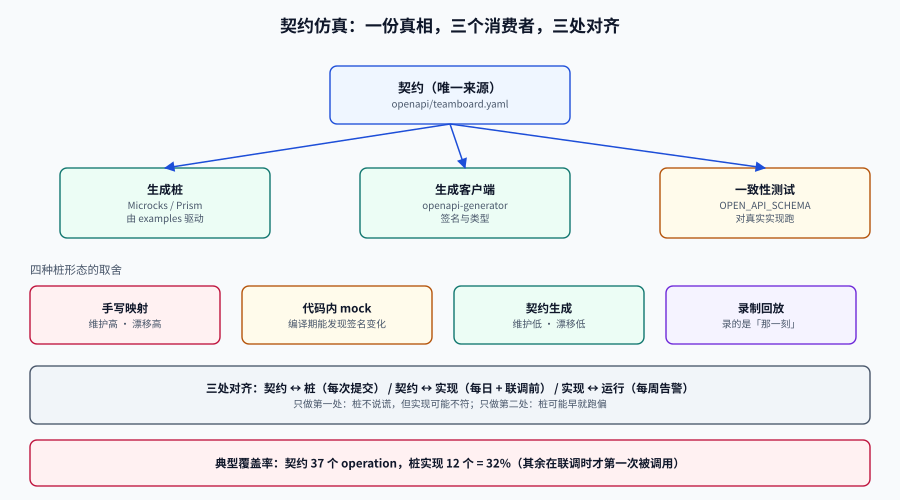

# 契约仿真：stub 与真实服务的漂移怎么收口

<p style="text-align:center;"></p>

契约仿真（Contract Simulation）用一个**假的下游服务**替代真实依赖，让测试能在没有对方环境、没有网络、没有配额的情况下跑完整条链路。

它真正的难点不是「怎么让 stub 返回 200」，而是**怎么知道这个 stub 已经开始说谎了**。一个说谎的 stub 比没有 stub 更危险：它让测试全绿，把缺陷推迟到联调甚至生产。

## 判据族声明

本页判据族 `TDC-A` ~ `TDC-H`，共 8 条。定义表在第十节。

## 一、四种形态：按维护成本与漂移风险选

| 形态 | 做法 | 建立成本 | 维护成本 | 漂移风险 | 适合 |
| --- | --- | --- | --- | --- | --- |
| **手写映射**（WireMock JSON） | 一条请求 → 一条响应 | 低 | **高**（接口一改就要改） | **高** | 接口少、极稳定（如汇率查询） |
| **代码内 mock**（Mockito / 假实现） | 在测试里 `when(...)` | 最低 | 中 | 中（编译期能发现签名变化） | 单元测试、领域层 |
| **契约生成**（OpenAPI/AsyncAPI → 桩） | 由契约文档自动生成 | 中 | **低**（改契约即改桩） | **低** | 有 OpenAPI 的 REST/gRPC 服务 |
| **录制回放**（record & replay） | 录一次真实流量，回放 | 低 | 中（要重录） | 中（录的是「那一刻」） | 第三方 API、无法拿契约的服务 |

选择顺序建议：**有契约 → 契约生成；没契约但能录 → 录制回放；两者都没有 → 手写映射，并把它当技术债登记。**

::: danger 「手写映射」的漂移是静默的
上游把 `amount` 从数字改成字符串 `"12.00"`，手写桩还返回数字。你的服务端解析正常（因为桩给的是老结构），测试全绿；联调时真实服务返回字符串，`BigDecimal` 解析抛 `NumberFormatException`。
**桩不会报错，它只会继续返回它记住的那个世界。**
:::

## 二、契约是唯一来源：一条链路

```text
openapi/teamboard.yaml  ──┬──> 生成桩（Microcks / Prism）──> 测试用假服务
                          ├──> 生成客户端（openapi-generator）──> 应用调用代码
                          └──> 一致性测试（对真实实现跑 schema 校验）──> 联调门禁
```

同一份文件喂三个消费者，三者的偏差才有机会被发现。反过来，如果桩是手写的、客户端是手写的、校验是手写的，三者可以各自漂移，永远不会互相纠正。

**Microcks** 是这条路线的开源实现：**2026-05-07 晋升 CNCF Incubating**，1.15.0 于 2026-08-05 发布，支持 OpenAPI / AsyncAPI / gRPC / GraphQL / Postman / SoapUI 六类制品。它的模型是「制品即真相」：

| 概念 | 存什么 | 给测试什么 |
| --- | --- | --- |
| API / Service | 名称、版本、协议、操作列表 | 可检索的目录 |
| Artifact | OpenAPI/AsyncAPI/protobuf 文件 | 解析出的 schema 与 examples |
| Mock | 由 examples 与 dispatch 规则生成的端点 | 可直接调用的假服务 |
| Test | 对实现端点跑一致性检查 | 「部署的服务是否仍符合契约」的证据 |

::: warning 契约里没有 example，桩就是空的
Microcks 能把结构解析出来，但**响应内容来自 example**。契约里只写 schema 不写 example，生成的桩只能给出「结构正确、值为空」的响应，测试等于没测。
给关键接口写 example 是契约工作的一部分，不是可选项。
:::

## 三、状态机桩：让「第二次调用」有不同的结果

真实服务是有状态的：第一次 `GET /orders/1` 返回 `PENDING`，支付回调之后返回 `PAID`。手写桩如果永远返回 `PENDING`，「已支付订单不能再支付」这条规则就永远测不到。

WireMock 用 **scenario** 表达状态迁移（稳定线为 3.x；4.x 处于 beta，新增消息框架，当前支持 WebSocket mock）：

```json
{
  "scenarioName": "order-lifecycle",
  "requiredScenarioState": "Started",
  "newScenarioState": "created",
  "request":  { "method": "POST", "url": "/api/orders" },
  "response": { "status": 201, "jsonBody": { "id": "o-1", "status": "PENDING" } }
}
```

```json
{
  "scenarioName": "order-lifecycle",
  "requiredScenarioState": "created",
  "newScenarioState": "paid",
  "request":  { "method": "POST", "url": "/api/orders/o-1/pay" },
  "response": { "status": 200, "jsonBody": { "id": "o-1", "status": "PAID" } }
}
```

```json
{
  "scenarioName": "order-lifecycle",
  "requiredScenarioState": "paid",
  "request":  { "method": "POST", "url": "/api/orders/o-1/pay" },
  "response": { "status": 409, "jsonBody": { "code": "ALREADY_PAID" } }
}
```

三条纪律：

1. **状态迁移要能重置**：`POST /__admin/scenarios/reset`，每个用例前调一次，否则用例顺序决定结果。
2. **状态名要业务化**（`created` / `paid`），不要 `s1` / `s2`——三个月后没人记得 `s2` 是什么。
3. **未定义的状态转移必须显式返回错误**，不能落到一个 catch-all 的 200 上。catch-all 会把「状态机走错了」变成「测试通过」。

## 四、故障注入：桩的价值一半在「不正常」

只返回 200 的桩只能测主路径。真实世界的下游会慢、会断、会返回半个响应：

```json
{
  "request": { "method": "GET", "url": "/api/risk/score" },
  "response": {
    "status": 200,
    "fixedDelayMilliseconds": 3000
  }
}
```

```json
{
  "request": { "method": "GET", "url": "/api/risk/score" },
  "response": {
    "fault": "CONNECTION_RESET_BY_PEER"
  }
}
```

| 注入类型 | 配置 | 能验证什么 |
| --- | --- | --- |
| 固定延迟 | `fixedDelayMilliseconds` | 客户端超时是否生效 |
| 分布延迟 | `delayDistribution`（lognormal / uniform） | 超时边界是否稳定（不要用固定值测边界） |
| 连接级故障 | `fault: CONNECTION_RESET_BY_PEER` | 重试与熔断是否触发 |
| 空响应 | `fault: EMPTY_RESPONSE` | 解析层是否容错 |
| 慢速分块 | `chunkedDribbleDelay` | 读超时是否按整体而不是按块计算 |
| 限流 | `status: 429` + `Retry-After` | 退避策略是否遵守服务端指示 |

::: danger 用固定延迟测超时边界，会测出假结论
客户端超时设 3000 ms，桩固定延迟 3000 ms——结果取决于两者谁的计时器先触发，每次运行可能不同，于是这个用例变成偶发红。
正确做法：超时 3000 ms 时，注 **1000 ms（必成功）** 与 **5000 ms（必超时）** 两档，中间地带不测。**边界不是用来踩的，是用来夹的。**
:::

## 五、漂移检测：三处对齐，缺一处就漏

| 对齐 | 检查什么 | 怎么做 | 频率 |
| --- | --- | --- | --- |
| **契约 ↔ 桩** | 桩是否覆盖了契约里每个 operation，响应是否符合 schema | 用契约生成桩（结构上保证），再跑一次 schema 校验 | 每次提交 |
| **契约 ↔ 实现** | 真实实现是否仍符合契约 | 一致性测试（Microcks `OPEN_API_SCHEMA` runner / Schemathesis / Dredd） | 每日 + 联调前 |
| **实现 ↔ 运行** | 线上实际返回是否符合契约（可选） | 影子流量采样 + schema 校验，只告警不阻断 | 每周 |

只做第一处（契约生成桩）能保证「桩不说谎」，但保证不了「实现符合契约」；只做第二处，桩可能早就跑偏了。**两处一起做，才有闭环。**

覆盖率也要算，而且要算得诚实：

```text
桩覆盖率 = 已被桩覆盖的 operation 数 / 契约里 operation 总数
```

一个典型项目的真实数字：契约里 **37 个 operation**，桩实现了 **12 个**（32%）。剩下 25 个不是「不需要」，而是「还没人写」——它们在联调时才第一次被调用。**把这个数字打进 CI 报告**，比写一句「mock 覆盖率良好」有用得多。

## 六、消费者驱动契约：什么时候值得

消费者驱动契约（Consumer-Driven Contract，CDC，Pact 是代表实现）的思路相反：由**消费者**声明「我只依赖这些字段」，生产者在 CI 里验证「我没有破坏任何一个消费者的期望」。

| 维度 | 契约生成桩 | CDC |
| --- | --- | --- |
| 真相来源 | 生产者写的 OpenAPI | 消费者写的期望 |
| 能发现的问题 | 结构不符 | **生产者删了消费者在用的字段** |
| 成本 | 中（要维护契约质量） | 高（要维护 broker、版本、验证流水线） |
| 适合 | 对内 API、契约先行团队 | 多消费者、生产者频繁改、组织边界清晰 |

判断标准：**消费者 ≥ 3 个，且生产者与消费者不在同一个团队**时，CDC 的收益才盖过成本。单团队内部，OpenAPI + 一致性测试足够。

## 七、一个可验证的最小配置

```text
contract/
├─ openapi/teamboard.yaml          # 唯一来源
├─ stubs/
│  ├─ mappings/order-lifecycle.json
│  ├─ mappings/risk-slow.json
│  └─ __files/order-created.json
└─ verify.sh                        # 三处对齐的检查入口
```

```shell
# 起桩（Docker）
docker run -d --name wm -p 8089:8080 \
  -v "$PWD/contract/stubs:/home/wiremock" \
  wiremock/wiremock:3 --global-response-templating

# 1) 桩是否活着
curl -s -o /dev/null -w "%{http_code}\n" http://localhost:8089/__admin/health
# 期望 200

# 2) 状态机：第一次支付成功，第二次 409
curl -s -X POST http://localhost:8089/api/orders/o-1/pay -H 'Content-Type: application/json' -d '{}' -o /dev/null -w "%{http_code}\n"
# 期望 200
curl -s -X POST http://localhost:8089/api/orders/o-1/pay -H 'Content-Type: application/json' -d '{}' -o /dev/null -w "%{http_code}\n"
# 期望 409

# 3) 重置场景（每个用例前必做）
curl -s -X POST http://localhost:8089/__admin/scenarios/reset -o /dev/null -w "%{http_code}\n"

# 4) 桩覆盖率：契约里的 operation 是否都有桩
grep -c "^  /" contract/openapi/teamboard.yaml          # 契约路径数
grep -l '"url"' contract/stubs/mappings/*.json | wc -l   # 有桩的文件数
```

## 八、易错点

::: danger 六个必踩的坑
1. **桩和实现用了两份契约**：一份在 `contract/`、一份在 `docs/api.md`，两者三个月后必然分叉。契约只能有一份，其余都是生成物。
2. **catch-all 返回 200**：任何未匹配请求都返回 200，于是「调错了路径」这件事永远发现不了。catch-all 应该是 **404 + 记录**。
3. **桩里的时间写死**：`"expires_at": "2025-01-01"` 在今天就是过期时间，用例行为随日期漂移。要么用模板动态生成，要么把时钟也注入。
4. **忘记重置 scenario**：上一个用例把状态推到 `paid`，下一个用例期望 `PENDING`，红得莫名其妙。
5. **只测 200 不测错误码**：错误码映射是业务逻辑的一部分，`409` / `422` / `429` 的分支必须各有桩。
6. **把「桩通过」当成「集成通过」**：这两件事之间隔着「契约 ↔ 实现」那一处对齐，缺了它，桩越完善越危险。
:::

## 九、判据表

| 编号 | 约定 | 定错了会怎样 | 怎么验证 |
| --- | --- | --- | --- |
| `TDC-A` | 契约只有**一份**，桩与客户端由它生成 | 多处契约分叉 | 仓库里 `openapi/*.yaml` 只有一个文件，且被生成的代码引用 |
| `TDC-B` | 桩覆盖率必须**可算并进报告** | 32% 的覆盖率被当成 100% | CI 报告里有 `stub_coverage = covered/total`，且数值 > 0 |
| `TDC-C` | 未匹配请求返回 404 并记录，不许 catch-all 200 | 调错路径永远发现不了 | `curl` 一个不存在的路径返回 404 |
| `TDC-D` | 有状态接口必须用 scenario，且每用例前重置 | 用例顺序决定结果 | 连续跑两次同一用例，结果相同 |
| `TDC-E` | 故障注入必须覆盖「慢 / 断 / 半包 / 限流」四类 | 容错分支测不到 | 四类各有至少一条 mapping；测试里有对应用例 |
| `TDC-F` | 超时边界用「必成功 + 必超时」两档夹，不踩边界 | 偶发红 | 桩延迟值只有远离超时阈值的两档 |
| `TDC-G` | 「契约 ↔ 实现」一致性测试在联调前必须跑 | 桩通过、集成失败 | 流水线里有 conformance 阶段，最近一次记录为通过 |
| `TDC-H` | 桩里的时间/ID 必须可注入或模板化 | 用例随日期漂移 | `grep -rn '"expires_at"' stubs/` 无固定过去日期 |

## 十、验证方式

```shell
# 1) 桩健康
curl -s -o /dev/null -w "%{http_code}\n" http://localhost:8089/__admin/health   # 200

# 2) 状态机可重置
curl -s -X POST http://localhost:8089/__admin/scenarios/reset -o /dev/null -w "%{http_code}\n"

# 3) 未匹配返回 404（不是 200）
curl -s -o /dev/null -w "%{http_code}\n" http://localhost:8089/api/not-exist    # 404

# 4) 桩覆盖率
total=$(grep -cE "^  /[a-z]" contract/openapi/teamboard.yaml)
covered=$(grep -rl '"url"' contract/stubs/mappings | wc -l | tr -d ' ')
echo "stub_coverage=$covered/$total"

# 5) 契约与实现一致性（Microcks CLI 示例，需运行中的 Microcks 实例）
microcks-cli test "TeamBoard API:1.0.0" http://localhost:8080 OPEN_API_SCHEMA --wait-for=30
# 期望：Success / 失败时列出具体不匹配的字段
```

第 5 条依赖 Microcks 实例（`microcks-cli` 与服务端版本独立发布，CI 里要分别 pin 版本）。跑不了时在报告里标 `⏳` 并写原因，不要把「没跑」写成「通过」。

## 十点五、与「契约演进与兼容」专题的分工

本页讲**测试替身**：用契约生成桩服务、让联调不依赖真实下游，以及消费者驱动契约在「仿真」语境下的适用边界。

[契约演进与兼容](../../../Backend/ContractEvolution/index.md) 把 CDC 放在**门禁**的位置上，回答的是不同的问题：

| 问题 | 本页 | 契约演进专题 |
| --- | --- | --- |
| 下游还没写好，我怎么联调 | 生成桩、录制回放 | 不涉及 |
| 我改了契约，谁的构建会红 | 只讲「消费者声明期望」 | [契约门禁](../../../Backend/ContractEvolution/ContractGate/index.md)：`can-i-deploy` 的退出码怎么变成发布阻塞项 |
| CDC 覆盖率只有 20% 怎么办 | 不在范围内 | [门禁分层](../../../Backend/ContractEvolution/ContractGate/index.md)：覆盖率低于 50% 时 CDC 只能当附加保险 |
| 结构没变但数值变了 | 桩不校验数值 | [golden 回放](../../../Backend/ContractEvolution/ContractGate/index.md)：必须断言值，不只断言状态码 |

::: tip 一个容易混淆的点
「契约测试通过」不等于「兼容」。契约测试验的是**已声明的期望**，而兼容性验的是**所有真实消费者**——后者里有一大半从未声明过任何期望。
:::

## 十一、参考资料

- Microcks 官方文档与 CNCF 晋升公告（2026-05-07）：<https://microcks.io/>、<https://www.cncf.io/blog/2026/05/07/microcks-becomes-a-cncf-incubating-project/>
- WireMock 官方文档（scenario、fault、delayDistribution）：<https://wiremock.org/docs/>
- Pact 官方文档（消费者驱动契约的适用边界）：<https://docs.pact.io/>
- OpenAPI Specification 3.1：<https://spec.openapis.org/oas/v3.1.0>
- 相关页：[API 设计](../../APIDesign/index.md)（契约风格）、[环境隔离](../EnvironmentIsolation/index.md)（依赖面）、[流量回放](../TrafficReplay/index.md)（没有契约时的替代路线）
