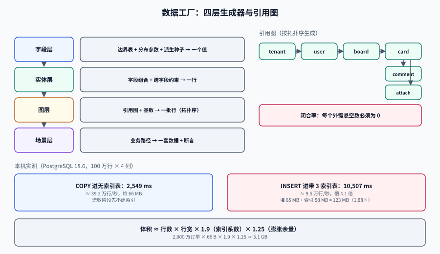

# 数据工厂：把「造数」写成可复算的程序

<p style="text-align:center;"></p>

数据工厂（Data Factory）是把「需要什么样的数据」变成一段**给定种子就能复算出同一批结果**的程序。它的产物不是一次性的 SQL 文件，而是**一组可参数化的生成器 + 一张引用关系图 + 一份指纹**。

## 判据族声明

本页判据族 `TDF-A` ~ `TDF-H`，共 8 条。定义表在第九节。

## 一、四层生成器

| 层 | 负责 | 输入 | 输出 | 复杂度 |
| --- | --- | --- | --- | --- |
| **字段层** | 单个字段的值域与分布 | 边界表、分布参数、种子 | 一个值 | 低 |
| **实体层** | 一行记录的字段组合（含跨字段约束） | 字段生成器 + 约束 | 一行 | 中 |
| **图层** | 多表之间的引用关系与基数 | 实体生成器 + 引用图 | 一批行（按拓扑序） | 高 |
| **场景层** | 「一个能触发某条业务路径的世界」 | 图层 + 场景脚本 | 一套数据 + 断言 | 最高 |

绝大多数「造数脚本 800 行」的团队，是**把四层揉在一个文件里**：字段值、外键关系、业务场景全用 `INSERT` 手写。改一个字段要在 40 处 `INSERT` 里找。

::: tip 判断自己处在第几层
问一个问题：「如果我要多造一条『金额刚好等于优惠上限』的订单，要改几个地方？」
答案在一个函数里 → 字段层；在一个配置文件里 → 实体层；在场景脚本里加一行 → 图层以上。
改五个 `INSERT` 语句 → 还在第 0 层（没有工厂）。
:::

## 二、分布：随机不是均匀

这是本页最容易被跳过、也最容易让测试变成摆设的一节。本机 PostgreSQL 18.6 实测，10 万行，两种分布：

```sql
-- 均匀：0 ~ 1,000,000 之间等概率
(random() * 1000000)::numeric(12,2) AS amt_uniform,
-- 对数正态：真实交易金额的常见形态（中位数约 1000）
(exp(6.9 + 1.2 * random_normal()))::numeric(12,2) AS amt_lognormal
```

| 指标 | 均匀分布 | 对数正态 | 差异 |
| --- | --- | --- | --- |
| `> 999000` 的行数 | **98** | **0** | 均匀分布凭空造出 98 个「99 万级订单」 |
| P50 | **501,910.00** | **990.60** | 差 507 倍 |
| P99 | **989,693.22** | **16,709.31** | 差 59 倍 |

两件事同时发生，而且方向相反：

1. **均匀分布制造了现实中不存在的极端值。** 98 条 99 万级订单会让「大额风控」「分档费率」这些分支跑得通——测试报告很好看，可上线后一个月也遇不到一次。**这是假绿的一种**。
2. **对数正态分布的 P99 只有 1.6 万。** 如果你按「P99 延迟」定 SLO，用均匀分布的数据压出来的是「99 万金额」的路径，用对数正态压出来的是「1.6 万金额」的路径，两者的耗时可能差一个数量级。**压测结论会因此完全错位**。

::: danger 「随机造数」的三个默认错误
1. `random()` 默认均匀——它是最不像真实的分布。金额、时长、文件大小、请求间隔，几乎都近似对数正态。
2. 字段之间默认**独立**——真实数据里「订单金额」与「商品数量」强相关，「注册时间」与「最后登录时间」有先后约束。独立生成会造出「数量 1 件、金额 99 万」这种不可能的组合。
3. 默认**没有脏数据**——真实数据有 `NULL`、有首尾空格、有全角字符、有 1900 年的日期。造数时一律干净，解析层的容错分支就永远测不到。
:::

**正确做法：分布写进配置，相关性写成约束。**

```yaml
# seed/spec/order.yaml
entity: order
count: 200000
seed: 20261019
fields:
  amount:
    generator: lognormal
    median: 990          # 与生产 P50 对齐
    sigma: 1.2
  item_count:
    generator: zipf
    min: 1
    max: 20
  created_at:
    generator: time_series
    start: 2025-10-01T00:00:00Z
    end:   2026-10-01T00:00:00Z
    # 工作日权重 5、周末权重 2：真实下单有明显的工作日效应
    weekday_weight: 5
    weekend_weight: 2
constraints:
  # 跨字段约束：金额必须落在「单价 × 数量」的合理区间内
  - "amount BETWEEN item_count * 9.9 AND item_count * 2000"
  # 脏数据按比例注入，比例进配置才可复现
  - "with_probability(0.02) amount IS NULL"
  - "with_probability(0.005) trim_nbsp(remark)"
```

## 三、唯一性：随机生成的假数据一定会撞

「用随机数造假手机号」听起来没问题，实测会打脸。8 位数字空间（`1990000` + 8 位，共 1 亿个号），10 万个用户：

```sql
SELECT count(*) AS rows, count(DISTINCT phone) AS distinct_phone,
       count(*) - count(DISTINCT phone) AS collisions
FROM c_rand;
```

| 方案 | 行数 | 不同值 | 碰撞 |
| --- | --- | --- | --- |
| `floor(random()*1e8)` | 100,000 | **99,936** | **64** |
| 序列 `lpad(i::text, 8, '0')` | 100,000 | **100,000** | **0** |

64 条碰撞意味着：导入带唯一索引的表时**直接失败**；如果表上没有唯一索引，则会出现「两个用户同一个手机号」，把所有依赖手机号唯一的用例变成薛定谔的。

理论上也可以算：从 `N` 个值里随机取 `n` 个，期望重复对数 ≈ `n(n-1)/(2N)`。`n=10⁵, N=10⁸` 时约 **50** 对，与实测的 64 同一量级。**只要用随机，就必须假设会撞。**

::: tip 三条可用做法
1. **序列 + 前缀**：`1990000` + 6 位序号 → 天然单射，且一眼能看出是假数据。
2. **HMAC 后取模再查表去重**：适合必须「看起来随机」的场景（如演示），代价是要维护映射表。
3. **数据库侧 `GENERATED BY DEFAULT AS IDENTITY`**：让库自己保证唯一，造数脚本不去争这个责任。
:::

## 四、确定性：种子必须「按实体派生」

一个全局 `Random(42)` 的问题是**顺序敏感**：并行生成两张表、或者给某张表多加一行，后面所有表的值全变。正确做法是**按实体键派生种子**：

```java
/** 同 (seed, entity, key) 永远得到同一个值，与生成顺序、并发度无关。 */
static long derive(long seed, String entity, long key) {
    long h = seed;
    for (byte b : entity.getBytes(StandardCharsets.UTF_8)) h = h * 1099511628211L ^ b;
    h ^= key + 0x9E3779B97F4A7C15L;
    h ^= (h >>> 33); h *= 0xff51afd7ed558ccdL;
    h ^= (h >>> 33); h *= 0xc4ceb9fe1a85ec53L;
    h ^= (h >>> 33);
    return h;
}

// 用法：某张表第 37 行的「金额」，只由这三个量决定
var rnd = new SplittableRandom(derive(20261019L, "order", 37));
var amount = lognormal(rnd, 990, 1.2);
```

三条性质，缺一不可：

- **顺序无关**：先造 `order` 还是先造 `user`，`order` 的值不变；
- **并发无关**：4 个线程并行生成，结果与单线程逐字节相同；
- **局部无关**：`user` 从 1000 行加到 2000 行，前 1000 行的 `order` 不受影响。

第三条尤其重要——它让「加一条测试数据」不会引起整库 diff。

## 五、引用图：按拓扑序生成，按闭合率验收

多表造数必须回答「父表先于子表」。把引用关系写成一张图：

```text
tenant ──< user ──< board ──< card ──< comment
   │           │        │        └──< attachment
   │           │        └──< card_member
   │           └──< notification
   └──< audit_log
```

生成顺序是这张图的**拓扑序**；一旦出现环（`card.updated_by → user` 与 `user.last_card_id → card` 互指），就要**先置空可空外键、生成完再回填**。

验收指标是**闭合率**：

```sql
-- 每个外键的「悬空引用」数，全部应为 0
SELECT 'comment.card_id' AS fk, count(*) AS dangling
FROM comment c LEFT JOIN card k ON k.id = c.card_id WHERE k.id IS NULL
UNION ALL
SELECT 'card.board_id', count(*)
FROM card c LEFT JOIN board b ON b.id = c.board_id WHERE b.id IS NULL;
```

::: danger 三个「不报错但错」的引用问题
1. **悬空外键**：如果建表时没加 `FOREIGN KEY`（测试库常为了造数方便而省略），悬空引用不会报错，只会让 join 少几行。
2. **基数错**：`board` 造了 100 个，`card` 只挂在其中 3 个上——「看板列表分页」的用例永远测不到「有 50 个看板」的场景。基数要写进配置并断言：`每 board 的 card 数 ∈ [0, 200]，中位数 12`。
3. **跨租户串**：多租户库里 `card.tenant_id` 与 `board.tenant_id` 不一致时，外键（如果只约束 `board_id`）不报错。**复合外键 `(board_id, tenant_id)` 才能挡住**。
:::

## 六、体量与吞吐：先算，再造

本机实测（PostgreSQL 18.6，4 列宽表：`bigint / text(9) / numeric(12,2) / timestamptz`）：

| 操作 | 行数 | 耗时 | 速率 | 体积 |
| --- | --- | --- | --- | --- |
| `COPY ... FROM`（无索引表） | 1,000,000 | **2,549 ms** | **≈ 39.2 万行/秒** | 堆 **66 MB** |
| `INSERT ... SELECT`（1 主键 + 2 索引） | 1,000,000 | **10,507 ms** | **≈ 9.5 万行/秒** | 堆 65 MB + 索引 **58 MB** = **123 MB** |

两条可直接用的结论：

1. **造数用 `COPY`，不要用 `INSERT`**。同样的数据，带索引的 `INSERT` 慢 **4.1 倍**。造数阶段可以先建表无索引、`COPY` 灌完再 `CREATE INDEX`。
2. **索引让体积变成 1.88 倍**。规划测试库容量时按「行宽 × 1.9」估，否则磁盘会在第 3 个月满。

据此可以写出容量估算：

```text
体积 ≈ 行数 × 行宽 × 1.9（索引系数） × 1.25（膨胀余量）
例：2,000 万订单 × 66 B × 1.9 × 1.25 ≈ 3.1 GB
```

行宽怎么估：`bigint` 8 B、`timestamptz` 8 B、`numeric(12,2)` 约 10 B、`text` 短串（≤ 126 B）约 `1 + 长度`。上例实测 66 MB / 1e6 = **66 B/行**，与手算 62 B 相差 6%（页头与行指针），够用。

## 七、一次完整的生成：从配置到可断言的库

```shell
# 1) 建结构（不含索引）
psql "$DATABASE_URL" -v ON_ERROR_STOP=1 -f db/schema/001_tables.sql

# 2) 按拓扑序灌数据（COPY，流式）
./bin/factory --spec seed/spec --seed 20261019 --out /tmp/seed.tsv
psql "$DATABASE_URL" -c "\copy tenant   FROM '/tmp/seed.tsv/tenant.tsv'   WITH (FORMAT csv)"
psql "$DATABASE_URL" -c "\copy \"user\" FROM '/tmp/seed.tsv/user.tsv'     WITH (FORMAT csv)"
psql "$DATABASE_URL" -c "\copy board    FROM '/tmp/seed.tsv/board.tsv'    WITH (FORMAT csv)"

# 3) 建索引与分析
psql "$DATABASE_URL" -v ON_ERROR_STOP=1 -f db/schema/002_indexes.sql
psql "$DATABASE_URL" -c "ANALYZE"

# 4) 打印指纹（见数据集版本化）
psql "$DATABASE_URL" -Atc "COPY (SELECT * FROM board ORDER BY id) TO STDOUT" | sha256sum
```

第 2 步的 `--seed` 是唯一可变项。同一条命令跑两次，第 4 步的哈希必须相同——这就是[数据集版本化](../DatasetVersioning/index.md)要的输入。

## 八、造数脚本本身也要有测试

这是最少见、回报最高的一条。生成器是代码，代码就会错：

| 测什么 | 断言 | 为什么 |
| --- | --- | --- |
| **确定性** | 同种子跑两次，逐字节相等 | 否则无法复现失败 |
| **单射** | `count(distinct fake_phone) = count(*)` | 否则导入撞唯一键 |
| **分布** | `P50 ∈ [800, 1200]`、`P99 ∈ [10000, 25000]` | 否则分布漂移没人发现 |
| **约束** | 跨字段约束违反数 = 0（除注入的脏数据比例外） | 否则造出不可能的组合 |
| **闭合** | 所有外键悬空数 = 0 | 否则 join 静默少行 |
| **基数** | 每个父实体的子实体数落在配置区间 | 否则分页/聚合场景测不到 |

六条里前两条是硬门禁（每次提交都跑），后四条可以每日跑一次。

## 九、判据表

| 编号 | 约定 | 定错了会怎样 | 怎么验证 |
| --- | --- | --- | --- |
| `TDF-A` | 每个实体有独立生成器，禁止在一个脚本里手写多表 `INSERT` | 改一个字段要改 40 处 | `grep -c "INSERT INTO" seed/*.sql` 为 0（数据一律走 `COPY`） |
| `TDF-B` | 种子必须**按实体键派生**，不用全局 `Random(seed)` | 顺序变化引起全库 diff | 打乱生成顺序重跑，指纹不变 |
| `TDF-C` | 字段分布必须显式配置，禁止裸 `random()` | 造出现实中不存在的极端值 | 配置里每个数值字段有 `generator` 子项；`grep -rn "random()" seed/` 为空 |
| `TDF-D` | 跨字段相关性必须写成可执行约束 | 造出「1 件 99 万」的组合 | 约束违反计数 = 0（注入脏数据除外） |
| `TDF-E` | 假标识必须**单射** | 唯一键冲突、用例随机红 | `count(*) = count(distinct fake_value)` |
| `TDF-F` | 引用图必须闭合（悬空外键 = 0） | join 静默少行 | 每个外键一条 `LEFT JOIN ... IS NULL` 计数，全为 0 |
| `TDF-G` | 基数必须写进配置并断言 | 分页/聚合场景测不到 | 子实体数按父实体分组，`min/max/median` 落在配置区间 |
| `TDF-H` | 生成器自己有六类测试 | 生成器错了没人知道 | CI 里有 `factory-selftest` 任务且最近 10 次全绿 |

## 十、验证方式

```shell
# 1) 确定性：同种子两次，指纹相同
./bin/factory --spec seed/spec --seed 20261019 --out /tmp/a
./bin/factory --spec seed/spec --seed 20261019 --out /tmp/b
diff -r /tmp/a /tmp/b && echo "OK: deterministic"

# 2) 顺序无关：先 user 后 order，与先 order 后 user，order 内容相同
./bin/factory --spec seed/spec --seed 20261019 --order user,order --out /tmp/c
diff /tmp/a/order.tsv /tmp/c/order.tsv && echo "OK: order-independent"

# 3) 单射
psql "$DATABASE_URL" -Atc "select count(*) - count(distinct phone) from users"
# 期望 0

# 4) 分布没有漂移（P50 应对齐配置的 median=990）
psql "$DATABASE_URL" -Atc "
select percentile_disc(0.5) within group (order by amount) from orders"
# 期望落在 [800, 1200]

# 5) 体积预估 vs 实际（偏差 > 30% 说明行宽估错）
psql "$DATABASE_URL" -Atc "select pg_size_pretty(pg_total_relation_size('orders'))"
```

## 十一、参考资料

- PostgreSQL 18 文档：`COPY`、`random_normal()`、`percentile_disc` 的语义。
- 《Generating Test Data》系列（Martin Fowler 站点上关于 Test Data Builder 的讨论）。
- k6 文档中关于「负载模型 > 数据体量」的说明：<https://grafana.com/docs/k6/latest/>
- Testcontainers 官方文档（把生成器跑在容器里的做法）：<https://java.testcontainers.org/>
- 相关页：[数据脱敏](../DataMasking/index.md)（改真实数据）、[数据集版本化](../DatasetVersioning/index.md)（怎么固定指纹）、[总览](../Overview/index.md)（判别力）
