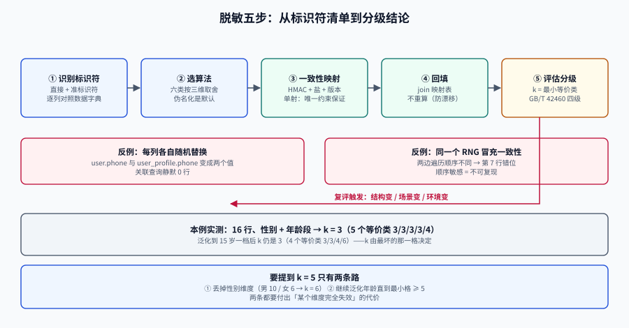

# 数据脱敏：从「打码」到可评估的去标识

<p style="text-align:center;"></p>

数据脱敏（Data Masking）是把真实数据里的个人信息换成「不可直接指向某个人、但仍能支撑这份数据被用于测试」的值，并且**给出一个可被复核的风险结论**。

「打码」和「脱敏」的区别不在手法，在**有没有结论**：把手机号中间四位换成 `****` 叫打码，它不能回答「这份数据还有多大概率被重新识别」；脱敏要能回答这个问题，并留下评估记录。

## 判据族声明

本页判据族 `TDM-A` ~ `TDM-H`，共 8 条。定义表在第十节。

## 一、先分清三个词（它们的法律后果不同）

| 术语 | 定义（要点） | 是否仍属个人信息 | 工程含义 |
| --- | --- | --- | --- |
| **假名化**（pseudonymization） | 用映射表/密钥替换标识符，**可复原** | 是 | 映射表本身就是高敏资产，必须与数据分开存放、单独授权 |
| **去标识化**（de-identification） | 移除直接标识符，使不借助额外信息无法识别 | 通常仍算（视重标识风险） | 我们日常做的「脱敏导入测试库」落在这一档 |
| **匿名化**（anonymization） | 经处理无法识别特定个人**且不能复原** | 否（不再适用个人信息规则） | 极难达成；k-匿名 + 泛化是常见路径，但要接受信息损失 |

中国《个人信息保护法》第 73 条同时定义了这两件事：「去标识化」是「个人信息经过处理，使其在不借助额外信息的情况下无法识别特定自然人的过程」；「匿名化」是「个人信息经过处理无法识别特定自然人**且不能复原**的过程」。第 4 条则规定「匿名化处理后的信息」不属于个人信息。**两个定义只差「不能复原」四个字，法律后果却完全不同**——把「去标识」写成「匿名」是合规文件里最常见的措辞错误。

::: warning 一个容易被忽略的推论
「已去标识」不等于「可以随便用」。去标识数据仍然属于个人信息，只是风险降低；它的使用范围仍受**原始收集目的**约束。
测试环境用它的合法性来自「内部研发必要」这一目的，而不是来自「已经脱敏了」。
:::

## 二、六类算法：按三维取舍，而不是按喜好

| 算法 | 做法 | 可逆 | 关联保持 | 分布保持 | 适用 |
| --- | --- | --- | --- | --- | --- |
| **掩码**（masking） | 保留首尾、中间替换 | 否 | 部分（同值仍同值） | 差 | 展示、日志 |
| **替换**（substitution） | 从字典/生成器取等长值 | 否 | 否（除非用映射表） | 好 | 姓名、地址 |
| **泛化**（generalization） | 降低精度（日期→月、年龄→区间） | 否 | 保持 | 变粗 | 准标识符 |
| **分桶/取整**（binning） | 数值离散化 | 否 | 保持 | 变粗 | 金额、时长 |
| **伪名化**（pseudonymization） | 确定性函数映射（HMAC） | 用映射表可逆 | **保持** | 保持 | 用户 ID、手机号、邮箱 |
| **差分隐私**（differential privacy） | 加噪，保证相邻数据集输出分布近似 | 否 | 破坏 | 可控 | 统计发布、报表 |

三维里最关键的是**关联保持**：能不能让「同一个用户在 5 张表里还是同一个人」。只有伪名化能同时做到「不可逆推」和「关联保持」——这就是为什么它应当是**默认选择**。

::: danger 别用「同一个随机数生成器」冒充一致性
```java
// 错误：两个字段各自 nextLong()，看起来「同源」，实际每调用一次就前进一格
var rnd = new Random(42L);
user.setPhone(fakePhone(rnd.nextLong()));
profile.setPhone(fakePhone(rnd.nextLong()));   // 与上一行不是同一个值
```

```java
// 正确：值只由「业务键 + 盐」决定，与调用顺序、调用次数无关
static String fakePhone(String userId, int saltVersion) {
    var mac = Mac.getInstance("HmacSHA256");
    mac.init(new SecretKeySpec(salt(saltVersion), "HmacSHA256"));
    byte[] h = mac.doFinal(userId.getBytes(UTF_8));
    long n = ByteBuffer.wrap(h).getLong() & Long.MAX_VALUE;
    return "199" + String.format("%08d", n % 100_000_000L);   // 1990000xxxx 保留假号段
}
```
顺序无关、次数无关、跨进程一致——这三条是「一致性」的全部内容。
:::

## 三、k-匿名：把「多大风险」算成一个数

**定义**：数据集中每个「准标识符组合」（等价类）至少包含 k 条记录。k=1 表示每条记录都独一无二，等于没保护。

一份 16 行的示例数据（性别 + 年龄段），按等价类计数：

```sql
-- 计算每个等价类的大小，最小者即 k
SELECT gender, age_band, count(*) AS class_size
FROM demo_user
GROUP BY gender, age_band
ORDER BY class_size
LIMIT 5;
```

```console
 gender | age_band | class_size
--------+----------+------------
 女     | 36-40    |          3
 男     | 36-40    |          3
 男     | 41-45    |          3
 女     | 46-50    |          3
 男     | 51-55    |          4
```

**k = 3**，共 5 个等价类（3/3/3/3/4）。

现在把年龄段从 5 岁一档泛化成 15 岁一档（`30-45` / `46-60`）：

```console
 gender | age_band | class_size
--------+----------+------------
 女     | 30-45    |          3
 男     | 30-45    |          6
 女     | 46-60    |          3
 男     | 46-60    |          4
```

**k 仍然是 3**。泛化掉了一半的年龄精度，风险一分没降——因为最小组由「女 + 30-45」这三条决定，而它们本来就是三条。

::: tip 这个反直觉的结果值得记住
**k 由最坏的那个等价类决定，而不是平均值。** 想提高 k，必须盯住最小的那一格去合并，而不是「整体泛化一下」。
本例要达到 k=5，只有两条路：① 丢掉性别维度（男 10 / 女 6，k=6）；② 继续泛化年龄直到最小格 ≥ 5。
两条都要付出「某个维度完全失效」的代价——这就是第一节说的「安全性上去、真实性下来」。
:::

## 四、k 该取多少：场景系数与环境系数

行业指南给了一个可算的式子：

```text
匿名化程度 = k 最小值 × 场景系数 × 环境系数  ≥ 1
```

| 共享场景 | 场景系数 | 建议 k |
| --- | --- | --- |
| 组织内部共享（同一法人、受控网络） | 1/3 | ≥ 3 |
| 向特定第三方提供（合同约束） | 1/2 | ≥ 2（实际建议 ≥ 5） |
| 对外公开发布 | 1 | ≥ 5，且需额外评估 |

测试库属于**组织内部共享**，因此 k ≥ 3 是下限而不是目标；一旦这份数据要拿去做演示（对外），必须重新评估。

## 五、GB/T 42460-2023 的四级：把结论写成一句话

标准把「可识别性」分四级，评估顺序是**先定性、再定量**：

| 级别 | 判定条件 | 结论 | 测试库能否使用 |
| --- | --- | --- | --- |
| **1 级** | 仍含**直接标识符**（姓名、身份证号、手机号、详细住址等） | 未去标识 | 禁止 |
| **2 级** | 已去除直接标识符，但**重标识风险 ≥ 可接受阈值** | 去标识不足 | 禁止 |
| **3 级** | 已去除直接标识符，且重标识风险 < 阈值 | 达到去标识效果 | 允许（按用途档位） |
| **4 级** | 不含任何标识符（含准标识符） | 不含个人信息 | 允许 |

定性一步的关键是**标识符清单**：把「直接标识符」和「准标识符」逐个列出来。经验清单：

- 直接标识符：姓名、身份证号、护照号、手机号、邮箱、详细住址、银行卡号、车牌、设备 ID、生物特征、人脸图。
- 准标识符（组合后可识别）：性别、出生日期/年龄、邮编、职业、机构名、就诊科室、订单时间（精确到秒）、金额。

::: danger 组合比单个更危险
「性别 + 出生日期 + 邮编」三列，在人口稀疏地区可以把人定位到个位数。所以**逐列脱敏是不够的**：必须按「准标识符组合」算等价类。
一份数据里没有手机号、没有姓名，照样可能是 1 级风险——只要那三列足够细。
:::

## 六、引用完整性：脱敏最容易在这里翻车

| 对象 | 会出什么事 | 正确做法 |
| --- | --- | --- |
| **外键** | 父表换了 ID、子表没换 → 关联查询 0 行（不报错） | 先建映射表，**所有表用同一映射**；或先脱敏父表再 `UPDATE ... FROM` 子表 |
| **唯一索引** | 两个不同用户被映射成同一个手机号 → `23505` 导入失败 | 映射函数要**单射**：同一输入同输出、不同输入不同输出（用 HMAC + 足够位宽） |
| **枚举/字典表** | 把 `status` 当成自由文本替换 → 值域被破坏 | 枚举列一律**不脱敏**，它不含个人信息 |
| **JSON / 数组列** | 只替换了顶层字段，嵌套里的手机号原样保留 | 按路径遍历，或对整列做「抽取-脱敏-回填」 |
| **全文检索列** | `search_vector` 是生成列，源列改了它不会自动重算 | 脱敏后 `UPDATE ... SET search_vector = to_tsvector(...)` 或重建生成列 |
| **审计/日志表** | 业务表脱敏了，`audit_log.payload` 里还留着原值 | 审计表纳入同一套映射，或整表丢弃（测试环境不需要真审计） |

**一致性脱敏的最小实现**：一张映射表 + 一个确定性函数。

```sql
-- 映射表：同一实体跨表复用的唯一来源
CREATE TABLE pii_map (
  entity      text        NOT NULL,          -- user / contact / company
  src_hash    bytea       NOT NULL,          -- hmac(src_value, salt) 的结果，不存原文
  dst_value   text        NOT NULL,
  salt_ver    int         NOT NULL,
  created_at  timestamptz NOT NULL DEFAULT now(),
  PRIMARY KEY (entity, src_hash, salt_ver),
  UNIQUE (entity, dst_value, salt_ver)       -- 保证单射，防唯一键冲突
);

-- 用 pgcrypto 生成假手机号（示例；生产建议在应用侧算，避免原文进 SQL 日志）
CREATE EXTENSION IF NOT EXISTS pgcrypto;

INSERT INTO pii_map (entity, src_hash, dst_value, salt_ver)
SELECT 'user',
       hmac(phone, 'salt-v1', 'sha256'),
       '199' || lpad((('x' || substr(md5(phone || 'salt-v1'), 1, 8))::bit(32)::bigint % 100000000)::text, 8, '0'),
       1
FROM src_user
ON CONFLICT DO NOTHING;

-- 回填时用 join，而不是再算一次（避免两处算法漂移）
UPDATE users u SET phone = m.dst_value
FROM pii_map m
WHERE m.entity = 'user' AND m.src_hash = hmac(u.phone, 'salt-v1', 'sha256') AND m.salt_ver = 1;
```

三条纪律：**原文不入库**（只存 `src_hash`）、**唯一约束保单射**、**回填用 join 不重算**。

## 七、动态脱敏：给「不能导出」的场景留一条路

有些环境根本不允许把数据搬出来（强监管行业）。此时用**动态脱敏**：数据留在原库，查询时按角色改写结果。

```sql
-- PostgreSQL 行级/列级访问控制的思路：给测试账号一个视图
CREATE VIEW v_user_masked AS
SELECT id,
       '用户' || substr(md5(id::text), 1, 6) AS name,
       '199' || lpad((abs(hashtext(id::text)) % 100000000)::text, 8, '0') AS phone,
       date_trunc('month', created_at) AS created_month
FROM user;

GRANT SELECT ON v_user_masked TO tester;
REVOKE SELECT ON user FROM tester;
```

代价要说清：视图会**丢失索引下推的机会**（`WHERE phone = ?` 变成对表达式求值），大表查询可能从毫秒变秒级；而且所有访问必须走视图，一旦有人拿到原表权限，前功尽弃。

## 八、易错点

::: danger 六个必踩的坑
1. **只脱敏主表、忘了日志与备份**：`slow_query.log`、`binlog`、备份文件里全是原文。清理范围按「数据流经的所有落点」列。
2. **用 `md5(phone)` 当假号码**：32 位十六进制塞不进 `varchar(11)`；截断后碰撞概率上升，且不同环境的盐不一致就对不上。
3. **盐写进代码仓库**：盐泄露等于映射可逆。盐进密钥管理，代码里只放 `salt_ver`。
4. **换盐不换数据**：`salt_ver` 升到 2 之后，老映射还在表里被复用，出现「同一手机号在 A 表是 19900001、B 表是 19900002」。切盐必须**整批重算 + 版本隔离**。
5. **以为「脱敏完就合规」**：还需要**评估记录**（谁评估、依据哪条标准、结论几级、何时复评）。没有记录，审计时等于没做。
6. **在 SQL 日志里泄露原文**：`UPDATE ... WHERE phone = '138...'` 会进慢查询日志。要么在应用侧算好再传 hash，要么关掉该语句的日志。
:::

## 九、复评：脱敏不是一次性动作

三个触发条件，任一满足就要重跑评估：

1. **数据结构变了**（新增了准标识符列，如「精确到秒的下单时间」）；
2. **使用场景变了**（从内部测试变成对外演示）；
3. **外部环境变了**（数据被复制到了更多机器、更多开发者手上）。

复评的产出只有一页纸：数据集名称、标识符清单、k 值、场景系数、环境系数、结论级别、复评日期。**这一页纸就是审计时要的东西。**

## 十、判据表

| 编号 | 约定 | 定错了会怎样 | 怎么验证 |
| --- | --- | --- | --- |
| `TDM-A` | 每份脱敏数据集必须有**级别结论**（1~4 级）与评估日期 | 审计无法证明合规 | 数据集 README 含「级别 / 评估日期 / 评估人」三行，缺一即不合格 |
| `TDM-B` | 直接标识符清单必须落盘，且与数据集逐列对照 | 漏一列就可能是 1 级 | 清单文件列出的列名，在数据字典里全部能找到；反向抽查 5 列 |
| `TDM-C` | 同一实体跨表必须映射到**同一值**（一致性） | 关联查询静默 0 行 | 任取 3 个用户，在各表按映射值 join，行数与脱敏前相同 |
| `TDM-D` | 映射必须**单射** | 唯一键冲突导致导入失败 | 映射表上有 `UNIQUE(entity, dst_value)`；`select count(*) - count(distinct dst_value)` = 0 |
| `TDM-E` | 原文**不得**出现在映射表、日志、备份中 | 脱敏等于没做 | `pii_map` 无明文列；对日志目录跑正则扫描命中 0 |
| `TDM-F` | 盐必须外置且带版本号 | 盐泄露可逆；换盐数据错乱 | 代码里 `grep -rn "salt" src/main` 只见 `saltVersion`，无字面量密钥 |
| `TDM-G` | k 值必须由**最小等价类**算出并记录 | 用平均值自我安慰 | 评估记录里有 `min(class_size)` 的 SQL 与结果，且等于记录的 k |
| `TDM-H` | 复评有**三个触发条件**且可追溯 | 数据漂移后仍用旧结论 | 数据集 README 有「下次复评触发条件」三条，且 git 历史能看到至少一次复评提交 |

## 十一、验证方式

```shell
# 1) 是否还有直接标识符（以手机号为例，假号段为 1990000xxxx）
psql "$DATABASE_URL" -Atc "select count(*) from users where phone ~ '^1[3-9][0-9]{9}$' and phone not like '1990000%'"
# 期望 0

# 2) 一致性：抽 3 个用户，跨表 join 行数与脱敏前一致
psql "$DATABASE_URL" -Atc "
select u.id, count(o.*) from users u left join orders o on o.user_id = u.id
group by u.id order by u.id limit 3"
# 期望：count 与脱敏前同一查询的结果逐行相等

# 3) 单射性
psql "$DATABASE_URL" -Atc "select count(*) from (select dst_value from pii_map group by dst_value having count(*)>1) t"
# 期望 0

# 4) k 值（示例表）
psql "$DATABASE_URL" -Atc "
select min(c) from (select count(*) c from demo_user group by gender, age_band) t"
# 期望 ≥ 3
```

## 十二、参考资料

- GB/T 42460-2023《信息安全技术 个人信息去标识化效果评估指南》，2023-10-01 实施（四级判定与评估流程）。
- GB/T 37964-2019《信息安全技术 个人信息去标识化指南》（标识符识别、技术分类）。
- 《中华人民共和国个人信息保护法》第 4 条（匿名化处理后的信息不属个人信息）、第 73 条（去标识化与匿名化的定义）。
- 中国互联网协会《匿名化技术应用指南》（2024-07）：`匿名化程度 = k × 场景系数 × 环境系数`。
- ISO/IEC 20889:2018 *Privacy enhancing data de-identification terminology and classification of techniques*。
- 相关页：[数据治理](../../../DB/DataGovernance/index.md)（分级分类标准）、[AI 安全与合规 · 数据最小化](../../../AI/AISecurityCompliance/DataMinimization/index.md)（真实数据生命周期）、[数据工厂](../DataFactory/index.md)（造数而不是改数）。
