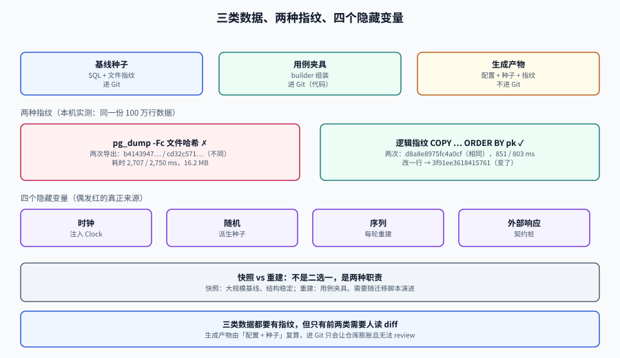

# 数据集与夹具的版本化

<p style="text-align:center;"></p>

数据集版本化（Dataset Versioning）解决的是「**同一份数据**」这四个字：让一次测试失败之后，任何人、在任何机器上，都能回到**当时那份一模一样的数据**上重跑。

没有这一层，测试报告里的「3 个用例失败」是不可复现的信息，团队只能靠猜。

## 判据族声明

本页判据族 `TDS-A` ~ `TDS-H`，共 8 条。定义表在第九节。

## 一、三类数据，三种版本化方式

| 类型 | 例子 | 谁改 | 版本化方式 | 是否进 Git |
| --- | --- | --- | --- | --- |
| **基线种子**（baseline seed） | 租户、角色、字典表、3 个演示用户 | 少数人、低频 | SQL 文件 + 文件指纹 | 是 |
| **用例夹具**（fixture） | 「一个已过期的邀请」「一张有 200 张卡片的看板」 | 用例作者、高频 | 建在测试代码里，用 builder 组装 | 是（代码） |
| **生成产物**（generated dataset） | 100 万行压测数据、回放语料 | 无人手改 | 生成配置 + 种子 + 指纹 | 否（配置进 Git） |

三条纪律：

1. **基线种子可以共享，用例夹具不许共享**。共享夹具是「一个用例改了数据、另一个用例莫名变红」的头号来源。
2. **生成产物永远不进 Git**。它由「配置 + 种子」复算出来，进 Git 只会让仓库膨胀且无法 review。
3. **三类都要有指纹**，但只有前两类需要人读 diff。

## 二、四个隐藏变量：偶发红的真正来源

「同一份数据」不等于「同一个数据库文件」。一次测试的结果由四个变量共同决定，任何一个不受控，就会偶发：

| 隐藏变量 | 表现 | 控制方式 |
| --- | --- | --- |
| **时钟** | `now()` 让「30 分钟过期」的用例在 12:00 与 12:29 结果不同 | 注入 `Clock`，测试里固定 `2026-10-19T00:00:00Z`；数据库侧用 `transaction_timestamp()` 而非 `clock_timestamp()` |
| **随机** | UUID、验证码、分片键每次都变 | 固定种子派生（见[数据工厂](../DataFactory/index.md)）；UUID 用固定值而非 `gen_random_uuid()` |
| **序列/自增** | 上一次运行把 `seq` 推到 1000，这次从 1001 开始 | 每次重建库；或断言里不依赖具体 ID |
| **外部响应** | 上游偶发 503、偶发慢 200ms | 契约桩 + 故障注入配置（见[契约仿真](../ContractSimulation/index.md)） |

::: danger 一个只在月末出现的红
某团队的「本月账单」用例在每月 1 号必红、其他时间绿。根因是用例造了「上月 15 号」的订单，但断言写的是「本月 1 号到月末的账单」——数据是**相对当前时间**造的，判据也是相对当前时间断言的，两者在跨月那一刻错位。
修法不是改断言，是**把「现在」变成参数**：`Clock.fixed(2026-10-19T00:00:00Z)`，造数与断言都用它。
:::

## 三、指纹：为什么不能用 `pg_dump` 的哈希

这是本页最重要的一条实测结论。

**做法 A（错）**：把数据库导出成文件，对文件算 SHA-256。

```shell
pg_dump -Fc -f d1.dump ...  &&  sha256sum d1.dump
pg_dump -Fc -f d2.dump ...  &&  sha256sum d2.dump
```

本机 PostgreSQL 18.6，**数据一行没改**，连续导出两次：

```console
b4143947ffa03381e83438998b61f80697b7c75a7596f917b6d801cbc578163f  d1.dump
cd32c571d3d3babd2e9bab59127e8a92aaa6f1becec0370dce8f395f36618f8d  d2.dump
```

**两次哈希不同。** 自定义格式（`-Fc`）的文件头里带导出时间等元信息，所以「内容相同、字节不同」。如果你把 dump 哈希当数据集指纹，CI 会**每次都判定「数据变了」**，于是这个门禁很快被人关掉。

**做法 B（对）**：对**逻辑内容**算指纹——按主键排序后逐行导出，再哈希。

```shell
psql "$DATABASE_URL" -Atc "COPY (SELECT * FROM board ORDER BY id) TO STDOUT" | sha256sum
```

同一份 100 万行数据，连续两次：

```console
d8a8e8975fc4a0cf...    # 851 ms
d8a8e8975fc4a0cf...    # 803 ms  ← 相同
```

改掉**一行**的一个字段（`amount + 0.01`），立刻变：

```console
3f91ee3618415761...
```

三条性质齐了：**稳定**（同数据同哈希）、**灵敏**（一行变则变）、**可解释**（哈希变了就是数据变了，不会因为导出时间而变）。

| 方案 | 稳定性 | 灵敏度 | 耗时（1e6 行 / 123 MB） | 结论 |
| --- | --- | --- | --- | --- |
| `pg_dump -Fc` 文件哈希 | ❌ 每次都变 | 有 | 2,707 ms / 2,750 ms，16.2 MB | 不能当指纹 |
| 逻辑指纹（`COPY ... ORDER BY pk`） | ✅ | 有 | **851 ms / 803 ms** | 推荐 |

::: tip 超过百万行怎么办
逻辑指纹的代价与数据量线性相关。可以按「分片指纹」做：每张表按 `hashtext(pk) % 16` 分 16 片，各算一个哈希，合成一个 Merkle 根。
好处是两次运行之间只有变动的分片需要重算——但要先把「分片规则」也写进指纹定义里，否则换个分片数就对不上。
:::

## 四、快照 vs 重建：不是二选一，是两种职责

| 维度 | 快照（dump/restore、模板库） | 重建（seed + 生成器） |
| --- | --- | --- |
| 建立耗时 | 中（本例 2.7 s 导出 / 16 MB） | 低（本例 `COPY` 1e6 行 2.5 s） |
| 恢复耗时 | 中（解压 + 建索引） | 低 |
| 可 review | ❌ 二进制，看不清改了什么 | ✅ SQL/YAML 逐行可读 |
| 能否跨版本 | ❌ 结构变了就恢复不了 | ✅ 跟着迁移脚本走 |
| 能否表达「意图」 | ❌ 只有结果 | ✅ 「这张看板有 200 张卡」写在配置里 |
| 适合 | **大规模基线**（几十万行以上、结构稳定） | **用例夹具、需要演进的基线** |

实践中的组合：**基线用重建，压测语料用快照**。基线必须能跟着迁移脚本演进（否则每次加字段都要重新导一份），而压测语料只需要「一份大的、稳定的、可复算」的数据，快照更省事。

## 五、变更可追：数据集也要有 changelog

数据集是资产，资产就要有变更记录。最小可用格式：

```markdown
## 2026-10-19 · v7（破坏性）
- `board.archived_at` 从「可空时间戳」改为「枚举 status 的一列」，旧断言 `archived_at IS NULL` 全部失效。
- 影响：12 个用例需要改断言；迁移脚本 `007_board_status.sql`。
- 指纹变化：d8a8e897 → 3f91ee36

## 2026-10-05 · v6
- 新增租户丙（用于跨租户矩阵第 19 格），基线行数 3 → 4。
- 指纹变化：……（非破坏性，无用例改动）
```

判断「破坏性」的三条标准：**列被删/改名**、**值域收窄**（枚举少了一个值）、**基数变化导致断言失效**（如「共 3 个租户」）。三条任一命中，就要在 changelog 里标 `破坏性` 并列出受影响用例。

## 六、清理责任：谁造谁收

三种清理策略，各有明确的适用面：

| 策略 | 做法 | 适用 | 风险 |
| --- | --- | --- | --- |
| **事务回滚** | 整个用例在一个事务里，结束 `ROLLBACK` | 单库、单连接、无外部副作用 | 测不了「提交后触发」的行为（outbox、CDC、异步） |
| **按标识清理** | 每个用例用自己的 `tenant_id` / 前缀，结束时按前缀删 | 多租户、需要真实提交 | 漏删会累积；级联删除顺序要对 |
| **整库重建** | 每个测试类重建 schema | 强隔离、CI 并行 | 慢（但可用模板库加速） |

::: danger 清理的三个静默失败
1. **`DELETE` 没删干净**：`ON DELETE CASCADE` 缺失时子表留下孤儿行，下一轮 `count(*)` 断言偏大。清理后要**断言归零**，不能只看命令退出码。
2. **序列没重置**：数据删了，`seq` 还在往前走。依赖「ID 从 1 开始」的用例第二轮就红。
3. **对象存储/缓存没清**：数据库干净了，附件桶里还有 300 个孤儿对象。写面清单要覆盖所有存储。
:::

## 七、共享夹具的四种反模式

| 反模式 | 症状 | 修法 |
| --- | --- | --- |
| **全局 `@BeforeAll` 造 50 行** | 用例之间靠执行顺序，单独跑就红 | 每个用例自己造所需的最小集 |
| **用例 A 依赖用例 B 的副作用** | 并行执行立刻崩 | 显式声明依赖，或合并成一个用例 |
| **「大家都用这个租户」** | 一个用例改了角色，别的用例 403 | 每个用例独立租户（前缀区分） |
| **夹具里写死自增 ID** | 换库就红 | 用业务键（`(tenant_id, key)`）或插入后取回 ID |

## 八、一个可执行的版本化骨架

```text
db/
├─ schema/            001_tables.sql  002_indexes.sql  003_constraints.sql
├─ seed/
│  ├─ 001_tenant.sql      基线：租户
│  ├─ 002_rbac.sql        基线：角色与权限
│  └─ spec/order.yaml     生成配置（含 seed: 20261019）
├─ CHANGELOG.md           数据集变更记录
└─ fingerprint.sh         逻辑指纹脚本

src/test/java/.../fixtures/
├─ BoardFixture.java      builder：默认 1 看板 / 3 列表 / 12 卡片
└─ TenantFixture.java     每用例独立租户，前缀 t{random-but-seeded}
```

```shell
#!/usr/bin/env bash
# db/fingerprint.sh —— 逻辑指纹（稳定、灵敏）
set -euo pipefail
TABLES="tenant user board card comment attachment"
for t in $TABLES; do
  printf '%-12s %s\n' "$t" \
    "$(psql "$DATABASE_URL" -Atc "COPY (SELECT * FROM $t ORDER BY id) TO STDOUT" | sha256sum | cut -c1-16)"
done | tee /tmp/fingerprint.txt
# 合成总指纹
sha256sum /tmp/fingerprint.txt | cut -c1-16
```

## 九、判据表

| 编号 | 约定 | 定错了会怎样 | 怎么验证 |
| --- | --- | --- | --- |
| `TDS-A` | 数据集指纹必须按**逻辑内容**算，不用 `pg_dump` 文件哈希 | CI 每次都判定「数据变了」，门禁被关掉 | 连跑两次 `db/fingerprint.sh`，输出相同 |
| `TDS-B` | 指纹必须**对一行改动敏感** | 数据悄悄变了但指纹不变 | 改一行一个字段，指纹必须变化（做过一次即可） |
| `TDS-C` | 四个隐藏变量（时钟/随机/序列/外部）都有显式控制 | 偶发红无法定位 | 代码里 `now()` 只出现在 `Clock` 注入点；`grep -rn "LocalDateTime.now()" src/test` 为空 |
| `TDS-D` | 用例夹具**不共享**，每个用例自带最小集 | 用例间隐式依赖 | 单跑任一用例都能通过（`--tests` 随机顺序跑 3 次） |
| `TDS-E` | 清理必须**断言归零**，不只看退出码 | 残留数据污染下一轮 | 清理后 `count(*)` = 0 的断言存在；连续跑两轮结果一致 |
| `TDS-F` | 序列、对象存储、缓存都在写面清单里 | 只清了数据库 | 写面清单 4 类存储各有清理目标与计数断言 |
| `TDS-G` | 数据集有 changelog，破坏性变更标出受影响用例 | 改数据后一片红没人知道为什么 | `CHANGELOG.md` 最新条目含「破坏性」标记时，PR 描述里列出受影响用例 |
| `TDS-H` | 生成产物不进 Git，只进配置与种子 | 仓库膨胀、无法 review | `git ls-files \| grep -E "\.(tsv\|csv\|dump)$"` 为空 |

## 十、验证方式

```shell
# 1) 指纹稳定（仓库内可执行，需本地 PostgreSQL）
./db/fingerprint.sh > /tmp/f1.txt
./db/fingerprint.sh > /tmp/f2.txt
diff /tmp/f1.txt /tmp/f2.txt && echo "OK: stable"

# 2) 指纹灵敏
psql "$DATABASE_URL" -c "update board set name = name || 'x' where id = (select min(id) from board)"
./db/fingerprint.sh > /tmp/f3.txt
diff -q /tmp/f1.txt /tmp/f3.txt || echo "OK: sensitive"

# 3) 反例：dump 文件哈希不稳定（证明为什么不能用它）
pg_dump -Fc -f /tmp/a.dump "$DATABASE_URL" && pg_dump -Fc -f /tmp/b.dump "$DATABASE_URL"
sha256sum /tmp/a.dump /tmp/b.dump   # 两行不同

# 4) 用例顺序无关（以 Maven 为例）
mvn -q test -Dsurefire.runOrder=random   # 连跑 3 次都应全绿
```

## 十一、参考资料

- PostgreSQL 18 文档：`pg_dump` 的格式说明（自定义格式含元信息）、`COPY TO STDOUT`。
- 《Working Effectively with Unit Tests》中关于 fixture 生命周期的讨论（每用例 vs 每类）。
- Testcontainers 的「可重用容器」文档：<https://java.testcontainers.org/features/reuse/>
- 相关页：[数据工厂](../DataFactory/index.md)（怎么造）、[环境隔离](../EnvironmentIsolation/index.md)（造在哪）、[总览](../Overview/index.md)（四个隐藏变量在失败模式里的位置）
