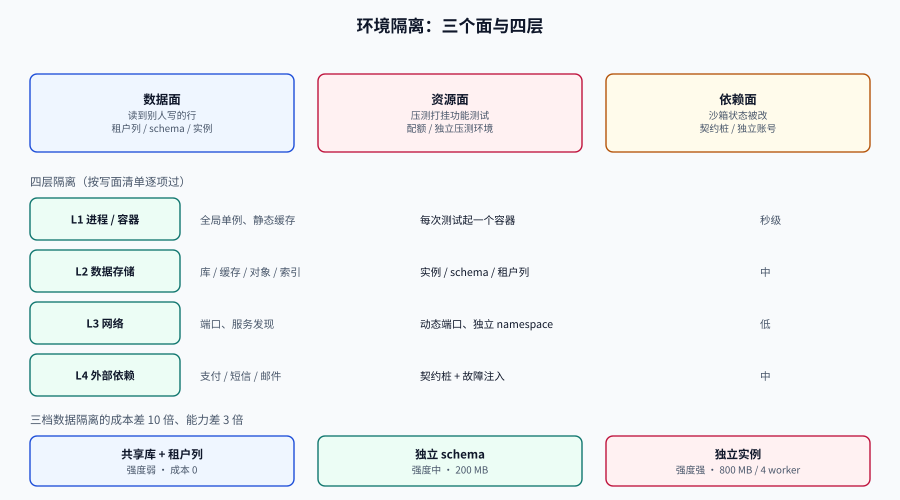

# 环境隔离：让失败不越界

<p style="text-align:center;"></p>

环境隔离（Environment Isolation）的目标不是「数据不串」，而是**一次失败不影响别人**：A 的压测不该打挂 B 的用例，A 改了 Redis 里的 key 不该让 B 的缓存断言失效，A 造的一条脏数据不该让 B 的分页断言多出一行。

判断隔离做得对不对，只有一个问题：**把两个团队的任务同时跑，失败会不会互相传播。**

## 判据族声明

本页判据族 `TDE-A` ~ `TDE-H`，共 8 条。定义表在第十节。

## 一、三个面：数据、资源、依赖

| 面 | 串了会怎样 | 典型现象 | 隔离手段 |
| --- | --- | --- | --- |
| **数据面** | 读到别人写的行、断言计数偏大 | 「昨天还是 3 条，今天 5 条」 | 租户列 / 独立 schema / 独立实例 |
| **资源面** | 别人占满 CPU、连接池、磁盘 | 平时 80 ms，压测时 4 s | 配额、限流、独立实例 |
| **依赖面** | 上游沙箱状态被改 | 「支付沙箱里的订单被确认了」 | 契约桩 / 独立沙箱账号 |

绝大多数团队只做数据面（「我们分了库」），然后被资源面和依赖面反复打脸。**压测打挂集成测试**是资源面，**上游沙箱被别人改状态**是依赖面，两者都不是「数据串了」。

## 二、四层隔离：按「写的传播面」算，不按「分了几个库」算

| 层 | 隔离对象 | 做法 | 成本 | 什么时候必须做 |
| --- | --- | --- | --- | --- |
| L1 **进程/容器** | 应用实例 | 每次测试起一个容器 | 低（秒级） | 有全局单例、静态缓存、`@PostConstruct` 预热 |
| L2 **数据存储** | 库、缓存、对象存储、搜索索引 | 独立实例 / 独立 schema / 租户列 | 中 | 有写操作 |
| L3 **网络** | 端口、服务发现、DNS | 动态端口、独立 namespace | 低 | 并行跑多个实例 |
| L4 **外部依赖** | 支付、短信、邮件、第三方 API | 契约桩 + 故障注入 | 中 | 有外部副作用 |

**按写面清单逐项过**，这是唯一可靠的方法：

```markdown
<!-- docs/test-data/write-surfaces.md -->
| 存储 | 地址 | 谁写 | 隔离方式 | 清理方式 |
| --- | --- | --- | --- | --- |
| PostgreSQL 主库 | db:5432/teamboard | 应用 | 独立实例（Testcontainers） | 销毁容器 |
| Redis 缓存 | cache:6379 | 应用 + 定时任务 | 独立实例，DB 0 | `FLUSHDB` |
| 对象存储 | s3://tb-test | 附件直传 | 独立 bucket + 前缀 `t/{tenant}/` | 按前缀删 |
| 搜索索引 | opensearch:9200/card | 索引同步 | 独立实例 + 索引名带 runId | 删索引 |
| 消息队列 | kafka:9092 | outbox 投递 | 独立 topic 前缀 | 删 topic |
| 邮件/短信网关 | 沙箱 API | 通知 | 契约桩（不进真实沙箱） | 无状态 |
```

六行里只要有一行写「共用生产」，整套隔离就是假的。

## 三、数据隔离三档：成本差 10 倍，能力差 3 倍

| 档位 | 做法 | 隔离强度 | 起一套的成本 | 适合 |
| --- | --- | --- | --- | --- |
| **共享库 + 租户列** | 一个库，每用例一个 `tenant_id` 前缀 | 弱（靠应用与 RLS） | 0（已有） | 大量只读用例、跨租户矩阵 |
| **独立 schema** | 一个实例，每用例一个 schema | 中（DDL 隔离、连接共享） | 低（`CREATE SCHEMA` 毫秒级） | 需要独立表的用例 |
| **独立实例** | 每用例/每 worker 一个容器 | 强（连 DDL、序列、统计信息都独立） | 中（启动 3~8 s） | 迁移测试、压测、并发 bug |

成本账（按 4 个并行 CI worker 估）：

```text
共享库：     0 额外内存，隔离强度弱，跨用例污染概率高
独立 schema：1 个实例 × 4 worker 共享，≈ 200 MB 内存，隔离强度中
独立实例：   4 × 200 MB ≈ 800 MB 内存，CPU 4 × 0.5 核，隔离强度强
```

::: tip 三档不是互斥的
一个务实的组合：**同一 CI job 内共享一个实例**（省启动时间），**每个测试类一个 schema**（隔离 DDL），**每个用例一个租户前缀**（隔离数据）。
真需要独立实例的只有两类：**测迁移脚本**（要干净的空库）和**测连接池/并发**（要能控连接数）。
:::

## 四、按需环境：Testcontainers 的正确用法与两个陷阱

Testcontainers for Java **2.0.0 于 2025-10-14 发布，2.0.5 于 2026-04-20**；1.x 的最后一版是 1.21.4（2025-12-16）。2.x 与 1.x 在模块坐标与部分 API 上有差异，升级时按官方迁移说明走，不要只改版本号。

```java
// 一个可复用的 PostgreSQL 容器：静态字段 = 整个 JVM 共享一个实例
@Testcontainers
class DbPerClassTest {

    @Container
    static final PostgreSQLContainer<?> PG =
        new PostgreSQLContainer<>("postgres:18")
            .withDatabaseName("teamboard")
            .withUsername("test")
            .withPassword("test")
            .withInitScript("db/schema/001_tables.sql");   // 只跑一次

    @BeforeEach
    void resetData() {
        // 关键：每次用例前恢复到基线，而不是只靠「容器是新的」
        runScript("db/seed/001_base.sql");
        runScript("db/seed/002_rbac.sql");
    }
}
```

**陷阱一：`withReuse(true)` 让容器跨运行复用，但数据不会自动回滚。** 复用的收益是启动时间（3~8 s → 0），代价是「上一次运行的残留」成了隐形的第五个隐藏变量。要用就必须配一个强力的 `resetData()`，且 `resetData()` 本身要有「清理后计数归零」的断言。

**陷阱二：`@Container` 静态 vs 非静态。** 静态是「每个类一个容器」，非静态是「每个方法一个容器」。后者在 200 个用例的套件里会让总时长从 2 分钟涨到 20 分钟——**启动开销乘以用例数**，而绝大多数用例并不需要全新实例。

启动时间的构成（经验值，随镜像与机器变化）：

| 阶段 | 耗时 | 能否优化 |
| --- | --- | --- |
| 拉镜像（首次） | 10~60 s | 预热到 CI runner 本地缓存 |
| 容器创建 + 启动 | 1~3 s | 用 `-alpine` 或精简镜像 |
| 等待就绪（`waitingFor`） | 1~5 s | 用日志/端口就绪策略，别用固定 `sleep` |
| 跑 init 脚本 | 0.2~2 s | 只建结构，不灌大数据（数据用 `COPY`） |

::: danger 别用 `Thread.sleep` 等容器就绪
固定 sleep 在慢机器上不够、在快机器上浪费。用 `Wait.forLogMessage("database system is ready to accept connections", 2)` 或 `Wait.forListeningPort()`。
更隐蔽的一种：**端口通了但库还没接受连接**——`forListeningPort` 会通过，第一次查询报 `Connection refused`。所以 PostgreSQL 官方模块用「日志出现两次 ready」作为就绪信号，这是有原因的。
:::

## 五、共享环境：租约与命名空间

不是所有环境都能按需拉起（有状态的大数据集群、需要白名单的第三方沙箱）。共享环境必须有**租约**：

```sql
CREATE TABLE env_lease (
  env          text        NOT NULL,          -- 环境标识，如 staging-k8s
  namespace    text        NOT NULL,          -- 使用者的命名空间/前缀
  owner        text        NOT NULL,          -- 谁占的（工号/邮箱）
  purpose      text        NOT NULL,          -- 用例/压测/演示
  acquired_at  timestamptz NOT NULL DEFAULT now(),
  expires_at   timestamptz NOT NULL,          -- 必须显式给，不给就是永久占用
  released_at  timestamptz,
  PRIMARY KEY (env, namespace)
);

-- 占租约：同一 (env, namespace) 只能有一个活跃租约
INSERT INTO env_lease (env, namespace, owner, purpose, expires_at)
VALUES ('staging-k8s', 'ci-pr-1842', 'hjc', 'integration', now() + interval '2 hours')
ON CONFLICT (env, namespace) DO UPDATE
  SET owner = EXCLUDED.owner, expires_at = EXCLUDED.expires_at, released_at = NULL
  WHERE env_lease.released_at IS NOT NULL OR env_lease.expires_at < now();
-- 冲突时影响行数为 0，说明有人正在用 —— 调用方必须把它当失败处理，不能静默继续
```

三条规则：

1. **命名空间带来源**（`ci-pr-1842`、`local-hjc-1`），一眼看出谁占的；
2. **过期时间必填**，默认 2 小时，可续租但有上限；
3. **抢占只能抢已过期或已释放的**，`ON CONFLICT ... WHERE` 的 `UPDATE 0` 就是「有人在用」，不能当成功。

再加一个回收任务：每天扫 `expires_at < now() - interval '24 hours' AND released_at IS NULL`，通知 owner 后清理。**没有回收任务，租约表三周后就全是僵尸。**

## 六、资源面：配额比隔离更便宜

资源串扰不需要「独立实例」来解决，配额更便宜：

| 手段 | 作用 | 代价 |
| --- | --- | --- |
| 容器 `--cpus` / `--memory` | 一个人跑不满整机 | 压测结论会失真（要在专用环境跑） |
| 连接池上限 | 防止一个服务占满数据库连接 | 需要按环境调 `maximumPoolSize` |
| 压测专用环境 | 压测不与他人共享 | 多一套环境的钱 |
| CI 并发上限 | 防止 20 个 job 同时起容器 | 排队变长 |

**压测永远不要和功能测试共享环境**，这是资源面最重要的一条。压测要的是「稳定的、独占的、可复现的」资源，共享环境三者都没有。

## 七、环境即代码：三条纪律

```yaml
# compose.test.yaml —— 只声明「测试需要什么」，不声明「怎么部署」
services:
  db:
    image: postgres:18
    environment:
      POSTGRES_DB: teamboard
      POSTGRES_USER: test
      POSTGRES_PASSWORD: test
    tmpfs: /var/lib/postgresql/data    # 内存盘：快，且退出即清空
    healthcheck:
      test: ["CMD-SHELL", "pg_isready -U test -d teamboard"]
      interval: 1s
      retries: 30
  cache:
    image: redis:7-alpine
    command: ["redis-server", "--save", "", "--appendonly", "no"]
```

1. **配置进仓库，密钥进环境变量**。测试环境的密码可以是 `test`，但不能出现真实的云凭证。
2. **端口不写死**，用动态映射（`-p 0:5432`），否则并行跑两个实例就冲突。
3. **不写 `sleep` 等就绪**，用 healthcheck / wait strategy。

## 八、成本对照：隔离强度 vs 维护成本

| 方案 | 单次启动 | 月成本（团队 10 人） | 维护负担 | 隔离强度 |
| --- | --- | --- | --- | --- |
| 一套共享的 staging | 0 | 一套环境 | 低（但脏数据要人清） | 弱 |
| 每人一套本地 compose | 10~20 s | 0（用本机资源） | 中（版本漂移） | 中 |
| CI 内 Testcontainers | 5~10 s/类 | CI 分钟数 | 低（配置在仓库） | 强 |
| 每人一套云端命名空间 | 0 | 高（按人算） | 中（要清理） | 强 |

::: warning 「每人一套本地环境」的隐藏成本
本地环境的版本漂移是最贵的：`postgres:16` 与 `postgres:18` 在 `NULLS NOT DISTINCT`、`jsonpath` 行为上不同，本地过、CI 挂的经典来源。
所以本地环境也要**用同一个 compose 文件**，而不是「我自己装了个 PG」。
:::

## 九、判据表

| 编号 | 约定 | 定错了会怎样 | 怎么验证 |
| --- | --- | --- | --- |
| `TDE-A` | 写面清单必须完整，每类存储有隔离与清理方式 | 残留污染、跨用例外溢 | 清单里每行都有 `隔离方式` 与 `清理方式` 两列，空值为 0 |
| `TDE-B` | 环境必须**声明式**（compose / 代码），不许口头步骤 | 新人三天跑不起来 | 从零克隆仓库到测试全绿 ≤ 3 条命令 |
| `TDE-C` | 端口/名称/前缀**不写死** | 并行冲突 | 配置里无固定端口；同一配置能同时起两份 |
| `TDE-D` | 就绪判断用 wait strategy，不用 `sleep` | 慢机器偶发失败 | `grep -rn "Thread.sleep" src/test` 为空 |
| `TDE-E` | 共享环境必须有租约，且有回收任务 | 僵尸占用、无法判断谁在用 | 租约表存在；抢占过期租约返回影响行数 1，抢占活跃租约返回 0 |
| `TDE-F` | 压测不与功能测试共享环境 | 压测打挂别人、结论失真 | 压测配置指向专用环境标识；该环境不入 CI 的共享池 |
| `TDE-G` | 本地与 CI 使用**同一份**环境定义 | 版本漂移导致本地过 CI 挂 | `docker ps` 里的镜像 tag 与 CI 配置一致（`grep image:` 对比） |
| `TDE-H` | 资源配额必须有上限 | 一个任务吃满整机 | 容器有 `cpus`/`mem_limit`，连接池有 `maximumPoolSize` |

## 十、验证方式

```shell
# 1) 从零到测试全绿（三条命令内）
git clone <repo> && cd <repo> && make test
# 期望：输出 BUILD SUCCESS / Tests run: N, Failures: 0

# 2) 配置声明式：不含固定端口
grep -nE '^\s+- "[0-9]+:[0-9]+"' compose.test.yaml || echo "OK: no fixed ports"

# 3) 无 sleep 等待
grep -rn "Thread.sleep" src/test || echo "OK: no sleep"

# 4) 并行不冲突：同时起两份
docker compose -f compose.test.yaml -p run1 up -d && docker compose -f compose.test.yaml -p run2 up -d
docker compose -p run1 ps --format '{{.Name}} {{.Status}}'
docker compose -p run2 ps --format '{{.Name}} {{.Status}}'
# 期望：两份都 healthy

# 5) 租约冲突语义（需库）
psql "$DATABASE_URL" -Atc "
insert into env_lease(env,namespace,owner,purpose,expires_at)
values('staging','ci-x','a','test', now()+interval '1 hour')
on conflict (env,namespace) do update set owner=excluded.owner
where env_lease.released_at is not null or env_lease.expires_at < now()"
# 第二次执行应返回 INSERT 0 0（有人在用）

# 6) 清理：销毁后无残留
docker compose -p run1 down -v && docker volume ls | grep -c run1
# 期望 0
```

## 十一、参考资料

- Testcontainers for Java 官方文档（含 2.x 变更与 `withReuse`）：<https://java.testcontainers.org/>
- PostgreSQL 官方镜像的就绪日志语义：<https://hub.docker.com/_/postgres>
- Docker Compose 的 `tmpfs`、`healthcheck`、`deploy.resources` 说明。
- k6 文档中「压测环境应独占」的实践说明：<https://grafana.com/docs/k6/latest/>
- 相关页：[数据集版本化](../DatasetVersioning/index.md)（数据怎么固定）、[契约仿真](../ContractSimulation/index.md)（依赖面怎么隔离）、[完整项目的环境与工程骨架](../../../../project/Complete/TeamBoard/Environment/index.md)
