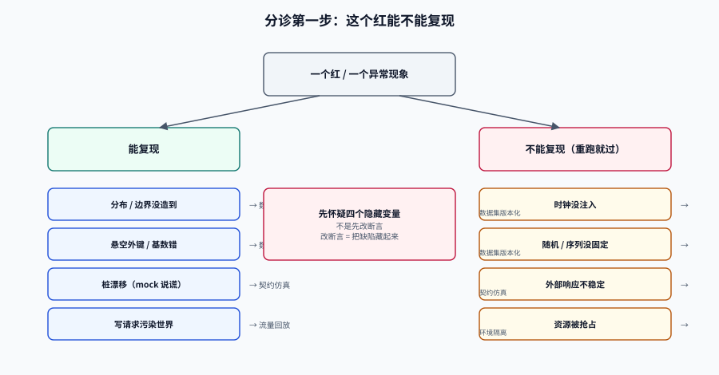

# 常见问题与最佳实践

<p style="text-align:center;"></p>

这一页不进新概念，只做三件事：**按症状分诊**（你现在遇到的现象大概属于哪一类）、**回答高频问题**（那些「好像都对但不知道选哪个」的地方）、**给一份可逐条打勾的上线自查表**。

## 判据族声明

本页判据族 `TDQ-A` ~ `TDQ-H`，共 8 条。定义表在第六节。

## 一、十类症状分诊

| 症状 | 大概率的根因 | 先看 | 一条命令先自证 |
| --- | --- | --- | --- |
| 用例本地过、CI 挂，重跑又过 | 四个隐藏变量没控住 | [数据集版本化](../DatasetVersioning/index.md) 第二节 | `grep -rn "LocalDateTime.now()" src/test` |
| 数据量一多，分页断言就红 | 数据基数不稳定、用例间共享夹具 | [数据集版本化](../DatasetVersioning/index.md) 第七节 | 单跑该用例 3 次 |
| 测试库被安全扫描报「存有个人信息」 | 直接拷贝了生产数据 | [数据脱敏](../DataMasking/index.md) | 手机号正则扫描 |
| 导入测试数据时 `duplicate key` | 假标识不唯一（随机碰撞） | [数据工厂](../DataFactory/index.md) 第三节 | `count(*) - count(distinct x)` |
| 报表/风控分支永远测不到 | 分布用了均匀，没造极端值 | [数据工厂](../DataFactory/index.md) 第二节 | 看 `> p99` 的行数 |
| `join` 结果少行但不报错 | 悬空外键（没建约束） | [数据工厂](../DataFactory/index.md) 第五节 | 每个外键一条 `LEFT JOIN ... IS NULL` |
| 别人一压测，我的用例就超时 | 资源面没隔离 | [环境隔离](../EnvironmentIsolation/index.md) 第六节 | 看容器有没有 `cpus`/`mem_limit` |
| 上游改了字段，我们的 mock 没变 | 手写桩漂移 | [契约仿真](../ContractSimulation/index.md) 第一节 | 桩覆盖率与契约 diff |
| 回放把测试库写乱了 | 副作用没隔离 | [流量回放](../TrafficReplay/index.md) 第四节 | 写请求占比 |
| 新人三天跑不起来环境 | 环境没声明式 | [环境隔离](../EnvironmentIsolation/index.md) 第九节 | 从 clone 到全绿几条命令 |

::: tip 分诊的第一步不是看日志，是问「这个红能不能复现」
能复现 → 数据或代码问题，按上表往下走。
不能复现 → 先怀疑四个隐藏变量（时钟/随机/序列/外部响应），不要先改断言。
**改断言让测试变绿，是把缺陷藏起来的标准动作。**
:::

## 二、十二问

**Q1：测试数据到底该不该用生产数据的副本？**

只在两种情况下可以：① 已按[数据脱敏](../DataMasking/index.md)做到 3 级并留了评估记录；② 一次性任务（迁移验证），用完即删。
日常回归不要用——它不可 review、不可演进、每次都要重新评估。

**Q2：脱敏到什么程度算够？**

不看「打了几个星号」，看**级别结论**。测试库属于组织内部共享，k ≥ 3 是下限；如果这份数据要拿去对外演示，按 k ≥ 5 重评。

**Q3：k-匿名是不是越高越好？**

不是。k 越高，等价类越粗，字段相关性被抹平，依赖相关性的缺陷测不出来。**k 是风险与可用性的取舍点，不是分数。**

**Q4：造数用 SQL 还是用程序？**

结构简单（≤ 5 张表、无跨字段约束）用 SQL；有引用图、有分布要求、要复算，用程序生成 TSV 再 `COPY`。
判据：改一个字段要动几处。超过 3 处就该上生成器。

**Q5：随机种子该放在哪？**

进代码或进配置文件，**不要放环境变量**。环境变量会让人「本地设一个、CI 设一个」，两边数据不同，偶发红又回来了。

**Q6：Testcontainers 会不会太慢？**

单类 5~10 s，200 个用例的套件会明显变慢。三个手段：静态容器（每类一个）、`withReuse`（跨运行复用，但要配强清理）、把重活（建索引、灌大表）挪到 `@BeforeAll`。

**Q7：`withReuse(true)` 到底能不能用？**

能，但必须配「每次用例前重置 + 重置后断言归零」。它复用容器，不复用状态——状态是你自己的责任。

**Q8：桩应该由谁维护？**

由**消费方**维护桩的期望，由**提供方**维护契约。只让一方维护，漂移必然发生。
如果组织上做不到，就退回「契约生成桩 + 每日一致性测试」，用机器代替人。

**Q9：契约测试和集成测试有什么区别？**

集成测试验证「我的服务 + 真实依赖能不能跑通」；契约测试验证「我的服务和依赖对同一个契约的理解是否一致」。
前者发现「跑不通」，后者发现「为什么跑不通」，两者不能互相替代。

**Q10：回放要不要比字段值？**

要比，但不能作为阻断门禁。字段值 diff 的噪音（时间、ID、排序、精度）会淹没真缺陷。门禁挂在状态码与结构上，字段值作为报告供人看。

**Q11：数据集要不要进 Git？**

基线种子（SQL）进；用例夹具（代码）进；生成产物（大文件）不进，只进配置与种子。
一条命令自查：`git ls-files | grep -E "\.(tsv|csv|dump)$"` 应该为空。

**Q12：怎么说服团队投入这套东西？**

不要说「提升质量」，说三个可数的东西：① 每周排查「重跑就过」的小时数；② 联调阶段发现的契约不兼容条数；③ 新人从 clone 到跑通第一条测试的时间。
这三个数下降，投入就有理由。

## 三、上线自查十四项

逐条打勾，任何一条为「否」都不要宣布「测试数据治理完成」。

| # | 检查项 | 判据 |
| --- | --- | --- |
| 1 | 数据集能一条命令重建 | `make seed` 成功且输出指纹 |
| 2 | 指纹稳定且灵敏 | 连跑两次相同；改一行则变 |
| 3 | 无真 PII | 正则扫描命中 0，或命中项全在豁免清单 |
| 4 | 每个用例独立租户/前缀 | 单跑任一用例通过 |
| 5 | 悬空外键为 0 | 每个外键一条计数 SQL |
| 6 | 假标识单射 | `count(*) = count(distinct x)` |
| 7 | 分布与生产对齐 | P50/P99 落在配置区间 |
| 8 | 脏数据比例按配置注入 | 实测比例与配置差 < 0.2% |
| 9 | 四个隐藏变量有控制 | 无裸 `now()` / `new Random()` / `sleep` |
| 10 | 写面清单完整 | 每类存储有隔离与清理方式 |
| 11 | 断网可跑集成测试 | 断开外网后 `*IT` 全绿 |
| 12 | 桩覆盖率可算 | CI 报告里有 `stub_coverage` |
| 13 | 清理后归零 | 清理后 `count(*)` = 0 |
| 14 | 数据集有 changelog | 最近一次变更含影响范围 |

## 四、术语表

| 术语 | 一句话解释 |
| --- | --- |
| **判别力**（discriminating power） | 数据集能让多少比例的已知缺陷变红 |
| **等价类**（equivalence class） | 准标识符取值完全相同的记录集合 |
| **k-匿名** | 每个等价类至少 k 条记录 |
| **准标识符**（quasi-identifier） | 单独不识别、组合可识别的字段（性别、年龄、邮编） |
| **伪名化** | 用确定性函数替换标识符，可借映射表复原 |
| **单射** | 不同输入必得不同输出（假数据的唯一性保证） |
| **夹具**（fixture） | 一个用例运行前需要的那份最小数据 |
| **逻辑指纹** | 按主键排序导出内容后算的哈希（区别于文件哈希） |
| **契约桩** | 由契约文档生成或手写的假下游服务 |
| **漂移**（drift） | 桩/文档与真实实现之间的偏差 |
| **影子表** | 与主表同结构、只接收回放写入的表 |
| **按需环境** | 测试开始时创建、结束时销毁的环境 |

## 五、五条最容易被写成「最佳实践」的错误建议

::: danger 这五句话听起来对，实际会害人
1. **「测试数据要尽量真实」**——真实的定义无法验收。应该说「金额分布对齐生产 P50/P99，偏差 < 20%」。
2. **「用生产数据脱敏后导入最省事」**——省的是第一天，贵的是之后每一天（每次结构变更都要重导、每次审计都要重评）。
3. **「mock 一下就行了」**——mock 通过 ≠ 集成通过。没有「契约 ↔ 实现」那一处对齐，mock 越完善越危险。
4. **「重跑一次就好了」**——偶发红是缺陷，不是噪音。重跑让红变绿，等于把缺陷藏起来。
5. **「覆盖率 80% 就合格」**——覆盖率度量「执行过」，不度量「断言过」。一行 `assertNotNull` 也能把覆盖率刷上去。
:::

## 六、判据表

| 编号 | 约定 | 定错了会怎样 | 怎么验证 |
| --- | --- | --- | --- |
| `TDQ-A` | 分诊表必须能指向**具体命令** | 分诊变成「再看看」 | 表里每行的「一条命令」列都能直接粘贴执行 |
| `TDQ-B` | 偶发红必须登记，不许靠重跑消解 | 缺陷被藏起来 | CI 里有 flaky 登记表，近 30 天新增条目数可查 |
| `TDQ-C` | 自查表 14 项必须逐条有「是/否」，不许「部分」 | 「基本完成」等于没做 | 自查记录里 14 行全为布尔值 |
| `TDQ-D` | 术语表与正文口径一致 | 同一概念两种说法 | 抽查 5 个术语，在正文中定义与术语表一致 |
| `TDQ-E` | 反面清单（第五节）必须在团队内公示 | 错误建议被当规范执行 | onboarding 文档里引用该清单 |
| `TDQ-F` | 每个「为什么」都要能落到数字 | 讨论停在立场层面 | 十二问里凡涉及取舍的回答都含数值或阈值 |
| `TDQ-G` | 自查表可机器判定的项必须自动化 | 人工打勾会走过场 | 14 项中至少 8 项有对应 CI 检查 |
| `TDQ-H` | 本页不定义新概念，只做索引 | 概念分裂、读者困惑 | 本页出现的术语在其余八页均有定义 |

## 七、验证方式

```shell
# 自查表里可自动化的 8 项，一条命令跑一遍（示例）
set -u
fail=0

# 1 数据可重建
make seed >/dev/null 2>&1 || { echo "FAIL: seed"; fail=1; }

# 2 指纹稳定
./db/fingerprint.sh > /tmp/f1 && ./db/fingerprint.sh > /tmp/f2
diff -q /tmp/f1 /tmp/f2 >/dev/null || { echo "FAIL: fingerprint unstable"; fail=1; }

# 3 无真 PII
n=$(psql "$DATABASE_URL" -Atc "select count(*) from \"user\" where phone !~ '^1990000[0-9]{8}$'")
[ "$n" = "0" ] || { echo "FAIL: pii $n"; fail=1; }

# 6 单射
n=$(psql "$DATABASE_URL" -Atc "select count(*)-count(distinct phone) from \"user\"")
[ "$n" = "0" ] || { echo "FAIL: collision $n"; fail=1; }

# 9 隐藏变量
grep -rq "LocalDateTime.now()" src/test && { echo "FAIL: raw now()"; fail=1; }
grep -rq "Thread.sleep" src/test && { echo "FAIL: sleep"; fail=1; }

# 13 清理归零
make clean-data >/dev/null 2>&1
n=$(psql "$DATABASE_URL" -Atc "select count(*) from card")
[ "$n" = "0" ] || { echo "FAIL: residue $n"; fail=1; }

echo "selfcheck_failures=$fail"
```

期望输出最后一行 `selfcheck_failures=0`。这个脚本本身就是「自查表可机器判」的示范：14 项里挑出 8 项能自动判的，剩下 6 项（区间口径、脏数据比例、写面清单、断网、桩覆盖率、changelog）留人工但要求给出证据链接。

## 八、参考资料

- GB/T 42460-2023《信息安全技术 个人信息去标识化效果评估指南》。
- Testcontainers 官方文档：<https://java.testcontainers.org/>
- Microcks / WireMock / k6 官方文档（分别对应契约、桩、压测）。
- 本专题其余页面：[总览](../Overview/index.md)、[数据脱敏](../DataMasking/index.md)、[数据工厂](../DataFactory/index.md)、[数据集版本化](../DatasetVersioning/index.md)、[环境隔离](../EnvironmentIsolation/index.md)、[契约仿真](../ContractSimulation/index.md)、[流量回放](../TrafficReplay/index.md)、[实战](../Practice/index.md)
