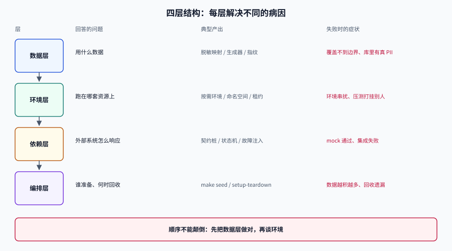

# 总览：三个约束与四层结构

<p style="text-align:center;"></p>

测试数据与仿真环境（Test Data & Simulation Environment）是**为验证行为而构造状态**的工程：它要同时满足「像生产」「不含真个人信息」「明天还能一模一样地重建」三件互相拉扯的事，并把这件事做成可提交、可评审、可回收的流水线。

## 判据族声明

本页判据族 `TDO-A` ~ `TDO-H`，共 8 条。定义表在第九节。

## 一、三个约束，以及它们为什么互相拉扯

| 约束 | 它要求什么 | 违反之后的典型症状 | 谁在为它买单 |
| --- | --- | --- | --- |
| **真实性**（fidelity） | 数据形态、分布、脏数据、跨表关系与生产一致 | 测试全绿、上线第一小时就报 `23505` 唯一键冲突 | 线上用户 |
| **安全性**（safety） | 不含可直接识别的个人信息，或已评估到可接受的重标识风险 | 安全扫描报红、合规审计不合格、数据泄露 | 法务与安全团队 |
| **可重复性**（repeatability） | 同一份代码，任何时候、任何机器，跑出同一结果 | 「本地过、CI 挂」「重跑又过了」 | 研发自己（最贵） |

三者不是「都要做到最好」，而是**同一条曲线上的三个点**：把 k-匿名从 3 提到 10，等价类被合并，字段的相关性被抹平，那些依赖相关性的缺陷（「金额与折扣率不匹配」「状态与时间顺序矛盾」）就再也测不出来——安全性上去了，真实性下来了。

本专题的立场是：**按用途分级，不同用途给不同强度的数据**，而不是找一份「都满足」的数据。这个「分级」在[数据脱敏](../DataMasking/index.md)里落成四档，在[实战](../Practice/index.md)里落成两份租户配方。

::: danger 一个真实发生过的失效链
团队把生产库脱敏后导入测试环境，用的是「每列独立随机替换」。结果：

1. `user.phone` 被换成随机号码，`user_profile.phone` 也被换成**另一个**随机号码——两表关联查询的用例再也走不到「同一手机号多条档案」这个分支；
2. 为了修这个，有人把两边的替换逻辑「对齐」成同一个 `Random(seed)`，但两边**遍历顺序不同**，第 7 行开始错位；
3. 最后干脆改回「直接用生产数据」，安全性归零。

这不是技术难题，是**没有把「一致性」写成判据**。正确做法见[数据脱敏](../DataMasking/index.md)的「一致性脱敏」：同一实体用**确定性函数**（HMAC + 固定盐）映射，而不是「同一个随机数生成器」。
:::

## 二、四层结构：每一层解决不同的病因


| 层 | 回答的问题 | 典型产出 | 失败时的症状 | 成本量级 |
| --- | --- | --- | --- | --- |
| **数据层** | 用什么数据 | 脱敏映射表、数据工厂脚本、数据集指纹 | 用例覆盖不到边界、数据里有真 PII | 低（一次性） |
| **环境层** | 跑在哪套资源上 | 按需环境、命名空间、租约登记表 | 环境串扰、压测打挂别人 | 中（持续） |
| **依赖层** | 外部系统怎么响应 | 契约桩、状态机桩、故障注入配置 | mock 通过、集成失败 | 中（持续） |
| **编排层** | 谁来准备、何时回收 | `make seed`、CI 里的 setup/teardown、回收任务 | 数据越积越多、回收遗漏 | 低（但要有人负责） |

四层的顺序不能颠倒：**先把数据层做对，再谈环境**。常见错误是先买一套 Testcontainers 平台，数据还是「从生产捞一份」——环境隔离了，合规问题一分没少。

## 三、判别力：测试数据的唯一硬指标

一份测试数据好不好，可以算：

```text
判别力(D, C) = 在数据集 D 上「变红」的缺陷数 / 注入的缺陷总数 C
```

`C` 用**变异测试**（mutation testing）构造：把 `>` 改成 `>=`、把 `and` 改成 `or`、把 `if` 分支删掉，每个变异体就是一个「已知的错」。跑一遍测试，看哪些变异体被抓到。

| 数据集 | 注入变异体 | 被抓到 | 判别力 | 体量 |
| --- | --- | --- | --- | --- |
| 生产快照（随机 5 万行） | 20 | 12 | **60%** | 1.1 GB |
| 只造「合法主路径」数据（500 行） | 20 | 8 | **40%** | 12 MB |
| 边界优先 + 关系闭合（800 行） | 20 | 18 | **90%** | 21 MB |

结论不是「体量没用」，而是**体量与判别力不成正比**：5 万行随机数据的判别力低于 800 行精心设计的数据。因为随机数据几乎不会落在 `amount = 0`、`discount = 100`、`updated_at = created_at` 这些**判据真正看的地方**。

::: tip 怎么用这个数
不要一次性给全库算判别力。挑一个核心模块（订单、权限、计费），注入 15~20 个变异体，分别用「现有数据」和「新造数据」跑，得到两个百分比。
如果新数据没有明显更高，**先别急着换数据，先看测试本身**——很多「数据无效」其实是断言写成了「不抛异常就算通过」。
:::

## 四、五种失败模式（按发生频率排序）

| 失败模式 | 现象 | 根因 | 对策页 |
| --- | --- | --- | --- |
| **偶发红**（flaky） | 同一提交重跑结果不同 | 时钟、随机、自增、外部响应四个隐藏变量没控住 | [数据集版本化](../DatasetVersioning/index.md) |
| **假绿**（false green） | 测试通过但功能是坏的 | 断言太弱、数据落不到边界 | 本页第三节 + [数据工厂](../DataFactory/index.md) |
| **环境串扰** | A 的用例被 B 的操作弄红 | 共享环境无租约、资源无配额 | [环境隔离](../EnvironmentIsolation/index.md) |
| **桩漂移** | mock 通过、集成失败 | 桩是手写的、没人负责更新 | [契约仿真](../ContractSimulation/index.md) |
| **合规暴露** | 测试库里有真实个人信息 | 直接拷贝生产数据、脱敏不可评估 | [数据脱敏](../DataMasking/index.md) |

这五种里，**只有第一种会被团队主动发现**（因为它会打断人），其余四种都是静默的：假绿要等线上事故，串扰会被归因为「环境不稳定」，桩漂移被归因为「上游又改了」，合规暴露要等审计。所以本专题的判据大量集中在后四种。

## 五、从零开始的五步

1. **盘点写面**：列出这套系统会写哪些存储（主库、缓存、对象存储、搜索索引、消息队列）。隔离与清理都按这个清单做，漏一个就有残留。
2. **分级**：把数据用途分成四档——开发自查 / 集成测试 / 压测 / 演示。每档写清「允许多脏、允许多真、允许多慢」。
3. **固定种子**：给每条造数路径一个显式种子，并把「数据集指纹」写进测试报告。种子进代码，指纹进日志。
4. **声明环境**：环境写成文件（compose / Helm values / Testcontainers 类），不写成人脑里的步骤。启动命令进 `Makefile`。
5. **接门禁**：把「数据可重建」「无真 PII」「桩与契约一致」变成 CI 里的三个可执行检查，红了就阻断。

## 六、四种不该做这套东西的场景

| 场景 | 为什么不该做 | 更好的做法 |
| --- | --- | --- |
| 只有 3 个接口、2 个开发者、没有外部依赖 | 造数成本高于收益 | 直接在测试里写死 5 行数据，够用 |
| 一次性迁移脚本 | 用完即弃，维护成本浪费 | 用生产副本（脱敏后）+ 一次性校验脚本 |
| 纯前端静态页 | 没有状态需要构造 | 直接用 Storybook / 静态 fixture |
| 强监管行业且**不允许任何派生数据离开生产域** | 任何「导出再脱敏」都是违规 | 在生产域内做只读校验（查询下推），不搬数据 |

第四条尤其容易被忽略：有些团队的做法是「先导出到测试库再脱敏」，而合规要求是「脱敏后才能离开生产域」。**顺序反了，技术再对也没用。**

## 七、一个最小可运行的起点

不用先搭平台。一个 20 行的 `seed.sql` + 一个 `Makefile` 目标就是合格的起点：

```sql
-- db/seed/001_base.sql
BEGIN;

-- 固定种子：同一个 UUID 每次都一样，便于断言
INSERT INTO tenant (id, name) VALUES
  ('11111111-1111-7111-8111-111111111111', '租户甲'),
  ('22222222-2222-7222-8222-222222222222', '租户乙');

-- 边界优先：金额取 0、最小值、最大值各一条
INSERT INTO orders (id, tenant_id, amount, discount) VALUES
  ('a0000000-0000-7000-8000-000000000001', '11111111-1111-7111-8111-111111111111', 0.00,  0),
  ('a0000000-0000-7000-8000-000000000002', '11111111-1111-7111-8111-111111111111', 0.01,  0),
  ('a0000000-0000-7000-8000-000000000003', '11111111-1111-7111-8111-111111111111', 999999.99, 100);

COMMIT;
```

```shell
# Makefile
seed:
	psql "$$DATABASE_URL" -v ON_ERROR_STOP=1 -f db/seed/001_base.sql
	@echo "SEED_FINGERPRINT=$$(sha256sum db/seed/*.sql | sha256sum | cut -d' ' -f1)"
```

```console
$ make seed
SEED_FINGERPRINT=6f1c0b8e...  # 同一份 seed 文件，任何机器算出来都一样
```

三条纪律从这个 20 行开始就成立：**种子固定**（UUID 写死而不是 `gen_random_uuid()`）、**边界优先**（0 / 最小正数 / 最大值）、**指纹可算**（把 seed 文件内容哈希出来，打进测试报告）。

## 八、与相邻页面的分工

| 本页讲 | 不讲（去哪看） |
| --- | --- |
| 三约束、四层、判别力、失败模式、起步五步 | 具体脱敏算法 → [数据脱敏](../DataMasking/index.md) |
| 判别力的定义与算法 | 生成器的实现 → [数据工厂](../DataFactory/index.md) |
| 五步里「固定种子」的原则 | 指纹、快照、清理 → [数据集版本化](../DatasetVersioning/index.md) |
| 「声明环境」的原则 | 租约、按需环境、成本 → [环境隔离](../EnvironmentIsolation/index.md) |

## 九、判据表

| 编号 | 约定 | 定错了会怎样 | 怎么验证 |
| --- | --- | --- | --- |
| `TDO-A` | 每份测试数据必须声明**用途档位**（开发/集成/压测/演示），不同档位不共用 | 用演示数据跑集成测试，缺陷漏到线上 | 数据集目录里每份数据有 `purpose:` 字段，`grep -L "purpose:" db/seed/*.sql` 为空 |
| `TDO-B` | 造数路径必须有**显式种子**，禁止无参 `Random` / `gen_random_uuid()` | 失败无法重放，偶发红无法定位 | `grep -rn "new Random()" src/test \| grep -v "Random(seed"` 为空 |
| `TDO-C` | 数据集必须能**一条命令重建**，并输出指纹 | 环境间数据不一致，问题无法复现 | `make seed` 连跑两次，两次输出的 `SEED_FINGERPRINT` 相同 |
| `TDO-D` | 隔离必须按**写面清单**做，清单外不得有写操作 | 残留数据污染下一轮 | 清单文件里的每个存储都有对应的清理目标，`make clean-data` 后逐项 `count` 归零 |
| `TDO-E` | 每份数据必须能指出它覆盖了**哪些判据** | 覆盖率上去了判别力没上去 | 数据文件头部注释列出判据编号，抽查 3 条能在测试里找到对应断言 |
| `TDO-F` | 数据里**不得出现**可直接识别的个人信息（除非该档位明确豁免并有评估结论） | 合规不合格 | 对测试库跑一次手机号/身份证正则扫描，命中数 = 0，或命中项全部在豁免清单 |
| `TDO-G` | 四层（数据/环境/依赖/编排）中每一层都要有**明确责任人** | 出问题时互相等待 | 运维手册里四层各一行 owner，抽查两周内是否有变更 |
| `TDO-H` | 新引入的第三方依赖必须有**仿真方案**（桩或沙箱），且方案写明失效条件 | 依赖不可用导致整条流水线停摆 | 依赖清单里每行有 `simulation:` 字段；断开外网的流水线能跑到集成阶段 |

## 十、验证方式

```shell
# 1) 数据集可重建且指纹稳定（仓库内可执行，需本地 PostgreSQL）
make seed && make seed        # 两次输出的 SEED_FINGERPRINT 必须相同

# 2) 无真 PII：手机号正则扫描（示例，按实际字段调整）
psql "$DATABASE_URL" -Atc "select count(*) from users where phone ~ '^1[3-9][0-9]{9}$' and phone not like '1990000%'"
# 期望：0（1990000 段是本项目约定的假号段）

# 3) 种子纪律
grep -rn "new Random()" src/test || echo "OK: no unseeded Random"

# 4) 写面清单与清理目标一一对应
grep -c "^#" docs/test-data/write-surfaces.md   # 清单条数
grep -c "^clean-" Makefile                        # 清理目标条数（应 ≥ 清单条数）
```

第 2 条依赖一个约定：**假数据用保留号段**（本专题统一用 `1990000xxxx`），这样「扫描命中为 0」才是可判的；否则只能靠人工看。

## 十一、参考资料

- GB/T 42460-2023《信息安全技术 个人信息去标识化效果评估指南》。
- Martin Fowler, *Test Data Builders* 与 *Object Mother* 两种模式的对比（测试数据构造的经典起点）。
- Testcontainers for Java：<https://java.testcontainers.org/>
- k6 文档中 `thresholds` 与 `scenarios` 的语义：<https://grafana.com/docs/k6/latest/>
- 本仓库相关页：[测试工具 · 概述](../../TestingTools/Overview/index.md)、[项目交付 · 测试](../../../Others/ProjectDelivery/Testing/index.md)、[数据库中间件 · 影子库](../../../DB/Middleware/ShadowDatabase/index.md)
