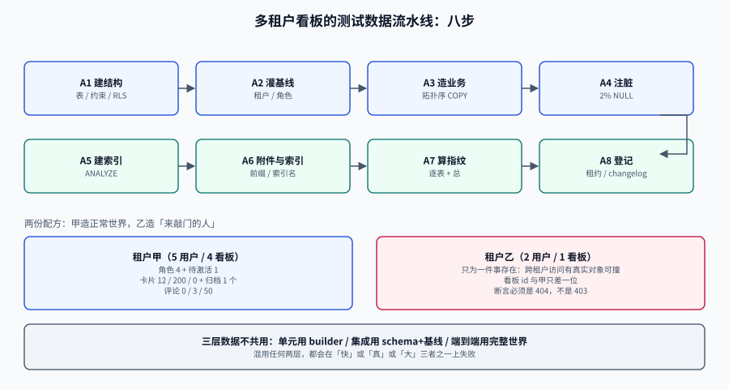
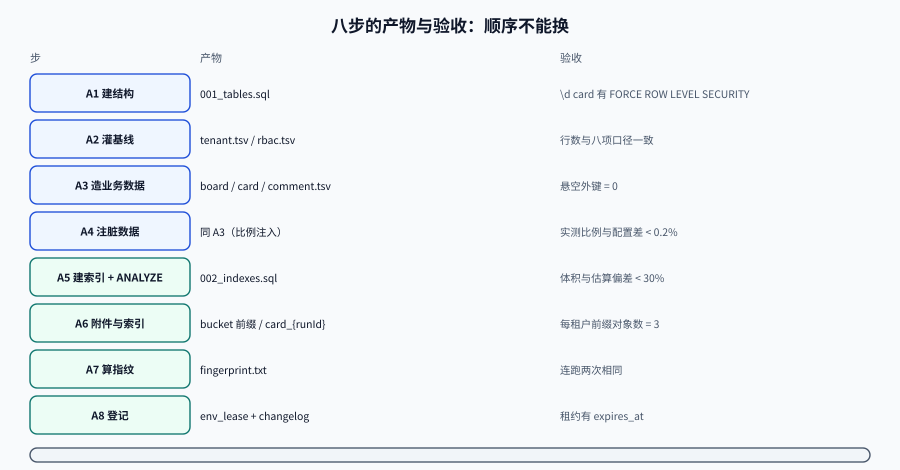

# 实战：给多租户看板搭一条测试数据流水线

<p style="text-align:center;"></p>

前面七页讲的是方法，这一页把它落到一个具体的系统上：**多租户在线协作看板**（本仓库 `project/Complete/TeamBoard` 实现的那个项目）。它的测试数据有三个特殊要求——**每个用例一个租户**、**跨租户越权必须可复现**、**附件与搜索索引也要隔离**——这三点决定了流水线的形状。

## 判据族声明

本页判据族 `TDP-A` ~ `TDP-H`，共 8 条。定义表在第十节。

## 一、先定口径（八项，全部写成数字）

| 口径 | 取值 | 为什么是这个数 |
| --- | --- | --- |
| 租户数 | 2 个基线（甲=正常、乙=边界）+ 每用例 1 个临时租户 | 跨租户矩阵需要「另一个租户」；临时租户保证用例互不干扰 |
| 每租户用户 | 甲 5 人（4 角色 + 1 待激活）、乙 2 人 | 四个角色才覆盖权限矩阵；待激活用于测「未接受邀请」分支 |
| 每租户看板 | 甲 3 个（含 1 个已归档）、乙 1 个 | 归档看板用于测列表过滤 |
| 每看板卡片 | 甲：12 / 200 / 0；乙：1 | 0 张测空态，12 张测常规，200 张测分页与 `v-memo` 边界 |
| 每卡片评论 | 甲：0 / 3 / 50 | 50 条用于测「折叠与游标分页」 |
| 附件 | 每租户 3 个（1 个 `pending`、1 个已确认、1 个超 25 MiB 被拒） | `pending` 与超限是两个独立分支 |
| 脏数据比例 | 2% `NULL`、0.5% 全角字符、1% 首尾空格 | 解析层容错必须被覆盖 |
| 种子 | `20261019`（进代码） | 任何机器复算结果一致 |

::: tip 口径必须写成数字的理由
「造一些用户和看板」不是口径，它没法验收。写成「甲 5 人、4 角色 + 1 待激活」，才能用一条 SQL 断言，也才能在数据集变更时判断「这次改动影响了哪些用例」。
:::

## 二、八步流水线



| 步 | 做什么 | 产物 | 验收 |
| --- | --- | --- | --- |
| **A1 建结构** | 建表、约束、RLS，不建索引 | `001_tables.sql` | `\d card` 有 `FORCE ROW LEVEL SECURITY` |
| **A2 灌基线** | 租户、角色、字典（`COPY`） | `/tmp/seed/tenant.tsv` 等 | 行数与口径一致 |
| **A3 造业务数据** | 按引用图拓扑序造看板/卡片/评论 | `/tmp/seed/*.tsv` | 悬空外键 = 0 |
| **A4 注入脏数据** | 按配置比例注入 `NULL`/全角/空格 | 同 A3 | 比例与配置一致（±0.2%） |
| **A5 建索引 + ANALYZE** | 建索引、更新统计信息 | `002_indexes.sql` | `pg_size_pretty` 与估算偏差 < 30% |
| **A6 附件与索引** | 对象存储前缀、搜索索引 | bucket `t/{tenant}/`、索引 `card_{runId}` | 每个租户前缀下对象数 = 3 |
| **A7 算指纹** | 逐表逻辑指纹 + 总指纹 | `/tmp/fingerprint.txt` | 连跑两次相同 |
| **A8 登记** | 写进 `env_lease` 与数据集 changelog | 一行租约、一条 changelog | 租约有 `expires_at` |

顺序不能换：**索引必须在灌数据之后建**（实测带索引 `INSERT` 比 `COPY` 慢 4.1 倍，见[数据工厂](../DataFactory/index.md)），**指纹必须在所有写入之后算**（否则算的是中间态）。

## 三、两份租户配方

### 租户甲（正常世界）

```yaml
# seed/spec/tenant-a.yaml
tenant: { id: "11111111-1111-7111-8111-111111111111", name: "甲科技" }
users:
  - { key: owner,   role: OWNER,   state: ACTIVE }
  - { key: admin,   role: ADMIN,   state: ACTIVE }
  - { key: member,  role: MEMBER,  state: ACTIVE }
  - { key: viewer,  role: VIEWER,  state: ACTIVE }
  - { key: pending, role: MEMBER,  state: PENDING }   # 未接受邀请
boards:
  - { key: b-normal,  cards: 12,  archived: false }
  - { key: b-large,   cards: 200, archived: false }    # 分页与 v-memo 边界
  - { key: b-empty,   cards: 0,   archived: false }    # 空态
  - { key: b-archive, cards: 5,   archived: true }     # 列表过滤
```

### 租户乙（越权与边界世界）

```yaml
# seed/spec/tenant-b.yaml
tenant: { id: "22222222-2222-7222-8222-222222222222", name: "乙公司" }
users:
  - { key: owner, role: OWNER, state: ACTIVE }
  - { key: other, role: MEMBER, state: ACTIVE }
boards:
  - { key: b-b1, cards: 1, archived: false }
# 乙的看板 id 与甲的某个看板 id 只差一位，用来测「同前缀不同租户」不会被误命中
overrides:
  - { field: board.id, pattern: "b-9f3*" }
```

乙的存在只有一个目的：**让「跨租户访问」这条用例有真实的第二个世界可撞**。没有乙，`XTM` 矩阵里那 18 格只能靠 mock 伪造，测不出 RLS 是否真的生效。

## 四、脱敏映射：测试库也要有假号段

即使是测试数据，也不该出现任何像真手机号的值——因为你无法保证某个开发者不会把它拷到别处。

```sql
-- 假号段约定：1990000 + 8 位，共 1 亿个号，足够单射
-- 本库所有手机号必须匹配 ^1990000[0-9]{8}$
CREATE DOMAIN fake_phone AS text
  CHECK (VALUE ~ '^1990000[0-9]{8}$');

ALTER TABLE "user" ALTER COLUMN phone TYPE fake_phone;
```

```sql
-- 生成：序列保证单射（实测随机 8 位在 10 万行时碰撞 64 次）
INSERT INTO "user" (id, tenant_id, phone, ...)
SELECT gen_random_uuid(),
       :'tenant_id',
       '1990000' || lpad(row_number() OVER (ORDER BY g)::text, 8, '0'),
       ...
FROM generate_series(1, :'user_count') g;
```

如果必须导入真实数据（例如做一次性的性能对比），走[数据脱敏](../DataMasking/index.md)的 `pii_map`：`src_hash = hmac(phone, salt)`，`dst_value` 由 `hmac` 派生，唯一约束保单射，回填用 join。

## 五、契约桩：三个下游，三份契约

| 下游 | 真实依赖 | 桩的形态 | 必须覆盖的异常 |
| --- | --- | --- | --- |
| 对象存储（预签名） | S3/MinIO | 契约生成（OpenAPI 片段） | 签名过期 `403`、桶不存在 `404`、超限 `413` |
| 邮件通知 | SMTP / 邮件服务 | 手写映射 + 内存收件箱 | 连接超时、收件人不存在 `550` |
| 搜索索引 | OpenSearch | 录制回放（真实查询录制一次） | 索引不存在、`429` 限流 |

三者的选择依据不同：对象存储有稳定契约（用契约生成）、邮件协议简单且无契约（手写）、搜索查询复杂且难写契约（录制）。

**验收一条**：把外网断开，集成测试必须仍能跑完。这是「依赖面隔离」的唯一硬判据。

## 六、测试分层与数据集对应

| 层 | 用什么数据 | 怎么建 | 时长目标 |
| --- | --- | --- | --- |
| 单元测试 | 用例夹具（builder，内存） | 代码内组装 | < 100 ms/用例 |
| 集成测试 | 独立 schema + 基线种子 | `@BeforeEach` 灌 baseline | < 2 s/类 |
| 端到端 | 完整世界（甲 + 乙 + 桩） | 一次起容器 + 全量 seed | < 60 s/套 |
| 压测 | 快照（100 万卡片） | 导出恢复 | 一次性 |

四层的数据**不共用**：单元测试用 builder 是为了快，端到端用真实库是为了真，压测用快照是为了大。混用任何两层，都会在某一维度上失败。

## 七、S1~S10 验收序列

```shell
# S1 结构就位：RLS 强制生效
psql "$DATABASE_URL" -Atc "select relrowsecurity, relforcerowsecurity from pg_class where relname='card'"
# 期望 t|t

# S2 基线行数与口径一致
psql "$DATABASE_URL" -Atc "select count(*) from board where tenant_id='11111111-1111-7111-8111-111111111111'"
# 期望 4（3 正常 + 1 归档）

# S3 卡片基数（200 张的看板存在）
psql "$DATABASE_URL" -Atc "select max(c) from (select count(*) c from card group by board_id) t"
# 期望 200

# S4 悬空外键为 0
psql "$DATABASE_URL" -Atc "
select count(*) from card c left join board b on b.id=c.board_id and b.tenant_id=c.tenant_id
where b.id is null"
# 期望 0（注意 join 带 tenant_id，才挡得住跨租户串）

# S5 假号段：无真手机号
psql "$DATABASE_URL" -Atc "select count(*) from \"user\" where phone !~ '^1990000[0-9]{8}$'"
# 期望 0

# S6 指纹稳定
./db/fingerprint.sh > /tmp/f1.txt && ./db/fingerprint.sh > /tmp/f2.txt
diff /tmp/f1.txt /tmp/f2.txt && echo "OK: stable"

# S7 跨租户越权返回 404（不是 403）
curl -s -o /dev/null -w "%{http_code}\n" \
  -H "Authorization: Bearer $TOKEN_A" -H "X-Tenant: 22222222-2222-7222-8222-222222222222" \
  http://localhost:8080/api/boards/b-normal
# 期望 404（跨租户必须 404，不能泄露「存在但无权」）

# S8 附件隔离：甲的前缀下只有甲的 3 个对象
aws --endpoint-url http://localhost:9000 s3 ls s3://tb-test/t/11111111-1111-7111-8111-111111111111/ --recursive | wc -l
# 期望 3

# S9 断网可跑：拔掉外网后集成测试仍通过
docker network disconnect bridge <app-container> && mvn -q -Dtest='*IT' test
# 期望 BUILD SUCCESS

# S10 清理归零
make clean-data && psql "$DATABASE_URL" -Atc "select count(*) from card"
# 期望 0
```

十条里 S7 最容易「测了个寂寞」：如果服务端返回 `403`，说明它先查到了资源再判权限，这本身就是信息泄露（攻击者能区分「存在」与「不存在」）。**跨租户一律 404**。

## 八、四条边界（本页刻意不做的事）

| 不做 | 原因 | 去哪看 |
| --- | --- | --- |
| 不重写权限矩阵 | `XTM` 已定义 18 格与四条 SQL | [跨租户矩阵](../../../../project/Complete/TeamBoard/CrossTenantMatrix/index.md) |
| 不重讲连接池串租户复现 | `PLP` 已给出五种形态与成本三档 | [连接池串租户](../../../../project/Complete/TeamBoard/PoolTenantLeak/index.md) |
| 不写压测脚本与 SLO | `LPG` 负责四场景与池层断言 | [压测与门禁](../../../../project/Complete/TeamBoard/LoadTestGate/index.md) |
| 不讲部署与密钥 | `DeployScripts` / `ConfigSecrets` 已覆盖 | [部署脚本](../../../../project/Complete/TeamBoard/DeployScripts/index.md) |

## 九、成本与收益（诚实版）

| 项 | 一次性成本 | 持续成本 | 收益 |
| --- | --- | --- | --- |
| 造数配置与生成器 | 3~5 人日 | 改字段时 0.5 人日 | 改数据结构不再改 40 处 `INSERT` |
| 脱敏映射 | 2 人日 | 复评每季度 0.5 人日 | 合规可举证 |
| 契约桩 | 3 人日（3 个下游） | 每次契约变更 0.5 人日 | 断网可跑，联调前发现不兼容 |
| 环境隔离 | 2 人日（compose + 租约） | 清理任务无人值守 | 新人 3 条命令跑起来 |

**收益不在「省时间」，在「减少无法解释的红」**。一个团队每周花 4 小时排查「重跑就过」的用例，一年 200 小时；这套东西的持续成本约 40 小时/年。

## 十、判据表

| 编号 | 约定 | 定错了会怎样 | 怎么验证 |
| --- | --- | --- | --- |
| `TDP-A` | 八项口径必须写成数字并落盘 | 「造一些数据」无法验收 | 口径文件里 8 行全为数字/枚举，无「若干」「适量」 |
| `TDP-B` | 基线至少两个租户，且各有独立看板 | 越权用例无法真实复现 | `select count(distinct tenant_id) from board` ≥ 2 |
| `TDP-C` | 每个用例用**临时租户**，不复用基线租户 | 用例间互相污染 | 测试代码里租户 id 由 `TenantFixture.newTenant()` 生成 |
| `TDP-D` | 手机号必须在假号段内（`1990000xxxxxxxx`） | 无法用一条 SQL 判「无真 PII」 | `select count(*) where phone !~ '^1990000[0-9]{8}$'` = 0 |
| `TDP-E` | 三层数据不共用（单元/集成/端到端） | 单元测试变慢或端到端不真 | 单元测试无数据库连接；端到端用容器 |
| `TDP-F` | 跨租户访问返回 **404** 而不是 403 | 泄露「资源存在」 | S7 断言 `404` |
| `TDP-G` | 断网后集成测试仍通过 | 依赖面没隔离 | 断开外网跑 `*IT` 全绿 |
| `TDP-H` | 清理必须归零且有断言 | 残留累积 | S10 的 `count(*)` = 0 |

## 十一、验证方式

见第七节 S1~S10。全部命令的前置条件：

- `DATABASE_URL` 指向一套**可销毁**的实例（Testcontainers 或本地容器），指向共享库时**不要跑** S10；
- S7 需要一个已启动的应用实例与两个租户的 token；
- S8 需要本地 MinIO（`localhost:9000`）；
- S9 会断开容器网络，跑完记得 `docker network connect bridge <app-container>`。

跑不了的项（例如本仓库不含工程代码，无法真的启动应用）在报告里标 `⏳` 并写原因，不标 ✅。

## 十二、参考资料

- 本项目相关章节：[跨租户矩阵](../../../../project/Complete/TeamBoard/CrossTenantMatrix/index.md)、[连接池串租户](../../../../project/Complete/TeamBoard/PoolTenantLeak/index.md)、[测试策略](../../../../project/Complete/TeamBoard/TestStrategy/index.md)
- Testcontainers 官方文档：<https://java.testcontainers.org/>
- PostgreSQL 18 文档：`ROW LEVEL SECURITY`、`CREATE DOMAIN`、`COPY`。
- 相关方法页：[数据工厂](../DataFactory/index.md)、[数据集版本化](../DatasetVersioning/index.md)、[契约仿真](../ContractSimulation/index.md)
