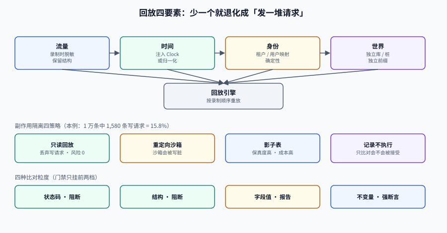

# 流量回放：重建一个能容纳这些请求的世界

<p style="text-align:center;"></p>

流量回放（Traffic Replay）把生产环境真实发生过的请求拿出来，在测试环境重放一遍，比较「改造前」与「改造后」的响应差异。

它听起来像「录制 + 播放」，实际难点全在另外三件事上：**时间**（请求里带着当时的时间语义）、**副作用**（回放会真的发短信、真的扣库存）、**数据状态**（当时的库存是 100，现在是 3）。

一句话概括：**回放不是重放请求，是重建一个能容纳这些请求的世界。**

## 判据族声明

本页判据族 `TDT-A` ~ `TDT-H`，共 8 条。定义表在第九节。

## 一、三个必失点

| 必失点 | 具体表现 | 后果 | 对策 |
| --- | --- | --- | --- |
| **时间** | 请求体里有 `created_at`、token 有过期时间、响应里有 `server_time` | diff 永远不相等，或请求被判定过期 | 时间注入 + 比对前归一化 |
| **副作用** | 回放触发真实发短信、扣库存、推消息 | 打扰真实用户、污染真实数据 | 写请求隔离（四种策略，见第四节） |
| **数据状态** | 请求 `GET /orders/o-1` 在当时存在，现在库里没有 | 大量 404，diff 全是噪音 | 快照同一时刻的数据，或按请求回填 |

三者里**副作用最危险**：它不是「结果不准」，而是「造成了真实影响」。所以回放的第一条纪律是：**在能证明副作用被隔离之前，只回放 GET。**

## 二、录制：三个采集点，一个原则

| 采集点 | 采什么 | 优点 | 缺点 |
| --- | --- | --- | --- |
| **入口**（网关 / 反向代理） | 完整 HTTP 请求 + 响应 | 最贴近用户视角，语言无关 | 看不到内部调用；响应可能已被压缩/加密 |
| **出口**（服务间调用） | 下游请求 + 响应 | 适合验证「改造后调用下游的方式变了没」 | 不含用户上下文，重放需要补 |
| **应用内**（中间件 / 拦截器） | 结构化请求对象 + 上下文（租户、用户） | 字段最全，易脱敏 | 与语言/框架绑定，性能开销 |

**一个原则：脱敏在录制时做，不在回放时做。**

回放时脱敏意味着「明文已经落盘过一次」，那一次就是泄露。录制侧就要：

- 请求头里的 `Authorization` / `Cookie` → 替换为占位符 + 映射表；
- 路径/查询里的手机号、邮箱、身份证 → 用与[数据脱敏](../DataMasking/index.md)相同的确定性映射；
- 请求体里的自由文本 → 按字段白名单保留，其余截断；
- **保留结构，替换值**：`{"phone":"19900001234"}` 而不是 `{"phone":"***"}`——后者会让「手机号格式校验」这类分支失效。

```json
{
  "trace_id": "5f3c...",
  "ts": "2026-10-18T09:12:33.412Z",
  "method": "POST",
  "path": "/api/boards/b-1/cards",
  "headers": { "authorization": "REDACTED:t-77", "x-tenant": "t-1" },
  "body": { "title": "设计评审", "assignee": "u-19900001234" },
  "status": 201,
  "resp_ms": 42
}
```

## 三、回放的四个要素

```text
回放 = 流量（已脱敏） + 时间（注入的时钟） + 身份（映射后的租户/用户） + 世界（隔离的写面）
```

少任何一个，回放就退化成「发一堆请求看会不会 500」。

**时间注入**的三种做法：

| 做法 | 说明 | 适用 |
| --- | --- | --- |
| **应用时钟注入** | `Clock` 由配置提供，回放时设为录制时刻 | 自研服务，最干净 |
| **请求时间改写** | 把请求里的时间字段按「录制时刻 → 回放时刻」平移 | 时间藏在业务字段里（如 `sign_time`） |
| **不注入，只归一化** | 接受时间不同，比对时剔除时间字段 | 快速验证「不崩」 |

第一种最好，第三种最省事但结论最弱。

## 四、副作用隔离：四种策略，按写请求比例选

先算一个数：**写请求占比**。

```shell
# 从录制文件统计（jq 示例）
jq -r '.method' traces/*.jsonl | sort | uniq -c | sort -rn
#   8420 GET
#   1180 POST
#    290 PUT
#    110 DELETE
```

示例数据：10,000 条里 **1,580 条是写请求（15.8%）**。这 1,580 条必须逐个决定怎么处理：

| 策略 | 做法 | 保真度 | 风险 | 适用 |
| --- | --- | --- | --- | --- |
| **只读回放** | 丢弃所有写请求 | 低（只验证读路径） | 无 | 第一次回放、读多写少的系统 |
| **重定向到沙箱** | 写请求发到沙箱环境/桩 | 中 | 沙箱状态被污染 | 有独立沙箱 |
| **影子表** | 写操作落在影子表，不碰主表 | 高 | 实现成本高（要改数据访问层） | 核心链路改造 |
| **记录不执行** | 写请求只比对「是否会被接受」（权限、校验），不真正落库 | 中 | 需要改造 | 权限/校验类改造 |

::: danger 「写请求发到沙箱」不是隔离
沙箱里的库存、余额、订单状态也是共享的。A 团队回放把库存扣到 0，B 团队回放时全是「库存不足」。
真正的隔离是**每次回放一套独立的世界**（独立库 + 独立桩 + 独立对象存储前缀），或者**根本不写**。
:::

## 五、比对：四种粒度，从粗到细

| 粒度 | 比什么 | 能发现 | 噪音 |
| --- | --- | --- | --- |
| **状态码** | 2xx/4xx/5xx 是否一致 | 大面积故障 | 极低 |
| **结构** | JSON schema 是否一致（字段有无、类型） | 字段被删/改名/类型变化 | 低 |
| **字段值** | 逐字段 diff（归一化后） | 业务逻辑变化 | 中（时间、ID、排序） |
| **不变量** | 金额守恒、状态迁移合法、计数一致 | 逻辑错误（即使字段值不同） | 极低 |

**建议组合：状态码 + 结构作为阻断门禁，字段值作为报告，不变量作为强断言。** 只比字段值会被噪音淹没，只比状态码等于没比。

字段值 diff 的噪音来源与归一化：

| 噪音来源 | 例子 | 归一化 |
| --- | --- | --- |
| 时间戳 | `"updatedAt": "2026-10-18T09:12:33Z"` | 替换为 `<TS>` |
| 自增 ID | `"id": 10423` | 按映射表替换为占位符 |
| 排序不稳定 | 列表顺序不同 | 按业务键排序后比较 |
| 精度 | `12.30` vs `12.3` | 数值统一 `BigDecimal` 比较 |
| 浮点误差 | `0.1+0.2` | 容差比较 |
| 随机 token | `"traceId": "..."` | 替换为 `<TRACE>` |

## 六、放量：三档，每档有明确判据

| 档 | 流量比例 | 时长 | 通过判据 | 不通过怎么办 |
| --- | --- | --- | --- | --- |
| 观察 | 1%（约 100 条） | 10 分钟 | 5xx 差异 = 0，结构差异 = 0 | 看具体请求，修完再放 |
| 验证 | 10%（约 1,000 条） | 30 分钟 | 字段差异率 < 0.5%，无新增 5xx | 分析差异分类，判断是预期变更还是缺陷 |
| 收口 | 50%（约 5,000 条） | 1 小时 | 不变量全部成立，延迟 P99 差异 < 20% | 回退，定位性能回归 |

**延迟差异也要比**：回放不只是「结果对不对」，还是「快不快」。改造后 P99 从 80 ms 涨到 400 ms，结果全对也是失败。

## 七、什么时候不值得做回放

| 场景 | 原因 | 更好的做法 |
| --- | --- | --- |
| 没有生产流量（新产品） | 没得录 | 用[数据工厂](../DataFactory/index.md)造 + [契约仿真](../ContractSimulation/index.md)桩 |
| 请求里没有足够上下文（如全靠 cookie 会话） | 重放时身份丢失 | 先补上下文透传，或改用入口录制 |
| 写请求占比 > 60% | 隔离成本极高 | 只回放读路径，写路径用影子表专项 |
| 团队 < 5 人、系统 3 个接口 | 建设成本远超收益 | 端到端测试 + 契约测试足够 |

回放的成本主要是**隔离设施**（影子表、独立世界）和**噪音治理**（归一化规则维护）。前者一次性，后者持续。**噪音治理是回放项目最容易烂尾的地方**：归一化规则越加越多，最后没人敢改。

## 八、一个最小可跑的流程

```shell
# 1) 采集（网关侧，已脱敏；这里用文件模拟）
#    traces/2026-10-18.jsonl  每行一条 {method,path,headers,body}

# 2) 统计写请求占比
total=$(wc -l < traces/2026-10-18.jsonl)
writes=$(jq -r 'select(.method != "GET") | .method' traces/2026-10-18.jsonl | wc -l)
echo "write_ratio=$writes/$total"

# 3) 只回放 GET（第一档，安全）
jq -c 'select(.method == "GET")' traces/2026-10-18.jsonl \
  | head -100 \
  | while read -r line; do
      path=$(echo "$line" | jq -r '.path')
      curl -s -o /dev/null -w "%{http_code} $path\n" "http://localhost:8080$path"
    done | sort | uniq -c | sort -rn | head

# 4) 与录制时的状态码比对
jq -r 'select(.method == "GET") | "\(.status) \(.path)"' traces/2026-10-18.jsonl \
  | head -100 | sort | uniq -c | sort -rn | head
# 两段输出的分布应当一致；差异行逐条排查
```

## 九、判据表

| 编号 | 约定 | 定错了会怎样 | 怎么验证 |
| --- | --- | --- | --- |
| `TDT-A` | 脱敏必须在**录制时**完成 | 明文落盘即泄露 | 录制文件里手机号正则命中 0 |
| `TDT-B` | 首次回放**只放 GET** | 真实副作用（短信、扣款） | 回放脚本里有 `method == "GET"` 过滤 |
| `TDT-C` | 写请求必须逐条声明隔离策略 | 沙箱被写脏、别人回放全红 | 写请求清单里每条有 `strategy` 字段，空值为 0 |
| `TDT-D` | 时间必须可注入或可归一化 | diff 全是噪音 | 比对报告里时间字段已替换为 `<TS>` |
| `TDT-E` | 比对必须分四档，且门禁只用前两档 | 噪音淹没真缺陷 | 报告里有状态码/结构/字段/不变量四段，门禁挂在第 1、2 段 |
| `TDT-F` | 放量必须三档，每档有数值判据 | 一次全量，出问题无法定位 | 放量记录里有三行（1%/10%/50%）与对应判据 |
| `TDT-G` | 延迟必须一起比 | 结果对但慢 5 倍也算失败 | 报告含 P50/P99 差异，阈值写明 |
| `TDT-H` | 归一化规则必须有版本与 owner | 规则越加越多，无人敢改 | 规则文件有 `version` 与 `owner`，git 历史可追 |

## 十、验证方式

```shell
# 1) 录制文件已脱敏
grep -cE '1[3-9][0-9]{9}' traces/*.jsonl || echo "OK: no raw phone"

# 2) 写请求比例（决定隔离成本）
total=$(cat traces/*.jsonl | wc -l)
writes=$(cat traces/*.jsonl | jq -r 'select(.method != "GET") | .method' | wc -l)
echo "write_ratio=$(echo "scale=3; $writes/$total" | bc)"

# 3) 只读回放无 5xx
... | grep -c '^5' || echo "OK: no 5xx"

# 4) 归一化后 diff 为空（同一版本回放两次）
./replay --traces traces/ --target http://localhost:8080 --out /tmp/r1.json
./replay --traces traces/ --target http://localhost:8080 --out /tmp/r2.json
diff <(normalize /tmp/r1.json) <(normalize /tmp/r2.json) && echo "OK: deterministic"
```

第 4 条是**自证**：同一个版本回放两次，归一化后的结果必须完全一致。如果不一致，说明世界没被完全隔离（时间、随机、数据状态至少有一个在漂）。

## 十一、参考资料

- Google SRE Workbook 中关于「影子流量与比对」的章节（canary / shadow 的取舍）。
- k6 文档：把回放流量转成压测脚本的做法（`k6 convert`）：<https://grafana.com/docs/k6/latest/>
- 数据库影子表方案参见本仓库[数据库中间件 · 影子库](../../../DB/Middleware/ShadowDatabase/index.md)。
- 相关页：[契约仿真](../ContractSimulation/index.md)（没有流量时的替代路线）、[数据脱敏](../DataMasking/index.md)（录制侧的映射）、[环境隔离](../EnvironmentIsolation/index.md)（独立世界怎么搭）
