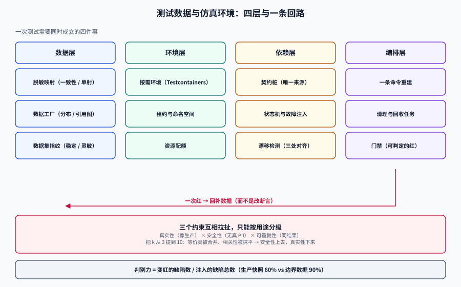

# 测试数据与仿真环境

测试数据与仿真环境（Test Data & Simulation Environment）要解决的问题只有一句：**让一次测试跑在一个「刚好能证明这次改动是错的」的状态上，并且这个状态明天还能一模一样地重建出来。**

这句话里有两个容易被略过的词。「刚好」指的是**判别力**——数据必须落在判据的边界上，否则测了一万次也不知道改对没改对；「一模一样」指的是**可重复性**——同一个提交在本地、在 CI、在同事机器上跑出三种结果，那这套测试就已经不再是测试，而是抽样调查。

绝大多数团队的测试数据是「从生产捞一份、导入测试库」：第一天很好用，三个月后没人知道那份数据是哪天的、里面有没有真实手机号、为什么某个用例在数据变多之后开始随机失败。本专题要给的是一套**按用途分级、按指纹固定、按失败面隔离**的做法：数据是被**设计**出来的，环境是被**声明**出来的，依赖是被**仿真**出来的。

## 与相邻专题的分工

| 专题 | 负责什么 | 与本专题的边界 |
| --- | --- | --- |
| 本专题 | **测试数据的生成、脱敏、版本化，环境的隔离与声明，外部依赖的仿真，流量的录制与回放** | —— |
| [测试工具 · 概述](../../Tools/TestingTools/Overview/index.md) | JMeter / Selenium / 接口自动化的工具选型与用法 | 那边回答「用什么跑」；本专题回答「**跑在什么数据上**」 |
| [项目交付 · 测试](../../Others/ProjectDelivery/Testing/index.md) | 测试分层、覆盖率门禁、flaky 治理、CI 门禁清单 | 那边给**策略**；本专题给策略落地时缺的那一层**状态供给** |
| [数据库中间件 · 影子库](../../DB/Middleware/ShadowDatabase/index.md) | 影子库/影子表做全链路压测时的流量透传与数据隔离 | 那边是**生产流量的旁路复制**；本专题是**造出来的、可提交进仓库的**测试状态 |
| [数据治理](../../DB/DataGovernance/index.md) | 元数据、血缘、质量规则、分级分类 | 分级分类的**标准**归那边；把分级**变成可执行的脱敏规则**归本专题 |
| [AI 安全与合规 · 数据最小化](../../AI/AISecurityCompliance/DataMinimization/index.md) | 采集最小化、留存期限、跨境 | 那边管**真实数据的生命周期**；本专题管**派生数据**（测试库里那一份） |
| [CI/CD · 自动化测试与质量门禁](../../Tools/CICD/Testing/index.md) | 流水线阶段划分、并行与缓存、门禁挂载点 | 那边是**流水线骨架**；本专题是流水线里那个「准备数据、拉起依赖」的**步骤** |
| [容器编排](../../Ops/ContainerOrchestration/index.md) | 镜像、调度、资源与网络 | 那边讲**怎么把容器跑起来**；本专题讲**什么时候该为一次测试拉起一套** |
| [API 设计](../../Tools/APIDesign/index.md) | 契约风格、版本、错误码 | 契约的**写法**归那边；本专题用契约**生成仿真服务**并检测漂移 |
| [项目实战 · TeamBoard 测试策略](../../../project/Complete/TeamBoard/TestStrategy/index.md) | 具体项目的测试分层与用例组织 | 那边的**数据配方**引用本专题的方法，不重复定义 |

::: tip 一句话理解
测试数据工程的产出不是「一堆数据」，而是**一个可被版本控制、可被判据检验、可被一键重建的状态**。
判断一份测试数据好不好，只有一个标准：**把它换成另一份，会不会有测试从绿变红**。不会变的那些测试，其实什么都没测。
:::

## 专题导航

- [总览：三个约束与四层结构](./Overview/index.md)：真实性 / 安全性 / 可重复性为什么互相拉扯、四层各管什么、五种失败模式、五步决策
- [数据脱敏：从「打码」到可评估的去标识](./DataMasking/index.md)：六类算法、k-匿名与等价类、GB/T 42460 的四级、一致性脱敏与引用完整性
- [数据工厂：把「造数」写成可复算的程序](./DataFactory/index.md)：四层生成器、分布与相关性、确定性种子、引用图与体量估算
- [数据集与夹具的版本化](./DatasetVersioning/index.md)：三类数据、数据集指纹、快照与迁移、清理责任、共享夹具的反模式
- [环境隔离：让失败不越界](./EnvironmentIsolation/index.md)：四层隔离、按需环境、租约与命名空间、三档数据隔离的成本账
- [契约仿真：stub 与真实服务的漂移怎么收口](./ContractSimulation/index.md)：四种 stub 形态、状态机桩、故障注入、三处对齐与漂移检测
- [流量回放：重建一个能容纳这些请求的世界](./TrafficReplay/index.md)：录制点、脱敏、时间与随机、副作用隔离、四种比对
- [实战：给多租户看板搭一条测试数据流水线](./Practice/index.md)：八步流水线、两份租户配方、映射表、S1~S10 验收序列
- [常见问题与最佳实践](./FAQ/index.md)：十类症状分诊、十二问、上线自查十四项、术语表

## 按症状找页面

| 你遇到的现象 | 大概率先看 |
| --- | --- |
| 测试库里有真实手机号，安全扫描报了一堆 | [数据脱敏](./DataMasking/index.md) 的「一致性脱敏」与「引用完整性」 |
| 同一个用例本地过、CI 挂，重跑又过 | [数据集与夹具的版本化](./DatasetVersioning/index.md) 的「四个隐藏变量」 |
| 造数脚本写了 800 行，改一个字段要改五处 | [数据工厂](./DataFactory/index.md) 的「四层生成器」 |
| 新人入职三天还没把环境跑起来 | [环境隔离](./EnvironmentIsolation/index.md) 的「按需环境」 |
| 上游改了字段，我们的 mock 还返回老结构 | [契约仿真](./ContractSimulation/index.md) 的「漂移检测」 |
| 回放了生产流量，结果把测试库写脏了 | [流量回放](./TrafficReplay/index.md) 的「副作用隔离」 |
| 覆盖率 80%，线上照样出问题 | [总览](./Overview/index.md) 的「判别力」与 [数据工厂](./DataFactory/index.md) 的「边界优先」 |
| 不知道该不该上 Testcontainers | [环境隔离](./EnvironmentIsolation/index.md) 的「三档成本账」 |

## 全专题的判据纪律

本专题十页共 **72 条判据**，每页 8 条，逐页独立前缀。判据只回答三件事：**约定是什么 / 定错了会怎样 / 怎么验证它没被破坏**。`index.md` 不设判据族。

| 页面 | 判据族 | 覆盖的约定 | 条数 |
| --- | --- | --- | --- |
| 总览 | `TDO-A` ~ `TDO-H` | 三约束不破、分层不越界、失败模式有对策 | 8 |
| 数据脱敏 | `TDM-A` ~ `TDM-H` | 按用途分级、关联保持不变、可评估可复评 | 8 |
| 数据工厂 | `TDF-A` ~ `TDF-H` | 种子确定、分布有据、引用图闭合 | 8 |
| 数据集版本 | `TDS-A` ~ `TDS-H` | 指纹可算、变更可追、清理有主 | 8 |
| 环境隔离 | `TDE-A` ~ `TDE-H` | 声明式、可回收、资源有界 | 8 |
| 契约仿真 | `TDC-A` ~ `TDC-H` | 契约唯一来源、桩可判定、漂移可见 | 8 |
| 流量回放 | `TDT-A` ~ `TDT-H` | 录制已脱敏、时间可注入、副作用被隔离 | 8 |
| 实战 | `TDP-A` ~ `TDP-H` | 配方可复算、验收可执行、越权可复现 | 8 |
| 常见问题 | `TDQ-A` ~ `TDQ-H` | 分诊可执行、口径不混用、自查可机器判 | 8 |

::: warning 为什么判据一律写成「可验证」而不是「最佳实践」
「测试数据要真实」这种话没法判对错——真实的定义随场景变。「数据集必须能由 `make seed` 在 90 秒内重建，且两次构建的 SHA-256 相同」就能判。
本专题每一页的「如何验证」都区分两类命令：**仓库内可静态执行**（`grep` / `jq` / `sha256sum` / `sqlite3` / `psql` 等）与**需要运行时**（起容器、压测、回放），后者一律写明前置条件，跑不了的标 `⏳` 并写原因，不把期望值抄进实测列。
:::

## 事实与口径速览（2026-10 核对）

| 事实 | 口径 | 对本专题的意义 |
| --- | --- | --- |
| GB/T 42460-2023《信息安全技术 个人信息去标识化效果评估指南》 | **2023-10-01 实施**；把可识别性分 **4 级**；定性（是否含直接标识符）+ 定量（k-匿名或差分隐私算重标识风险）两步定级 | 「脱敏做完了」不是一句话，是一个**分级结论**；本专题的脱敏页按这四级组织验收 |
| 中国互联网协会《匿名化技术应用指南》 | 匿名化程度 = **k 最小值 × 场景系数 × 环境系数 ≥ 1**；组织内部共享 k 可低至 3，对外共享建议 **k ≥ 5** | 给出「k 该取多少」的可算依据，不再凭感觉 |
| Testcontainers for Java | **2.0.0 于 2025-10-14 发布，2.0.5 于 2026-04-20**；1.x 最后一版为 1.21.4（2025-12-16） | 按需环境的主流实现；2.x 与 1.x 的 API 有差异，升级要按迁移说明走 |
| Microcks | **2026-05-07 晋升 CNCF Incubating**；1.15.0 于 2026-08-05 发布；支持 OpenAPI / AsyncAPI / gRPC / GraphQL / Postman / SoapUI 六类制品 | 契约仿真的「规格驱动」路线，桩与一致性测试共用同一份制品 |
| WireMock | 稳定线为 3.x；**4.x 处于 beta**，新增消息框架（当前支持 WebSocket mock） | 「请求匹配」路线；4.x 的消息仿真不要用在关键路径上 |
| k6 | **2.0.0 于 2026-05-11 GA，2.3.0 于 2026-09-21**；1.8.2（2026-10-12）仍在打补丁；AGPL-3.0；`thresholds` 不达标时进程退出码非零 | 压测数据的体量与回放比例都由它承载，门禁靠退出码 |
| 判据族前缀 | 本专题用 `TD*` 九族；全库已占用前缀中无 `TD` 开头 | 避免与 `TD`（若他处使用）撞号造成读者误读 |

::: danger 三条会静默失效的坑（本专题反复出现）
1. **「脱敏了」但关联断了**：`user.id` 做了随机替换、`order.user_id` 没换，或换了但两边盐不同——查询不报错，只是「这个用户的订单查不到」。脱敏的第一条不是「不可逆」，是**同一实体的所有出现必须映射到同一个值**。
2. **「造数用了随机」于是不可复现**：`new Random()` 不设种子，失败用例无法重放，别人复现不了只能猜。随机不是问题，**不可复现的随机**才是问题。
3. **「环境隔离了」但依赖没隔离**：数据库独立、Redis 独立，可上游支付网关还是共用的沙箱——A 的用例把沙箱里的订单状态改了，B 的用例立刻红。隔离要按**写的传播面**算，不是按「我们分了几个库」算。
:::

## 学习路径

1. 先读[总览](./Overview/index.md)，把「真实性 / 安全性 / 可重复性」三角和四层结构记住——后面八页都在解这个三角里的某一个角。
2. 再做[数据脱敏](./DataMasking/index.md)：只要库里有真实个人信息，这就是唯一有**合规截止日**的一件事，优先级高于一切「更好用」。
3. 然后[数据工厂](./DataFactory/index.md) + [数据集版本化](./DatasetVersioning/index.md)：这两页合起来才构成「可重建」。
4. 有外部依赖的团队接着读[契约仿真](./ContractSimulation/index.md)，有生产流量的团队再读[流量回放](./TrafficReplay/index.md)——顺序不要反，回放的成本是仿真的十倍。
5. 最后按[实战](./Practice/index.md)的 S1~S10 走一遍，用[常见问题](./FAQ/index.md)的自查表收口。

## 参考资料

- GB/T 42460-2023《信息安全技术 个人信息去标识化效果评估指南》，2023-10-01 实施。
- GB/T 37964-2019《信息安全技术 个人信息去标识化指南》（标识符识别方法的出处）。
- 中国互联网协会《匿名化技术应用指南》（2024-07）与《匿名化技术互联网应用指南》（2025-07）。
- Testcontainers for Java 官方文档：<https://java.testcontainers.org/>
- Microcks 官方文档：<https://microcks.io/documentation/>
- WireMock 官方文档（含 4.x beta 的消息框架）：<https://wiremock.org/docs/>
- Grafana k6 文档（thresholds / scenarios）：<https://grafana.com/docs/k6/latest/>
- 《欧盟通用数据保护条例》(GDPR) 第 4(5) 条「假名化」定义，用于对照理解「去标识 ≠ 匿名化」。
