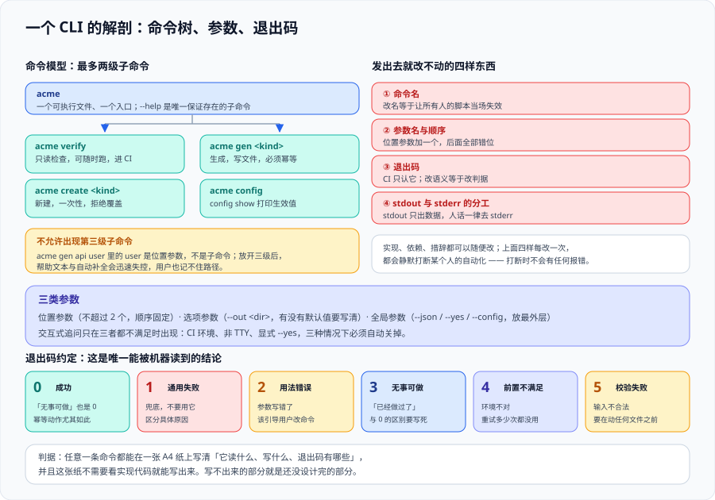

# CLI 设计：命令模型与用户体验



这一页讲的是**命令一旦发出去就改不动的那一层**：命令名、参数名、退出码、stdout 与 stderr 的分工。功能可以后加、实现可以重写、输出措辞可以随便改，但这四样东西**每一次改动都会打断某个人的自动化**，而且打断是静默的。

::: tip 一句话定位
CLI 设计不是「怎么把功能做得更全」，而是**「怎么让第一次用它的人和第一百次用它的人都不出错」**——前者靠帮助与默认值，后者靠稳定的参数名、可预测的退出码和机器可读输出。
:::

## 一、命令模型：先定「动词 × 名词」的骨架

命令行有两种通用的组织方式，**必须先选一种并坚持到底**，混用是新人最大的困惑源。

| 模型 | 形态 | 适合 | 例子 |
| --- | --- | --- | --- |
| **动词优先** | `tool <verb> [noun]` | 工具做的事不多，但**对象种类多** | `git commit`、`docker run` |
| **名词优先** | `tool <noun> <verb>` | 对象种类少，但**每个对象上的动作多** | `kubectl get pod`、`aws s3 cp` |

**判据**：问自己「新人问的是『怎么创建一个服务』还是『服务能做哪些事』」。前者是动词优先，后者是名词优先。

**子命令深度上限是两层**（`tool a b`），第三层就说明该拆成两个工具或改用参数。理由很直接：`--help` 的可发现性随深度断崖下降，而**没人会 `--help` 三层**。

::: danger 踩坑：把「名词」写成了动词的宾语
一个常见的错误形态是 `tool create-service`、`tool delete-service`、`tool list-services`——**命令数随对象种类线性增长，而每个命令里的逻辑几乎一样**。十几个之后，帮助输出的第一屏全是重复内容，用户找不到东西。

正确做法是把对象提出来：`tool service create` / `tool service list`。**代价是要改一次命令名（破坏性变更），所以这件事必须在第一版做对**。
:::

## 二、三个参数族：位置参数、选项、标志

| 族 | 形态 | 数量上限 | 规则 |
| --- | --- | --- | --- |
| **位置参数**（argument） | `tool copy <src> <dst>` | **最多 2 个** | 超过 2 个必有人记错顺序 |
| **选项**（option，带值） | `--out ./dist` | 不限 | 必须有长名；短名只给最高频的 3~5 个 |
| **标志**（flag，不带值） | `--dry-run` | 不限 | 不要用 `--no-x` 之外的双重否定；不要在补充说明里用 `--no-` 前缀表达「关闭 X」，因为你会同时需要「开启 X」 |

**四条硬规则**：

1. **每一个选项都要有长名**（`--output`），短名（`-o`）是可选优化。理由是脚本与文档里长名可读，且长名基本不会撞车。
2. **不要用「位置参数 + 可选」的组合**。`tool build [target]` 这种写法在脚本里极难判断意图；改成 `--target`。
3. **布尔标志要有明确默认值并写进帮助**。`--verbose` 与 `--quiet` 并存时，**必须定谁优先**（推荐：后出现者生效，或直接互斥报错）。
4. **参数校验发生在解析阶段，报错必须指明「哪一项、为什么、怎么改」**。

```shell
# 反例：报错只说「参数无效」，用户不知道改哪
$ my-tool build --env prd
error: invalid value

# 正例：三项齐全（哪一项 / 为什么 / 怎么改）
$ my-tool build --env prd
error: --env 的取值无效：「prd」
  期望：dev | staging | prod
  你可能是想写：prod
```

## 三、帮助文本：这是唯一的「说明书」

`--help` 是用户唯一一定会看到的东西。**没有 `--help` 的 CLI 等于没有文档**。

一个够用的帮助必须包含五块，顺序固定：

| 块 | 内容 | 常见缺失 |
| --- | --- | --- |
| ① 一句话做什么 | 第一行，不超过 80 字符 | 直接开始列参数 |
| ② 用法（usage） | 命令形态，**可选部分用 `[]`、互斥用 `\|`** | 写成一行巨长的伪代码 |
| ③ **可复制的最小示例** | 2~3 条真实命令 | **最常见缺失**——用户是靠抄示例学会的 |
| ④ 参数清单 | 每项：名称、默认值、取值、是否必填 | 缺默认值 |
| ⑤ **退出码表** | 每个码的含义 | 几乎所有人都漏这一块 |

::: tip 为什么退出码表必须写进 `--help`
因为**读 `--help` 的人正是写自动化脚本的人**。把退出码藏在 README 第三页，等于逼人靠猜；而猜错的代价是脚本在错误分支上继续往下跑。本页判据 `CD-B` 就判这一条。
:::

## 四、交互：必须能关掉

交互提问对人是友好的，对脚本是致命的。**判据只有一条：任何交互都必须能被参数或环境变量完全替代。**

```js
// scripts/lib/isInteractive.mjs
// 作用：判断「当前是否可以安全地提问」
// 三重条件缺一不可：不是 CI、有 TTY、没有被 --yes 关掉
export function isInteractive({ ci = process.env.CI, tty = process.stdout.isTTY, yes = false } = {}) {
  // 1) CI 环境一律不提问：CI 里提问的结局是挂住 30 分钟然后超时
  if (ci) return false
  // 2) 输出被重定向（管道/文件）时不提问：提问内容会混进 stdout
  if (!tty) return false
  // 3) 用户显式要求「全部用默认值」
  if (yes) return false
  return true
}
```

```shell
# 验证三态（期望依次输出 false / false / false）
CI=1 node -e "import('./scripts/lib/isInteractive.mjs').then(m=>console.log(m.isInteractive()))"
node -e "import('./scripts/lib/isInteractive.mjs').then(m=>console.log(m.isInteractive({tty:false}))"
```

**预期输出**：两行都是 `false`。
**第三条验证**（TTY 下但要求非交互）：

```shell
my-tool create --name demo --yes ; echo "退出码=$?"
# 预期：全程无提问，退出码 0（说明 --yes 真的把交互关掉了，而不是「跳过了提问」）
```

::: danger 踩坑：在「非交互」时用默认值**静默**继续
比「挂住」更糟的是「静默用默认值」。CI 里跑 `my-tool deploy`，因为不是 TTY，工具自动选了 `--env dev` 并把 dev 部署了一遍——**退出码 0，日志正常**。

正确做法：**当「本该问的问题」没有答案时，是失败而不是取默认值**。只有两种情况可以用默认值：① 该选项有语义上安全的默认值（如 `--out ./dist`）；② 用户显式传了 `--yes`。判断标准是「猜错的后果能不能撤销」。
:::

## 五、输出：stdout 是数据，stderr 是人话

这一条是本专题最容易被违反、代价最大的约定。

| 流 | 只放什么 | 谁在消费 |
| --- | --- | --- |
| `stdout` | **结果数据**：JSON、文件路径、机器可读文本 | 管道与脚本 |
| `stderr` | 进度、日志、警告、**提问**、人类可读的摘要 | 人的眼睛 |

```shell
# 判据：--json 模式下 stdout 必须能直接被解析
my-tool list --json > out.json 2> err.log
jq -e '.items | length' out.json ; echo "jq 退出码=$?"
head -3 err.log   # 进度与提示在这里
```

**预期输出**：`jq` 退出码 0 并打印条数；`err.log` 里有进度文字。

`--json` 的三条附加约定：

1. **结构化输出必须优先于人类可读输出的升级**——加字段可以，删字段/改名/改类型都不行（见[总览](../Overview/index.md)的契约表）。
2. **`--json` 时不允许出现彩色转义序列**，即使 stderr 是 TTY。
3. **错误也要有结构**：`{"code":"ENOENT","message":"...","hint":"..."}`，这样脚本既能读退出码也能读 `code`。

## 六、退出码：只新增，不改义

退出码是**自动化唯一可靠的判据**（比解析输出可靠得多）。一套够用的约定如下，**照抄即可**：

| 码 | 含义 | 脚本该怎么做 |
| --- | --- | --- |
| `0` | 成功（含「无事可做」？**不含**，见下） | 继续 |
| `1` | 通用失败（未分类错误） | 报错停止 |
| `2` | **用法错误**（参数非法、缺必填） | 修脚本 |
| `3` | **无事可做**（幂等命中、全部跳过） | 继续，但可提示 |
| `4` | 前置条件不满足（缺依赖、缺权限、目标不存在） | 补前置 |
| `5` | 校验失败（生成的产物没通过检查） | 停止，看报告 |

::: danger 踩坑：把「无事可做」当成成功
`0` 同时表示「做成了」和「啥也没做」时，调用方就无法区分二者。典型后果：CI 里 `my-tool version` 在没有待发布变更时返回 0，于是**发布流水线照常走到「推送制品」那一步**，推了一个空东西上去。

Changesets 3.0 修的就是这一类问题：`changeset version` 在**没有未发布变更时改为退出码 1**（3.0 之前是静默 0）。这个改动的破坏性在于——**任何无条件执行它、且开了 `set -e` 的发布脚本都会在空发布时变红**。

```shell
# 验证你的工具是否会区分这两个状态
my-tool version ; echo "有变更时=$?"
my-tool version ; echo "无变更时=$?"   # 第二次期望非 0
```
:::

## 七、配置来源的优先级要写进 `--help`

CLI 的配置至少来自四处。**优先级必须定死并写在 `--help` 里**，否则「我明明在哪哪配了」会成为长期争论。

推荐顺序（从高到低）：**命令行参数 → 环境变量 → 项目配置文件 → 用户级配置文件 → 内置默认值**。

```text
配置优先级（--help 里原文照抄）
  1. 命令行参数        例如 --env prod
  2. 环境变量          例如 MYTOOL_ENV=prod
  3. 项目配置          例如 ./.mytoolrc（从当前目录逐级向上找）
  4. 用户配置          例如 ~/.config/mytool/config.toml
  5. 内置默认值        见各选项的 [default: ...]
显示当前生效值：my-tool config show
```

**必须有 `config show`**（或等价子命令）来打印「每一项最终来自哪一层」。没有它，排查「为什么行为和配置不一样」就只能靠猜。

## 八、验证方式

```shell
# 1) 帮助是否可用：10 秒内能看到示例与退出码表
my-tool --help | head -30
my-tool --help | grep -cE '示例|Examples'      # 期望 ≥ 1
my-tool --help | grep -cE '退出码|Exit'         # 期望 ≥ 1

# 2) stdout/stderr 分工
my-tool list --json >out.json 2>err.log && jq -e . out.json >/dev/null ; echo "jq=$?"
grep -q '正在' err.log && echo "进度在 stderr（正确）"

# 3) 非交互模式真的关掉了交互
my-tool create --name demo --yes </dev/null ; echo "非交互退出码=$?"   # 期望 0

# 4) 退出码语义：用法错误必须是 2
my-tool build --env notexist ; echo "用法/取值错误=$?"   # 期望 2 或 4，且与 --help 的退出码表一致
```

**预期输出**：①②③④ 四组命令的退出码与 `--help` 里声明的退出码表**逐条一致**。任何不一致说明退出码表是「写着好看」的，不是契约。

## 九、判据清单

| 判据 | 内容 | 怎么验证 |
| --- | --- | --- |
| `CD-A` | 命令模型（动词优先 / 名词优先）事先选定并全线一致，子命令不超过两层 | `my-tool --help` 的顶层列表里同类动作成组出现，且没有 `tool a b c` 形态 |
| `CD-B` | `--help` 五块齐全（一句话、usage、可复制示例、参数含默认值、**退出码表**） | `my-tool --help` 里 `grep` 到示例与退出码两节 |
| `CD-C` | 位置参数不超过 2 个；每个选项都有长名；布尔选项声明了优先级 | 手工点数 `usage` 里的必填位置参数 |
| `CD-D` | 任何交互都能被参数或环境变量完全替代；CI 与重定向下不提问 | `CI=1 my-tool ... < /dev/null` 不挂起，且完成全部动作 |
| `CD-E` | 本该提问而没有答案时为失败，不静默取默认值（除非用户显式 `--yes`） | 非 TTY 下缺必填项，退出码非 0 且 stderr 说明缺哪项 |
| `CD-F` | stdout 只放数据、stderr 放人话；`--json` 模式下 stdout 可直接解析且无色码 | `my-tool ... --json > out.json` 后 `jq -e . out.json` 退出码 0 |
| `CD-G` | 退出码只新增不改义，且 `0` 与「无事可做」区分开 | 连续两次执行同一命令，第二次「无事可做」时退出码与首次不同 |
| `CD-H` | 配置五层优先级写进 `--help`，且提供 `config show` 打印每项来源 | 在四层各设一个不同值，`config show` 的输出与声明的优先级一致 |

## 十、与相邻专题的分工

- **本页讲「命令长什么样、退出码怎么定」**；[CLI 工程化](../CliImplementation/index.md) 讲用什么语言写、依赖怎么控、怎么测与发布。
- 本页讲的多数约定与 [Command Line Interface Guidelines](https://clig.dev/) 一致；**分歧处一律以「脚本可消费」为优先**（例如可读性 vs 结构化输出冲突时，选结构化）。
- 生成的**目录结构**归 [脚手架](../Scaffold/index.md)；本页管的是命令这一层。
- 退出码在流水线里怎么用归 [CI/CD](../../CICD/index.md)；本页只管**定义**，不管消费方怎么编排。

## 参考资料

- [Command Line Interface Guidelines](https://clig.dev/)：命令行工具的通用设计约定，本页多处直接引用其建议
- [GNU Coding Standards · Exit Status](https://www.gnu.org/prep/standards/html_node/Exit-Status.html)：退出码约定的经典来源
- [posix · Utility Conventions](https://pubs.opengroup.org/onlinepubs/9699919799/basedefs/V1_chap12.html)：参数语法（`--` 分隔符、选项合并）的规范定义
- [no-color.org](https://no-color.org/)：`NO_COLOR` 环境变量的事实标准
- [commander 官方文档 · Custom option processing](https://github.com/tj/commander.js#custom-option-processing)：参数解析与自定义校验的用法
- [Typer 官方文档](https://typer.tiangolo.com/)：用类型注解驱动帮助与校验的另一种思路
