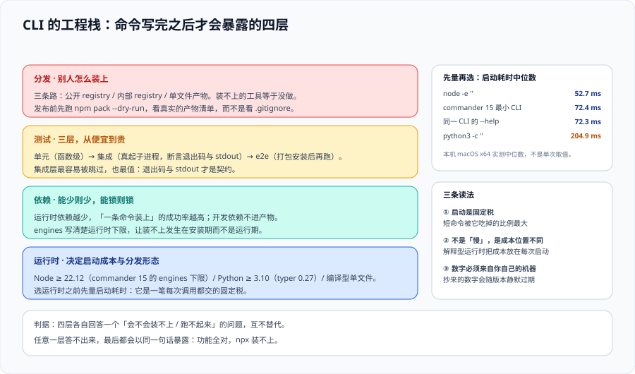

# CLI 工程化：选型、依赖、测试与发布



这一页讲**命令写完之后的事**：用什么语言写、依赖怎么控、怎么测、怎么发出去。这些话题看起来平淡，但它们决定了「这个工具能不能被别人装上并稳定地跑起来」——而这一步失败的团队非常多：功能全对，`npx` 装不上。

::: tip 一句话定位
CLI 是最挑剔的一类程序：**它要在一年后某台你没见过的机器上、由非作者启动，只用一次，并且不能失败**。所以它的第一目标不是性能也不是优雅，而是**可预测**——包括启动开销、依赖面、错误行为。
:::

## 一、语言与运行时：四问定选型

| 问题 | 为什么它决定选型 |
| --- | --- |
| ① **谁在用这台机器** | 只有开发者用 → 可以要求 Node/Python 运行时；给运维/测试用 → 倾向零依赖二进制 |
| ② **启动开销能不能忍** | 被 shell 补全、被循环调用、被 `git` 钩子高频触发时，启动开销会被放大几十倍 |
| ③ **怎么分发** | npm / PyPI / 单个二进制 / 容器镜像——分发方式的难度几乎完全由这一条决定 |
| ④ **生态里有没有你要的库** | 模板渲染、AST 改写、YAML 解析——缺生态的语言写工具链会非常痛苦 |

**启动开销是真实存在的、且容易被低估的一项。** 下面这组数据是本机实测（macOS x64 Intel，Node **v22.22.2**，Python **3.13.12**，各 15~20 次取中位数）：

| 被测对象 | 中位数启动耗时 | 相对空启动的增量 |
| --- | --- | --- |
| `node -e ''`（Node 空启动） | **52.7 ms** | — |
| 一个 1 KB 的纯 Node 脚本 | 56.5 ms | +3.8 ms |
| **引入 commander 15 的最小 CLI**（`demo build`） | **72.4 ms** | **+19.7 ms** |
| 同一个 CLI 的 `--help` | 72.3 ms | +19.6 ms |
| `python3 -c ''`（Python 空启动，含 site 初始化） | **204.9 ms** | — |
| `python3 -V`（不初始化 site） | **9.5 ms** | — |

**怎么读这组数**：

- **Node 的启动底线在 50 ms 量级**，引一个参数解析库再加约 20 ms。这个量级对交互使用完全无感，但**如果你要把这个 CLI 放进一个遍历 2000 个文件的循环里，就是 145 秒的地板**——此时正确做法不是换语言，而是**给工具加一个「批量模式」**（一次启动处理多个输入），而不是启动 2000 次。
- **Python 的 205 ms 里有约 195 ms 是解释器初始化**（`-V` 只要 9.5 ms 就是证据）。所以「Python 写的 CLI 慢」这个印象**大部分不是你的代码慢**，而是每次调用都要付这份固定成本。同样的对策是批量模式。
- **`python3 -V` 比 `python3 -c ''` 快 20 倍**这件事本身也是个教训：**测出来的数字，先问「我测的是我想测的东西吗」**。本页作者的第一次测量得出「Node CLI 启动 255 ms」，原因是用一个会启动 Python 的解释器取时间戳，把测量工具的开销算进了被测对象——**换掉计时方式后降到 72 ms**。

::: danger 踩坑：把启动开销算成「性能问题」然后去优化业务代码
一个被 `git` 钩子每次提交都调用的检查工具，实测 1.2 秒里有 1.1 秒是启动与依赖加载，真正扫描只要 0.1 秒。团队的第一反应通常是「优化扫描算法」——**方向完全错了**。

正确的做法按收益排序：① **减少顶层依赖**（只 import 真正要用的模块，避免在模块顶层 `import` 整个框架）；② **合并调用**（一次启动处理多个文件）；③ 换更小的运行时；④ 最后才是优化算法。

```shell
# 判据：把 "启动" 与 "干活" 分开计时（在工具内部打两行 stderr）
my-tool check . 2>&1 >/dev/null | grep -E '^(boot|scan)='
# 预期：boot=... scan=... 两行；若 boot 占绝对多数，优化方向是依赖而不是算法
```
:::

## 二、依赖：CLI 的依赖会被下游一起装上

库和 CLI 的依赖策略**完全不同**，这是最常被混淆的一点。

| | 作为**库**被依赖 | 作为**CLI**被依赖 |
| --- | --- | --- |
| 依赖树 | 会被去重、可能提升到上层 | **整棵树装进使用者的环境** |
| 冲突 | 由包管理器解 | 仍然由包管理器解，但**使用者会直接把失败归因于你** |
| peer 依赖 | 常见 | **尽量避免**（装不上就是装不上） |
| 体积敏感度 | 中 | 高（`npx` 每次可能重新下载） |
| 更新节奏 | 跟随上游 | **必须允许使用者锁定版本** |

**四条纪律**：

1. **依赖数量是有预算的**。「为了少写 30 行而引一个包」在库里通常划算，在 CLI 里常常不划算——那 30 行会永久住在使用者的 `node_modules` 里。
2. **不要用 peerDependencies 表达「可选增强」**，改用运行时动态检测：能加载就启用，不能就降级并提示。
3. **锁定自己的依赖**（生产依赖用精确版本 + lockfile 提交）。库倾向于放宽版本区间，**CLI 倾向于收紧**——因为 CLI 的行为是给使用者看的，行为漂移等于 bug。
4. **区分「运行时依赖」与「构建期依赖」**。模板、测试框架、打包器都不应该出现在使用者的依赖树里。

```json
// package.json —— CLI 的依赖策略示例
{
  "name": "@acme/tool",
  "type": "module",
  "bin": { "acme": "./bin/acme.js" },
  "engines": { "node": ">=22.12.0" },
  "dependencies": {
    "commander": "15.0.0"
  },
  "devDependencies": {
    "vitest": "^3.0.0",
    "esbuild": "^0.25.0"
  },
  "files": ["bin", "dist", "README.md"]
}
```

::: info 版本事实（2026-10 口径）
`commander` **15.0.0**（2026-05-29）是 **ESM-only**，`engines.node` 为 **`>=22.12.0`**（本机实测包的 `package.json` 确认）。这意味着：① 只支持 CJS 的老仓库**不能**直接升到 15；② `engines` 不是强制约束，**使用者用 Node 20 装上后会在运行时以 `SyntaxError` 崩掉**，所以 `engines` 必须配合 `--help` 与文档里的显式说明。

`commander` **14.x 只修安全问题、承诺支持到 2027-05**，这是「被下游锁住的人」的过渡窗口。凡是被别的仓库依赖的工具，升级跨大版本时应当**同时提供 14 兼容线**而不是直接切断。
:::

## 三、可执行入口：`bin` 字段与三个平台

CLI 能被「当成命令敲」靠的是三件事，缺一不可：

| 环节 | 做法 | 常见失败 |
| --- | --- | --- |
| 声明入口 | `package.json` 的 `bin` 指向一个文件 | 指向的文件没有执行权限或没有 shebang |
| shebang | 文件首行 `#!/usr/bin/env node` | 写成绝对路径 `/usr/local/bin/node`（换机器就废） |
| 链接 | 包管理器在 `node_modules/.bin` 建链接 | 只在本地跑得通，发出去后 `npx` 找不到 |

```js
#!/usr/bin/env node
// bin/acme.js —— shebang 必须是文件第一行，前面不能有空行或 BOM
// 真正的实现放在 dist/，bin 只做「转交」，这样升级实现不需要动入口
import('../dist/cli.js')
  .then((m) => m.main(process.argv.slice(2)))
  .catch((err) => {
    // 未捕获的异常必须落地成非 0 退出码与 stderr 输出
    console.error(`acme: 未预期的错误\n${err?.stack ?? err}`)
    process.exit(1)
  })
```

::: danger 踩坑：Windows 上的三个具体问题
1. **`#!/usr/bin/env node` 在 Windows 上无效**。npm 会为 `bin` 自动生成 `.cmd` / `.ps1` 垫片，所以**通常能跑**——但前提是**装了 npm 并创建了 `bin` 链接**。直接把 `.js` 文件拷给别人双击是跑不起来的。
2. **路径分隔符**：`path.join` 之外的手工拼 `/` 会在 Windows 上出问题；`process.env.HOME` 在 Windows 上**不存在**（要用 `os.homedir()`）。
3. **终端编码**：Windows 旧控制台默认代码页不是 UTF-8，中文与 emoji 会乱码。**输出里的非 ASCII 字符要能被关掉**（见 `--json` 与 `NO_COLOR`）。

这三条在 macOS/Linux 上完全测不出来，所以 CI 里**至少要有一个 Windows job**，哪怕只跑 `--help`。
:::

## 四、测试：三层，重点是后两层

CLI 的测试分层和库不一样——**「函数正确」不代表「命令正确」**，因为参数解析、退出码、stdout/stderr 的分流都在函数之外。

| 层 | 测什么 | 怎么做 | 覆盖到什么 |
| --- | --- | --- | --- |
| L1 单元 | 纯函数（派生、校验、路径计算） | 直接 import | 逻辑分支 |
| **L2 契约** | `--help` 文本、退出码、`--json` 结构 | **快照 + 断言** | **你许诺给使用者的那层** |
| **L3 端到端** | 真起一个子进程跑一遍 | `spawn` 后断言 stdout/stderr/退出码 | 装得上、跑得起来 |

L2 的关键是：**把 `--help` 也纳入测试**。因为 `--help` 是契约的一部分（见 [CLI 设计](../CliDesign/index.md)），它被无声改掉过一次，就意味着某个人的脚本再也读不到他期待的东西。

```js
// test/cli.e2e.test.mjs —— L3：真起子进程，只断言三件可观测的事
import { test, expect } from 'vitest'
import { spawnSync } from 'node:child_process'

const run = (...args) => spawnSync(process.execPath, ['bin/acme.js', ...args], { encoding: 'utf8' })

test('--json 时 stdout 必须是纯 JSON 且退出码为 0', () => {
  const r = run('build', '--json')
  expect(r.status).toBe(0)
  // 只解析 stdout；stderr 里的进度不能影响解析
  expect(() => JSON.parse(r.stdout)).not.toThrow()
})

test('用法错误退出码为 2，且错误信息进 stderr', () => {
  const r = run('build', '--env', 'notexist')
  expect(r.status).toBe(2)
  expect(r.stderr).toMatch(/--env/)
  expect(r.stdout).toBe('')      // 失败时 stdout 必须干净，避免污染管道
})

test('无事可做时退出码为 3（不是 0）', () => {
  const r = run('build', '--json')      // 第二次执行，产物已存在
  expect([0, 3]).toContain(r.status)    // 若为 0，说明「无事可做」被当成成功了
})
```

::: tip 不要断言颜色与画框
断言 `expect(out).toContain('✓')` 或断言表格边框的字符，会让每一次依赖升级都变成测试失败。**断言退出码、字段存在性与关键词**，不要断言渲染细节。这条与 Typer 官方文档给的建议一致（它明确提醒不要断言框线）。
:::

## 五、发布：三条路径与各自的坑

| 路径 | 使用者怎么装 | 适合 | 主要坑 |
| --- | --- | --- | --- |
| **公共 registry** | `npx @acme/tool` / `pnpm add -g` | 开源或半公开工具 | 包名被占、`files` 漏配导致跑不起来 |
| **私有 registry** | 配 `.npmrc` 后同公共 | 内部工具 | 鉴权令牌过期是最高频故障（见[分发与版本](../Distribution/index.md)） |
| **单文件二进制 / 容器镜像** | 下载或 `docker run` | 使用者没有 Node/Python | 体积、签名、多平台构建 |

**发布前的最小检查清单**：

```shell
# 1) 打包内容是否正确（最容易漏的一条：files 没配全，装出来的包缺 dist/）
npm pack --dry-run 2>&1 | tail -20

# 2) 从「干净环境」装一次并跑通（不要在自己仓库里测）
cd "$(mktemp -d)" && npm init -y >/dev/null && npm i -g /path/to/acme-1.0.0.tgz
acme --help >/dev/null && acme build --json | head -1 ; echo "干净环境退出码=$?"

# 3) engines 是否真的被看见（期望有 EBADENGINE 警告）
npm i -g ./acme-1.0.0.tgz 2>&1 | grep -i EBADENGINE || echo "（本机满足 engines）"
```

**预期输出**：① `npm pack --dry-run` 列出的文件里包含 `bin/`、`dist/`、`README.md`；② 干净环境下 `--help` 与 `build` 都成功、退出码 0；③ 在低版本 Node 上能看到 `EBADENGINE` 警告。

**发布动作本身的三条纪律**：

1. **版本号由变更类型推出来，不靠记忆**。破坏性变更必须抬大版本——`commander` 15 抬大版本的直接原因是「ESM-only + Node 底线抬高」，这两条都会让下游直接崩。
2. **发布必须可从 CI 一键完成**，不允许「只有某个人的笔记本上有 npm token」。
3. **发布后立刻在一个干净环境里装一次**（上面第 2 条）。发行版最常见的失败是「本地能跑、装出来缺文件」，而它只会在使用者那里暴露。

## 六、验证方式

```shell
# 1) 启动开销基线（在目标机器上测，不要抄别人的数）
for i in $(seq 1 20); do node bin/acme.js --version >/dev/null; done
# 用 hyperfine / 或上面的 Python 计时法，取中位数作为基线写进 README

# 2) 依赖树里没有开发期依赖泄漏
npm ls --omit=dev --all --depth=0

# 3) 入口三件套
head -1 bin/acme.js                       # 期望 #!/usr/bin/env node
node -e "console.log(require('./package.json').engines)"   # 期望 { node: '>=22.12.0' }
ls -l bin/acme.js                         # 期望有可执行位（-rwxr-xr-x）

# 4) 三层测试能各跑一层
npx vitest run test/unit          # L1
npx vitest run test/contract      # L2（含 --help 快照）
npx vitest run test/cli.e2e.test.mjs   # L3
```

**预期输出**：① 中位数稳定在可接受区间（写进 README 作为基线，回归时可对比）；② 只剩运行时依赖；③ 三行都符合；④ 三层全绿。**若 L2 的快照失败，先判断是「确实改了契约」还是「只是措辞变了」**——前者要抬版本，后者更新快照即可。

## 七、判据清单

| 判据 | 内容 | 怎么验证 |
| --- | --- | --- |
| `CI-A` | 选型回答了四问（使用者 / 启动开销 / 分发方式 / 生态），并把启动基线写进 README | README 里有启动耗时基线数字与测量方式 |
| `CI-B` | 启动开销测过，且「启动 vs 干活」两段能分开计时 | 工具内部能输出 `boot=` 与 `run=` 两行，且优化方向有据 |
| `CI-C` | 运行时依赖数量有意识控制；开发期依赖不进入使用者的依赖树 | `npm ls --omit=dev --all` 里没有测试/构建类包 |
| `CI-D` | 生产依赖锁定为精确版本并提交 lockfile；不用 peerDependencies 表达可选增强 | 依赖树可复现：删 `node_modules` 重装得到同一棵树 |
| `CI-E` | 入口三件套齐全：`bin` 声明、相对 shebang、可执行位 | `head -1 bin/*.js` 是 `#!/usr/bin/env node`，权限位含 `x` |
| `CI-F` | 测试分三层，且 `--help` 文本属于被测试的契约层 | 测试目录里存在契约层，`--help` 有快照或结构化断言 |
| `CI-G` | 断言只针对退出码 / 结构 / 关键词，不断言颜色与画框 | 搜索测试文件，无对 ANSI 码或 `✓` 之类符号的断言 |
| `CI-H` | 发布后能在干净环境装一次并跑通；版本号按变更类型推出 | 有一次干净环境安装记录（临时目录），且发布由 CI 完成 |

## 八、与相邻专题的分工

- **本页讲「用什么写、怎么测、怎么发」**；[CLI 设计](../CliDesign/index.md) 讲参数与退出码**该是什么**，[分发与版本](../Distribution/index.md) 讲**私有 registry 与版本传播**。
- 「依赖树为什么要锁定、解析规则是什么」归 [包管理器深入](../../PackageManager/index.md)；本页只讲 CLI 场景的取舍。
- 发布流水线怎么编排归 [CI/CD](../../CICD/index.md)；本页只讲**发布前必须成立的几条事实**。
- 依赖的成分与漏洞治理归 [依赖与安全治理](../../DependencyGovernance/index.md)；本页不重复。

## 参考资料

- [commander 官方仓库与 CHANGELOG](https://github.com/tj/commander.js)：15.0.0 的 ESM-only 与 Node 底线，14.x 的安全支持窗口
- [npm Docs · package.json `bin`](https://docs.npmjs.com/cli/v11/configuring-npm/package-json#bin)：可执行入口的声明与 Windows 垫片行为
- [npm Docs · `files` 字段](https://docs.npmjs.com/cli/v11/configuring-npm/package-json#files)：打包白名单（漏配是发布后缺文件的头号原因）
- [npm Docs · `npm pack`](https://docs.npmjs.com/cli/v11/commands/npm-pack)：发布前自检打包内容
- [Node.js · `engines` 与 `EBADENGINE`](https://docs.npmjs.com/cli/v11/configuring-npm/package-json#engines)：为什么 `engines` 不是强约束
- [Vitest 官方文档](https://vitest.dev/)：本页三层测试示例所用运行器
- [Typer 官方文档 · Testing](https://typer.tiangolo.com/tutorial/testing/)：Python CLI 的测试方式与「不要断言渲染细节」的建议
