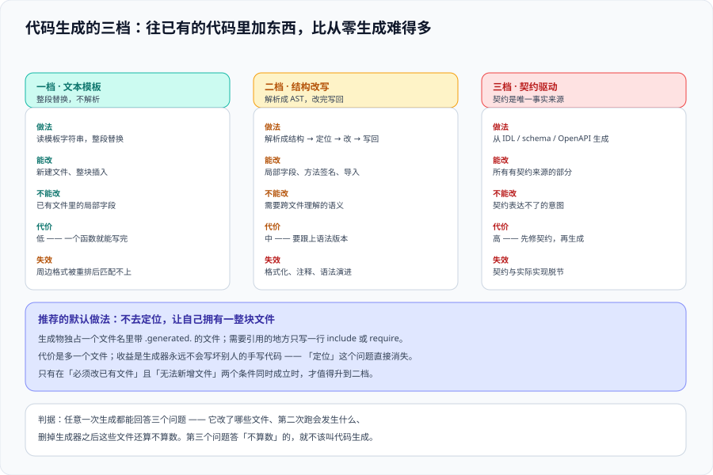

# 代码生成：从文本模板到语法树



脚手架负责「从零生成一棵树」，代码生成负责的是**「往已经存在的代码里加东西」**。这是复杂度真正上台阶的地方：新建一个文件只需要渲染，**改动一个已有文件需要理解它**。

::: tip 一句话定位
代码生成的核心矛盾只有一句话：**生成器想要独占产出物，而人也想改这些文件**。三档方案的差别，本质上是「怎么划分这两者的地盘」——地盘划得越清楚，方案就越稳。
:::

## 一、三档方案：能力、代价与分界线

| 档 | 机制 | 能做什么 | 做不到什么 | 代价 |
| --- | --- | --- | --- | --- |
| **① 文本模板** | 占位符替换，整文件覆盖 | 生成**新文件**；覆盖**完全由工具拥有**的文件 | 改一个已有文件里的某一处 | 最低 |
| **② 结构感知改写** | 解析成语法树 / 结构化文本，按节点定位后插入 | 往已有文件里**插入节点**（路由表、依赖注入、import） | 理解语义（改对位置 ≠ 改对意思） | 中（要装解析器、要处理格式） |
| **③ 契约驱动** | 从一份**描述**（OpenAPI / Protobuf / Schema）生成多份产物 | 让多端产物天然一致 | 契约本身写错就全错 | 高（要先有契约与工具链） |

**分界线只有一条**：**你要不要动已经存在、且人不希望被整体覆盖的文件**。

- 不动 → ① 足够（`plop` / `hygen` 的 `add` 动作就是这个档）。
- 要往一个手写的 `router.ts` 里插一行 → 需要 ②。
- 要让「服务端接口 + 前端客户端 + 文档」三份东西永远一致 → 需要 ③。

::: danger 踩坑：用正则去改代码
「往路由文件里插一行」最直觉的做法是写正则，比如在 `const routes = [` 后面插入一行。**它在你的机器上能跑一年，然后在一个把数组改成多行、或加了注释的提交之后静默插错位置，或者什么都没插。**

三个具体后果：
1. **插入到注释里**：`const routes = [ /* 新增路由放这里 */` → 生成器把新路由插进了注释。
2. **插进了字符串**：文件里另有一处字面量 `'const routes = ['`。
3. **格式被破坏**：插入后缩进与括号位置不符合 `prettier`，下一次 `lint:fix` 会把它重排成另一个样子——**于是每次生成都在和格式化器互相打架**。

正确顺序是：**能改数据的就不改代码**（把路由表抽成一个数组/JSON，生成器只追加条目），**必须改代码的就上解析器**，**真需要文本插入时必须带唯一锚点**（见第三节）。
:::

## 二、档 ② 的落地：解析器只是工具，定位才是难点

「用 AST」听起来高级，但真正的难点从来不是解析，而是**在树里找到那个唯一的插入位置**。

| 定位方式 | 做法 | 稳健性 |
| --- | --- | --- |
| 按**唯一锚点字符串** | 找 `/* @gen:routes */` 这样的标记 | 中（人删掉标记就失效，但失效是**显式**的） |
| 按**结构特征** | 找「名为 `routes` 的数组字面量」 | 中高（改了变量名就失效） |
| 按**语义标记** | 找带装饰器 / 注解的节点（`@gen.route`） | 高，但要求目标语言支持注解 |
| 按**约定位置** | 固定文件（`routes.generated.ts`） | **最高**——因为不定位就不需要稳健的定位 |

::: tip 最高稳健性其实是「不定位」
把「会被追加的那部分」独立成一个**完全由工具拥有的文件**（文件名带 `.generated.` 前缀），人写的代码只负责引用它。这样生成器永远只需要「整体覆盖一个没人手改的文件」，定位问题直接消失。

```text
src/routes/
├── index.ts            # 人写：引用了 routes.generated.js，可以随便改
├── auth.ts             # 人写
└── routes.generated.ts # 完全由工具拥有，文件头写明「不要手改」
```

```ts
// src/routes/routes.generated.ts —— 文件头必须写清归属，这是唯一的防线
// ⚠️ 本文件由 `acme gen routes` 生成，请勿手改。
// 需要新增路由：在 src/routes/*.ts 里导出，然后重新执行 `acme gen routes`。
export const generatedRoutes = [
  { path: '/users', method: 'get', handler: '../users#list' },
  { path: '/users/:id', method: 'get', handler: '../users#detail' },
] as const
```
:::

## 三、幂等：生成器最重要的性质

**「跑两次」的结果必须与「跑一次」相同。** 这一条不满足，生成器迟早会在某次重复执行里把文件搞乱。

幂等的三种实现，按稳健性排序：

| 方式 | 做法 | 适用 |
| --- | --- | --- |
| **整体覆盖**（推荐） | 产物完全由工具拥有，每次重新算一遍整份内容 | `.generated.` 文件、契约驱动产物 |
| **标记区间** | 只替换 `<!-- gen:begin -->` 与 `<!-- gen:end -->` 之间的内容 | 必须嵌在人写文件里的片段 |
| **内容比对** | 生成后与已有内容 diff，无差异则不写（`--check` 模式报「无变化」） | 所有方案的**附加**保险 |

```js
// scripts/gen/inject.mjs —— 标记区间替换的最小实现（无依赖）
// 设计要点：标记必须成对出现且唯一；缺失任一标记一律报错，绝不"猜"位置
const BEGIN = '<!-- gen:begin -->'
const END = '<!-- gen:end -->'

export function injectBetween(src, body) {
  const b = src.indexOf(BEGIN)
  const e = src.indexOf(END)
  // 1) 两个标记都必须存在且唯一：多一个就说明有人手改过，必须人工介入
  if (b === -1 || e === -1) {
    throw new Error(`缺少注入标记：${b === -1 ? BEGIN : END}（请手工补上，不要自动猜位置）`)
  }
  if (src.indexOf(BEGIN, b + 1) !== -1 || src.indexOf(END, e + 1) !== -1) {
    throw new Error('注入标记出现多次，无法确定唯一区间')
  }
  if (e < b) throw new Error('注入标记顺序颠倒')
  // 2) 只替换区间内的内容，区间外的任何改动都被保留
  return src.slice(0, b + BEGIN.length) + '\n' + body.trim() + '\n' + src.slice(e)
}
```

```shell
# 幂等验证（本机可跑）：连续注入两次，结果必须逐字节相同
node -e "import('./scripts/gen/inject.mjs').then(m=>{
  const src='# A\n<!-- gen:begin -->\n旧内容\n<!-- gen:end -->\n# B\n'
  const once=m.injectBetween(src,'X'); const twice=m.injectBetween(once,'X')
  console.log('幂等:', once===twice)
})"
# 预期输出：幂等: true
```

## 四、删除与重命名：生成器最难的部分

**新增是加法，删除是减法，而减法需要知道「什么曾经是我加的」。**

| 场景 | 天真做法 | 正确做法 |
| --- | --- | --- |
| 源里删掉了一条定义，产物要同步删 | 重新整份生成（**只对整体覆盖方案有效**） | 整体覆盖：天然同步；标记区间：把区间内容整体替换；结构改写：**需要先记住上次生成了哪些节点**（通常靠命名约定，如统一加 `gen_` 前缀） |
| 重命名一个生成物 | 生成新文件、旧文件留着 | 生成新文件后**显式删除旧文件**，并在 stderr 列出删除清单 |

::: danger 踩坑：孤儿产物
「只加不删」的生成器会在半年后留下一批没人知道来源的文件。它们的危害不是占空间，而是**让下一批人认为它们是手写代码**——于是有人开始改它们，改完被下次生成覆盖。

两条防线：
1. **所有生成物在文件头写明「由 X 生成、勿手改」**（见第二节示例）。
2. **`--check` 模式**：重新生成到临时位置，与工作区比对；**存在「在工作区但不在产物里」的文件时报错**，把那批孤儿列出来。这正是 API 契约工具链里的「生成物 diff 为空」做法（见 [API 设计与治理](../../APIDesign/index.md)）。

```shell
# 孤儿产物检查（判据 CG-G 的验证方式）
my-tool gen --check ; echo "退出码=$?"
# 预期：退出码 0 且无差异；若存在手改或孤儿文件，退出码 5 并逐条列出
```
:::

## 五、档 ③：契约驱动生成

契约驱动（OpenAPI / Protobuf / JSON Schema → 代码）是**收益最大、也最容易做歪**的一档。它的正确用法只有一句话：

> **契约是唯一的手写来源，所有产物都是它的投影。**

| 环节 | 正确做法 | 反模式 |
| --- | --- | --- |
| 事实来源 | 契约文件进版本控制、**人工评审** | 从代码反向生成契约，然后两份互相漂移 |
| 产物归属 | 产物目录整体由工具拥有（`.generated.` / `generated/`） | 把产物和手写代码混在同一目录 |
| 漂移检查 | CI 里跑「重新生成 + `git diff --exit-code`」 | 靠人记得重新生成 |
| 定制化 | 用配置（模板 / 扩展点）表达 | **手工改产物** |
| 何时不生成 | 契约只有一两个接口时 | 为一两个接口引一整套生成器 |

```shell
# 契约驱动的核心判据：生成物 diff 为空（CI 里可直接当门禁）
my-tool gen --check
git diff --exit-code -- src/generated ; echo "漂移检查退出码=$?"
# 预期：退出码 0。非 0 说明「产物与契约不同步」——
#       可能是有人手改了产物，也可能是改了契约忘了重新生成
```

::: warning 说明：生成物要不要过 lint / 格式化
**要，但不是「必须符合人写的规范」**。正确做法是两条：

1. **生成器自己负责输出可读格式**（缩进、换行）。生成出来的东西**人也要读**——读不懂的产物会让人绕过它去手写，一旦绕过，契约驱动就名存实亡。
2. **把生成产物加入 lint 白名单**（如 `.eslintignore` / `sonar.exclusions`），理由是「在产物上报的格式问题，修法应该是改模板，不是在产物里改」——**但类型检查与编译必须包含它们**，否则你会得到一堆编译不过的产物。
:::

## 六、验证方式

```shell
# 1) 幂等：连续两次生成，产物逐字节相同
my-tool gen && git add -A && my-tool gen && git diff --exit-code ; echo "幂等性退出码=$?"

# 2) 归属声明：每个生成物都能自己说明来源
git ls-files 'src/**/*.generated.*' | while read -r f; do
  head -1 "$f" | grep -qE '由|generated by' || echo "缺少归属声明: $f"
done

# 3) 标记区间成对且唯一（这四条任一不满足都必须报错而非静默）
git grep -c 'gen:begin' -- 'src/**'; git grep -c 'gen:end' -- 'src/**'

# 4) 手改保护：手改产物后，漂移检查必须失败
printf '\n// hand edit\n' >> src/routes/routes.generated.ts
my-tool gen --check ; echo "手改后退出码=$?"   # 期望非 0
git checkout -- src/routes/routes.generated.ts  # 复原
```

**预期输出**：① `幂等性退出码=0`；② 所有生成物都有归属声明（无 `缺少归属声明` 行）；③ 两个标记的计数**逐文件相等**且均为 1；④ 手改后退出码**非 0**，且输出指名该文件。

## 七、判据清单

| 判据 | 内容 | 怎么验证 |
| --- | --- | --- |
| `CG-A` | 先选档（文本模板 / 结构改写 / 契约驱动），选型理由回答「要不要改动已存在的手写文件」 | 选型说明里能指向具体文件与具体位置 |
| `CG-B` | 需要改动已有文件时不用正则；用解析器或唯一锚点 | 生成器代码里搜不到「搜字符串后 `splice`/`replace` 插代码」的写法 |
| `CG-C` | 能被整体覆盖的产物独立成 `.generated.` 文件，人写代码只引用它 | 存在 `.generated.` 目录/文件，且手写文件中以 import 引用它 |
| `CG-D` | 每个生成物在文件头声明来源与「勿手改」 | `head -1` 逐文件检查，无一例外 |
| `CG-E` | 幂等：连续两次生成产物完全相同 | `gen && gen && git diff --exit-code` 退出码 0 |
| `CG-F` | 标记区间必须成对且唯一，缺失或重复时报错而非猜测 | 手工删掉一个标记，生成器以非 0 退出并指认缺失的标记 |
| `CG-G` | 有暴露孤儿产物与手改的检查（`--check`），且能进 CI 当门禁 | 手改产物后 `--check` 非 0；删除契约条目后产物同步减少 |
| `CG-H` | 契约驱动时，契约是唯一手写来源；产物与契约 diff 为空 | CI 中「重新生成 + `git diff --exit-code`」为绿；产物目录无人写改 |

## 八、与相邻专题的分工

- **本页讲「怎么把代码写进已有文件」**；[脚手架](../Scaffold/index.md) 讲从零生成一棵树，两者的共同部分是「渲染」，但归属与幂等要求不同。
- 契约（OpenAPI）**怎么写、怎么 lint、怎么防漂移**归 [API 设计与治理](../../APIDesign/index.md)；本页只讲「从契约到产物」这一段。
- 生成物要不要进质量门禁、进哪一层归 [代码质量平台](../../CodeQuality/index.md)。
- 「Schema → 页面视图」这类生成归 [低代码平台](../../../Frontend/LowCode/index.md)；本页管的是**源码文件层面**的生成。
- 生成产物的分发（要不要发到 registry）归 [分发与版本](../Distribution/index.md)。

## 参考资料

- [OpenAPI Generator 官方文档](https://openapi-generator.tech/)：契约驱动的多语言产物生成
- [openapi-typescript](https://openapi-ts.dev/)：从契约生成 TypeScript 类型的最小可用路径
- [ts-morph 官方文档](https://ts-morph.com/)：TypeScript 的结构感知改写（档 ② 的常用工具）
- [jscodeshift（Codemod）](https://github.com/facebook/jscodeshift)：批量结构改写的经典工具
- [plop 官方文档 · Actions](https://plopjs.com/documentation/#built-in-actions)：`add` / `modify` / `append` 三类动作的语义差异
- [hygen 官方文档](https://www.hygen.io/)：模板与目标文件的组织方式
- [Prettier · Ignoring code](https://prettier.io/docs/ignore)：把生成物排除在格式化之外的正确方式
