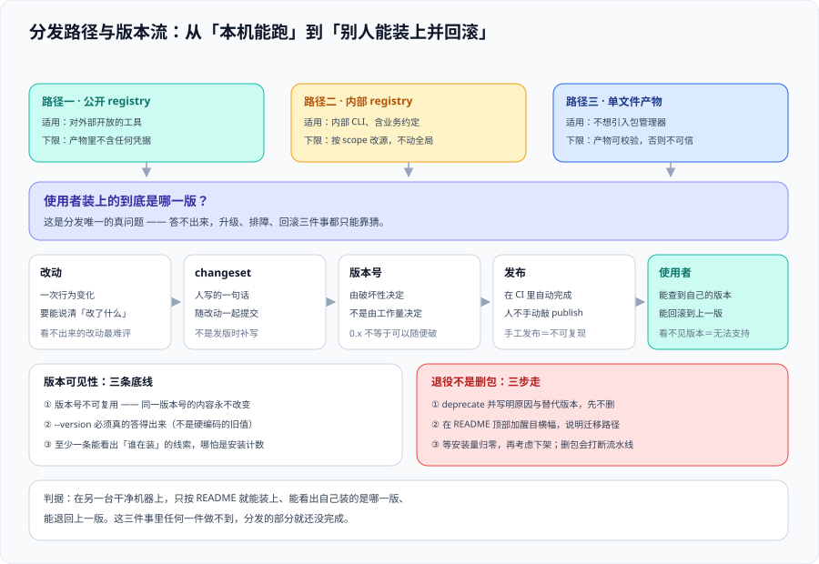

# 分发与版本治理



一个在本机能跑的工具，和**一个别人能装上、能升级、出问题能找到原因的工具**，中间差的就是这一页。分发看起来只是「推个包」，实际上它决定了两件事：**使用者能不能复现你的环境**，以及**你能不能知道大家在用哪一版**。

::: tip 一句话定位
分发的核心不是「怎么把文件送出去」，而是**「送出去之后，版本怎么走、旧版本怎么退场、用错版本的人怎么知道」**。
:::

## 一、三条分发路径

| 路径 | 使用者动作 | 依赖环境 | 适合 | 最难的一步 |
| --- | --- | --- | --- | --- |
| **公共 registry** | `npx` / `pnpm add -g @scope/tool` | Node/Python 运行时 | 公开工具、开源 | 包名与命名空间保护 |
| **私有 registry** | 配 `.npmrc` 后同上 | 运行时 + 内网可达 | 内部工具（**最常用**） | 鉴权与网络（见第三节） |
| **单文件二进制 / 镜像** | 下载 / `docker run` | 无（二进制自带） | 使用者没有运行时的场景 | 多平台构建与签名 |

选型只看一件事：**使用者的机器上有没有你需要的运行时**。

- **有**（大多数内部工具）→ registry。它顺手解决了版本、升级、回滚三件事，成本最低。
- **没有**（给测试、运维、非工程同学用）→ 二进制或镜像。**不要要求他们装 Node**——这一步的摩擦会让工具的使用率降到零。

## 二、私有 registry 的落地要点

以 Verdaccio 形态为例（自托管 npm 私有 registry 的事实标准之一）。落地只有四件事，但这四件各有明确的失败形态。

| 事项 | 配置位置 | 失败形态 |
| --- | --- | --- |
| **uplinks（上游代理）** | `config.yaml` 的 `uplinks:` | 没配上游 → 只装得到私有包，公共包全 404 |
| **鉴权** | `auth:` + `htpasswd` / LDAP / OAuth | 令牌过期 → `E401`，且**看起来像网络问题** |
| **存储** | `storage:` 目录 | 容器重建后数据丢（**必须挂持久卷**） |
| **发布权限** | `packages:` 的 `access` / `publish` | 所有人可发同一 scope → 版本被别人覆盖 |

```yaml
# verdaccio/config.yaml —— 内部 registry 的最小可用配置（结构示例）
# 说明：把「上游代理」与「访问控制」两件事写清楚，其余保持默认
uplinks:
  npmjs:
    url: https://registry.npmjs.org/     # 上游：没这一项公共包全都装不到
    cache: true                           # 缓存下载过的包，减轻出口压力

packages:
  # 私有命名空间：只有认证用户能读，只有指定组能发
  '@acme/*':
    access: $authenticated
    publish: acme-publishers
    unpublish: acme-publishers
  # 其余全部走上游代理（只读，禁止在本地发布同名包）
  '**':
    access: $all
    publish: $authenticated
    proxy: npmjs
```

```ini
# .npmrc —— 项目侧配置：把 scope 指向内部 registry（其余走公共）
# 注意：只对 @acme 生效，避免把整个项目的下载都指向内网
@acme:registry=https://npm.acme.internal/
# 令牌不要写在项目 .npmrc 里（会被提交）——它属于用户级 ~/.npmrc 或 CI 的密钥注入
```

::: danger 踩坑：四个会静默浪费半天的配置问题
1. **令牌过期看起来像网络问题**。`E401 Unauthorized` 与「内网不通」在 CI 日志里都是一行红字，而前者只需要重登。**排查顺序**：先 `npm whoami --registry=...` 确认身份，再看网络。
2. **`registry` 与 `@scope:registry` 混用**。只写 `registry=内部地址` 会把**所有**依赖都指向内网；上游没配 `uplinks` 时，整个 `install` 因为一个公共包失败。**只给 scope 定向**。
3. **提交了带令牌的 `.npmrc`**。这是最贵的一类事故（令牌一旦进 Git 历史，等于永久泄露）。正确做法：`.npmrc` 只放 registry 地址，令牌走环境变量 `NODE_AUTH_TOKEN` / CI 密钥。
4. **容器里的 registry 数据丢了**。registry 的存储目录**必须挂持久卷**，否则一次重建，所有私有包的历史版本消失——而且**没人立刻发现**，直到某天有人 `install` 旧版本失败。
:::

## 三、版本策略：语义化版本的三个具体判据

SemVer 的三个数字分别对应三类改动，但团队真正纠结的永远是「这次算不算破坏性」。**用下面这张表判，不要讨论**。

| 改动 | 版本位 | 判据（一句话） |
| --- | --- | --- |
| 新增子命令 / 新增选项 / 新增 JSON 字段 | patch 或 minor | **已有调用不需要改动**就能继续工作 |
| 修 bug、改措辞、改颜色、改日志格式 | patch | 没有机器在消费被改的东西 |
| **改退出码含义、改参数名、改 JSON 字段名/类型、抬运行时底线** | **major** | **会让某个人的自动化静默出错** |
| 默认值变更 | **major**（除非原默认值本身是 bug） | **改默认值是唯一「不报错但出错」的一类** |

::: tip 一句话记住
**判断标准不是「用户用不用得到这个新功能」，而是「旧调用不改还能不能用」。** 后者决定的是版本号，前者只决定 changelog 写什么。
:::

## 四、monorepo 的版本传播：最容易被低估的一环

单包仓库的版本管理是「改一版、发一版」。**多包仓库完全不同**：一个包升级后，依赖它的包要不要跟着发？跟到什么版本？

以 Changesets 形态为例（JS monorepo 的版本与 changelog 主流工具）。它的模型是：**贡献者在提 PR 时写一个说明「哪些包改了、各自该怎么发」的 markdown 文件**，发布时由工具消费这些文件统一算版本、更新 changelog、按依赖顺序发布。

| 做法 | 版本从哪来 | 优点 | 代价 |
| --- | --- | --- | --- |
| **变更文件驱动**（Changesets） | 人在 PR 里写 release intent | 一次改动覆盖多个包可以说清楚；发布前可评审 | **每个 PR 多一个文件**；没人写就卡住 |
| **提交信息驱动**（语义化提交 + 自动发布） | 从 commit message 推断 | 无额外文件 | 要求提交规范严格；跨包改动难表达 |

::: danger 踩坑：Changesets 3.0 的六个破坏性变更（2026-08-11 发布）
从 v2 升到 v3 **不是换个版本号**。以下六条会让现有流水线直接变红或行为改变：

| 变更 | v2 写法 | v3 写法 | 后果 |
| --- | --- | --- | --- |
| 命令改名 | `changeset tag` | **`changeset git-tag`** | 旧命令不存在 |
| 参数改名 | `--sinceMaster` | **`--since=main`** | 旧参数被忽略或报错 |
| 配置改名 | `prettier` | **`format`** | 配置项静默失效 |
| **空发布退出码** | `0`（静默成功） | **`1`** | **`set -e` 的脚本在无变更时变红** |
| 私有包默认行为 | 会升版本 | **默认不再升版本**（需显式开启） | 私有包不再产出新版本 |
| peer 依赖传播 | 给依赖方 major | **改为 patch** | 需要破坏性时**必须手写 major** |

配套的 `changesets/action` **v2 要求 CLI v3**；在 v2 项目上必须继续用 action v1。**升级顺序：先升 CLI，再升 action。**
:::

## 五、发布动作：让 CI 做，且留下溯源

| 要求 | 做法 | 为什么 |
| --- | --- | --- |
| **发布由 CI 执行** | 打 tag 触发流水线 | 消除「只有某人笔记本上有令牌」这一单点 |
| **令牌最小权限** | 只给发布所需 scope | 泄露时的爆炸半径 |
| **溯源**（provenance） | npm 的 trusted publishing / `--provenance` | 使用者能验证「这个包确实来自那个仓库的那次提交」 |
| **发布前跑一次干净安装** | 见 [CLI 工程化](../CliImplementation/index.md) | 发行版最常见的失败是缺文件 |
| **发布后打 tag** | 版本号 = tag 名 | 让「某个版本对应哪次提交」可查 |

## 六、撤销与退役：删不掉，只能标记

registry 的版本号是**不可变**的（这是它最大的优点）。所以「发错了」的处理方式是**标记**而不是删除。

| 情况 | 正确动作 | 不要做 |
| --- | --- | --- |
| 版本有问题但不致命 | `npm deprecate` 标记该版本 + 给出替代版本 | 期待使用者会自己看到 |
| 版本有安全事故 | **deprecate 全部受影响区间** + 发一个修复版本 | 直接 `unpublish`（会让已锁定该版本的项目**瞬间装不上**） |
| 整个包退役 | 先 deprecate（保留一个大版本周期的窗口），再归档仓库 | 立刻删除 |
| 令牌泄露 | **立刻吊销令牌** + 审查该 token 发布过的所有版本 | 只改密码 |

```shell
# 退役三步（每一步都可执行、可验证）
# ① 标记：给出替代方案与移除时间
npm deprecate '@acme/tool@<2.0' '已弃用：请升级到 2.x（2027-04 后不再维护）'
# ② 验证标记生效
npm view '@acme/tool@1.5.0' deprecated
# ③ 到期后归档仓库，但保持包可安装（不要 unpublish）
```

## 七、版本可见性：知道大家在用哪一版

「使用者用的是哪一版」这个问题的答案，决定了你能不能安全地删掉旧兼容代码。三种做法的成本递增：

| 做法 | 成本 | 得到什么 |
| --- | --- | --- |
| **什么都不做** | 0 | 只能靠猜；**永远不敢删兼容代码** |
| **版本号上报**（一次 HTTP POST，带版本与 os/arch，可关闭） | 低 | 版本分布、平台分布 |
| **完整遥测**（命令、耗时、错误） | 高（要处理隐私与合规） | 能指导功能优先级 |

::: warning 说明：上报必须可关闭，且默认要说清
在 CLI 里加遥测是**有代价**的：使用者会（合理地）怀疑。所以三条底线：① **默认行为与关闭方式写进 `--help`**；② 有明确的环境变量关闭开关（如 `ACME_TELEMETRY=0`）；③ **不上报任何与内容有关的东西**（文件路径、代码片段、仓库名一律不要）。做不到这三条，就不要上报——**默默收集会毁掉这个工具的信任**。
:::

## 八、验证方式

```shell
# 1) scope 定向是否正确（不应把公共包也指向内网）
npm config get registry
npm config get @acme:registry

# 2) 身份是否有效（令牌过期的第一诊断命令）
npm whoami --registry=https://npm.acme.internal/ ; echo "whoami 退出码=$?"

# 3) 干净环境安装 + 版本核对
cd "$(mktemp -d)" && pnpm add -g @acme/tool && acme --version ; echo "安装退出码=$?"

# 4) 溯源与一致性：版本号、git tag、package.json 三处必须一致
node -e "console.log(require('./package.json').version)"
git tag --points-at HEAD
# 预期：三处版本号相同

# 5) 弃用标记可见
npm view @acme/tool@1.5.0 deprecated
```

**预期输出**：① 默认 registry 是公共源，只有 `@acme` 指向内网；② `whoami` 打印用户名且退出码 0；③ 干净环境里装得上、版本正确；④ 三处版本号一致；⑤ 被弃用版本能读到弃用说明。

## 九、判据清单

| 判据 | 内容 | 怎么验证 |
| --- | --- | --- |
| `DS-A` | 分发路径按「使用者机器上有没有运行时」选定，而不是按团队偏好 | 选型说明里写明使用者的环境前提与对应的安装命令 |
| `DS-B` | 私有 registry 四件事齐全：上游代理、鉴权、持久存储、发布权限分组 | 配置里四项可见；删掉 `uplinks` 后公共包应装不到（说明它真的在起作用） |
| `DS-C` | `.npmrc` 只做 scope 定向；**令牌不进仓库**，走环境变量或 CI 密钥 | `git grep -nE '(_authToken\|_auth)\\s*=' -- '.npmrc'` 无命中 |
| `DS-D` | 版本号按「旧调用不改还能不能用」判定；改默认值按 major 处理 | 抽查最近三个版本的 changelog，破坏性变更的版本位正确 |
| `DS-E` | monorepo 的版本传播有明确模型（变更文件驱动或提交信息驱动），且升级跨大版本时逐条核对破坏性变更 | 存在一次变更文件/提交规范的实际记录；Changesets 2→3 的六条已逐条核对 |
| `DS-F` | 发布由 CI 完成并带溯源；发布前有一次干净环境安装记录 | CI 里有发布 job；能找到一次临时目录安装成功的记录 |
| `DS-G` | 「发错了」用 deprecate 标记而不是删除，且给出替代版本 | 被弃用版本上能读到弃用说明；不存在无说明的 `unpublish` 记录 |
| `DS-H` | 若能知道使用者的版本分布，则上报可关闭、默认有说明、不上报内容相关信息 | `--help` 里有遥测说明与关闭开关；抓包或读源码确认上报字段里无路径/内容 |

## 十、与相邻专题的分工

- **本页讲「怎么让工具在别人机器上稳定地用上、并可控地退场」**；[CLI 工程化](../CliImplementation/index.md) 讲打包与发布前的检查，[内部平台](../InternalPlatform/index.md) 讲使用者变成非工程师之后形态怎么变。
- 依赖的**解析规则与 lockfile** 归 [包管理器深入](../../PackageManager/index.md)；本页只讲「我们自己的包怎么发」。
- 制品仓库的**治理侧**（成分、漏洞、许可证）归 [依赖与安全治理](../../DependencyGovernance/index.md)。
- 发布流水线怎么编排、制品怎么存归 [CI/CD](../../CICD/index.md)。
- 签名与溯源的技术细节（SBOM、SLSA、cosign）归 [依赖与安全治理 · 来源可信](../../DependencyGovernance/Provenance/index.md)。

## 参考资料

- [Verdaccio 官方文档](https://verdaccio.org/docs/)：uplinks、鉴权与存储配置
- [npm Docs · registry 与 scope 配置](https://docs.npmjs.com/cli/v11/using-npm/registry)：`registry` 与 `@scope:registry` 的区别
- [npm Docs · `npm deprecate`](https://docs.npmjs.com/cli/v11/commands/npm-deprecate)：退役与弃用标记的正确姿势
- [Changesets 官方文档](https://changesets.dev/)与 [changesets/action](https://github.com/changesets/action)：monorepo 版本与发布流程
- [Changesets 迁移指南（v2 → v3）](https://github.com/changesets/changesets/blob/main/docs/migration-guide.md)：本页第六节六条破坏性变更的出处
- [Semantic Versioning 2.0.0（中文）](https://semver.org/lang/zh-CN/)：版本位与破坏性的判定依据
- [npm Docs · Provenance](https://docs.npmjs.com/generating-provenance-statements)：溯源声明与可信发布
