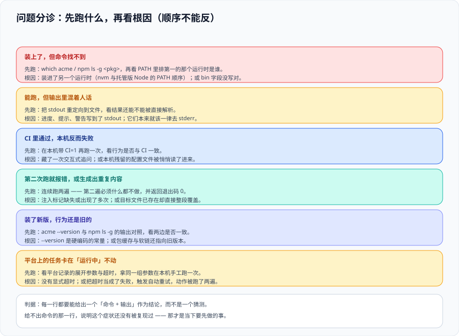

# 常见问题与最佳实践



这一页把前面八页里反复出现的失败形态收成一张分诊表：**先看现象，再决定跑哪条命令，最后才看根因**。顺序很重要——大多数排障的时间浪费在「先猜根因」上。

::: tip 一句话定位
工具链的问题有一个共同特征：**它们几乎都不报错**。命令成功退出、日志干净、构建全绿——只是行为不是你想要的。所以排障第一步永远是**让隐藏的东西显形**，而不是换一种写法试试。
:::

## 一、现象分诊表

| 现象 | 先跑什么 | 最常见的根因 | 去哪一页 |
| --- | --- | --- | --- |
| 命令「成功」但什么都没做 | 连续跑两次比对产物；看退出码是否为 `3` | 幂等命中被当成成功；`--check` 没开 | [CLI 设计](../CliDesign/index.md) |
| **JSON 输出解析失败** | `my-tool ... --json >out.json 2>err.log`，看 `out.json` 首行 | 进度/警告打进了 stdout | [CLI 设计](../CliDesign/index.md) |
| CI 里挂住直到超时 | `CI=1 my-tool ... </dev/null` 复现 | 该提问时没有答案，工具在等输入 | [CLI 设计](../CliDesign/index.md) |
| 命令在别人机器上装不上 | `npm pack --dry-run`，再看 `engines` | `files` 漏配；Node 版本低于 `engines` | [CLI 工程化](../CliImplementation/index.md) |
| **命令启动很慢** | 工具内部分别打 `boot=` 与 `run=` | 优化方向搞反了（多数是依赖加载而非算法） | [CLI 工程化](../CliImplementation/index.md) |
| 用了 `--yes` 却还是提问 | `CI=1` + 重定向 + `--yes` 三项齐测 | 只覆盖了其中一种「非交互」条件 | [CLI 设计](../CliDesign/index.md) |
| 生成的代码把不该改的地方改了 | 在产物里搜原内容；看是否用了正则 | 用正则改代码；占位符与目标语言插值撞车 | [脚手架](../Scaffold/index.md)、[代码生成](../Codegen/index.md) |
| 跑两次生成器结果不一样 | `gen && gen && git diff --exit-code` | 时间戳/随机数进了产物；标记区间不唯一 | [代码生成](../Codegen/index.md) |
| **手改的代码被覆盖了** | 看产物文件头有没有「勿手改」 | 手改落在了工具拥有的文件里 | [代码生成](../Codegen/index.md) |
| 产物里有一批没人认识的文件 | `gen --check`，看孤儿清单 | 只加不删的生成器 | [代码生成](../Codegen/index.md) |
| **`install` 在某个包上 404** | `npm whoami --registry=...` | registry 全量改写而没配 uplinks | [分发与版本](../Distribution/index.md) |
| 发布流水线在「无变更」时变红 | 检查是否无条件执行了版本命令 | 空发布退出码从 `0` 变成了 `1` | [分发与版本](../Distribution/index.md) |
| 私有包的历史版本突然装不到 | 检查 registry 的存储卷 | 容器重建后数据没挂持久卷 | [分发与版本](../Distribution/index.md) |
| **平台上一个部署「失败」了但其实成功了** | 查执行记录的状态是否是 `unknown` | 超时被当成失败并自动重试 | [内部平台](../InternalPlatform/index.md) |
| 不知道同事用的是哪一版 | 问一句，或看有没有版本上报 | 缺版本可见性 → 永远不敢删兼容代码 | [分发与版本](../Distribution/index.md) |
| 工具没人用了但也没人删 | 查最后调用时间 | 没写退役条件，也没有「连续零调用」的判据 | [总览](../Overview/index.md) |

::: tip 三句话定位法
1. **「命令成功但结果不对」→ 先看退出码与 stdout/stderr 的分工**（九成问题在这一层）。
2. **「我的机器上对、别人机器上不对」→ 先看环境前提（`engines` / 依赖 / 路径 / 编码）**。
3. **「跑一次对、跑两次不对」→ 幂等**。这三条覆盖了本专题绝大多数现象。
:::

## 二、高频十二问

### 1. 一个小脚本也要做成 CLI 吗？

不要。判据是[总览](../Overview/index.md)的公式与「下一步现象」：**只有出现「副本被复制修改」或「有人问有没有一个命令」时，才升级形态**。写了 8 行的脚本停在脚本档是完全正确的。

### 2. commander 还是 yargs？oclif 呢？

- **只要子命令 + 帮助 + 退出码** → `commander`（15.0.0 / 2026-05-29，**ESM-only、要求 Node ≥ 22.12**，本机实测引入它增加约 **20 ms** 启动开销）。
- **需要中间件、命令模块化、补全** → `yargs`。
- **要做**多命令产品级 CLI（有插件体系、要发布多个 plugin）→ `oclif`（`@oclif/core` 4.x 线）。
- **别选的那些**：自己解析 `process.argv`（你会重写一个更差的库）。

### 3. `npx` 和全局安装，团队该用哪个？

`npx`（或 `pnpm dlx`）适合**版本固定的一次性调用**（CI 里写死版本号）；全局安装适合**高频交互使用**。**团队工具推荐「加进项目 devDependencies + 用脚本调」**——这样版本随仓库走，`package.json` 里就能看出大家用哪版。

### 4. 模板该放仓库里还是发成 npm 包？

**参与方只有本仓库 → 放仓库里**（改模板和改代码在同一个 PR 里，评审方便）。**要跨仓库复用 → 发成包**，并且必须同时定**分发方式**（否则第三个仓库里会出现第三份分叉）。

### 5. 生成的代码要不要提交进 Git？

**要**。理由：① 使用者不需要跑生成器就能构建（降低上手摩擦）；② 产物变更进入 code review（契约改了但产物没跟，能在 PR 里看见）；③ CI 里可以直接跑 `--check` 做漂移门禁。**代价是 PR 会变大**——这正是应该看见的信息。

### 6. 怎么让「生成物别被手改」这件事真正生效？

三道防线，按可靠性排序：① **产物独立成 `.generated.` 文件**（最重要）；② **文件头写「勿手改 + 怎么重新生成」**；③ **`--check` 进 CI**，手改会让流水线红。**只做 ② 是没用的**——没人读文件头。

### 7. 工具链的测试要写多少？

**至少覆盖 L2 契约层**（`--help` 文本、退出码、`--json` 结构）与 **L3 端到端**（真起子进程）。L1 单元的性价比取决于逻辑复杂度。详见 [CLI 工程化](../CliImplementation/index.md)。

### 8. 内部 registry 用 Verdaccio 还是买云服务？

自托管（Verdaccio 形态，稳定线 **6.x，最新 6.10.5 / 2026-10-03**）适合**内网、成本敏感、需要离线**；云服务适合**要 SSO 与审计、不想运维**。选型只看一件事：**你有没有人愿意在-registry-挂掉时被叫起来**。要区分「`master` 分支」与「6.x 稳定线」——前者是 v7 预发布（要求 Node ≥ 24），README 顶部那条 `npm install -g verdaccio@next-9` 装到的是**预发布**。

### 9. 什么时候该上内部平台？

四条信号之一出现时（[内部平台](../InternalPlatform/index.md)）：使用者不是工程师、命令要求使用者没有的权限、需要跨系统编排、需要留痕。**四条都没有时做平台是净亏损**。

### 10. 工具链要不要采集使用数据？

12 个人的团队不需要——**问一句就知道**。使用人数上去之后，采**最小集**（版本号 + os/arch），且**必须可关闭、默认说清、不上报内容相关信息**。收集文件路径或代码片段是最快的信任破产方式。

### 11. 大版本升级（比如 commander 14 → 15）该怎么推进？

三条：① **先读破坏性变更表**（commander 15 的两条是 ESM-only 与 Node ≥ 22.12），逐条判断本项目是否受影响；② **给下游留窗口**（commander 14.x 承诺安全支持到 2027-05，用它作为过渡）；③ **在 CI 里跑一个最小消费用例**（`--help` + 一次真实调用），否则升级只会被「本地试了一下」验证。

### 12. 怎么说服团队「先做校验命令，不做脚手架」？

**拿数字说话**，不要讲道理。把[实战](../Practice/index.md)第 0 步那张表填上自己团队的数：`N`（能查出每月次数）、`t₁`（现场掐表一次）、`t₂`、`C`。大多数团队填完会发现「最想要的那个功能」`N` 最小。

## 三、上线自查清单（20 项）

**是否值得做**

1. 算过 `N × (t₁ − t₂) × 存活月数 > C`，且 `N` 有出处。
2. 现成方案能覆盖的部分没有自建。
3. 成熟度没有跳级（上一档出现信号才进下一档）。
4. 使用者、支持范围、负责人三项明确。

**CLI 本身**

5. `--help` 五块齐全（含**可复制示例**与**退出码表**）。
6. 位置参数 ≤ 2，每个选项都有长名。
7. 任何交互都能被参数或环境变量替代；`CI=1` + 重定向下不提问。
8. 本该提问而无答案时为失败，不静默取默认值。
9. `stdout` 只有数据，进度/警告/提问都在 `stderr`。
10. `--json` 输出可被 `jq` 直接解析，且无色码。
11. 退出码只新增不改义，且 `0` 与「无事可做」（`3`）区分开。
12. 配置五层优先级写进 `--help`，并有 `config show`。

**工程与分发**

13. `bin` 声明 + 相对 shebang + 可执行位三项齐全。
14. 生产依赖锁定版本并提交 lockfile；开发期依赖不进使用者依赖树。
15. 启动开销测过（含 `boot` 与 `run` 分段），有基线数字。
16. 测试覆盖契约层与端到端层；不断言颜色与画框。
17. 发布由 CI 完成并带溯源；发布前有一次干净环境安装记录。
18. `.npmrc` 只做 scope 定向，**仓库里搜不到令牌**。

**生成与平台**

19. 生成器幂等；产物带归属声明；`--check` 能在 CI 里当门禁。
20. 若已平台化：执行记录含**展开后参数**与 `unknown` 状态；有逃生通道。

## 四、最佳实践十二条

1. **先算账再动手**。`N` 最大的那件先做，不是最有意思的那件。
2. **能用现成的就用现成的**，自研只留团队特有的那层约定。
3. **先文档、再脚本、最后才是命令**。反过来做会得到一个没人敢用的命令。
4. **`stdout` 是数据，`stderr` 是人话**。一次定死，不许反悔。
5. **退出码是契约**。`0` 只表示「确实做成了」，「无事可做」要有自己的码。
6. **任何交互都必须能关掉**，且关掉之后行为必须与交互时一致。
7. **生成物独立成文件，文件头写归属**，并且用 `--check` 让它可执行。
8. **不要用正则改代码**。要么把数据抽出来，要么上解析器。
9. **幂等是生成器的第一性质**。跑两次结果必须一样。
10. **`.npmrc` 不放令牌**；令牌泄露的第一动作是吊销，不是改密码。
11. **平台的执行记录要存展开后的参数**，不是模板名。
12. **给每件工具写下退役条件**，否则它永远不会被删。

## 五、术语表

| 术语 | 含义 |
| --- | --- |
| **脚手架（scaffold）** | 生成一整棵项目目录树的工具；生成物一次性归项目所有 |
| **微生成器（micro-generator）** | 在已有项目里生成/修改少量文件（`plop` / `hygen` 这一类） |
| **Golden Path** | 平台提供的、预先验证过的标准做法，覆盖多数场景 |
| **幂等（idempotent）** | 同一输入执行两次，结果与执行一次相同 |
| **契约驱动（contract-first）** | 契约是唯一手写来源，产物都是它的投影 |
| **漂移（drift）** | 产物与来源（契约/模板）不再同步 |
| **`generated.` 约定** | 文件名带此标记表示完全由工具拥有、不接受手改 |
| **uplink** | 私有 registry 向上游公共 registry 转发并缓存的通道 |
| **uplift / exit code** | 进程退出码；自动化判断成败的首要依据 |
| **deprecate** | 在 registry 上标记某版本已弃用（**不删除**，仍可安装） |
| **provenance** | 制品与其来源提交之间的可验证声明 |
| **逃生通道** | 平台外的人工例外路径；没有它，使用者会绕过平台 |
| **`unknown` 状态** | 超时或断开导致「结果不明」的状态，**不等于失败** |
| **启动开销（cold start）** | 进程从启动到能处理输入的固定成本；被高频调用时被放大 |
| **契约层测试** | 针对 `--help` 文本、退出码、结构化输出的测试 |
| **自助率** | 使用者自己发起 / 总发起数；衡量平台是否真的被自助使用 |

## 六、验证方式

```shell
# 1) 分诊表本身的可用性：三句话定位法各有一条命令能立刻区分
my-tool --json >out.json 2>err.log && jq -e . out.json >/dev/null ; echo "① 输出分流=$?"
CI=1 my-tool --version >/dev/null && my-tool gen >/dev/null 2>&1 ; echo "② 环境/幂等=" $?
my-tool gen && git add -A >/dev/null && my-tool gen && git diff --exit-code >/dev/null ; echo "③ 幂等=$?"

# 2) 自查清单可机械化的一部分（令牌与文件头）
git grep -nE '(_authToken|_auth)\s*=' -- '.npmrc' ; echo "令牌检查（期望无输出）=$?"
git ls-files '**/*.generated.*' | while read -r f; do head -1 "$f" | grep -qE '勿手改|generated by' || echo "缺归属声明: $f"; done

# 3) 退出码三态互不相同
for a in "" "--only-changed=nonexistent" "--runtime=nonexistent"; do my-tool verify $a >/dev/null 2>&1; printf '%s ' $?; done; echo
# 预期：三个数字互不相同（例如 0 3 4）
```

**预期输出**：① 三行都通过；② 令牌检查无输出、归属声明无缺失；③ 三个退出码互不相同。

## 七、判据清单

| 判据 | 内容 | 怎么验证 |
| --- | --- | --- |
| `TQ-A` | 分诊表按「现象 → 先跑什么 → 根因 → 去哪页」四列组织，且每个现象都有可执行的第一条命令 | 抽查任意一行，其「先跑什么」不需要额外解释即可执行 |
| `TQ-B` | 三句话定位法成立：成功但结果不对 → 输出分流；我这边对别人不对 → 环境前提；一次对两次不对 → 幂等 | 三类现象各有一条命令能立刻区分 |
| `TQ-C` | 高频问答里的版本事实都带日期，且指向具体版本 | 搜页面内版本号，每一处都有括号内的核对时间 |
| `TQ-D` | 自查清单每一项都可机械判定或可人工一眼判定，没有「是否合理」这类无法验证的项 | 逐项自问「谁、用什么动作判定」 |
| `TQ-E` | 最佳实践与前面各页的判据一致，不出现互相矛盾的建议 | 与本专题各页的判据表交叉比对，无冲突 |
| `TQ-F` | 术语表覆盖本专题出现的全部专有词，且不与库内既有专题的口径冲突 | 页面内出现的专有词逐个在术语表中能找到或已在前文定义 |
| `TQ-G` | 本页不引入新的工具版本事实；所有版本沿引各页并保持一致 | 页面内版本号与 [总览](../Overview/index.md)、[分发与版本](../Distribution/index.md) 逐条一致 |

## 八、与相邻专题的分工

- **本页是排障与自查的收口**，不新增做法；每一条现象都指向具体页面。
- 与**库内其他专题**相关的现象（流水线、依赖治理、契约、低代码）不在本页展开，在对应专题的 FAQ 里。
- 本页的「上线自查清单 20 项」与 [分发与版本](../Distribution/index.md) 第六节、[内部平台](../InternalPlatform/index.md) 第八节有重叠部分——**重叠处口径以本页为准**（它是全专题的汇总），其余细节回各页。

## 参考资料

- [Command Line Interface Guidelines](https://clig.dev/)：本页多数约定的上游来源
- [commander 官方仓库](https://github.com/tj/commander.js)：版本与 Node 底线
- [oclif 官方文档](https://oclif.io/)：何时该选插件式框架
- [Changesets 迁移指南](https://github.com/changesets/changesets/blob/main/docs/migration-guide.md)：空发布退出码等破坏性变更
- [Verdaccio 官方文档与 VERSIONS](https://verdaccio.org/docs/)：稳定线与预发布线的区别
- [npm Docs · `npm deprecate`](https://docs.npmjs.com/cli/v11/commands/npm-deprecate)：弃用与退役
- [Backstage 官方文档](https://backstage.io/docs/)：内部平台的形态参考
