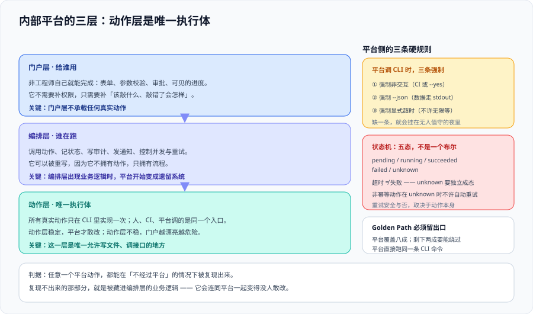

# 内部平台：从命令到自助服务



当一个工具的使用者**不再是工程师**时，形态就必须变。不是因为命令不好用，而是因为**命令要求使用者具备三样他可能没有的东西**：知道该敲什么、有权限敲、敲错了能自己判断。内部平台要补的就是这三样。

::: tip 一句话定位
内部平台不是「给 CLI 套一个网页」。它的本质是**把「该敲什么」变成「填几个空」，把「有没有权限」变成一次审批，把「敲错了怎么办」变成一条可查的记录**。
:::

## 一、什么时候该从命令走到平台

四条信号，**出现任意一条就该考虑**；四条都不出现时，做平台是净亏损。

| 信号 | 具体表现 | 平台要补什么 |
| --- | --- | --- |
| ① 使用者不是工程师 | 群里出现「帮我跑一下那个命令」 | 表单 + 默认值 + 结果解释 |
| ② 命令要求权限而使用者没有 | 每次都要找人代跑 | 以**服务身份**执行 + 审批留痕 |
| ③ 需要跨系统编排 | 一次操作要动仓库、CI、云资源三处 | 编排层 + 状态跟踪 |
| ④ 需要留痕与审计 | 「谁在什么时候把生产环境改了什么」答不上来 | 每次执行落一条不可改的记录 |

::: danger 踩坑：把平台做成「流程搬运」
最常见的失败做法是：把线下的审批表格原样搬到一个网页表单上，字段照抄 40 个，**没有人重新想过「哪些字段其实可以从别处读到」**。结果是线上版本比线下还慢，因为线下可以口头补一句，线上只能走完整流程。

**平台化唯一的正当理由是「减少人的输入与判断」，不是「把流程电子化」。** 判断标准：上线后，完成同一件事需要人回答的问题数量**必须减少**。没减少，就是把成本从一个人转移到了另一个人。
:::

## 二、三层结构：每一层只做一件事

| 层 | 职责 | 不做什么 | 典型实现 |
| --- | --- | --- | --- |
| **动作层** | 真正干活：调 API、改文件、发请求 | **不做审批、不做展示** | 已有的 CLI / 内部 API（**复用，不重写**） |
| **编排层** | 把多个动作串成一次「业务动作」：参数校验、顺序、重试、状态 | 不做权限判断（权限在门户与服务身份上） | 工作流引擎 / 一段服务端代码 |
| **门户层** | 目录、表单、状态展示、审批 | 不实现业务逻辑 | Backstage 类门户 / 自研页面 |

**本页最重要的一条设计约束**：

> **平台不重新实现动作逻辑。** 动作层（CLI 或 API）是**唯一执行体**，平台只负责给参数、触发它、记录结果。

理由很直接：一旦平台里出现第二份「怎么部署」的实现，它就会和 CLI 的第 137 行的修复脱节——**而且脱节是静默的**，因为两条路径平时都「能跑」。

::: tip 平台怎么调 CLI 而不被 CLI 拖累
CLI 是给交互使用设计的，平台调用它时必须补三件事：

1. **强制非交互**（`--yes` / `CI=1`），否则平台会在等一个永远不会出现的回答上超时；
2. **强制机器可读输出**（`--json`），否则平台要解析人类可读文本——**那等于把措辞变成了契约**；
3. **给一个明确的超时**，并把超时当成一次「未知结果」而不是「失败」（见第五节）。

```shell
# 平台侧调用 CLI 的正确形态（三条缺一不可）
CI=1 my-tool deploy --env prod --version "$V" --yes --json --timeout 15m > result.json 2> err.log
echo "退出码=$?"    # 0=成功 / 3=无事可做 / 4=前置不满足 / 5=校验失败（见 CLI 设计的退出码表）
```
:::

## 三、Golden Path：平台真正交付的东西

平台不是一个「什么都能配」的界面——**那是一张没人填得完的表单**。平台交付的是**黄金路径**：一条被预先验证过、覆盖 80% 场景的标准做法。

| 要素 | 平台的职责 | 常见错误 |
| --- | --- | --- |
| **模板** | 提供 2~3 个经过验证的组合（不是无限可选） | 把底层参数全部暴露成输入框 |
| **默认值** | 每个字段都有默认值，且默认值能跑通 | 默认值是占位符（`xxx`） |
| **校验** | 在**提交前**校验，而不是执行到一半才报错 | 提交成功、5 分钟后在日志里失败 |
| **逃生通道** | 允许「不满足条件时走人工」 | 平台之外没有路 → 大家绕过平台 |

::: warning 说明：一定要留逃生通道
任何平台都会遇到「标准路径不适用」的情况。**没有逃生通道的平台，会教会所有人绕过平台**——而绕过之后就没有留痕了，比不做平台更糟。

逃生通道的标准形态：一个「申请例外」按钮，落到一个**有 SLA 的人工队列**上，并记录**这次例外用了哪个参数组合**（这就是下一步要固化的候选）。
:::

## 四、审批与留痕：记录什么才算数

一条可用的执行记录至少包含六项。缺任何一项，事后都无法复盘。

| 字段 | 内容 | 为什么必须有 |
| --- | --- | --- |
| **谁发起** | 身份（不是「某个服务账号」） | 责任归属 |
| **谁批准** | 审批人 + 时间 | 审批不是形式 |
| **什么参数** | **完整展开后的参数**，不是模板名 | 「模板 v3 变了」之后才能还原当时到底跑了什么 |
| **对着什么** | 目标环境/资源标识 | 防止「以为是测试环境」 |
| **开始与结束时间** | 两个时间戳 | 时长与超时判断 |
| **结果** | 退出码 + 机器可读输出的摘要 | 「成功了」这三个字没有信息量 |

::: danger 踩坑：记录模板名而不是展开后的参数
「2026-10-16 14:02 张三用 `deploy-service` 模板部署了服务」——这条记录在**模板改了之后**就完全失去意义：你无法知道当时模板的默认值是什么、选的是哪个版本。

**正确做法：落库的是「展开后的完整参数集合」**，模板名只作为附加信息。这也让「同参数重放」成为可能（排查时的救命功能）。
:::

## 五、异步执行与状态：两个必须承认的事实

平台的执行大多是**长任务**（构建、部署、迁移）。它引入了两个在 CLI 里不存在的问题：

| 问题 | 事实 | 处理方式 |
| --- | --- | --- |
| **超时 ≠ 失败** | 网络断了、进程被杀了，而远端可能已经执行成功 | 状态机里必须有 **`unknown`** 这一档，并给出「怎么查明真相」的步骤 |
| **重试可能重复执行** | 同上，重试会再跑一遍 | 动作层必须**幂等**；不幂等的一律不自动重试，只能人工确认 |

**三态不够，至少要四态**：`pending`（已接受）/ `running`（执行中）/ `succeeded` / `failed` / **`unknown`（结果不明，需人工核对）**。

```text
执行记录的状态流转（判据 IP-F 的验证对象）
pending → running → succeeded
                  → failed（有退出码与 stderr 摘要，可重试）
                  → unknown（超时/连接中断；必须给出核对命令，禁止自动重试）
```

::: danger 踩坑：把「超时」当成「失败」然后自动重试
一个部署任务在 15 分钟超时被标记为失败，调度器按策略重试了一次。**结果是同一个版本被部署了两遍**——多数时候没事，但那次它同时触发了两次数据库迁移，第二次因为「表已存在」而失败，于是整条流水线红在一个看起来无关的地方。

**铁律：不幂等或幂等性不确定的动作，超时后一律进 `unknown` 且不自动重试。** 幂等性由动作层保证（见[总览](../Overview/index.md)的契约边界）。
:::

## 六、度量：平台有没有用的三个数字

不做度量的平台，会在半年后陷入「不知道它在被用还是没人用」的僵局。

| 指标 | 定义 | 健康区间（判断方向，非绝对） |
| --- | --- | --- |
| **自助率** | 由使用者自己发起 / 总发起数 | 上升；**下降说明表单太难或校验太严** |
| **成功率** | `succeeded` / (`succeeded` + `failed`) | 上升；`failed` 高说明**校验放得太靠后** |
| **人工介入率** | 走逃生通道 / 总发起数 | **不为 0 但应较低**；为 0 通常意味着**没人敢用例外**（不健康） |

三个指标各自的解读方向不一样，**不要把它们合成一个分数**——一个「综合健康度 87 分」既不指向任何动作，也会让人停止思考。

## 七、什么时候**不该**做平台

1. **使用者还是工程师，且人数不到 10**：一条命令 + 一份 README 的成本远低于一个平台。
2. **动作本身还在变**：平台会把不稳定流程固化，改起来比命令贵十倍。
3. **缺少「以服务身份执行」的能力**：平台的所有价值有一半来自「使用者不需要权限」，做不到这一点，平台只是个远程命令执行器，**还多了一层安全风险**。
4. **没有人负责它**：平台是有 SLA 的东西（它挂住时使用者会等你），必须有明确的负责人。

## 八、验证方式

```shell
# 1) 动作层是否被复用（不该出现第二份实现）
git grep -c 'deploy' -- src/  # 期望：真正的动作只在动作层出现一次

# 2) 平台调用 CLI 时是否强制非交互与机器可读
grep -nE '(--yes|CI=1).*(--json)' -r platform/ ; echo "三项齐全检查=$?"

# 3) 记录里是不是「展开后的参数」而不是模板名
#    取一条最近的执行记录（示例用本地 JSON 记录文件）
jq -e '.[0] | has("params_expanded") and has("actor") and has("target")' executions.json ; echo "六字段检查=$?"

# 4) unknown 状态是否存在且不可自动重试
jq -r '.[] | select(.status=="unknown") | .recheck_cmd' executions.json | head -1
# 预期：能打印出一条「查明真相」的命令，而不是空

# 5) 逃生通道存在
curl -sS "$PLATFORM/index/exception" | grep -qi 'exception\|例外' && echo "逃生通道存在"
```

**预期输出**：① 动作实现只有一处；② 平台侧调用同时带 `--yes`（或 `CI=1`）、`--json`、`--timeout`；③ 执行记录含六项字段；④ `unknown` 状态有对应的核对命令；⑤ 例外入口可达。

## 九、判据清单

| 判据 | 内容 | 怎么验证 |
| --- | --- | --- |
| `IP-A` | 做平台的理由是四条信号之一（非工程师使用 / 权限 / 跨系统编排 / 留痕），并写明平台化后「人要回答的问题变少了」 | 上线前后各数一次「一次操作要回答的问题数」，后者更小 |
| `IP-B` | 三层职责不混：动作层不复审批、编排层不判权限、门户层不含业务逻辑 | 逐层抽查代码，找不到跨层职责 |
| `IP-C` | **动作层是唯一执行体**，平台不重新实现动作逻辑 | 全仓搜同一动作的实现，只有一处 |
| `IP-D` | 平台调用动作时强制非交互 + 机器可读 + 显式超时，且按退出码分支 | 调用代码里三项齐全；退出码分支覆盖 0/3/4/5 |
| `IP-E` | 提供 2~3 条 Golden Path，字段有可跑的默认值，校验在提交前 | 表单字段数 ≤ 8；空表单直接提交能成功 |
| `IP-F` | 状态机含 `unknown`，且不幂等动作超时后不自动重试，给出核对命令 | `unknown` 记录里能读到核对命令；调度配置里此类动作无自动重试 |
| `IP-G` | 执行记录至少六项：发起人、审批人、**展开后参数**、目标、起止时间、结果 | 抽查一条记录，六项齐全且参数已展开 |
| `IP-H` | 有逃生通道且记录例外参数；三个度量指标在采集 | 例外入口可达；自助率/成功率/人工介入率有数据、不合成单一分数 |

## 十、与相邻专题的分工

- **本页讲「使用者不再只有工程师时，形态怎么变」**；[CLI 设计](../CliDesign/index.md) 讲命令本身，[分发与版本](../Distribution/index.md) 讲怎么让命令装得上。
- **低代码搭建平台**是一个特定形态（把页面搭出来），归 [低代码平台](../../../Frontend/LowCode/index.md)；本页讲的是**执行动作**的平台。
- 工作流引擎本身的实现归 [工作流与规则引擎](../../../Backend/WorkflowEngine/index.md)；本页只讲编排层在平台里的位置。
- 审批与留痕在**完整交付流程**里的位置归 [完整项目交付](../../../Others/ProjectDelivery/index.md)。
- 以服务身份执行带来的安全边界（最小权限、凭据轮换、密钥生命周期）归 [安全加固](../../../Ops/SecurityHardening/index.md) 与 [云上架构 · 安全](../../../Ops/CloudArchitecture/Security/index.md)。

## 参考资料

- [Backstage 官方文档](https://backstage.io/docs/)：开发者门户的事实标准（软件目录 + 模板 + 插件）
- [Team Topologies（平台团队与黄金路径）](https://teamtopologies.com/)：Golden Path 与平台团队职责的来源
- [CNCF Platforms White Paper](https://tag-app-delivery.cncf.io/whitepapers/platforms/)：平台的三层能力模型与反模式
- [OpenGitOps · 幂等与协调循环](https://opengitops.dev/)：为什么「执行体必须幂等」是平台化的前提
- [CloudEvents](https://cloudevents.io/)：跨系统编排时事件形状的通用约定
