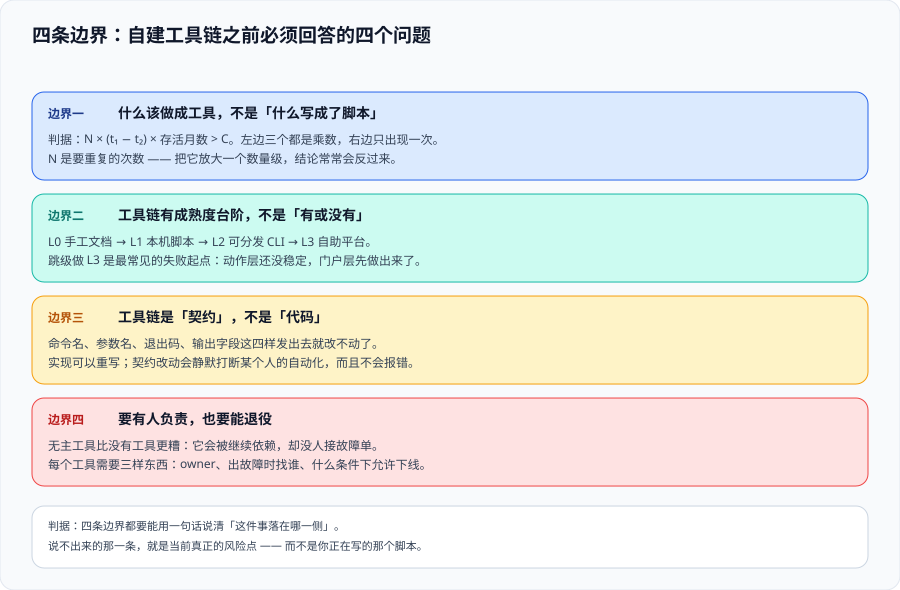

# 总览：自建工具链的四条边界



「自建工具链」这四个字听起来像是「写点脚本」，但它真正难的地方不在写，而在**判断哪些事值得做成工具、做出来之后谁负责它活下去**。这一页先把边界画出来：什么时候该自建、什么时候该用现成的、做到哪一层就够。

::: tip 一句话定位
工具链不是「让开发变快」的魔法，它是**把团队里重复出现的手工动作，换成一次写好、所有人共用、能被机器检查的东西**。它的收益来自「重复次数 × 每次省下的时间」，成本来自「它自己也要被维护」。
:::

## 一、先算一笔账：什么时候自建是划算的

自建工具链是一条**先投入、后回收**的曲线。判断要不要做，只需要估算四个量：

| 量 | 含义 | 怎么估 |
| --- | --- | --- |
| `N` | 这件事每月被做的次数 | 去翻提问记录、工单、群聊；不要靠印象 |
| `t₁` | 每次手工做需要的时间（含踩坑） | 找一个人现场做一遍并掐表 |
| `t₂` | 每次用工具做需要的时间 | 工具做完之后的稳态耗时，通常还有一次学习成本 |
| `C` | 工具本身的建设 + 维护成本 | 首版工时 + **每月维护工时 × 预期存活月数** |

**划算的判据**：`N × (t₁ − t₂) × 存活月数 > C`。

大多数人算这笔账时会漏掉 `t₂` 里的**学习成本**和 `C` 里的**维护成本**。一个每月被用 3 次、每次省 5 分钟的工具，即使首版只花 2 小时，也几乎永远收不回来——因为它每次都要有人记得它存在，而「记得」这件事本身有成本。

::: danger 三个最容易算错的地方
1. **把「一次性批量脚本」当成「工具」**：一次性脚本解决的是**一次性问题**（比如第一次迁移 300 个文件），它的正确归宿是**跑完就删或归档**，不是包装成命令养起来。判据是「这件事下个月还会不会发生」。
2. **把 `t₁` 算成「熟练工的时间」**：手工动作的真实成本由**最不熟练的人**决定——那个人才会去提问、才会漏步骤、才会用到那个「只有老张知道」的参数。
3. **漏掉「它坏了谁修」**：没人负责的命令比没有命令更糟，因为大家会先试它、失败、再手工做一遍——等于工序翻倍。
:::

## 二、边界一：什么该做成工具，什么不该

「该不该自建」和「该不该做成工具」是两个问题。下面这张表给出**动手前的四条禁令**。

| 情况 | 该不该自建 | 理由 |
| --- | --- | --- |
| 社区已有成熟方案且能覆盖 80%（如格式化、lint） | **不自建**，用现成的 + 一份薄配置 | 你在为剩下的 20% 承担 100% 的维护责任 |
| 动作涉及公司的特殊约定（命名、目录、审批） | **自建** | 这部分没有公开方案能覆盖 |
| 一次性迁移、一次性盘点 | **写脚本，不建工具** | 它的生命周期以「跑完」为终点 |
| 只有一个人做的动作 | **先别做**，先让它被第二个人做过至少一次 | 单人动作里的隐性知识还没被逼出来，做出来的工具会缺一半参数 |
| 需要跨仓库复用、且别人会独立升级 | **可以自建**，但必须同时定「分发方式」 | 没有分发方式的工具链会在第三个仓库里分叉成三份 |
| 每天被做 10 次以上、步骤超过 5 步 | **优先自建**，这是收益最高的一类 | 步骤数决定了手工做必然出错 |

::: warning 说明：能用现成的时候，用现成的
自建工具链的第一原则不是「自己写」，而是**「别人写好的部分不要再写一遍」**。参数解析、颜色输出、模板渲染、版本管理全都有成熟库；自建的部分应该只有**你们团队特有的那层约定**。把「用 commander 还是自己解析 argv」当成一个需要慎重的问题，本身就是选错了战场。
:::

## 三、边界二：四条成熟度台阶，别跳级

工具链的形态有四档，**每一档解决的问题不同，不是「越往后越好」**。

| 档 | 形态 | 解决的问题 | 典型信号（说明你该往下一档走） |
| --- | --- | --- | --- |
| L0 | **文档 + 检查清单** | 有人不知道该做什么 | 清单被跳过、或每个人理解不同 |
| L1 | **脚本**（可执行、无参数或参数极少） | 动作固定但繁琐 | 脚本开始被复制修改，出现多个近似副本 |
| L2 | **CLI**（有子命令、参数、帮助、退出码） | 动作有变体，且要能接进自动化 | 有人问「有没有一个命令能一次做完」 |
| L3 | **自助平台**（不写代码的人也能用） | 使用者不是工程师，或需要审批与留痕 | 使用者开始在群里请求「帮我跑一下」 |

**判据是「上一层出现了什么现象」，不是「团队规模多大」**。十个人的团队如果有两百个外部使用者，L3 是必需的；两百人的团队如果只有一个仓库，L3 是负担。

::: danger 跳级的两种典型代价
1. **L0 直接跳到 L3**：上来就做一个平台，但底下的动作还没稳定。结果是**把不确定的流程固化成了一个更难改的东西**——流程图很好看的平台，点下去什么都没发生。
2. **L1 停在 L1 且拒绝升级**：脚本被复制了七份，其中三份的差异没人说得清。这时真正的成本不是「重复」而是**「不知道哪份是对的」**。
:::

## 四、边界三：工具链是「契约」不是「代码」

这一条是本专题最容易被忽略、也最容易付代价的边界。

一个被三个人以上使用的命令，**它的参数名、退出码、输出格式就是契约**。一旦有人写了 `my-tool build --out dist > log`，你改掉 `--out` 或让它把日志打到 stdout，就破坏了这个人的自动化——而且**不会有人报错**，他会在两周后发现日志里混进了别的东西。

| 属于契约的部分 | 改动代价 | 需要的动作 |
| --- | --- | --- |
| 命令名与子命令名 | 高 | 加别名，至少保留一个大版本 |
| 参数名与短横线形式 | 高 | 加别名；不要改语义 |
| **退出码** | **最高** | 只允许新增码，不允许改变已有码的含义 |
| `stdout` / `stderr` 的分工 | 高 | 数据进 stdout、日志进 stderr，一次定死不许反悔 |
| 机器可读输出（`--json`）的字段 | 中 | 只加字段，不删、不改名、不改类型 |
| 人类可读输出的措辞与颜色 | 低 | 随便改（但不要指望有人看它） |

::: tip 一句话记住
**要有人（或脚本）消费的输出，就是接口；没人消费的输出，才是「界面」。** 前者按版本管理，后者随便改。
:::

## 五、边界四：工具链要有人负责，也要能退役

「谁维护」这件事必须在第一条命令发布**之前**就写下来，否则它会在第一个人离职时变成孤儿。

| 必须写下的四件事 | 写在哪儿 | 最低要求 |
| --- | --- | --- |
| 负责人 | 仓库 `CODEOWNERS` 或工具目录下 `MAINTAINERS` | 至少两人，避免单点 |
| 支持范围 | 工具仓库 README 顶部 | 明确「支持哪些 OS / 语言版本 / 使用场景」 |
| 反馈入口 | 命令 `--help` 的末尾 | 一个 issue 模板链接或群名，不要只写「找人问」 |
| 退役条件 | 工具仓库 README | 写明「什么时候可以删它」，否则它永远不会被删 |

**退役判据的三条**（满足任一即可进入弃用流程）：

1. **连续一个季度零调用**（有埋点就直接看数据，没有埋点就靠口头确认）；
2. **上游出现了官方等价方案**（例如框架官方发布了脚手架）；
3. **它维护的动作已经不再需要**（流程改了，那一步取消了）。

退役不是直接删。**弃用流程三步**：① 在 `--help` 与 README 顶部打「已弃用 + 替代方案 + 移除日期」；② 被调用时打印一行 stderr 警告（**但不改变退出码**）；③ 到期后删仓库、从 registry 上 `deprecate`（撤销而不是删除，让旧版本仍可安装并有提示）。

::: danger 踩坑：把「弃用警告」打到 stdout
有人为了显眼，把弃用警告 `echo` 到 stdout。结果所有 `my-tool list --json > out.json` 的脚本**解析失败**——一个只打了行字的改动，让十几个下游任务同时红。**警告一律进 stderr**（见本页判据 `TL-D`）。
:::

## 六、什么时候**不该**自建工具链

下面四类场景，自建通常是净亏损：

1. **团队只有 1~3 人且都在同一个 screen 前面**：口头同步的成本远低于维护一个工具。
2. **动作本身还在天天变**：把不稳定的流程固化成工具，等于给一个还在动的东西浇筑混凝土。**先用手工流程跑够 10 次**，再考虑沉淀。
3. **你没有余量去维护它**：工具链的维护是**持续性**的（依赖升级、Node 大版本换代、OS 兼容）。如果团队连续两个迭代都在赶需求，做出来的工具会在第三个迭代被遗忘。
4. **这件事本质上是一次性的**：迁移、盘点、审计取证。跑完归档即可。

## 七、最小起步三步

不要一上来做平台。**三步**，每步都有可当场执行的验收。

1. **把一件事写成文档**：选一个「每周至少发生一次、超过 5 步」的动作，写成带命令的检查清单。
   **验收**：让一个没做过的人照文档做一遍，全程不问你；把他卡住的地方补进文档。
2. **把它变成一个零参数的脚本**：把清单里所有需要人肉填空的地方改成「从仓库里读」或「带默认值」。
   **验收**：脚本在**干净克隆的仓库**上跑一次成功；把仓库目录改名后仍成功（证明没有硬编码路径）。
3. **把它变成有子命令与退出码的 CLI**：补上 `--help`、`--dry-run`、机器可读输出与退出码约定。
   **验收**：`my-tool --help` 能在 10 秒内让人知道该敲什么；失败时退出码非 0 且 stderr 有下一步动作。

::: tip 一句话理解
**先有文档，再有脚本，最后才是命令。** 反过来做的团队，最后得到的是一个没人知道该不该用的命令。
:::

## 八、验证方式

以下命令不需要任何工程代码，在任意一个仓库里都能跑，用来验证本页的四条边界是否被遵守。

```shell
# 1) 工具是否声明了「谁能用、支持什么」：README 顶部 20 行里应能找到支持范围
head -20 README.md | grep -nE "支持|Requires|Requirements|Node|Python|macOS|Linux"

# 2) 是否声明了负责人：应至少命中一个文件
ls -1 CODEOWNERS .github/CODEOWNERS MAINTAINERS 2>/dev/null

# 3) 退出码是否被当成契约（示例：检查脚本里有没有人依赖非 0/1 的码）
git grep -nE '\$\? *(==|-eq) *[2-9]' -- '*.sh' '*.yml' '*.yaml'

# 4) stdout/stderr 分工：把 stdout 重定向到文件后，文件里不应出现进度/警告类文字
my-tool build --json > out.json 2> err.log && head -3 out.json && head -3 err.log
```

**预期输出**：① 命中至少一行支持范围；② 命中一个负责人文件；③ 如命中，说明有人把自定义退出码写进了自动化——此时改退出码就是破坏性变更；④ `out.json` 首行应是 JSON 起点（`{` 或 `[`），**不是** `正在构建...` 这类文字。

## 九、判据清单

| 判据 | 内容 | 怎么验证 |
| --- | --- | --- |
| `TL-A` | 动手前先算过 `N × (t₁ − t₂) × 存活月数 > C`，而不是凭「感觉麻烦」立项 | 立项说明里能看到四个量的估算，且 `N` 有出处（工单/提问记录） |
| `TL-B` | 现成方案能覆盖的部分不自建，自建的只有团队特有约定 | 逐项列出「用了什么现成库」，自研代码里找不到参数解析、模板渲染、颜色输出 |
| `TL-C` | 成熟度不跳级：上一档出现了信号才进下一档 | 每一档的升级理由能指向一个具体现象（副本数量、提问记录），不是「想做」 |
| `TL-D` | 所有警告/进度/日志进 stderr，stdout 只放数据 | `my-tool --json > out.json` 后 `out.json` 可直接被 `jq` 解析 |
| `TL-E` | 退出码被当成契约：只新增、不改变已有含义，且把含义写进 `--help` | `--help` 里有退出码表；搜索下游脚本，没有依赖未在表中声明的码 |
| `TL-F` | 负责人、支持范围、反馈入口、退役条件四项在首发前就写下 | 四项在 README 或 `CODEOWNERS` 里逐条可见，四项缺一即不合格 |
| `TL-G` | 退役走三步流程，且弃用期内的警告不改变退出码 | 触发弃用分支后，退出码与正常路径一致，警告只出现在 stderr |
| `TL-H` | 起步按「文档 → 零参数脚本 → CLI」三步走，每步都有可当场执行的验收 | 三步的验收都有一次实际记录（含失败并修正的那次） |

## 十、与相邻专题的分工

- **本页讲「要不要做、做到哪一档」的判断（决策边界）**；[脚手架](../Scaffold/index.md) 讲结构怎么生成，[CLI 设计](../CliDesign/index.md) 讲命令模型与退出码该怎么定，[分发与版本](../Distribution/index.md) 讲怎么让别人稳定地用上。
- 仓库**内部**的规范与目录组织归 [前端工程化](../../../Frontend/Others/FrontendEngineering/index.md)；本页只管**跨仓库重复的那部分**。
- 校验命令在流水线里**挂在哪一步**归 [CI/CD](../../CICD/index.md)；本页只管它**由谁提供、谁写维护**。

## 参考资料

- [Semantic Versioning 2.0.0（中文）](https://semver.org/lang/zh-CN/)：版本号语义——判断「这次改动算不算破坏性」的权威依据
- [Command Line Interface Guidelines](https://clig.dev/)：命令行工具的通用设计约定（本专题 CLI 设计一页多处引用）
- [The Twelve-Factor App](https://12factor.net/zh_cn/)：把配置放进环境是工具能被复用的前提
- [GNU Coding Standards · Exit Status](https://www.gnu.org/prep/standards/html_node/Exit-Status.html)：退出码约定的经典来源
- [GitHub Docs · About CODEOWNERS](https://docs.github.com/en/repositories/managing-your-repositorys-settings-and-features/customizing-your-repository/about-code-owners)：把「谁负责」写进仓库的方式
