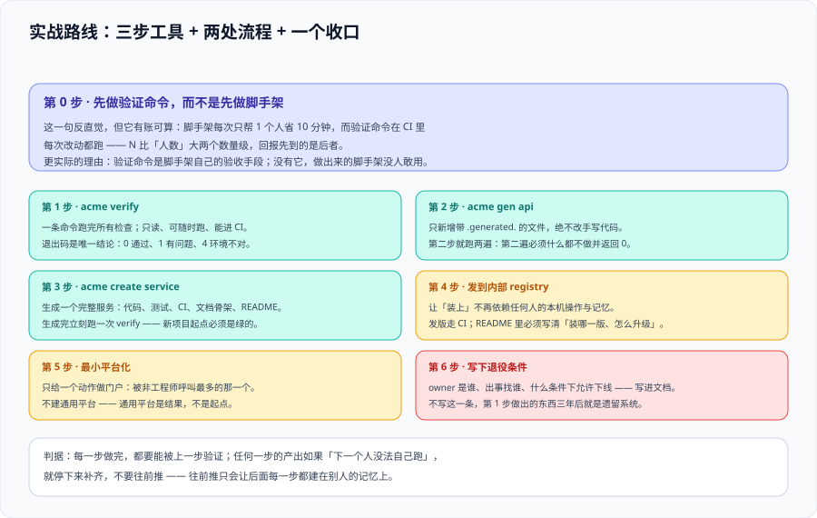

# 实战：给一个多语言仓库搭一条工具链



前面八页讲的是判断与做法。这一页把它们串成一次**可照着走的落地**——场景是一个真实形状的仓库：**三种语言、十来个开发、四件每天都要重复的事**。

::: tip 本页的写法纪律
每一步给出**做什么、验收判据、失败时的表现**。所有命令都是**读者在自己仓库里执行**的（本仓不存放任何工程代码）；凡引用版本事实处都带核对日期。**本页不给「预计耗时」**——耗时取决于你的仓库现状，写出来只会误导。
:::

## 一、设定：仓库与四件重复的事

| 维度 | 现状 |
| --- | --- |
| 语言 | TypeScript（前端 + BFF）、Java 25（核心服务）、Python 3.13（数据任务） |
| 人数 | 12 人，其中 3 人不是主语言作者 |
| 仓库形态 | pnpm workspace + Maven 多模块 + uv 项目，三者各自有自己的命令 |
| 已有资产 | 一份 3 页的 `CONTRIBUTING.md`，两段被复制了 5 份的 shell 脚本 |
| 痛点（真实提问记录） | 「新建一个服务要改哪些地方」「契约加了字段，客户端要不要手动改」「发版本要跑哪几步」「本地跑全量校验要敲几条命令」 |

**四件要沉淀的事**（按「每月发生次数 × 每次耗时」排序）：

| 序 | 动作 | 每月次数 | 谁会做 | 目标形态 |
| --- | --- | --- | --- | --- |
| ① | 新建一个服务（三语言各一套骨架） | ~2 | 主语言作者 | **脚手架**（`acme create service`） |
| ② | 加一个接口（契约 → 三端产物） | ~10 | 三种语言的作者 | **契约驱动生成**（`acme gen api`） |
| ③ | 本地全量校验（lint + 测试 + 契约检查） | ~200（每天多次） | 所有人 | **一条命令**（`acme verify`） |
| ④ | 发版本（含 changelog 与内部 registry 发布） | ~4 | 轮值发布人 | **平台化**（先 CLI，再审批入口） |

## 二、第 0 步：先算账，再动手

按[总览](../Overview/index.md)的公式 `N × (t₁ − t₂) × 存活月数 > C`，只对**最确定的一件**先做：

| 动作 | `N`/月 | `t₁`（手工，含踩坑） | `t₂`（用工具） | 首版 + 维护 `C`（人时） | 结论 |
| --- | --- | --- | --- | --- | --- |
| ① 新建服务 | 2 | 半天（含漏配） | 5 分钟 | 首版 6h + 每月 1h | **先不做**（`N` 太小） |
| ② 契约 → 三端 | 10 | 每端 20 分钟 = 1h | 3 分钟 | 首版 12h + 每月 2h | **做**（跨端一致性是硬需求） |
| ③ 全量校验 | 200 | 每次 12 分钟 | 3 分钟 | 首版 3h + 每月 0.5h | **先做**（收益最高） |
| ④ 发版本 | 4 | 1.5h（含 chat 沟通） | 20 分钟 | 首版 10h + 每月 2h | **第二步做** |

**结论很反直觉：先把「校验」做成一条命令，而不是先做脚手架。**

理由有三条，都来自计算而不是偏好：① `N` 高出两个数量级；② 校验命令**天然是幂等的无副作用动作**，最不容易做歪；③ 它同时是「工具链的验收手段」——后面每一步都能用它验证（**这一点比前两条更重要**）。

::: warning 说明：这一步不是可选的
跳过第 0 步直接开工，最常见的结局是：花了三周做了一个漂亮的脚手架，**每月被用两次**，然后没人维护。**先把「收益最高、风险最低」的那件做掉**，团队对工具链的信任就是从这条命令开始的。
:::

## 三、第 1 步：`acme verify`——把校验收成一条命令

**做什么**：把三语言各自的 lint / 测试 / 契约检查收成一个入口，**并让它支持增量**。

**关键设计只有两条**：

1. **子命令按「维度」而不是「语言」划分**：`acme verify lint` / `acme verify test` / `acme verify contract`，而不是 `acme verify ts` / `acme verify java`。理由：**出问题时人的第一句话是「lint 挂了」还是「Java 挂了」**——前者是可动作的信息。
2. **每个维度都必须能在「只改动了一个文件」时给出「跳过哪些」的判断**，否则 12 分钟成本原样保留。

```shell
# 目标形态（每条维度独立可跑，且都能单独定位失败）
acme verify lint       # 三语言一起，输出按语言分组
acme verify test --since=main   # 只跑受改动影响的模块
acme verify contract   # 契约 lint + 生成物 diff 为空
acme verify            # 等价于上面三条按顺序执行，短路退出

# 验收判据（TP-A）
acme verify 2>&1 | tail -5 ; echo "退出码=$?"
# 预期：退出码 0；末尾五行里能看到三个维度的汇总（各自通过数/失败数）
# 失败时的预期：退出码为 5（校验失败），stderr 指名第一个失败项与「怎么复现」
```

**失败时的三种表现，必须能区分**：

| 表现 | 退出码 | 说明 |
| --- | --- | --- |
| 某维度真的失败 | `5` | 有具体的失败项与复现命令 |
| 前置不满足（缺 JDK 25、缺 uv） | `4` | **不进入校验**，直接报环境问题 |
| 没有需要校验的改动 | `3` | 「无事可做」不是成功（见 [CLI 设计](../CliDesign/index.md)） |

## 四、第 2 步：`acme gen api`——让契约成为唯一手写来源

**做什么**：契约（OpenAPI）改完后，一条命令产出三端产物：TS 客户端类型、Java 接口骨架、Python 客户端。

**三条设计约束**（这是全项目最贵的一段，出错成本最高）：

1. **产物目录整体由工具拥有**，文件名带 `.generated`（见[代码生成](../Codegen/index.md)）。
2. **`--check` 模式是门禁**：重新生成到临时位置 + `git diff --exit-code`。
3. **不允许手工改产物，且产物文件头写明这一点**。

```shell
# 验收判据（TP-B）：生成物 diff 为空
acme gen api && git diff --exit-code -- '**/api.generated.*' ; echo "漂移检查=$?"
# 预期：退出码 0（说明产物与契约同步）
# 反例验证：手改一个产物文件后再跑，必须非 0 并指名文件
printf '\n// hand edit\n' >> packages/api/api.generated.ts
acme gen api --check ; echo "手改后=$?"    # 期望非 0
git checkout -- packages/api/api.generated.ts
```

::: danger 这一步最容易踩的三个坑
1. **产物进了 lint 但没进编译器**：结果是一堆「lint 全绿、编译不过」的产物。正确做法是产物**排除格式规则、必须包含类型检查**。
2. **契约里的可选字段被生成成必填**：这是生成器配置问题，但**表现是「本地能跑、某台机器上崩」**——因为少传的那个字段只在特定请求路径上被读取。**用一条「最小可用请求」的端到端测试锁住它**。
3. **生成器版本漂移**：生成器自己被升级后产物会变，于是**所有人的 `--check` 同时变红**。生成器必须是**精确版本锁定**的生产依赖（见 [CLI 工程化](../CliImplementation/index.md)）。
:::

## 五、第 3 步：`acme create service`——把脚手架做出来

到这一步再做脚手架，是因为前两步已经建立了「工具是可以信的」这件事。

**做什么**：一条命令生成三语言可选的服务骨架，包含目录、构建配置、`verify` 接入与 CI 配置。

```shell
# 目标形态
acme create service --name order-sync --lang java --with-api --dry-run   # 先看要生成什么
acme create service --name order-sync --lang java --with-api
cd order-sync && acme verify ; echo "新服务自检=$?"
```

**验收判据（TP-C）**：生成后**直接 `acme verify` 通过**。这是脚手架质量的唯一诚实判据——如果新生成的骨架自己都不能通过校验，说明骨架已经过期了。

```shell
# 三条边界验证（都要跑）
acme create service --name order-sync --lang java --dry-run | grep -F '<<' ; echo "占位符残留=$?"  # 期望非 0（无残留）
acme create service --name order-sync --lang java ; echo "重复执行=$?"                              # 期望非 0（目录已存在）
cd /tmp && mv order-sync renamed-sync && cd renamed-sync && acme verify ; echo "改名后=$?"          # 期望 0
```

::: warning 脚手架的「过期」问题
骨架会随基础设施变化而需要更新（新的 JDK 版本、新的 CI 语法）。**不要提供「升级已生成项目」的命令**，除非能回答「我手改的那一行会不会丢」（见[脚手架](../Scaffold/index.md)）。

本项目的选择是：**不提供升级，提供 `acme create` 的 `--dry-run` 对比**——让作者自己看新骨架长了什么样，然后决定要不要手工同步。
:::

## 六、第 4 步：把 `acme` 发到内部 registry

**做什么**：把 `acme` 发到内部 registry，让所有人 `pnpm add -g @acme/cli` 就能用。

```shell
# 验收判据（TP-D）：干净环境装得上、跑得通
cd "$(mktemp -d)" && pnpm add -g @acme/cli && acme --version && acme verify --help >/dev/null
echo "干净安装=$?"    # 期望 0
```

**这一步只做四件事**（详见[分发与版本](../Distribution/index.md)）：scope 定向、持久存储、发布权限分组、**CI 发布 + 溯源**。

```ini
# 项目 .npmrc：只做 scope 定向，令牌走环境变量
@acme:registry=https://npm.acme.internal/
```

## 七、第 5 步：发布流程平台化（只做最小的一层）

**做什么**：不发版本这个动作本身，而是**给它加一个审批与留痕的入口**。

理由：发版本的使用者里包含**非主语言作者**（轮值发布人），而且这动作要求内部 registry 的发布权限——正好命中[内部平台](../InternalPlatform/index.md)的四条信号中的两条（② 权限、④ 留痕）。

**最小形态**（刻意不做门户与表单）：

```shell
# 平台层不做业务逻辑，只做三件事：给参数、触发、记录
# 1) 校验发起人是否有权发布
# 2) 以服务身份执行动作层的同一条命令（唯一执行体）
CI=1 acme release --bump minor --yes --json --timeout 20m > result.json 2> err.log
# 3) 把「展开后的完整参数 + 退出码 + 结果摘要」落一条不可改记录
```

```shell
# 验收判据（TP-E）：执行记录里有展开后的参数，而不是模板名
jq -e '.[0] | has("params_expanded") and has("actor") and has("target") and has("duration")' release-records.json
echo "记录完整性=$?"   # 期望 0
```

**明确不做**（本期的四件事）：

1. **不做门户页面**——使用者是工程师，命令足够；
2. **不做表单**——参数只有三个，命令行比表单快；
3. **不做跨系统编排**——发布只动一个 registry；
4. **不做遥测**——12 个人的团队，问一句就知道大家在用哪版。

## 八、第 6 步：收口——写下「退役条件」

最后一步不是加功能，而是**给每件工具写下退役条件**（见[总览](../Overview/index.md)第五节）。这是唯一能让工具链**不死在半路**的动作。

```markdown
<!-- tools/acme/README.md 顶部：四件事写在一起 -->
支持范围：macOS 14+ / Linux x64 / Node >= 22.12；仅支持内部 registry 场景
负责人：@team-dx（至少两人）
反馈：issues 模板 .github/ISSUE_TEMPLATE/acme-cli.yml

退役条件（满足任一即进入弃用流程）
- 连续一个季度零调用
- Maven / pnpm / uv 官方发布了等价的骨架生成能力
- 契约生成被上游工具链（如 OpenAPI Generator 官方模板）完整覆盖
```

```shell
# 验收判据（TP-H）：四件事在首发前就写下
grep -cE '支持范围|负责人|反馈|退役条件' tools/acme/README.md    # 期望 4
ls .github/ISSUE_TEMPLATE/acme-cli.yml                            # 期望存在
```

## 九、验证方式

```shell
# 端到端：从零到「一条命令全绿」五条冒烟
acme --version                                        # 1) 装得上
acme create service --name smoke --lang java --dir /tmp/smoke --dry-run | head -5   # 2) 生成可预览
acme gen api --check                                  # 3) 契约产物无漂移
acme verify                                           # 4) 全量校验通过
acme verify lint ; echo "单维度=$?"                    # 5) 单维度可独立定位

# 退出码语义冒烟（三种状态必须可区分）
acme verify ; echo "有改动=$?"          # 期望 0
acme verify --only-changed=nonexistent ; echo "无事可做=$?"   # 期望 3
acme verify --runtime=java-nonexistent ; echo "前置不满足=$?"  # 期望 4
```

**预期输出**：五条冒烟全部成功；三种状态的退出码依次为 `0` / `3` / `4`，**互不相同**。任何两个相同，说明退出码表是装饰品。

## 十、判据清单

| 判据 | 内容 | 怎么验证 |
| --- | --- | --- |
| `TP-A` | 校验先于一切：`verify` 是一条命令、按维度分、支持增量、三种状态退出码可区分 | 单维度可独立执行；`0`/`3`/`4` 三态实测 |
| `TP-B` | 契约是唯一手写来源，产物与契约 diff 为空，产物文件头声明归属 | `acme gen api --check` 退出码 0；手改后非 0 |
| `TP-C` | 脚手架生成后**直接能通过 `verify`**；重复执行与占位符残留都有明确失败 | 新生成的骨架 `acme verify` 退出码 0；两条反例退出码非 0 |
| `TP-D` | 在干净环境（临时目录）装得上并跑得通，令牌不进仓库 | 干净安装记录；`.npmrc` 里无 `_authToken` |
| `TP-E` | 发布流程平台化只做最小一层，且复用动作层命令；记录含展开后参数 | 记录里六字段齐全，`params_expanded` 存在 |
| `TP-F` | 每件工具都有负责人、支持范围、反馈入口、退役条件四项，且在首发前写下 | 四项逐条可见；issue 模板存在 |
| `TP-G` | 顺序由算账决定（`N` 大、风险低的先做），而不是按「哪个更有意思」 | 落地顺序能对着第 0 步的表格解释，且校验是最先做的 |
| `TP-H` | 明确列出「本期不做」的四件事，且每一项都有理由（不是没时间） | 四条「不做」各有判据（使用者是工程师 / 参数量 / 系统数 / 团队规模） |

## 十一、与相邻专题的分工

- **本页是「照着做一遍」**；[总览](../Overview/index.md) 讲判断、[脚手架](../Scaffold/index.md) 到[内部平台](../InternalPlatform/index.md) 各讲一层的做法。
- 校验命令在流水线里挂哪一步归 [CI/CD](../../CICD/index.md)；本页只保证**它会存在且可执行**。
- 契约本身怎么写归 [API 设计与治理](../../APIDesign/index.md)；本页只消费它。
- 项目的流程方法论（需求到上线的完整路径）归 [完整项目交付](../../../Others/ProjectDelivery/index.md)；本页讲的是**其中重复动作的沉淀**。
- 本页的场景与 [实时监控大盘项目](/project/Complete/MonitoringDashboard/index.md) 无依赖关系——那是另一个独立项目的实战记录。

## 参考资料

- [Command Line Interface Guidelines](https://clig.dev/)：本页退出码与输出分流约定的来源
- [OpenAPI Generator 官方文档](https://openapi-generator.tech/)：契约驱动生成器的配置与模板扩展
- [openapi-typescript](https://openapi-ts.dev/)：TS 类型产物的最小路径
- [pnpm workspace 官方文档](https://pnpm.io/workspaces)：多语言仓库里前端侧的 workspace 组织
- [uv 官方文档](https://docs.astral.sh/uv/)：Python 侧的工程化入口
- [Maven 多模块指南](https://maven.apache.org/guides/mini/guide-multiple-modules.html)：Java 侧的模块组织
- [Conventional Commits 1.0.0](https://www.conventionalcommits.org/zh-hans/)：版本与 changelog 的信息来源
