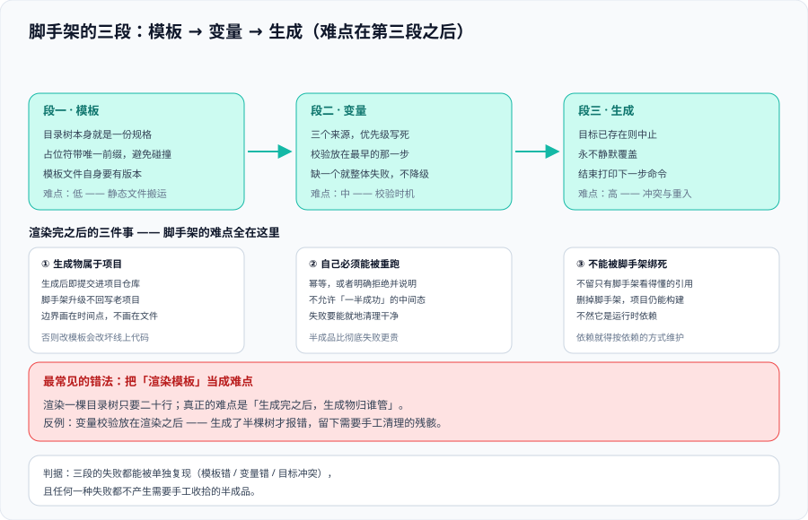

# 脚手架：模板、变量与项目生成



「脚手架」这个词被用得很宽：从 `git clone 模板仓库` 到 `npx create-xxx` 都叫脚手架。这一页把它拆开——**脚手架的难点从来不是「渲染模板」这件事（一个 20 行的函数就能做），而是「渲染完之后，生成物归谁管」**。

::: tip 一句话定位
脚手架是**把「一个项目该长什么样」从人的记忆里搬到文件系统里**的工具。它的输入是几个变量，输出是一棵能跑的目录树，关键约束是：**生成之后，工具就再也没有发言权**。
:::

## 一、三种形态，先选对再动手

| 形态 | 做法 | 变量能力 | 生成后升级 | 适合 |
| --- | --- | --- | --- | --- |
| **Git 模板仓库** | `git clone --depth 1` 然后删 `.git` 改地址 | 几乎没有（靠生成后手工改） | 只能靠人对比上游 | 模板极少变、团队只有一两个仓库 |
| **模板引擎 + 变量替换** | `cookiecutter` / `hygen` 风格：目录树里放 <span v-pre>`{{name}}`</span> 占位符 | 有（走交互或参数） | 不支持（生成物是**你的**） | 大多数内部脚手架 |
| **交互式生成器（框架式）** | `plop` / `yeoman` / 各家 `create-*`：生成器是代码，可做任何事 | 有（可写逻辑） | 部分支持（如 `nx migrate`、`vue upgrade`） | 需要多轮提问、条件分支、后置安装 |

**选型的三条判据**：

1. **需要「生成后还能升级」吗**？需要就倾向框架式生成器（它有能力记录来源），否则老实用模板引擎。**模板引擎的生成物是一次性的，这是它的设计前提，不是缺陷**。
2. **模板要在多个仓库间共享吗**？要共享就得有一个**分发渠道**（`npm` 包、Git 仓库、私有 registry），见[分发与版本](../Distribution/index.md)。
3. **要生成的是「整棵项目树」还是「项目里的一个文件」**？前者用模板引擎或 Git 模板；后者用微生成器（`plop` / `hygen`），因为它天然支持 `append` / `modify`，能改现有文件。

## 二、一条 `create` 命令的解剖

一个能用的脚手架，最少由五段组成。**任何一段缺失都会在某个具体场景下炸掉**。

| 段 | 做什么 | 缺了会怎样 |
| --- | --- | --- |
| ① 参数采集 | 交互提问 + 命令行参数 + 从环境/仓库推断 | 全交互，无法在 CI 里用；或全参数，新人不知道该填什么 |
| ② 校验与规范化 | 项目名合法性、目标目录是否为空、名称各形态派生 | 生成出 `my project`（带空格）或 `MyProject` 与 `my-project` 混用 |
| ③ 渲染 | 目录名与文件内容里的占位符替换 | 生成了 <span v-pre>`{{name}}`</span>/ 这样的目录 |
| ④ 条件与后置动作 | 按选项删文件、装依赖、初始化 git、装钩子 | 生成物「看起来对但跑不起来」 |
| ⑤ 收尾输出 | 告诉用户下一步敲什么 | 用户生成完愣在那儿，回来问你 |

::: tip 一段可复制的最小实现（Node）
下面是**渲染与派生**这一段的最小可用形态，用来说明「变量采集之后到底做了什么」。它不依赖任何脚手架框架：

```js
// scripts/create/derive.mjs
// 作用：把用户输入的「一个名字」派生成四种形态，避免各处手工转换
export function deriveName(raw) {
  // 1) 先规范化：去掉首尾空白、把空格与下划线统一成短横线
  const slug = raw.trim().replace(/[\s_]+/g, '-')
  // 2) 合法性：小写字母开头，允许小写字母/数字/短横线（npm 包名规则）
  if (!/^[a-z][a-z0-9-]*$/.test(slug)) {
    throw new Error(
      `项目名不合法：${raw}\n` +
        `规则：小写字母开头，只能包含小写字母、数字、短横线。` +
        `建议写法：my-service`,
    )
  }
  const words = slug.split('-')
  const pascal = words.map((w) => w[0].toUpperCase() + w.slice(1)).join('')
  return {
    slug,                          // my-service      → 目录名、包名
    pascal,                        // MyService        → 类名、CSS 命名空间
    constant: words.join('_').toUpperCase(), // MY_SERVICE → 环境变量前缀
    label: raw.trim(),             // 用户原样输入      → 文档标题
  }
}
```

```shell
# 验证派生是否正确（期望输出四行，四种形态各一行）
node -e "import('./scripts/create/derive.mjs').then(m=>console.log(m.deriveName('my service')))"
```

**预期输出**：`{ slug: 'my-service', pascal: 'MyService', constant: 'MY_SERVICE', label: 'my service' }`。
接着用非法输入验证它会失败：

```shell
node -e "import('./scripts/create/derive.mjs').then(m=>m.deriveName('My Service'))" ; echo "退出码=$?"
```

**预期输出**：stderr 打印「项目名不合法…建议写法：my-service」，`退出码=1`。
:::

## 三、模板目录的约定

模板的目录结构与项目结构**一一对应**，占位符直接写在路径和内容里。这是最直白也最不容易出错的约定。

```text
templates/service/
├── package.json.hbs            # 文件名也参与渲染（后缀只用来标记模板）
├── src/
│   ├── index.ts.hbs
│   └── {{slug}}/               # 目录名里的占位符会被替换
│       └── handler.ts.hbs
├── deploy/
│   └── compose.yaml.hbs
└── _conditional/               # 以下划线开头的目录：默认不生成，按选项搬运
    └── helm/
        └── Chart.yaml.hbs
```

**四条约定**（缺一条就会在某个边界上出问题）：

1. **模板文件统一加后缀**（`.hbs` / `.ejs` / `.tpl`）。理由不是「渲染器需要」，而是**编辑器能正确高亮、且能一眼看出哪些文件是模板**。
2. **含占位符的目录名允许存在，但必须在 `--dry-run` 输出里可见**。否则第一次跑的人不知道会生成什么目录。
3. **需要「按选项才生成」的内容放独立目录**（如 `_conditional/`）。不要试图在同一个文件里塞大量 <span v-pre>`{{#if}}`</span>——模板一旦需要调试，就该拆成两个模板。
4. **模板里不放密钥、不放真实域名**。要放就放 `.env.example` 与占位值；真实值由**生成后的**一步（接密钥管理系统）填。**模板会被提交进仓库并长期存在，写进去就等于泄露**。

::: danger 踩坑：占位符语法与目标语言的语法撞车
模板语言一旦用 <span v-pre>`{{ }}`</span>，就会和目标语言自己的模板/插值语法冲突——**生成出来的文件本身也可能含 <span v-pre>`{{ }}`</span>**（Vue 模板、Jinja 模板、Helm chart 都是）。两个具体后果：

1. **把不该替换的也替换了**：生成一个 Vue 项目时，<span v-pre>`<p>{{ msg }}</p>`</span> 里的 `msg` 会被脚手架当成自己的变量，替换成空字符串——**页面能跑，但内容没了**，而且没人会想到是脚手架干的。
2. **转义方式各框架不同**：`hbs` 用 <span v-pre>`\{{`</span>、`ejs` 用 `<%%`、Jinja 用 ``。**不要靠记忆**——在模板里出现目标语言插值的每一处都加转义，并在生成后 `grep` 一次确认。

正确做法是**给模板变量加命名空间前缀**（如 `__PROJECT_slug__` 或 `<<slug>>`），把撞车概率降到接近零：

```text
# 推荐：用不易撞车的分隔符
src/pages/index.vue:  <p><<label>> 的欢迎页</p>   <!-- 只替换 <<label>> -->
                      <p>{{ msg }}</p>              <!-- 原样保留，交给 Vue -->
```
:::

## 四、变量只有三个来源，优先级必须写死

| 来源 | 用途 | 优先级 |
| --- | --- | --- |
| 命令行参数 | CI、脚本、熟练用户 | **最高**（任何来源都可被它覆盖） |
| 环境变量 | CI 与容器化调用 | 中 |
| 交互提问 | 人第一次使用 | 最低（有默认值） |

**关键设计：每一项都要有默认值，且默认值要「能跑」**。一个默认值填错的脚手架，比没有默认值更糟——用户会一路回车，然后拿到一个跑不起来的项目。

派生的辅助变量（`pascal` / `constant` / `camel`）**必须由 `slug` 算出，不允许用户单独输入**。让用户同时填 `my-service` 和 `MyService` 的结果是两者不一致，而且是在生成后很久才被发现。

## 五、幂等、重入与「目录已存在」

脚手架第二常见的故障是**跑第二次**。三种处置，必须明确选一种并写进 `--help`：

| 策略 | 行为 | 适用 |
| --- | --- | --- |
| **拒绝**（默认） | 目标目录非空则退出码 1，提示换目录或加 `--force` | 生成**整棵项目树**（推荐默认） |
| **合并** | 已存在的文件跳过，新文件写入 | 向**已有项目**注入一个模块 |
| **覆盖** | 直接覆盖 | 危险；仅当配合 `--dry-run` 与版本控制兜底 |

::: danger 踩坑：「合并」模式下的静默跳过
合并模式最危险的地方是它**成功退出但什么都没做**——因为文件都已存在，于是用户以为「更新成功了」。**必须把「跳过了几个文件」打到 stderr，且当跳过数等于模板文件数时给非 0 退出码**（说明这次执行事实上没有任何效果）。

```shell
# 判据：合并模式下，全部跳过时应为非 0 退出码
my-tool add module --dir . ; echo "退出码=$?"
# 预期：stderr 有「跳过 12 / 共 12」，退出码=3（语义见 --help 的退出码表）
```
:::

## 六、生成之后：工具还要不要管

这是本页最重要的一条边界。

**默认答案：不管。** 生成物从落地那一刻起就属于项目，它会被改、被删、被重写。脚手架再回头去「升级」它，等于在两个所有者之间反复抢方向盘——**结果是项目里的改动被覆盖**。

想让脚手架继续管，只有一条路：**在设计阶段就把「可升级区域」划出来**。

| 做法 | 机制 | 代价 |
| --- | --- | --- |
| **三段分区** | 文件头部标 `<!-- gen:begin -->` / `<!-- gen:end -->`，只有区间内由工具维护 | 模板与代码要约定标记，且**改区间外会被下次覆盖**（必须先说清） |
| **同步命令** | 提供 `sync` 子命令，先把上游差异打到 stdout，人工确认后再落盘 | 需要一次人工介入；但对存量项目最安全 |
| **只生成新文件** | 工具只负责「还没有的文件」，已存在的一律不管 | 老文件永远停在旧版本，需要单独清理路径 |

**判据**：如果你的脚手架号称「可以升级已生成的项目」，那么**必须能回答「我手改的那一行会不会丢」**。答不上来，就不要提供这个能力——提供一个会丢改动的升级命令，比不提供更糟。

## 七、验证方式

```shell
# 1) 干跑：不落盘就能看到将要生成的全部路径
my-tool create service --name demo-svc --dry-run
# 预期：列出 12 条左右的相对路径，且路径里不含未替换的占位符（grep 无输出）
my-tool create service --name demo-svc --dry-run | grep -F '<<' ; echo "占位符残留=$?"

# 2) 落盘并验证可运行
my-tool create service --name demo-svc --dir /tmp && cd /tmp/demo-svc
pnpm install && pnpm build ; echo "退出码=$?"

# 3) 幂等：同一目录再跑一次，必须是明确的失败而不是静默成功
cd /tmp && my-tool create service --name demo-svc --dir /tmp ; echo "重复执行退出码=$?"

# 4) 无硬编码：改目录名后仍能构建
cd /tmp && mv demo-svc renamed-svc && cd renamed-svc && pnpm build ; echo "改名后退出码=$?"
```

**预期输出**：① 路径清单完整、无 `<<` 残留；② `pnpm build` 退出码 0；③ 重复执行退出码**非 0** 且提示目标目录非空；④ 改名后仍为 0（若失败，说明模板里硬编码了原目录名）。

## 八、判据清单

| 判据 | 内容 | 怎么验证 |
| --- | --- | --- |
| `SD-A` | 生成前先选形态（Git 模板 / 模板引擎 / 框架式生成器），选型理由指向具体需求 | 选型表里三项需求（可升级 / 跨仓库共享 / 整树还是单文件）各有明确答案 |
| `SD-B` | 五段齐全：参数采集、校验规范化、渲染、条件与后置动作、收尾输出 | 人为拿掉任一环节，能说清会在什么场景下炸掉 |
| `SD-C` | 变量三种来源的优先级写死，且每项有「能跑的」默认值 | 不加任何参数执行一次，生成物能通过构建 |
| `SD-D` | 派生变量（pascal / constant / camel）由 slug 计算，不允许用户单独输入 | 参数表里只有 slug 一个「名字类」输入 |
| `SD-E` | 模板里的占位符分隔符与目标语言插值语法不撞车，且生成后无残留 | `--dry-run` 与落盘产物里 `grep` 占位符无命中 |
| `SD-F` | 目录已存在时的行为三选一且写进 `--help`；合并模式下全跳过为非 0 | 重复执行两次，第二次退出码非 0，stderr 说明跳过数量 |
| `SD-G` | 生成物默认归项目所有；若提供升级能力，必须能回答「手改会不会丢」 | 在生成物里手改一行，执行升级命令，检查该行是否保留 |
| `SD-H` | 模板里不放密钥与真实域名，只放 `.env.example` 与占位值 | `git grep -nE '(AKIA\|BEGIN [A-Z ]*PRIVATE KEY\|https?://[a-z0-9.-]+\.(com\|cn))' -- templates/` 无真实凭据命中 |

## 九、与相邻专题的分工

- **本页讲「目录树怎么生成」**；[CLI 设计](../CliDesign/index.md) 讲这条命令的参数与退出码该怎么定，[分发与版本](../Distribution/index.md) 讲模板怎么分发给别人。
- 生成出来的**项目内部**该怎么组织（目录规范、构建、测试）归 [前端工程化](../../../Frontend/Others/FrontendEngineering/index.md)；本页只管**生成那一刻**。
- 「生成页面」这一类（Schema → 视图）归 [低代码平台](../../../Frontend/LowCode/index.md)；本页管的是**文件系统层面的生成**。
- 需要「生成后还能被工具持续升级」的复杂场景，本页只给三条做法与代价，**不展开实现**。

## 参考资料

- [plop 官方文档](https://plopjs.com/)：`add` / `addMany` / `modify` / `append` 四类动作与 Handlebars 用法
- [hygen 官方文档](https://www.hygen.io/)：frontmatter 与 `post-commands`（生成后动作）的写法
- [Yeoman 官方文档](https://yeoman.io/)：子生成器与生命周期钩子
- [Cookiecutter 官方文档](https://cookiecutter.readthedocs.io/)：`cookiecutter.json` 与 replay（把答案存下来给 CI 复用）
- [Handlebars 官方文档](https://handlebarsjs.com/guide/expressions.html#escaping-handlebars-expressions)：<span v-pre>`\{{`</span> 转义的确切行为
- [npm Docs · Creating a package](https://docs.npmjs.com/creating-node-js-modules)：包名合法性规则（本页 `deriveName` 校验的依据）
