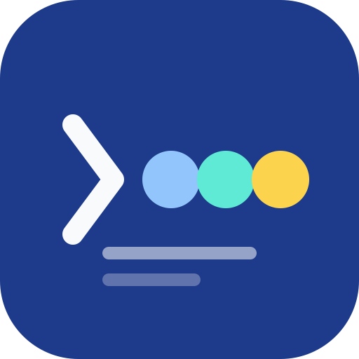
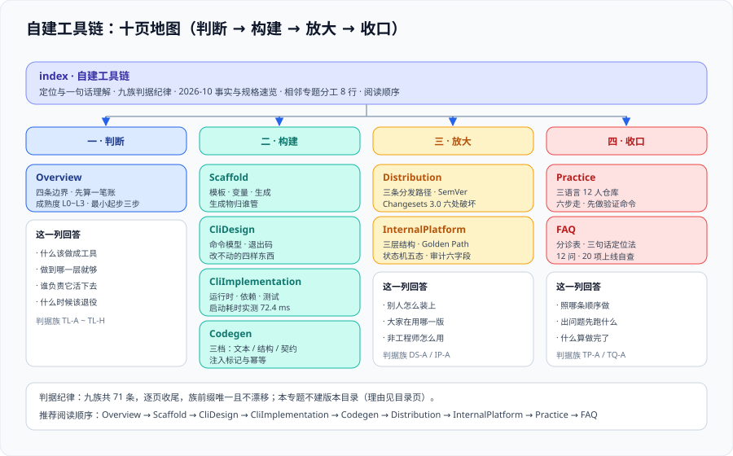

# 自建工具链

<p style="text-align:center;"></p>



这一页讲的是**当团队反复做同一件事时，怎么把这件事从「某个人记得怎么做」变成「一条命令就能做完」**。脚手架、代码生成器、内部 CLI、开发者平台——它们表面上是四类工具，实际上是同一件事的四个成熟度台阶。

本专题的主线是 **脚手架（生成结构）→ CLI（封装动作）→ 代码生成（生成内容）→ 分发与版本（让它跑在别人机器上）→ 内部平台（让不写代码的人也能用）**，落地到一条可验证的搭链路径。

::: tip 一句话理解
**自建工具链的产出不是「一个工具」，而是「一条不用问人也能走完的路」。** 判据不是「写得漂不漂亮」，而是「新同事第一次用，要不要有人在旁边看着」。
:::

- [总览：自建工具链的四条边界](Overview/index.md)
- [脚手架：模板、变量与项目生成](Scaffold/index.md)
- [CLI 设计：命令模型与用户体验](CliDesign/index.md)
- [CLI 工程化：选型、依赖、测试与发布](CliImplementation/index.md)
- [代码生成：从文本模板到语法树](Codegen/index.md)
- [分发与版本治理](Distribution/index.md)
- [内部平台：从命令到自助服务](InternalPlatform/index.md)
- [实战：给一个多语言仓库搭一条工具链](Practice/index.md)
- [常见问题与最佳实践](FAQ/index.md)

## 本专题的判据纪律

本专题每一页都配一张「判据定义表」：每条设计决定都要能回答三件事——**约定是什么、定错会怎样、怎么验证它没被破坏**。判据族前缀与数量如下，便于逐页对照。

| 页面 | 判据族 | 数量 |
| --- | --- | --- |
| 总览：四条边界 | `TL-A` | 8 |
| 脚手架 | `SD-A` | 8 |
| CLI 设计 | `CD-A` | 8 |
| CLI 工程化 | `CI-A` | 8 |
| 代码生成 | `CG-A` | 8 |
| 分发与版本 | `DS-A` | 8 |
| 内部平台 | `IP-A` | 8 |
| 实战 | `TP-A` | 8 |
| 常见问题 | `TQ-A` | 7 |

## 2026-10 事实与规格速览（核对时间 2026-10）

下表所有版本按 2026-10 官方发布页与包仓库核对。**这张表会过期**——每一页的版本结论后面都带日期，而不是写「当前最新」；本库的硬纪律是：没有日期的「最新版本」等于没有信息。

| 场景 | 工具 | 版本（核对时间 2026-10） | 状态与要点 |
| --- | --- | --- | --- |
| Node CLI 框架 | **commander** | **15.0.0**（2026-05-29） | **ESM-only、要求 Node ≥ 22.12**；14.x 只修安全问题、承诺支持到 2027-05 |
| Node CLI 框架 | **@oclif/core**（oclif） | **4.x**（oclif CLI 4.23.1 / 2026-05-14） | 插件体系与多命令产品级 CLI；4.0 大幅精简 `ux` 模块，提示/进度/表格改用专门库 |
| Node 微生成器 | **plop** | 持续维护 | Handlebars 模板 + `add` / `addMany` / `modify` / `append` 四类动作，交互式 |
| Node 微生成器 | **hygen** | 持续维护 | EJS 模板 + frontmatter，**无交互**，适合脚本与 CI 驱动 |
| JS monorepo 版本 | **@changesets/cli** | **3.0.3**（2026-09-14）；3.0.0 于 **2026-08-11** | ESM-only、Node ≥ 22.11；安装体积 **16.1MB → 2.1MB**；命令改名 `changeset tag` → `changeset git-tag`、`--sinceMaster` → `--since=main`；`prettier` 配置项 → `format`；**私有包默认不再升版本**；`changeset version` 空发布时**退出码 1**；peer 依赖变更改为 patch 传播；2.x 在 `maintenance-v2` 分支 |
| 私有 registry | **Verdaccio** | **6.10.5**（2026-10-03） | 6.x 要求 Node ≥ 22；`master` 分支是 v7 预发布线（Node ≥ 24），**README 顶部那条 `npm install -g verdaccio@next-9` 装到的是预发布** |
| Python CLI | **Typer** | **0.27.2**（2026-08-28） | 要求 Python ≥ 3.10；**仍在 1.0 之前**；0.26.1 起把 Click 源码内联（vendored），**不再支持以 Click 插件方式扩展** |
| Python CLI | **Click** | 8.2.x 线 | 显式装饰器、成熟的第三方扩展生态；需要 Click 插件时选它而不是 Typer |
| 版本控制入口 | **Git hooks 管理器** | 见 [CI/CD](../CICD/index.md) | 本专题不重复讲钩子产品，只讲「工具链把校验放在哪一段」 |

::: warning 说明：三条编号线互不同步
**框架版本 ≠ 工具版本 ≠ 语言版本**。commander 的 15 和 Node 的 24 之间没有对应关系，`@changesets/cli` 的 3 与 `@changesets/config` 的 4 也是各自独立发版（升级不是改一个号）。页面里凡出现版本号，都写明**它属于哪条线**。
:::

## 版本组织说明：为什么本专题不建版本目录

本库对**大版本差异**的处理办法是建版本目录（`docs/Backend/Java/Frame/Spring/Spring5/` 与 `Spring6/`、`docs/Frontend/Frame/Vue/Vue2/` 与 `Vue3/`、`docs/Backend/Java/Frame/SpringBoot/v2/`、`v3/`、`v4/`），旧版本目录**保留并在页首标注维护状态，不覆盖旧内容**。

「自建工具链」不按这个办法组织，理由有三条：

1. **它是通用技术名，没有单一官方版本线**。「自建工具链」不是某个产品的名字（对比：`Spring6` 是），不存在「工具链 5」与「工具链 6」两条需要长期并存的内容线。
2. **承接大版本差异的是被选的工具，不是这个专题**。commander 14 → 15（ESM-only、Node 底线抬高）、Changesets 2 → 3（命令与配置改名）这类断层，**写在各页的 `::: info` 里并标注适用版本**，不另开目录。
3. **两条线长期并存的情况只有在「存量项目还在用」时才出现**。本专题讲的工具都装在**开发者本机**、`pnpm install` 一次就换掉，不像 Spring 那样有无法升级的生产系统压着。所以「保留旧版本目录」在这里没有服务对象。

::: info 旧版本内容怎么保留
本专题不删除任何历史写法。凡有实质差异处（例如 commander 14 的 CJS 写法、Changesets 2 的 `changeset tag`），在页面内用 `::: info` 标注「适用版本」并保留原写法，**不覆盖、不改写**。
:::

## 相关专题与分工

本专题与库内八个相邻专题存在明确边界，**互不替代**：

| 相邻专题 | 它讲什么 | 本专题讲什么 |
| --- | --- | --- |
| [前端工程化](../../Frontend/Others/FrontendEngineering/index.md) | 一个前端仓库内部的规范、构建、测试与目录结构 | **跨仓库重复的那部分**：怎么把「每个新仓库都要配一遍」的事做成一条命令 |
| [低代码平台](../../Frontend/LowCode/index.md) | 把页面结构抽成可校验的 Schema，可视化搭建 + 出码 | 低代码**自己也是**一条自建工具链；本专题讲它的引擎与协议，低代码专题讲它的产品形态 |
| [CI/CD](../CICD/index.md) | 流水线怎么设计、门禁挂在哪一步、制品怎么管 | 工具链**跑在人本机上的那一半**；两侧共用同一批校验命令，谁都不许另写一套 |
| [依赖与安全治理](../DependencyGovernance/index.md) | SBOM、漏洞优先级、许可证、私服的治理流程 | 私域分发的**发布侧动作**（怎么把包推上去、版本怎么定）；治理侧判据归那边 |
| [代码质量平台](../CodeQuality/index.md) | 静态分析的规则与质量门禁怎么定 | 工具链是**门禁的执行载体**之一；门禁条件怎么定归那边 |
| [包管理器深入](../PackageManager/index.md) | lockfile、依赖解析、pnpm 的存储与链接原理 | 自建包的**发布、分发与版本传播**；解析原理归那边 |
| [API 设计与治理](../APIDesign/index.md) | 契约（OpenAPI）怎么写、怎么 lint、怎么防漂移 | 契约驱动生成的那一段：从契约定稿到**生成物**；契约本身归那边 |
| [完整项目交付](../../Others/ProjectDelivery/index.md) | 一个项目从需求到上线的流程方法论 | 项目里**重复出现的动作**怎么沉淀成工具；流程本身归那边 |

一句话判据：**要问「这个仓库该怎么组织」，去前端工程化；要问「这套东西怎么让十个人用同一个版本」，来本专题。**

## 建议阅读顺序

```text
Overview（四条边界：先判断这件事该不该做成工具）
  → Scaffold（从模板到一条 create 命令）
  → CliDesign（命令模型与退出码：这是唯一无法事后补救的一层）
  → CliImplementation（语言选型、依赖、测试、发布）
  → Codegen（模板不够用时，往上走到语法树与契约）
  → Distribution（怎么让它在别人机器上跑起来且版本可控）
  → InternalPlatform（从一条命令走到自助服务）
  → Practice（照着走一遍，跑通 TP-A~TP-H）
  → FAQ（分诊树）
```

## 与「开发环境与终端工程」的分工（第 197 天补充）

| 那边回答什么 | 本页回答什么 | 新专题回答什么 |
| --- | --- | --- |
| 编译链、SDK、多版本共存的工具面 | 怎么装、怎么切、怎么配 | 切换之后「谁先被找到」的判定，以及 shim 与 PATH 改写的代价差别 |
| 每个版本管理器的命令 | 命令速查 | 为什么 `node -v` 直接调用 25.6 ms 而跨版本 exec 要 982.7 ms |

::: warning 这一页特有的一个坑
shim 类工具（asdf / SDKMAN / volta）靠 `PATH` 最前面的 shim 目录拦截命令，而 `PATH` 改写类工具（nvm / fnm）直接改指向。两者混用时会出现「`which` 说 A、`shim` 跑 B」的双份真相——判定方法是 `command -v X` 与 `X --version` 各自打印的路径对比，修法是只保留一种机制。
:::

## 参考资料

- [commander 官方仓库与 CHANGELOG](https://github.com/tj/commander.js)：版本线、Node 底线与旧大版本支持策略
- [oclif 官方文档](https://oclif.io/)与 [@oclif/core Releases](https://github.com/oclif/core/releases)：插件式 CLI 框架
- [plop 官方文档](https://plopjs.com/)：微生成器的动作模型
- [hygen 官方文档](https://www.hygen.io/)：无交互模板生成
- [Changesets 官方文档](https://changesets.dev/)与 [GitHub Action](https://github.com/changesets/action)：monorepo 版本与 changelog
- [Typer 官方文档](https://typer.tiangolo.com/)与 [Release Notes](https://typer.tiangolo.com/release-notes/)：Python CLI 的类型驱动写法与 Click 内联这一变化
- [Click 官方文档](https://click.palletsprojects.com/)：需要 Click 插件时的选择
- [Verdaccio 官方文档](https://verdaccio.org/docs/)：私有 registry、uplinks 与鉴权
- [npm CLI 官方文档 · package.json bin](https://docs.npmjs.com/cli/v11/configuring-npm/package-json#bin)：可执行入口的声明方式
- [Semantic Versioning 2.0.0](https://semver.org/lang/zh-CN/)：版本号语义的权威定义
