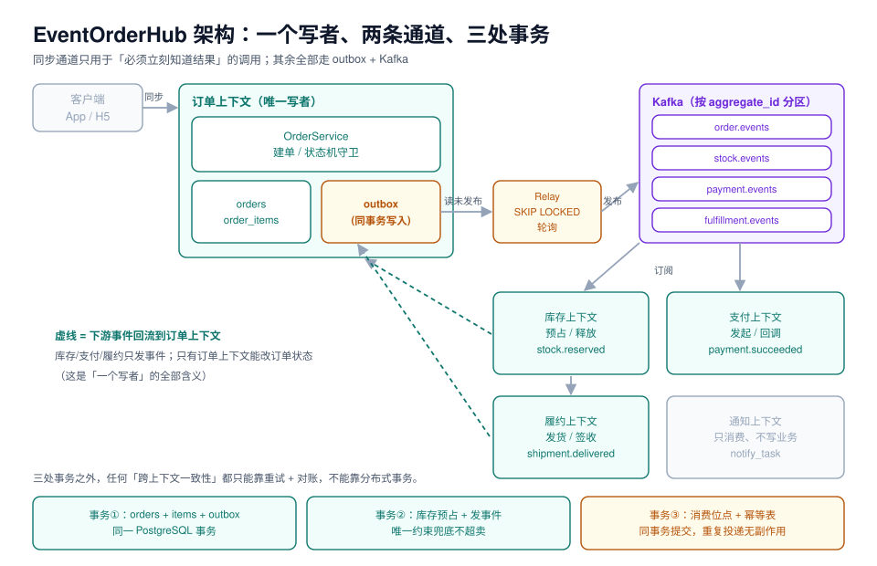

# 架构设计：事件流与一致性边界

第 1 周第 3 步。前两天定了「谁拥有什么」（[需求拆分](../Requirements/index.md)）和「用什么版本」（[技术选型与版本基线](../TechBaseline/index.md)），今天要把它们落成**一张能照着实现的图**：哪些调用必须同步、事件走什么通道、一致性靠哪几处事务兜住、失败时谁负责补偿。

判断标准只有一条：**别人只看这一页，能不能判断出「这段代码该写在哪个上下文、该走同步还是异步」。**



## 一、同步还是异步：18 个调用逐个定性

架构里最容易含糊的一句话是「我们事件驱动」。真正要定的是**每一处调用**用哪种通道，判据只有两条：

- 调用方**必须立刻知道结果**才能继续（用户点了「提交订单」，不能先返回「稍后告诉你」）→ 同步；
- 结果可以被**重试、被补偿、被对账**兜住，且调用方不依赖返回值 → 异步。

| # | 调用 | 通道 | 判据 | 若做成异步的后果 |
| --- | --- | --- | --- | --- |
| 1 | 客户端 → 建单 | 同步 | 用户要看到订单号 | 用户不知道下单成功没 |
| 2 | 建单 → 库存预占 | **同步**（同库写入，不跨服务） | 不预占就不能承诺有货 | 超卖或下单后立刻取消 |
| 3 | 建单 → 支付单创建 | **同步** | 要把支付参数返回给客户端 | 客户端拿不到支付链接 |
| 4 | 建单 → 通知 | 异步 | 发不发短信不影响下单 | 通知失败拖垮建单 |
| 5 | 建单 → 履约 | 异步 | 支付成功后才发货 | 发货早于付款 |
| 6 | 支付回调 → 订单状态 | **同步写库 + 异步事件** | 回调必须返回成功才不被重推 | 重复回调、状态回退 |
| 7 | 库存预占结果 → 订单 | 异步 | 预占可能失败，失败要取消 | 长时间挂起 |
| 8 | 支付成功 → 履约 | 异步 | 可以晚几秒 | 不影响正确性 |
| 9 | 发货 → 通知 | 异步 | 同上 | 同上 |
| 10 | 超时未支付 → 取消 | 异步（定时） | 允许延迟 | — |
| 11 | 取消 → 释放库存 | 异步 | 最终一致即可 | — |
| 12 | 退款 → 通知 | 异步 | 同上 | — |
| 13 | 所有状态变更 → 审计 | 异步（同事务 outbox） | 不能因为审计失败阻塞业务 | 审计丢事件 |
| 14 | 订单详情查询 | 同步读 | 用户要看 | — |
| 15 | 列表分页查询 | 同步读 | 同上 | — |
| 16 | 对账日报 | 异步批 | 离线 | — |
| 17 | 库存快照刷新 | 异步 | 缓存可丢 | — |
| 18 | 幂等键校验 | **同步**（同库/Redis） | 必须当场判重 | 重复下单 |

::: tip 两条判据的实际用法
拿不准时问两个问题：**「这个调用失败，用户能不能接受『过一会儿再说』？」**（能 → 异步）和**「这个调用晚 5 秒，会不会导致另一处判断错误？」**（会 → 同步）。

第 2 行值得一提：建单和库存预占虽然属于两个上下文，但它们**在同一个 PostgreSQL 里**，所以用同一个本地事务，而不是「建单发事件、库存异步预占」——后者会让「下单成功但没货」变成常态。
:::

## 二、事件信封：六个字段，一个都不能少

所有事件共用同一个信封，业务字段放 `data`：

```json
{
  "event_id": "01J9Z3K7Y8Q2M4V6B8N0P1R2S3",
  "event_type": "order.created",
  "event_version": 1,
  "occurred_at": "2026-10-22T02:15:31.402Z",
  "aggregate_id": "10231",
  "trace_id": "4bf92f3577b34da6a3ce929d0e0e4736",
  "data": { "order_no": "NO000010231", "amount": 199.00, "items": 2 }
}
```

| 字段 | 用途 | 缺失的后果 |
| --- | --- | --- |
| `event_id` | 消费端幂等键（唯一索引） | 重复投递无法去重 |
| `event_type` | 路由与反序列化 | 消费端只能靠 topic 猜，加事件类型就要改消费者 |
| `event_version` | 兼容升级（同类型多版本并存） | 改字段就必须同时升级所有消费者 |
| `occurred_at` | 业务时间（不是入库时间） | 乱序时无法判断谁先 |
| `aggregate_id` | **分区键**（同一聚合进同一分区） | 同一订单的事件可能乱序 |
| `trace_id` | 全链路追踪 | 出问题只能靠时间戳猜 |

::: danger `occurred_at` 必须由生产者在事务内取值
如果用消费端时间或 Kafka 的 `CreateTime`，跨主机时钟偏移会让「谁先谁后」判断错。正确做法是在**写 outbox 的同一事务里**取 `now()` 并写进载荷，这样事件顺序与数据库提交顺序一致。
:::

## 三、Topic 设计：四个 topic，一个分区键

| Topic | 生产者 | 消费者 | 分区键 | 保留 |
| --- | --- | --- | --- | --- |
| `order.events` | 订单 | 通知、审计、履约 | `aggregate_id` | 7 天 |
| `stock.events` | 库存 | 订单 | `aggregate_id` | 7 天 |
| `payment.events` | 支付 | 订单、通知 | `aggregate_id` | 7 天 |
| `fulfillment.events` | 履约 | 订单、通知 | `aggregate_id` | 7 天 |

三条纪律：

1. **按聚合分区，不按事件类型分**——同一订单的所有事件必须进同一分区，否则「同一订单的事件乱序」会让状态机守卫失效。
2. **每个 topic 单一生产者**——两个服务往同一个 topic 写，事件版本与字段语义必然分叉。
3. **保留 7 天起步**——消费者故障超过保留期就只能重建（重放全量），这是运维现实。

```shell
# 本地验证用一条命令建 topic（Kafka 4.x 已无 ZooKeeper）
docker exec -it eoh-kafka /opt/kafka/bin/kafka-topics.sh \
  --bootstrap-server localhost:9092 --create \
  --topic order.events --partitions 3 --replication-factor 1 \
  --config retention.ms=604800000
```

## 四、三处事务：一致性只在这三个地方被保证


```sql
-- 事务①：建单（orders + order_items + outbox 同一事务）
begin;
insert into orders (order_no, user_id, status, amount)
values ('NO000010231', 777, 'AWAITING_PAYMENT', 199.00) returning id;
insert into order_items (order_id, sku, qty, price) values (10231, 'SKU-1', 1, 199.00);
insert into outbox (aggregate_id, event_type, payload)
values (10231, 'order.created',
        '{"event_id":"01J9Z3K7...","event_version":1,"aggregate_id":"10231","data":{"amount":199.00}}');
commit;
```

```sql
-- 事务②：库存预占（唯一约束兜底不超卖，不用 Redis 锁）
update stock set reserved = reserved + 1
where sku = 'SKU-1' and available - reserved >= 1
returning id;
-- 影响行数为 0 → 预占失败 → 发 stock.rejected，订单侧取消
```

```sql
-- 事务③：消费位点 + 幂等表（同事务提交）
begin;
insert into consumed_event (event_id, consumer) values ('01J9Z3K7...', 'order-service');
-- 冲突（23505）→ 直接 commit，说明已经处理过
update orders set status = 'PAID' where id = 10231 and status = 'AWAITING_PAYMENT';
update consumed_offset set last_offset = 4421 where consumer = 'order-service';
commit;
```

::: warning 三处之外没有强一致
「支付成功但订单还是待支付」「库存释放了但订单已发货」这类问题，**不能靠加一个分布式事务解决**（那会把可用性换成另一种故障）。正确做法是：状态机守卫 + 定时对账 + 人工兜底工单。项目第 2 周的「补偿与对账」章节会把它做成日报。
:::

## 五、失败矩阵：七种失败，各有归属

| # | 失败 | 现象 | 谁负责 | 处置 |
| --- | --- | --- | --- | --- |
| 1 | 建单事务提交前崩溃 | 无订单、无事件 | 订单 | 客户端收到 5xx，重试（幂等键保证不重单） |
| 2 | 提交后 relay 挂 | 订单存在、事件未发 | Relay | 重启后继续扫 `published = false` |
| 3 | 发出但消费失败 | 事件在 topic、消费者报错 | 消费者 | 重试 + 退避；超限进 DLQ |
| 4 | 消费成功但位点没提交 | 重启后重复消费 | 消费者 | 幂等表去重（事务③） |
| 5 | 库存预占成功、订单侧没收到 | 库存被占、订单待支付超时 | 订单 + 库存 | 超时取消 → 释放事件 |
| 6 | 支付回调重复 | 订单被推两次 `PAID` | 订单 | 状态机守卫（`where status = 'AWAITING_PAYMENT'`） |
| 7 | 履约已发货、订单仍显示已支付 | 用户看到的状态落后 | 订单 | 消费 `shipment.delivered` 重试；对账发现 |

这张表的价值在于：**每个失败都能指到一个上下文**。指不到归属的失败，说明边界没画清。

## 六、今天的可验证构建步骤

架构页必须能「跑起来一半」，否则只是 PPT。今天要落地的是一个**最小可运行骨架**：三个容器 + 一张 outbox 表 + 一个 relay 抢占实验。

```yaml
# deploy/compose.yaml（读者在自己工程里创建，本仓不提交）
services:
  postgres:
    image: postgres:18.6
    environment:
      POSTGRES_PASSWORD: pg
      POSTGRES_DB: eoh
    ports: ["5432:5432"]
    command: ["postgres", "-c", "wal_level=logical", "-c", "lock_timeout=3s"]
  kafka:
    image: apache/kafka:4.2.1
    ports: ["9092:9092"]
    environment:
      KAFKA_NODE_ID: 1
      KAFKA_PROCESS_ROLES: broker,controller
      KAFKA_LISTENERS: PLAINTEXT://:9092,CONTROLLER://:9093
      KAFKA_ADVERTISED_LISTENERS: PLAINTEXT://localhost:9092
      KAFKA_CONTROLLER_QUORUM_VOTERS: 1@localhost:9093
      KAFKA_CONTROLLER_LISTENER_NAMES: CONTROLLER
      KAFKA_LISTENER_SECURITY_PROTOCOL_MAP: CONTROLLER:PLAINTEXT,PLAINTEXT:PLAINTEXT
      KAFKA_OFFSETS_TOPIC_REPLICATION_FACTOR: 1
      KAFKA_AUTO_CREATE_TOPICS_ENABLE: "false"
  redis:
    image: redis:8.2
    ports: ["6379:6379"]
```

```shell
docker compose -f deploy/compose.yaml up -d
docker compose -f deploy/compose.yaml ps          # 三个都是 running / healthy
```

```sql
-- outbox 表：唯一索引 + 部分索引，保证「未发布」的扫描是索引扫描
create table outbox (
  id           bigserial primary key,
  aggregate_id bigint not null,
  event_type   text   not null,
  payload      jsonb  not null,
  published    boolean not null default false,
  created_at   timestamptz not null default now()
);
create index idx_outbox_unpublished on outbox (id) where published = false;
```

**验证点（今天必须跑过）**：两路 relay 并发抢同一批 2000 条未发布事件，`FOR UPDATE SKIP LOCKED` 让它们**各拿一批、零重复**；去掉它，两路会抓到同一批。

```sql
-- 两路并发执行同一条语句（两个 psql 会话同时跑）
with c as (
  select id from outbox where published = false order by id limit 500
  for update skip locked
)
update outbox set published = true from c where outbox.id = c.id returning outbox.id;
```

实测（2000 条未发布，limit 500，两路并发）：

| 写法 | 两路各拿到 | 重复条数 | 说明 |
| --- | --- | --- | --- |
| `for update skip locked` | 500 / 500 | **0** | 互不阻塞，各自取走一批 |
| 无 `for update` | 500 / 500 | **500** | 两路抓到同一批，重复投递 500 条 |

::: danger 这条读数解释了「为什么消费端必须幂等」
上面第二行不是理论：只要 relay 是多实例部署，**没有 `SKIP LOCKED` 就一定有重复投递**。而即使有 `SKIP LOCKED`，崩溃重启也会重发（发布后、提交前崩溃）。所以消费端的幂等表不是「防御性编程」，是**架构的一部分**。
:::

## 七、当日验收清单

| # | 验收项 | 命令 | 预期 |
| --- | --- | --- | --- |
| 1 | 三容器起得来 | `docker compose ps` | 3 个 running |
| 2 | PG 参数生效 | `show lock_timeout;` | `3s` |
| 3 | topic 建得出来、自动创建关闭 | `kafka-topics.sh --list` | 只有手动建的 4 个 |
| 4 | outbox 部分索引存在 | `\d outbox` | 有 `idx_outbox_unpublished` |
| 5 | relay 并发零重复 | 两路并发 SQL | 500 / 500，重复 0 |
| 6 | 重复投递可去重 | 插两次同 `event_id` | 第二次 23505，业务无副作用 |

## 八、下一步（第 1 周第 4 步）

下一步是**数据库设计：九张表与六条不变量**。今天只定了 outbox 一张表，明天要把 `orders` / `order_items` / `payment` / `payment_callback_log` / `stock` / `stock_reservation` / `shipment` / `shipment_item` / `notify_task` 的完整 DDL 写出来，并给六条不变量各配一条可执行 SQL（第 181 天已在需求页给过版本，明天要落成表结构与约束）。

## 九、本页判据

| 编号 | 判据 | 看什么现象 | 不满足时改哪里 |
| --- | --- | --- | --- |
| `EOA-A` | 每个跨上下文调用都标了同步/异步 | 第一节 18 行表 | 逐条定性，不许写「视情况」 |
| `EOA-B` | 事件信封六个必填字段齐全 | 示例 JSON | 缺 `event_id` / `aggregate_id` 的最常见 |
| `EOA-C` | 分区键是 `aggregate_id` | topic 配置 | 按事件类型分区会导致同订单乱序 |
| `EOA-D` | 每个 topic 单一生产者 | topic 表 | 两个生产者必须拆 topic |
| `EOA-E` | 状态变更只在订单上下文 | 代码搜索 `update orders set status` | 出现第二处即违规 |
| `EOA-F` | 三处事务在代码里可定位 | 三个事务的入口函数 | 找不出来说明边界是虚的 |
| `EOA-G` | relay 用 `for update skip locked` | SQL | 无它会重复投递（实测 500/500） |
| `EOA-H` | 消费端有幂等表且与位点同事务 | DDL + 提交顺序 | 幂等表单独事务提交 = 仍会重复 |

## 参考资料

- [需求拆分：五个上下文、十个故事与订单状态机](../Requirements/index.md)（本页的上游）
- [技术选型与版本基线](../TechBaseline/index.md)（三条能力边界与本页的关系）
- PostgreSQL 18 Documentation: `FOR UPDATE SKIP LOCKED`、部分索引（`CREATE INDEX ... WHERE`）
- Apache Kafka 4.2 Documentation: *KRaft*、*Topic Configs*（`retention.ms`、`cleanup.policy`）
- 本仓库：[事务性发件箱与最终一致性](../../../../docs/Backend/Microservices/DistributedTransaction/MessageTable/index.md)、[幂等与状态机](../../../../docs/Backend/IdempotencyStateMachine/index.md)
