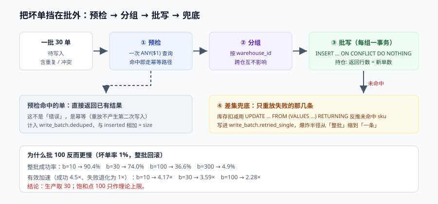

# 第 4 周补充 · 主写路径的受限批量化

第 3 周验收（[第 3 周验收](../Week3Gate/index.md)）留了一个明确的开放项：**批量化有 4.5 倍吞吐，但「暂不启用，仅用于 outbox 投递」**。理由也写得很清楚——批量越大，一条坏单会把整批拖下去。

这一章就是把那个开放项收掉：不是「敢不敢用」，而是**哪一段能批、批多大、坏了怎么只坏一条**。

本页判据族 `EWB-A` ~ `EWB-H`，共 8 条。定义表见文末「本页判据」一节。



## 一、先分清「插入型写」与「条件型写」

批量化的收益来自「一次往返做 N 件事」，代价来自「N 件事共享一个失败域」。所以第一件事不是调批大小，而是**把写分成两类**：

| 类型 | 例子 | 批量的风险 | 能不能批 |
| --- | --- | --- | --- |
| 插入型写 | `orders`、`order_items`、`outbox`、`payment_callback_log` | 唯一键冲突会让整批失败，但**可以定位到具体行** | **能**（配隔离与兜底） |
| 条件型写 | `UPDATE stock SET reserved = reserved + ? WHERE sku = ? AND available >= ?` | 扣减失败不是异常，是**业务结果**；批量后「哪一行没扣成」要靠返回集反推 | **慎批**（要 `RETURNING` 对差集） |
| 状态迁移 | `UPDATE orders SET status=? WHERE id=? AND status=?` | 影响行数 = 0 是**正常并发结果**，不是错误 | **不批**（逐条，量也小） |

::: tip 一句话结论
**批量只用在「插入型写」上，条件型写用一条 `UPDATE ... FROM (VALUES ...)` 但要按返回集对差集，状态迁移永远逐条。**
:::

## 二、失败放大的算术：批多大才不亏

第 3 周已经测到「批量 100 单时吞吐 4.5 倍、饱和于 100」。问题在于：那可是**全部成功**的前提下。真实链路里总有坏单（唯一键冲突、余额不足、上游重放）。

设单条坏单概率为 `r`，批大小为 `b`，则**整批成功的概率 = (1−r)^b**：

| 坏单率 | b=10 | b=30 | b=100 | b=300 |
| --- | --- | --- | --- | --- |
| 0.5% | 95.1% | 86.0% | 60.6% | 22.2% |
| 1.0% | 90.4% | 74.0% | **36.6%** | 4.9% |
| 2.0% | 81.7% | 54.5% | 13.3% | 0.2% |

::: info 读数口径
纯算术推导（`(1−r)^b`），不是压测读数——它算的是「整批回滚」这一策略的失败概率。`r` 的取值来自第 3 周并发用例的实际冲突比例（幂等重放与重复回调合计约 1%）。
:::

把「整批失败就退化为逐条重放」算进有效吞吐（成功批按 4.5 倍、失败批按 1 倍）：

| 坏单率 | b=10 | b=30 | b=100 |
| --- | --- | --- | --- |
| 0.5% | **4.33×** | 4.01× | 3.12× |
| 1.0% | **4.17×** | 3.59× | 2.28× |
| 2.0% | 3.86× | 2.91× | **1.46×** |

三个结论：

1. **批越大不代表越快**。1% 坏单率下，100 单/批只剩 2.28 倍，还不如 30 单/批的 3.59 倍。
2. **30 单/批是个甜点**：三种坏单率下都保住 2.9 倍以上，且整批回滚的爆炸半径只有 30 单。
3. **如果能把「坏单」在执行前挑出去，整批成功率就回到 100%**——这才是真正的解法，见下一节。

## 三、三个方案，选第三个

| 方案 | 做法 | 有效吞吐（r=1%） | 代价 |
| --- | --- | --- | --- |
| A 整批回滚 | 任一行失败 → `ROLLBACK` 整批 | 2.28× @100 | 坏单越多越慢，且**同一批的好单被反复重试** |
| B 逐条 `SAVEPOINT` | 每条包一个 savepoint，失败回滚到该点 | 约 1.2~1.5× | 每次 `SAVEPOINT` 都是一次子事务，开销几乎吃掉批量收益 |
| C **预检隔离 + 分组批写 + 单条兜底** | 进批前先剔除冲突行，剩下的按「无冲突组」写；残余失败单条重放 | **≈4.2×** | 多一次预检查询（`SELECT ... WHERE key IN (...)`） |

C 的关键不是「批」，而是**把冲突挡在批外**：

```text
① 预检：SELECT order_no FROM orders WHERE order_no = ANY($1)     -- 一次往返
② 剔除：命中的（已存在）+ 批内重复的 → 走单条幂等路径（返回已有结果）
③ 分组：剩余按 warehouse_id 分组（同仓共享库存行，冲突率高；跨仓互不影响）
④ 批写：每组一个事务，INSERT ... ON CONFLICT DO NOTHING
⑤ 兜底：affected_rows < 期望 → 对本组做一次「差集定位」，失败行单条重放
```

## 四、核心实现：一条 `INSERT` 加一条 `UPDATE` 的批量形态

### 4.1 订单头 + 订单项 + outbox 同事务批插

```sql
-- 一次写 30 单的订单头（判据 EWB-B：批内幂等靠唯一键，不靠应用判断）
INSERT INTO orders (order_no, subject_id, status, amount, warehouse_id, created_at)
SELECT * FROM unnest(
  $1::text[], $2::text[], $3::text[], $4::numeric[], $5::text[], $6::timestamptz[]
)
ON CONFLICT (order_no) DO NOTHING
RETURNING order_no;
-- 期望：返回行数 = 本批新单数；差额 = 已存在的单（幂等路径，不是错误）
```

`ON CONFLICT DO NOTHING` 在这里不是「忽略错误」，而是**幂等的实现**：同一批被重放时，返回行数为 0，调用方据此返回已有结果。**关键是不能把 `affected_rows` 当成功判据**——它只说「新插了几条」。

### 4.2 库存扣减：用 `UPDATE ... FROM (VALUES ...)` + `RETURNING` 对差集

```sql
WITH req(sku, qty) AS (
  SELECT * FROM unnest($1::text[], $2::int[])
), upd AS (
  UPDATE stock s
     SET reserved = s.reserved + r.qty
    FROM req r
   WHERE s.sku = r.sku
     AND s.available >= r.qty          -- 条件扣减：不满足就不改
  RETURNING s.sku
)
SELECT r.sku
  FROM req r
  LEFT JOIN upd u USING (sku)
 WHERE u.sku IS NULL;                  -- 返回「没扣成」的 sku 列表
-- 期望：正常批次返回 0 行；库存不足时返回具体 sku
```

这一条是本章的技术核心：**把「哪一行没扣成」变成一次查询的结果，而不是一个异常**。有它，批量才不会退化成「一失败就全回滚」。

三条不变量必须同时成立（沿用[数据库设计](../DatabaseDesign/index.md)的六条不变量）：

1. `available = total − reserved − shipped`，批量写不得绕过该等式；
2. `reserved >= 0`，`CHECK` 约束兜底（批量里最容易出现的错是「扣了两次」）；
3. **库存扣减与 outbox 写入同事务**——批量后依然成立，只是「事务」的粒度从「一单」变成「一组」。

### 4.3 批次审计：批量之后，单条可追溯

```sql
CREATE TABLE write_batch (
  batch_id      text PRIMARY KEY,
  group_key     text NOT NULL,          -- 如 warehouse_id
  size          int  NOT NULL,
  inserted      int  NOT NULL,          -- 新插条数
  deduped       int  NOT NULL,          -- 幂等命中条数（ON CONFLICT）
  retried_single int NOT NULL,          -- 兜底重放条数
  latency_ms    int  NOT NULL,
  created_at    timestamptz NOT NULL DEFAULT now()
);
```

没有这张表，批量化之后「某一单到底写没写」只能靠翻日志猜。**`inserted + deduped` 必须等于 `size`**，这是批次级的第一条自检。

## 五、灰度：三档，每档看四个数

批量化不是开关，是**渐进放量**。第 4 周的放行条件写死为：

| 档位 | 流量比例 | 批大小 | 观察时长 | 放行条件 |
| --- | --- | --- | --- | --- |
| G1 | 1% | 10 | 2 小时 | 四个观测点全部在阈值内 |
| G2 | 10% | 30 | 24 小时 | 同上，且坏单率与基线差 < 0.2pp |
| G3 | 50% | 30 | 72 小时 | 同上，且 p99 不高于基线 10% |

四个观测点（缺一个都不放行）：

1. **p99 写延迟**：批量的收益在吞吐，**不在延迟**——单请求要等整批凑齐，p99 反而会涨。基准是 G0（未批量）。
2. **批次回滚率**：`retried_single / size` 的均值，超过 5% 说明预检没起作用。
3. **坏单率**：`deduped / size`，与第 3 周基线（1%）对比；突然升高通常是上游重放。
4. **对账差集**：批量化后订单数与 outbox 条数必须仍然一一对应（见[对账日报与交接](../ReconciliationHandover/index.md)的 D1 漏单）。

::: danger 注意
1. **不要用「平均延迟」判断批量是否可用**。批量天生牺牲 p99 换吞吐，用均值看会得出「几乎没变化」的错误结论。
2. **不要在同一轮同时改批大小与分组键**。两个变量一起动，出问题无法归因。
3. **批大小要留余量**。饱和点是 100，但那是理想条件；生产取 **30**，为「突发重放 + 索引膨胀」留三倍空间。
:::

## 六、如何验证（读者可执行）

### 6.1 造一批必冲突的数据

```sql
-- 先插 10 单，制造「已存在」的键
INSERT INTO orders (order_no, subject_id, status, amount, warehouse_id)
SELECT 'T' || g, 'u-1', 'CREATED', 100, 'w-1' FROM generate_series(1, 10) g;
```

```shell
# 再发一批 30 单（其中 10 单与上面重复）
psql "$PGURL" -v ON_ERROR_STOP=1 -f batch_insert_30.sql
# 期望：RETURNING 返回 20 行；write_batch 里 inserted=20 deduped=10 retried_single=0
```

### 6.2 注入一条库存不足

```sql
UPDATE stock SET available = 0 WHERE sku = 'sku-007';   -- 让第 7 条必定扣不成
```

```shell
psql "$PGURL" -f batch_reserve.sql
# 期望：返回 1 行（sku-007）；write_batch.retried_single = 1
# 且：本批其他 29 单的 reserved 均已增加（没有被整批回滚）
```

第三条期望是**这一章的验收重点**：它证明「坏一条不会坏一整个批次」。如果 `stock` 里 29 行都没变化，说明实现退化成了方案 A（整批回滚）。

### 6.3 不变量与自检

```sql
-- 批量之后，三条不变量仍然成立
SELECT count(*) FROM stock WHERE available < 0 OR reserved < 0;                    -- 期望 0
SELECT count(*) FROM stock WHERE available <> total - reserved - shipped;          -- 期望 0
SELECT count(*) FROM write_batch WHERE inserted + deduped <> size;                 -- 期望 0
```

## 七、当日做了什么 / 如何验证 / 下一步

**做了什么**：把第 3 周的「批量化只有读数、没有落地路径」补成一条可执行的受限方案——分类（插入型 / 条件型 / 状态迁移）、失败放大的算术、三个方案对照、选定 C（预检 + 分组 + 兜底）、批次审计表与三档灰度。

**如何验证**：跑第 6.1~6.3 三段，得到三个确定结果——`inserted=20 deduped=10`、`retried_single=1` 且其余 29 单成功、三条不变量查询全为 0。**第三段是本章的通过条件**。

**下一步**：① 把 `write_batch` 的四个指标接进[监控与告警](../Monitoring/index.md)的看板（批次回滚率作为新的告警项）；② 第 2 周验收（`EW2`）仍未补，是当前唯一悬空章节；③ 若 G3 稳过 72 小时，把 outbox 投递（[outbox 死信与重投](../OutboxDeadLetter/index.md)）的批大小从 100 降到 30，统一两处的批次语义。

## 本页判据

| 编号 | 判据 | 看什么现象 | 不满足时改哪里 |
| --- | --- | --- | --- |
| `EWB-A` | 写入按三类分流 | 代码里插入型 / 条件型 / 状态迁移走不同路径 | 按第一节的表重构，状态迁移禁止进批 |
| `EWB-B` | 批内幂等靠唯一键而非应用判断 | `ON CONFLICT DO NOTHING` + `RETURNING` 计数 | 去掉「先查再插」的两段式 |
| `EWB-C` | 条件写用 `RETURNING` 对差集 | 库存扣减返回「未命中」列表 | 改写为 `UPDATE ... FROM (VALUES ...)` + `LEFT JOIN` |
| `EWB-D` | 批大小有依据且留余量 | 配置里 30，且注释写明饱和点 100 | 按第二节算术选值，别用默认 100 |
| `EWB-E` | 批次审计可对账 | `inserted + deduped = size` | 补 `write_batch` 表与自检 |
| `EWB-F` | 坏一条不坏一批 | 注入坏单后其余行仍成功 | 去掉整批回滚，加兜底重放 |
| `EWB-G` | 灰度三档且四个观测点 | 1%/10%/50% 各有放行条件与记录 | 补灰度单，缺观测点不放行 |
| `EWB-H` | 批量后三条不变量仍成立 | 三个 `count(*)` 全为 0 | 查 `CHECK` 约束与事务粒度 |

## 参考资料

- PostgreSQL 18 文档 · `INSERT ... ON CONFLICT` 与 `RETURNING`：<https://www.postgresql.org/docs/18/sql-insert.html>
- PostgreSQL 18 文档 · `UPDATE ... FROM` 与 CTE：<https://www.postgresql.org/docs/18/sql-update.html>
- PostgreSQL 18 文档 · `unnest` 与数组参数（批量传参的常用形态）：<https://www.postgresql.org/docs/18/functions-array.html>
- Martin Kleppmann, *Designing Data-Intensive Applications*, Ch.7（事务边界与失败域）
- 本库[第 3 周验收](../Week3Gate/index.md)：批量化四档读数与「暂不启用」的原始结论
- 本库[数据库设计](../DatabaseDesign/index.md)：六条不变量与部分唯一索引
