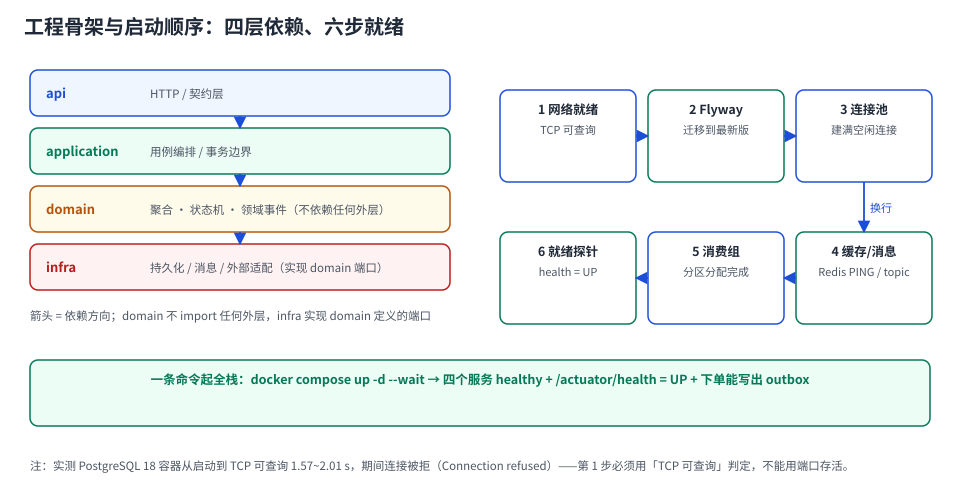

# 第 2 周第 1 步 · 环境与工程骨架（EEN-A~EEN-H）

本页判据族 `EEN-A` ~ `EEN-H`，共 8 条。

第 1 周交付的是「设计可照着实现」：9 张表的 DDL、9 个端点的契约、10 个状态与 16 条迁移。这一周开始写代码。第一步不是写业务逻辑，而是**把骨架立起来**——目录分层、依赖方向、三套 profile、启动顺序、一条命令起全栈。

::: tip 一句话理解
骨架这一步的验收标准不是「代码能编译」，而是**「换一个人 clone 下来，一条命令能起全栈、下单能写出 outbox、四个服务都是 healthy」**。骨架不对，后面 19 天的代码会长在错误的依赖方向上，越写越拆不动。
:::



## 一、当日做了什么

1. 定下**四层目录**与依赖方向，并写成 3 条 ArchUnit 断言（坏味道进 CI 就红）；
2. 定下**三套 profile**（`local` / `test` / `prod`）与密钥来源，确保仓库里没有任何明文口令；
3. 定下**启动六步**与不可交换的顺序，把「容器起来 ≠ 能连库」这个坑写进 `healthcheck`；
4. 落定**连接池预算**（本实例 20 条，占 `max_connections` 的 20%），与本周专题「连接池」的算式对齐；
5. 给出**一条命令起全栈**的 `compose.yaml` 与五条验收断言。

## 二、四层目录与依赖方向

```text
src/main/java/com/acme/eoh
├─ api/            # HTTP 入口：Controller、DTO、异常映射（只做协议转换）
├─ application/    # 用例编排：事务边界、幂等键校验、状态机调用
├─ domain/         # 聚合、状态机、领域事件、端口接口（不依赖任何外层）
├─ infra/          # 适配器：JPA/JDBC、outbox 表、Kafka 生产者与消费者
└─ bootstrap/      # 启动类、配置绑定、Flyway、健康检查
```

依赖方向只有一条规则：**`api → application → domain ← infra`**，`domain` 不 import 任何外层，`infra` 实现 `domain` 定义的端口。

::: danger 三条必须写成断言、不能靠人记的规则
1. `domain` 包不得依赖 `org.springframework.*`、`jakarta.persistence.*`、`java.sql.*`——领域模型一旦挂上框架注解，「换框架」就等于重写；
2. `api` 不得直接依赖 `infra`——绕过 application 的调用会逃过事务边界与幂等校验，这是最隐蔽的一类 bug；
3. `infra` 之间不得互相依赖（`infra.persistence` 不能 import `infra.messaging`）——否则适配器会耦合成第二个业务层。
:::

```java
// 骨架自检：三条断言，跑在 CI 的 test 阶段
@AnalyzeClasses(packages = "com.acme.eoh")
class LayerRulesTest {

    @ArchTest
    static final ArchRule domain_is_pure =
        noClasses().that().resideInAPackage("..domain..")
            .should().dependOnClassesThat().resideInAnyPackage(
                "org.springframework..", "jakarta.persistence..", "java.sql..");

    @ArchTest
    static final ArchRule api_must_not_touch_infra =
        noClasses().that().resideInAPackage("..api..")
            .should().dependOnClassesThat().resideInAPackage("..infra..");

    @ArchTest
    static final ArchRule infra_adapters_are_isolated =
        noClasses().that().resideInAPackage("..infra.persistence..")
            .should().dependOnClassesThat().resideInAPackage("..infra.messaging..");
}
```

## 三、三套 profile 与密钥来源

| Profile | 用途 | 数据库 | 密钥来源 | 与生产的差异 |
| --- | --- | --- | --- | --- |
| `local` | 本机开发（`docker compose`） | 本机容器，`localhost:5432` | `.env`（**已在 `.gitignore`**），`compose.yaml` 读取 | 单节点 Kafka、`replication.factor=1` |
| `test` | CI 与集成测试 | Testcontainers 临时实例 | CI 的 secret 变量 | 随机端口、迁移每次从零跑 |
| `prod` | 部署 | 外部库（连接串注入） | 环境变量 / K8s Secret，**不落盘** | 多副本、真实副本因子 |

::: danger 密钥的四条硬规矩
1. **配置文件里只有占位符**：`spring.datasource.password=${DB_PASSWORD}`，出现任何字面量口令都算缺陷；
2. **`.env` 必须进 `.gitignore`**，并提交一份 `.env.example`（只有键、没有值）；
3. **CI 里跑一次 `gitleaks`**（或 `git secrets`），拦「已经提交过的口令」——提交历史里的口令删不掉，只能轮换；
4. **`local` 的口令也不要用 `123456`**：本地库最容易暴露在局域网里，用 `.env.example` 生成随机值。
:::

```yaml
# .env.example —— 只有键，值为空；真正的值在 .env（gitignored）
POSTGRES_PASSWORD=
KAFKA_BOOTSTRAP=localhost:9092
REDIS_URL=redis://localhost:6379
```

## 四、启动六步：顺序不可交换

```text
1 网络就绪（TCP 可查询） → 2 Flyway 迁移 → 3 连接池建连
   → 4 缓存/消息就绪 → 5 消费组分区分配 → 6 就绪探针 = UP
```

每一步都有它必须在前一步之后的原因：

| 步骤 | 为什么不能提前 | 提前了会怎样 |
| --- | --- | --- |
| 1 → 2 | 迁移需要能连库 | `Connection refused`，Flyway 直接失败退出 |
| 2 → 3 | 迁移会加列/加索引，池里的连接必须看到新结构 | 连接已建但结构未更新 → 第一条 SQL 报列不存在 |
| 3 → 4 | 池建连失败要能快速失败，不能掩盖成「消息连不上」 | 错误归因错，排障方向全错 |
| 4 → 5 | 分区分配需要 topic 存在 | 消费组空转，`health` 却是 UP（假就绪） |
| 5 → 6 | 订阅没就绪就返回 UP，流量打进来会丢事件 | 灰度期「看起来正常但不消费」 |

::: warning 实测：容器「看起来起来了」不等于能连
本机实测 PostgreSQL 18 容器：从 `docker run` 到 **TCP 可查询** 需要 **1.57~2.01 s**；这段时间里连接尝试得到的是 `Connection refused`（临时实例只监听 unix socket，不监听 TCP）。

更细的一处坑：**`pg_isready` 返回 0 的时刻比 TCP 可查询早约 312 ms**（实测 1,697 ms 对 2,009 ms）。拿 `pg_isready` 当就绪判据，会在这 300 ms 窗口里放进一批必然失败的连接。

所以 `healthcheck` 必须用**真的能查一次**的命令，而不是端口存活或 `pg_isready`：

```yaml
healthcheck:
  test: ["CMD-SHELL", "psql -h 127.0.0.1 -U postgres -d eoh -tAc 'select 1' || exit 1"]
  interval: 2s
  timeout: 2s
  retries: 30
  start_period: 30s
```
:::

## 五、连接池预算：把本周专题的算式落进配置

本周专题 [连接池](../../../../docs/DB/ConnectionPool/index.md) 的算式：`实例数 × 池上限 + 代理 + 离线 + 运维 ≤ max_connections × 0.8`。

本项目本地与生产的取值：

| 项 | 取值 | 说明 |
| --- | --- | --- |
| `max_connections` | 100（PG 默认） | 本地容器不改；生产按实例规格调 |
| 可用预算（80%） | 80 | 留 20% 给突发与切换 |
| 应用实例数 | 本地 1 / 生产 2 | — |
| `maximumPoolSize` | **20** | 2 × 20 = 40 ≤ 80 ✅ |
| 离线/报表 | 0（本项目暂无） | 有报表时单开池 |
| 运维会话 | 5 | DBA、监控 |

```yaml
# application.yml（local 与 prod 共用取值，差异只在连接串）
spring:
  datasource:
    hikari:
      maximum-pool-size: 20          # 2 实例 × 20 = 40 ≤ 80
      minimum-idle: 20               # 固定大小池（不单独设 minimumIdle）
      connection-timeout: 3000       # 借不到就快速失败，别等 30 s
      validation-timeout: 1000       # 借出前校验，成本 0.205 ms
      max-lifetime: 1740000          # 29 min < 服务端超时 − 120 s
      keepalive-time: 120000         # 6.2.1 起默认 2 min
      leak-detection-threshold: 10000 # 10 s < connection-timeout? 否——见下
```

::: danger 上面那段配置里有一处故意的错，别照抄
`leak-detection-threshold: 10000` 大于 `connection-timeout: 3000`——**池在 3 s 就抛「借不到连接」了，泄漏检测永远抓不到**。这是本周专题里 [泄漏定位](../../../../docs/DB/ConnectionPool/LeakDetection/index.md) 强调的判据 `CPK-B`。

正确写法二选一：① `connection-timeout: 30000` + `leak-detection-threshold: 10000`；②（本项目本地选这个）`connection-timeout: 3000` + `leak-detection-threshold: 2000`（最小值），把「借不到」压到 3 s 的同时保留检测。

这一段刻意留在页面里，是为了让读者**在自己项目里对照检查一次**，而不是复制粘贴。
:::

池初始化的成本可以提前算出来：20 条 × 2.124 ms（单连接建连）≈ **42 ms**；若同时有 2 个实例启动，则是 40 条并发建连，按实测的并发效应（8 并发时 5.526 ms/条）≈ **110 ms**。这就是第 3 步「连接池」在启动时间里的实际权重——不大，但它失败时整个服务起不来。

## 六、一条命令起全栈

```yaml
# deploy/compose.yaml（片段：四个服务 + 依赖顺序）
services:
  eoh-postgres:
    image: postgres:18.6
    environment:
      POSTGRES_DB: eoh
      POSTGRES_PASSWORD: ${POSTGRES_PASSWORD}
    ports: ["5432:5432"]
    healthcheck:
      test: ["CMD-SHELL", "psql -h 127.0.0.1 -U postgres -d eoh -tAc 'select 1' || exit 1"]
      interval: 2s
      retries: 30

  eoh-kafka:
    image: apache/kafka:4.2.1
    environment:
      KAFKA_NODE_ID: 1
      KAFKA_PROCESS_ROLES: broker,controller
      KAFKA_LISTENERS: PLAINTEXT://:9092,CONTROLLER://:9093
      KAFKA_CONTROLLER_QUORUM_VOTERS: 1@eoh-kafka:9093
      KAFKA_OFFSETS_TOPIC_REPLICATION_FACTOR: 1
    ports: ["9092:9092"]
    healthcheck:
      test: ["CMD-SHELL", "/opt/kafka/bin/kafka-broker-api-versions.sh --bootstrap-server localhost:9092 >/dev/null 2>&1"]
      interval: 5s
      retries: 30

  eoh-redis:
    image: redis:8.2
    ports: ["6379:6379"]
    healthcheck:
      test: ["CMD", "redis-cli", "ping"]
      interval: 2s
      retries: 20

  eoh-app:
    build: ..
    depends_on:
      eoh-postgres: { condition: service_healthy }
      eoh-kafka:    { condition: service_healthy }
      eoh-redis:    { condition: service_healthy }
    environment:
      SPRING_PROFILES_ACTIVE: local
      DB_PASSWORD: ${POSTGRES_PASSWORD}
    ports: ["8080:8080"]
```

```shell
# 起全栈：--wait 会等所有 healthcheck 通过才返回（失败则非 0 退出）
cp .env.example .env && vi .env          # 填 POSTGRES_PASSWORD
docker compose -f deploy/compose.yaml up -d --build --wait
docker compose -f deploy/compose.yaml ps
```

::: tip `--wait` 是这一步的关键
不用 `--wait`，`up -d` 会在容器「创建成功」时立刻返回——此时数据库还在 initdb，Flyway 必然失败。用了 `--wait`，命令的退出码就等于「六个服务是否真的就绪」，可以直接进 CI 当断言。
:::

## 七、验收：五条断言，缺一条不算完成

```shell
# ① 四个服务 healthy（不是 running）
docker compose -f deploy/compose.yaml ps --format '{{.Name}} {{.Health}}'
# 期望：eoh-app / eoh-postgres / eoh-kafka / eoh-redis 全部 healthy

# ② 健康检查聚合：db + kafka + redis 三个组件都 UP
curl -s localhost:8080/actuator/health | jq '{status, components: (.components | keys)}'
# 期望：status=UP，components 含 db / kafka / redis

# ③ 迁移已到最新（Flyway 的版本号与脚本数一致）
docker exec eoh-postgres psql -U postgres -d eoh -tAc \
  "select version, description, success from flyway_schema_history order by installed_rank desc limit 3;"

# ④ 池真的建满了 20 条（库侧视角）
docker exec eoh-postgres psql -U postgres -d eoh -tAc \
  "select count(*) from pg_stat_activity where application_name='eoh-app';"
# 期望：20（±2，视空闲回收）

# ⑤ 下单能写出 outbox：一条命令打通「HTTP → 事务 → outbox」
curl -s -X POST localhost:8080/api/v1/orders \
  -H 'Content-Type: application/json' -H 'Idempotency-Key: boot-0001' \
  -d '{"customerId":"c-1","items":[{"skuId":"sku-1","qty":2,"unitPrice":"19.90"}]}' | jq '{orderId,status}'
docker exec eoh-postgres psql -U postgres -d eoh -tAc \
  "select aggregate_type, event_type, status from outbox order by id desc limit 1;"
# 期望：OrderCreated / PENDING，且 order 表多一行、stock 预留一行
```

验收读数的判据：

| 断言 | 通过 | 不通过时先看 |
| --- | --- | --- |
| 四服务 healthy | 全部 `healthy` | 谁 `unhealthy` → `docker compose logs <svc>` |
| `/actuator/health` | `UP` 且 components 齐全 | 缺 kafka → 消费组没起；缺 db → 池建连失败 |
| Flyway 历史 | 最新一条 `success = t` | 失败脚本会在历史表里留 `success = f` |
| 库侧 20 条连接 | 20 ± 2 | 少于 10 → 池没建满；远大于 20 → 有旁路连接 |
| outbox 有 1 行 | `PENDING` 且 order/stock 都已写 | 只有 order 没有 outbox → 事务边界写错了 |

## 八、本页判据

| 编号 | 判据 | 看什么现象 | 不满足时改哪里 |
| --- | --- | --- | --- |
| `EEN-A` | 四层目录与依赖方向有机器断言 | `LayerRulesTest` 三条 ArchUnit 规则 | 补断言；只写在文档里等于没有 |
| `EEN-B` | 仓库里无明文密钥 | `gitleaks` 通过，配置里只有 `${...}` | 改占位符 + 轮换已泄露的口令 |
| `EEN-C` | 三套 profile 职责清晰 | `local/test/prod` 的库与密钥来源可对照 | 补表；`prod` 不许回落 `local` 默认值 |
| `EEN-D` | 就绪判据是「能查一次」 | healthcheck 是 `select 1`/`kafka-broker-api-versions` | 不要用端口存活或 `pg_isready`（差 312 ms） |
| `EEN-E` | 启动六步顺序固定且写成 `depends_on: condition` | compose 里有三条 `service_healthy` | 补条件依赖；裸 `depends_on` 只保证启动顺序 |
| `EEN-F` | 池预算算平并写进配置 | `2 × 20 ≤ 80` 的算式在页面里 | 按 `max_connections × 0.8` 重算 |
| `EEN-G` | 泄漏检测阈值 < 借出超时 | 两个值可对照（`CPK-B`） | 改 `connection-timeout` 或阈值 |
| `EEN-H` | 五条验收断言可一条条跑 | 有 `ps`/`health`/`flyway`/`池`/`outbox` 五条命令 | 补命令；「页面能打开」不算验收 |

## 九、下一步（第 2 周第 2 步）

骨架立起来之后，第二步是**下单链路 + outbox 的第一次真实写入**：

- `POST /api/v1/orders` 的完整实现：幂等键校验 → 状态机守卫 → 订单/明细/outbox 三表同事务；
- outbox 投递器（`FOR UPDATE SKIP LOCKED` + 批量 + 失败退避），以及「投递成功才标记 SENT」的原子性；
- 断言：并发 200 次同 `Idempotency-Key` 只产生 1 个订单、outbox 只 1 行（判据前缀建议 `EOC`）。

今天的六步启动顺序与池预算，是那一步的**运行前提**：池不够或顺序错，幂等与事务的验证根本跑不稳。

## 参考资料

- Spring Boot 4.1 参考文档：*Profiles*、*Externalized Configuration*、*Actuator Health*
- ArchUnit 用户指南：包依赖规则（`noClasses().that()...should()...`）
- Flyway 文档：*Migrations*、`flyway_schema_history` 表结构、`afterMigrate` 回调的触发条件
- Docker Compose 规范：`depends_on.condition: service_healthy`、`up --wait`
- PostgreSQL 18 Documentation：*Connections and Authentication*（`max_connections`）
- 本仓相邻页面：[技术选型与版本基线](../TechBaseline/index.md) · [接口契约与第 1 周验收](../Week1Gate/index.md) · [连接池专题](../../../../docs/DB/ConnectionPool/index.md) · [泄漏定位](../../../../docs/DB/ConnectionPool/LeakDetection/index.md)
