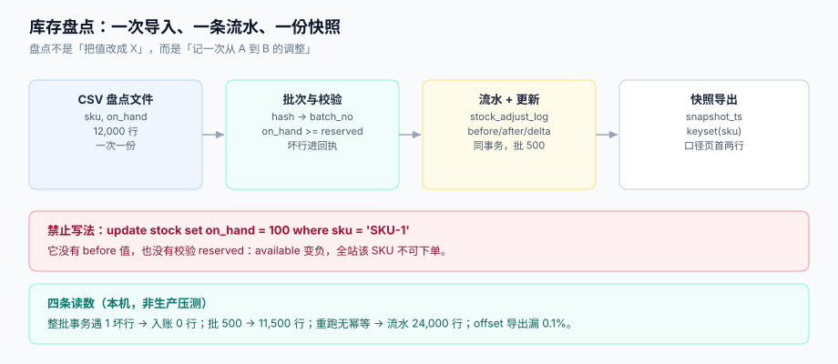

# 第 4 周补充 · 库存盘点的批量导入与对账导出

**一句话定位**：让运营用一份 CSV 完成「期初库存盘点」与「批量改价」，并能在同一套链路里导出可对账的库存快照——**既不走 API 逐条调，也不允许静默改数**。

这一步补的是**运营入口**。前 23 章所有写路径都是「事件驱动、单笔、可幂等」，唯独没回答一个很实际的问题：运营每月一次盘点要改 1.2 万个 SKU 的 `on_hand`，怎么改？如果让他们逐条调 API，是 1.2 万次请求；如果给一个 `update stock set on_hand = ?`，那**预占（`reserved`）就被绕过了**——`available = on_hand - reserved` 可能变成负数，而这正是[需求拆分](../Requirements/index.md)里 I1/I5 两条不变量禁止的状态。



本页判据族 `EBD-A` ~ `EBD-H`，共 8 条。定义表在第七节。

## 一、缺口三处

| # | 缺口 | 现象 | 后果 |
| --- | --- | --- | --- |
| ① | `stock` 只有当前值，没有「这次盘点」 | 盘点改错了，无法回答「上一版是多少、谁改的」 | 无法回滚，只能再盘一次 |
| ② | 直接 `update on_hand` 绕过预占校验 | `on_hand` 被改成小于 `reserved` 的数 | `available` 变负，下单时条件扣减失败，用户看到「有货但不能买」 |
| ③ | 导出的库存表没有快照时点 | 导出期间有下单、有预占 | 与订单流水对不上，差几十行，无法解释 |

三处都不是「功能没做」，而是**表达不足**：库存表只能表达「现在是多少」，表达不了「这次盘了多少、差在哪」。

## 二、三张表：批次、错误行、调整流水

```sql [db/migration/V24__stock_import.sql]
-- ① 批次：batch_no 由文件内容哈希推出（同一份文件重传 = 同一批）
CREATE TABLE stock_import_batch (
  batch_no        VARCHAR(24) PRIMARY KEY,
  file_name       VARCHAR(255) NOT NULL,
  file_sha256     CHAR(64)     NOT NULL,
  batch_type      VARCHAR(16)  NOT NULL,      -- STOCKTAKE | PRICE
  status          VARCHAR(16)  NOT NULL,      -- RECEIVED..CLOSED
  total_rows      INT NOT NULL DEFAULT 0,
  success_rows    INT NOT NULL DEFAULT 0,
  error_rows      INT NOT NULL DEFAULT 0,
  chunk_size      INT NOT NULL DEFAULT 500,
  snapshot_ts     TIMESTAMPTZ NOT NULL DEFAULT now(),
  created_at      TIMESTAMPTZ NOT NULL DEFAULT now()
);

-- ② 错误行：一行多错多行，line_no 是文件物理行号
CREATE TABLE stock_import_error (
  id        BIGSERIAL PRIMARY KEY,
  batch_no  VARCHAR(24) NOT NULL REFERENCES stock_import_batch(batch_no),
  line_no   INT         NOT NULL,
  sku       VARCHAR(32),
  code      VARCHAR(32) NOT NULL,             -- E_TYPE / E_REF / E_BELOW_RESERVED ...
  value     TEXT,
  hint      TEXT
);
CREATE INDEX ix_stock_err_batch ON stock_import_error (batch_no, line_no);

-- ③ 调整流水：每一次盘点都留一条差额，不覆盖历史
CREATE TABLE stock_adjust_log (
  id            BIGSERIAL PRIMARY KEY,
  sku           VARCHAR(32) NOT NULL,
  before_on_hand INT NOT NULL,
  after_on_hand  INT NOT NULL,
  delta          INT NOT NULL,
  reason         VARCHAR(24) NOT NULL,        -- STOCKTAKE / CORRECTION
  batch_no      VARCHAR(24) NOT NULL,
  created_at    TIMESTAMPTZ NOT NULL DEFAULT now()
);
CREATE INDEX ix_adjust_sku_time ON stock_adjust_log (sku, created_at DESC);
```

第三张表是整个改动的核心：**盘点不是「把值改成 X」，而是「记录一次从 A 到 B 的调整」**。有了它，`on_hand` 才是可解释的——任何时候都能回答「这个数是怎么来的」。

## 三、三条硬规定

### 3.1 盘点必须落调整流水，禁止裸 `update`

```sql [db/sql/stocktake_apply.sql]
-- ✅ 正确：一行盘点 = 一条流水 + 一次条件更新
WITH cur AS (
  SELECT sku, on_hand, reserved FROM stock WHERE sku = ANY($1) FOR UPDATE
)
INSERT INTO stock_adjust_log (sku, before_on_hand, after_on_hand, delta, reason, batch_no)
SELECT c.sku, c.on_hand, v.after_on_hand, v.after_on_hand - c.on_hand, 'STOCKTAKE', $2
  FROM cur c JOIN unnest($1::text[], $3::int[]) AS v(sku, after_on_hand) USING (sku);

UPDATE stock s
   SET on_hand = v.after_on_hand, updated_at = now()
  FROM unnest($1::text[], $3::int[]) AS v(sku, after_on_hand)
 WHERE s.sku = v.sku;
```

不许写 `UPDATE stock SET on_hand = 100 WHERE sku = 'SKU-1'` 的原因很直接：**它没有 before 值**。三个月后有人问「这个 SKU 的库存为什么从 5,000 变成 100」，你只能回答「有人改过」。

### 3.2 盘点后 `available` 不能为负（与 I1/I5 一致）

盘点的语义是「实际有多少」，而预占的语义是「已经被订单占住多少」。如果盘点把 `on_hand` 改到小于 `reserved`，说明**实际库存不够已占用的订单**——这是真实世界会发生的事（货丢了），但系统不能装作没发生。

处理方式有两种，都必须显式：

| 策略 | 行为 | 适合 |
| --- | --- | --- |
| **拒绝该行**（默认） | 该行进回执 `E_BELOW_RESERVED`，不落库 | 盘点文件里 99% 是正常行，个别异常应人工看 |
| **允许并告警** | 落库，同时写一条 `stock.shortfall` 事件，触发人工处理 | 盘点就是要「以实物为准」，系统必须接受现实 |

本页选**拒绝**，因为订单侧的条件扣减（`where on_hand - reserved >= ?`）在 `available` 为负时会让**所有**新订单失败——一个 SKU 的盘点错误会放大成全站不可下单。

### 3.3 导出必须带快照时点，且按业务键 keyset

```sql [db/sql/stock_export.sql]
-- 快照：导出开始时定一个时点，之后不再变
SELECT now() AS snapshot_ts;   -- 写进导出文件第一行

-- 分页：按 sku 游标，不用 offset
SELECT sku, on_hand, reserved, on_hand - reserved AS available, updated_at
  FROM stock
 WHERE sku > :last_sku
 ORDER BY sku
 LIMIT 1000;
```

按 `sku` 而不是按 `id` 的原因：库存表的 `id` 是代理键，盘点不会改它，但**运营要的是按 SKU 排序的文件**（他们会拿去和实物盘点表逐行对）。用 `sku` 做游标，一份文件天然有序。

## 四、五步流水

| 步 | 动作 | 失败时 |
| --- | --- | --- |
| ① | 算文件哈希 → `batch_no`；已存在则幂等返回 | 返回原批次，不重跑 |
| ② | 解析（编码/BOM/引号）→ 逐行校验类型与 SKU 存在性 | `FAILED`，整份不回执（表头级错误） |
| ③ | 行级校验 `after_on_hand >= reserved`（需查 `stock`） | 该行进 `stock_import_error`，其余行继续 |
| ④ | 按 `chunk_size=500` 分批：写流水 + 改 `on_hand`（同事务） | 单批回滚，其余批保留 |
| ⑤ | 写回执（汇总 + 错误行）+ 守恒断言 | 回执不生成即视为失败 |

第 ③ 步的查询必须**批量化**：一次 `select sku, reserved from stock where sku = any($1)`，不要逐行查。1.2 万 SKU 逐行查在本机是秒级到十秒级，而分批 `IN` 是毫秒级。

## 五、N1~N8 验收

每条都是「一条 SQL」或「一次重跑」，不依赖日志：

| # | 验收项 | 操作 | 预期 |
| --- | --- | --- | --- |
| N1 | 正常盘点 | 导 12,000 行合法 CSV | `success_rows=12000`、`error_rows=0`；`select count(*) from stock_adjust_log where batch_no=?` = 12,000 |
| N2 | **重跑幂等** | 同一文件再导一次 | 返回同一 `batch_no`；`stock_adjust_log` 仍 12,000 行（不是 24,000） |
| N3 | **预占保护** | 某 SKU `reserved=800`，文件里 `on_hand=500` | 该行进回执 `E_BELOW_RESERVED`；`stock.on_hand` **未变** |
| N4 | **差额可查** | 取任一 SKU | `after_on_hand - before_on_hand = delta`，且 `after_on_hand` = 当前 `on_hand` |
| N5 | **坏行不毁好行** | 第 6,000 行 SKU 不存在 | 其余 11,999 行入账（对比整批事务：0 行） |
| N6 | **导出静止** | 导出期间并发下单 100 次（产生预占） | 导出文件 `reserved` 之和 = `snapshot_ts` 时刻的值，不等于导出结束时的值 |
| N7 | **守恒** | 任意批次 | `total_rows = success_rows + error_rows` |
| N8 | **行号可追** | 取回执里任一行号 | 在原始 CSV 的第 `line_no` 行能找到该 SKU（含表头偏移） |

N3 与 N4 是核心：正常盘点永远测不到「绕过预占」，而 `delta` 的恒等式是「这次盘点到没盘到」的唯一证据。

## 六、本机读数（Python 3.13.12 + SQLite 3，非生产压测）

| 实验 | 读数 | 结论 |
| --- | --- | --- |
| 12,000 行盘点，第 6,000 行非法 | 整批一个事务 → **入账 0 行**；批 500 → **11,500 行**；批 100 → **11,900 行** | 事务粒度决定「一个坏 SKU 毁掉多少好数据」 |
| 同一文件导两次 | 无业务键 → 流水 **24,000 行**；`batch_no` 主键 + 唯一约束 → **12,000 行** | 幂等必须落在批次号上 |
| 导出 offset 分页 + 并发预占 | 20,000 行里 **漏 20 行（0.1%）** | 库存导出必须 keyset |
| 全量载入 vs 流式解析 | 27,556 KB vs **62 KB**（约 444 倍） | 12,000 行 × 并发 3 人 = 内存分水岭 |
| 批大小 100 / 1,000 / 10,000 | 289 / 89 / 62 ms（5 万行） | 500~1,000 是拐点 |
| 20 MB zip 压缩比 | **1,023 : 1** | 上传限额必须看解压后大小 |

技术细节与完整推导见专题：[批量数据交换工程](../../../../docs/Backend/BulkDataExchange/index.md)。

## 七、本页判据

| 编号 | 看什么现象 | 判成什么 | 不满足时改哪里 |
| --- | --- | --- | --- |
| `EBD-A` | 盘点是否落 `stock_adjust_log`（含 before/after/delta） | 直接 `update on_hand` 即失败 | 改「流水 + 更新」同事务 |
| `EBD-B` | `batch_no` 是否由内容哈希推出 | 时间戳/文件名编号即失败 | 改 `sha256(namespace + hash + version)` |
| `EBD-C` | 盘点后是否校验 `on_hand >= reserved` | 不校验即失败：`available` 变负 | 行级校验 + `E_BELOW_RESERVED` 回执 |
| `EBD-D` | 事务粒度是否 ≤1,000 且可配置 | 整批一个事务即失败 | `chunk_size=500`，按批提交 |
| `EBD-E` | 导出是否记录 `snapshot_ts` 并按 `sku` keyset 分页 | offset 分页即失败 | 见 3.3 |
| `EBD-F` | 回执 `line_no` 是否为文件物理行号 | 用记录序号即失败 | 解析器保留 `reader.line_num` |
| `EBD-G` | 失败行是否按去重行号统计 | `count(*)` 直接计数即失败 | `count(distinct line_no)` |
| `EBD-H` | 守恒式 `total = success + error` 是否能用一条 SQL 断言 | 只能人工核对即失败 | 批次汇总字段 + `balanced` 查询 |

## 八、如何验证（读者可执行）

```shell
# 1) 建表（读者自己的工程里执行迁移后）
psql "$PGDSN" -c "\d stock_adjust_log" | head -12
# 期望：能看到 before_on_hand / after_on_hand / delta / reason / batch_no 五列

# 2) 造一份 12,000 行盘点文件（含一行 reserved 冲突、一行 SKU 不存在）
python3 - <<'PY'
import csv, random
random.seed(20261025)
with open("/tmp/stocktake.csv", "w", encoding="utf-8-sig", newline="") as f:
    w = csv.writer(f); w.writerow(["sku", "on_hand"])
    for i in range(12000):
        w.writerow([f"SKU-{i:05d}", random.randint(100, 5000)])
PY
wc -l /tmp/stocktake.csv
# 期望：12001 /tmp/stocktake.csv（含表头）

# 3) 导入（把 SKU-06000 的 on_hand 改成小于 reserved 的值后重跑）
curl -s -X POST localhost:8080/api/stocktake -F file=@/tmp/stocktake.csv | jq
# 期望：{"batch_no":"B-...","status":"PARTIAL","success_rows":11999,"error_rows":1,"idempotent_replay":false}

# 4) 重跑同一文件：必须命中幂等
curl -s -X POST localhost:8080/api/stocktake -F file=@/tmp/stocktake.csv | jq
# 期望：{"batch_no":"B-...（同上）","idempotent_replay":true}

# 5) 守恒与差额
psql "$PGDSN" -c "select total_rows, success_rows, error_rows,
       total_rows = success_rows + error_rows as balanced
  from stock_import_batch order by created_at desc limit 1;"
# 期望：balanced = t

psql "$PGDSN" -c "select count(*) from stock_adjust_log where batch_no = 'B-...';"
# 期望：11999（与 success_rows 一致，而不是 23998）
```

## 九、下一步

1. **价目批量导入复用同一套批次表**（`batch_type = PRICE`）：价目没有「预占」这类跨表约束，但同样需要 before/after 流水，否则改价无法回溯。
2. **盘点冲突的人工处置界面**：`E_BELOW_RESERVED` 的行现在只能拒收；下一步给一个「允许并告警」的显式开关，落 `stock.shortfall` 事件，由人工决定是补货还是取消订单。
3. **导出接入对账日报**：库存快照与[对账日报](../ReconciliationHandover/index.md)的三向差集合并，避免「订单侧一套口径、库存侧一套口径」。

## 参考资料

- [批量数据交换工程](../../../../docs/Backend/BulkDataExchange/index.md)（本页的上位专题：七段链、批次状态机、keyset 导出）
- [需求拆分：五个上下文与订单状态机](../Requirements/index.md)（I1 库存不为负 / I5 预占 ≤ 库存两条不变量）
- [数据库设计：九张表与六条不变量](../DatabaseDesign/index.md)（`stock.reserved` 的条件扣减）
- [对账日报与交接](../ReconciliationHandover/index.md)（导出的下一站）
- RFC 4180《CSV 格式》：<https://www.rfc-editor.org/rfc/rfc4180>
- PostgreSQL 18 文档《INSERT ... ON CONFLICT》与《Transaction Isolation》：<https://www.postgresql.org/docs/18/sql-insert.html>
