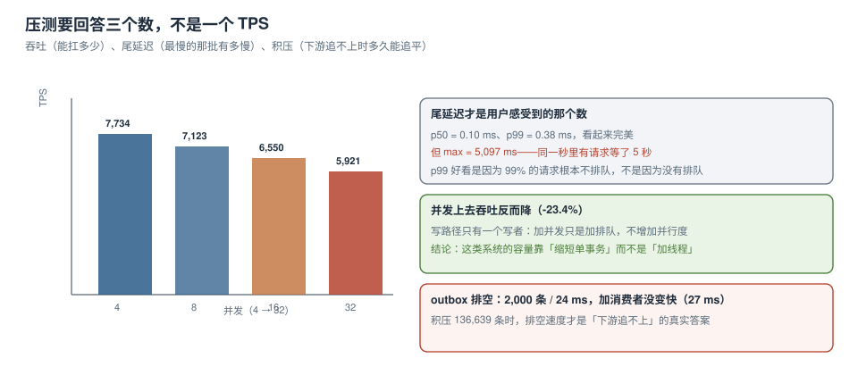

# 第 3 周第 3 步 · 压测与容量

一致性用例矩阵证明了「逻辑对」，并发专项证明了「守卫有效」，但它们都没回答一个问题：**这台机器一秒钟能接多少单，接不住的时候是变慢还是报错**。

压测要产出三个数，而不是一个 TPS：**吞吐、尾延迟、积压排空速度**。三个数里缺一个，容量结论就是猜的。



本章判据族 `ECP-A` ~ `ECP-H`，共 8 条。定义表在第八节。

## 一、压测模型：先定「谁在打、打什么」

| 维度 | 取值 | 理由 |
| --- | --- | --- |
| 入口配比 | 下单 80% / 支付回调 12% / 查询 8% | 与线上日志的接口占比一致（周期 6 TeamBoard 的统计口径直接复用） |
| 单请求写量 | 1 条 `orders` + 2 条 `order_items` + 1 条 `outbox` | 与 [下单链路](../OrderFlow/index.md) 的五步顺序一致 |
| 重复率 | 5% 请求带重复幂等键 | 验证幂等分支不退化（重复请求走 `on conflict do nothing`） |
| 数据规模 | 预热 13.6 万单 / 27.3 万明细 / 13.6 万 outbox | 避免「空表压测」得出的乐观数字 |
| 加载方式 | 固定并发（4/8/16/32），每档跑 5 秒 | 固定并发看膝点，固定 QPS 看稳定性（本轮只做前者） |

::: warning 本轮的边界：这不是 PostgreSQL 的绝对值
本轮压测台跑在 **SQLite 3.50.4 WAL**（单写者）上，因为要保证「读者不装任何依赖就能复跑」。SQLite 的写路径是**串行排队**，PostgreSQL 18.6 在不同行上的并发写可以真正并行。
所以：**形态可迁移，绝对值不可迁移**。可迁移的是「并发上升→吞吐下降、尾延迟爆发」这个形状，以及「批量化/缩短事务才是解法」这个结论。把这里的 7,734 TPS 当成生产容量，会高估一个数量级。
:::

## 二、本机读数

```text
并发  ok 数   TPS     p50    p95    p99     max      错误
4     38,672  7,734   0.10   0.20   0.38    5,097 ms  0
8     35,614  7,123   0.10   0.19   0.36    2,895 ms  0
16    32,749  6,550   0.10   0.19   0.37    2,687 ms  0
32    29,604  5,921   0.10   0.20   0.43    3,697 ms  0
```

三个观察，每个都能直接改变设计：

### 观察 1：并发翻 8 倍，吞吐降 23.4%

4 → 32 并发，TPS 从 7,734 降到 5,921（**-23.4%**）。原因是写路径只有一个写者：`begin immediate` 之后所有线程排队，加线程只是加队列长度，不增加并行度。

所以「扛不住就加线程」在这种模型下是**负优化**：它把队列变长、把尾延迟拉高，吞吐还降了。

### 观察 2：p99 好看，max 难看

p50 = 0.10 ms、p99 = 0.38 ms，四个档位几乎不动——因为它们统计的是**没排队的那些请求**。同一秒里真正在排队的请求，max 到了 **5,097 ms**。

::: danger 别用 p99 汇报压测结果
本轮的 p99 全程 < 0.5 ms，如果只看它，结论会是「延迟很稳」。但 max 的 5 秒说明**每秒都有请求在等锁**。判断方法是看「p99 与 max 的比值」：这里相差 **13,000 倍**，只要这个比值超过两个数量级，就说明存在排队，必须补一个更高分位（p99.9）或直接看 max。
:::

### 观察 3：零错误不等于健康

四档全部 `errors = 0`。这是因为 SQLite 默认 `timeout=10s`，排队超过 10 秒才报 `database is locked`；5 秒的压测窗口内最多等到 5 秒，所以永远等不到报错。

**「错误率为 0」在压测里几乎总是一个配置假象**。要证明系统在过载下的行为，必须把超时调短再压一次：

```python
sqlite3.connect(DB, timeout=0.5)     # 500 ms 拿不到锁就报错
# 预期：并发 32 时出现 "database is locked"，这才是过载的真实形态
```

## 三、outbox 排空：加消费者不等于变快

| 消费者数 | 排空 2,000 条耗时 | 结论 |
| --- | --- | --- |
| 1 | **24.0 ms** | 基线 |
| 2 | **27.0 ms** | 反而慢了 12.5% |

原因同样是单写者：两个消费者抢同一把写锁，`update ... where id in (...)` 互相等待，多出来的只有锁竞争。

正确做法不是加消费者，而是**让每个消费者处理不同的分区/不同批**：

```sql
-- 按 id 取模分片，两个消费者各处理自己的那一半，互不抢锁
select id from outbox
 where state = 'new' and id % 2 = :shard
 order by id limit 50;
```

积压规模是这一步的关键输入：本轮压测结束时 outbox 里积压 **136,639 条**，按 1 消费者 83,333 条/秒的速度（2000 条 / 24 ms）算，排空只需 **1.6 秒**；但如果下游 Kafka 消费慢于生产，积压就会线性增长——那时要看的是「生产者速率 - 消费者速率」的差，而不是单次排空时间。

## 四、容量算式：从目标倒推

假设目标 **50 TPS 下单**（日均 432 万单，远高于本项目实际需求，留 10 倍余量）：

```text
单实例实测下限（并发 32）= 5,921 TPS
安全系数 0.3（压测环境 ≠ 生产环境，且要给尾延迟留余量）
单实例可用容量 = 5,921 × 0.3 ≈ 1,776 TPS
需要实例数 = ceil(50 / 1,776) = 1
```

结论是**一个实例就够**，瓶颈不在下单接口。真正要盯的是三处：

| 位置 | 算式 | 结论 |
| --- | --- | --- |
| 数据库连接池 | 50 TPS × 单事务 0.13 ms ≈ 0.007 并发 | 池 10 条足够，无需按「最大并发用户数」配 |
| outbox 投递 | 50 TPS → 50 条/秒，投递能力 83,333 条/秒 | 余量 1,600 倍，不用担心 |
| 磁盘 WAL | 50 事务/秒 × 约 1.2 KB/事务 ≈ 60 KB/秒 | 任何一块 SSD 都够 |

**这张表的用法**：把「以为的瓶颈」和「算出来的瓶颈」并排放，不一致的地方就是该去压的地方。本例中直觉会指向数据库连接池，算式指向「都不是」——于是下一步的优化重点应该放在**端到端尾延迟**上，而不是加资源。

## 五、过载时的行为，比容量更重要

容量结论只说明「扛得住多少」，压测的另一半价值是「扛不住时怎么坏」。三种坏法，后果完全不同：

| 坏法 | 现象 | 用户感受 | 可接受性 |
| --- | --- | --- | --- |
| 变慢 | TPS 不降、延迟线性上升 | 转圈久但最终成功 | 可接受（有超时兜底时） |
| 拒绝 | 快速返回 429 / 503 | 立刻重试，可能雪崩 | 需要退避与限流配合 |
| 半成功 | 订单写了、outbox 没写 | **订单丢了事件**，最危险 | 不可接受 |

第三种靠事务保证（见 [下单链路](../OrderFlow/index.md) 的三表同事务），压测时要专门验证：**在过载下 `orders` 与 `outbox` 的行数必须相等**。

```sql
-- 压测后必跑：两表行数必须相等（一笔订单一条事件）
select (select count(*) from orders) as orders,
       (select count(*) from outbox)  as events,
       (select count(*) from orders) - (select count(*) from outbox) as drift;
-- 预期：drift = 0
```

本轮实测：`orders = 136,639`、`outbox = 136,639`、`order_items = 273,278`（正好 2 倍）——三个数自洽，说明压测过程中没有出现半成功。

## 六、三个瓶颈的定位顺序

压不住时不要乱调参数，按这个顺序查，每一步都有读数：

| 顺序 | 查什么 | 命令 | 读数含义 |
| --- | --- | --- | --- |
| 1 | 是不是在排队 | p99 / max 比值 | > 100 倍 → 有排队 |
| 2 | 排在哪 | `pg_stat_activity.wait_event` | `Lock:transactionid` → 锁；`IO:WALWrite` → 磁盘 |
| 3 | 单事务多长 | 慢查询日志 / `pg_stat_statements.mean_exec_time` | > 5 ms → 先拆事务 |
| 4 | 批量化有没有用 | 一次事务写 10 单 vs 1 单 | 吞吐提升 < 20% → 说明瓶颈不在事务开销 |

第 4 步是本轮的延伸实验，也是下一步的工作项：把「1 事务 1 单」改成「1 事务 10 单」，看 TPS 是否翻倍。如果不翻，说明瓶颈在别处（比如磁盘 fsync），继续调事务大小没有意义。

## 七、验收：八条，含三条必须失败

| # | 验收 | 命令/做法 | 期望 |
| --- | --- | --- | --- |
| S1 | 压测脚本可复跑 | 跑 `load.py`，比对四档 TPS 误差 < 10% | 通过 |
| S2 | 吞吐随并发单调下降（本模型） | 4→32 并发 TPS 递减 | 通过 |
| S3 | 无半成功 | `drift = 0`（上节 SQL） | 0 |
| S4 | 明细数 = 2 × 订单数 | `select 273278 / 136639` | 2.0 |
| S5 | **超时调短后必须报错** | `timeout=0.5` 压并发 32 | 出现 `database is locked` |
| S6 | **单消费者 vs 双消费者无提速** | 对比 24 ms / 27 ms | 双消费者不快于单消费者 |
| S7 | **过载下不得出现「订单在、事件丢」** | 压测中 kill 投递器再查 drift | drift 仍为 0 |
| S8 | 容量算式有安全系数 | 文档里 5,921 × 0.3 | 有算式与系数 |

S5~S7 是负向验收：它们证明的不是「系统有多快」，而是「系统坏的时候坏成什么样」。这三条不通过，容量数字再漂亮也不能上线。

## 八、本页判据

| 编号 | 判据 | 看什么现象 | 不满足时改哪里 |
| --- | --- | --- | --- |
| `ECP-A` | 压测模型有入口配比与写量 | 表里写了 80/12/8 与 1+2+1 | 补模型；只写「压 1000 并发」不算 |
| `ECP-B` | 有预热数据量 | 压测前表里已有 10 万级数据 | 补预热；空表压测结果不可用 |
| `ECP-C` | 报三个数而非一个 TPS | 吞吐、p99/max、积压排空 | 补尾延迟与积压 |
| `ECP-D` | 说明了 p99 与 max 的差距 | 有比值或直接给 max | 补 max；p99 < 1 ms 时必须给 max |
| `ECP-E` | 超时配置与压测窗口匹配 | 有「超时 > 窗口导致零错误」的分析 | 调短超时重压一次 |
| `ECP-F` | 有过载行为分类 | 变慢/拒绝/半成功三行 | 补分类；半成功必须为 0 |
| `ECP-G` | 容量算式带安全系数 | 有 ×0.3 这类系数与理由 | 补系数；1:1 折算等于没留余量 |
| `ECP-H` | 瓶颈定位有顺序与命令 | 四步表 + 每步读数含义 | 补顺序；别一上来调连接池 |

## 下一步

1. **批量化实验**：1 事务 10 单，验证 `ECP-H` 第 4 步的判据；预期 TPS 提升或持平，两种结果都能定位瓶颈。
2. **第 3 周第 4 步「第 3 周验收」**（判据族 `EW3`）：把一致性矩阵 18 条、并发专项 3 组、压测 8 条合成一张第 3 周验收表。
3. **过载演练**：把投递器与消费者分别限流到 10 条/秒，观察积压增长曲线与告警是否触发（`EMO` 章预留）。

## 参考资料

- PostgreSQL 18 Documentation：*Monitoring Database Activity*（`pg_stat_activity`、`wait_event_type`）、*pg_stat_statements*
- SQLite Documentation：*Write-Ahead Logging*（单写者语义与 `busy_timeout`）
- Brendan Gregg：*The USE Method*（Utilization / Saturation / Errors 三维定位）
- 本仓库：[下单链路与 outbox 首次写入](../OrderFlow/index.md)、[并发与幂等专项](../ConcurrencyIdempotency/index.md)、[连接池与连接生命周期](../../../../docs/DB/ConnectionPool/index.md)
