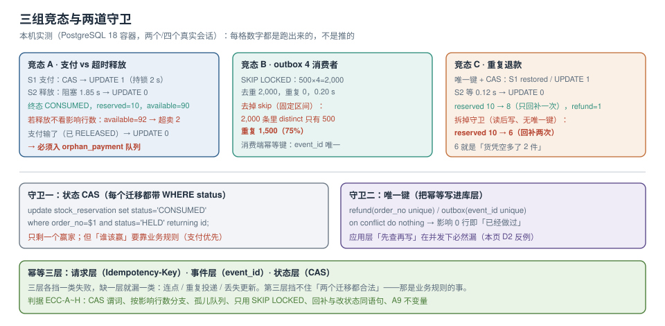

# 第 3 周第 2 步 · 并发与幂等专项

第 3 周第 1 步的矩阵证明了「单条链路的正确性」，但它留下三个明确的缺口，其中**退款链路缺失**会连带 5 条迁移边不可达。今天这一步把它们一次补掉，并且用**两个真实会话**把三组竞态跑出读数——不是「理论上不会重复」，而是「重复了会变成哪个数」。

::: info 当日范围
- 补 **退款链路**：`CONSUMED → REFUNDED` 与**第二次库存回补**（这是矩阵里 5 条未覆盖边的前置）。
- 验证 **支付与释放同时到达**的完整时序（第 1 步只做了「已释放再收支付」的静态版本）。
- 验证 **outbox 四个消费者并发扫描**（`SKIP LOCKED` 在 4 路下的重复率）。
- 不做：压测与容量（第 3 周第 3 步 `ECP`）、发货与签收（`ESF`）。
:::



本页判据族 `ECC-A` ~ `ECC-H`，共 8 条。

## 一、当日做了什么

| 项 | 内容 | 结果 |
| --- | --- | --- |
| 新增状态迁移 | `CONSUMED → REFUNDED`（退款成功，第二次回补库存） | 迁移数 16 → 17 |
| 新增表 | `refund(order_no unique, reason, …)` | 幂等键落在库层，不靠应用约定 |
| 三组竞态实测 | 支付 vs 释放 / 4 消费者 outbox / 重复退款 | 三个读数 + 一个反例读数 |
| 新增断言 | `A9` 退款只回补一次、`A10` 孤儿支付必须入队 | 见第七节 |

一条必须先说清的边界：**本步只做「状态与库存」的并发正确性，不做性能**。所有读数都是「单条链路在两个会话下的行为」，不是吞吐量。

## 二、竞态一：支付成功与超时释放同时到达

这是本周期最容易写错的一处，因为两支代码在**不同的上下文**里、由**不同的触发源**驱动：支付回调来自渠道 HTTP 请求，释放来自定时扫描。它们唯一共享的东西就是 `stock_reservation.status`。

### 时序（两个真实会话，实测）

会话 S1（支付回调）：`CONSUMED` 分支，拿到行锁后睡 2 秒再提交。
会话 S2（超时释放）：0.3 秒后到达，走同一个 `WHERE status='HELD'` 的 CAS。

| 时刻 | S1 | S2 | 数据库 |
| --- | --- | --- | --- |
| 0.0 s | `begin`；`UPDATE … SET status='CONSUMED' WHERE order_no='o-1' AND status='HELD'` → **UPDATE 1** | — | 行被 S1 锁住 |
| 0.3 s | `pg_sleep(2)` | `begin`；同样的 `UPDATE … SET status='RELEASED'` → **阻塞** | S2 等锁 |
| 2.3 s | `commit` | 锁释放，S2 重新求值 `status='HELD'` → **不成立** | — |
| 2.3 s | — | **UPDATE 0**，`commit` | 终态 `CONSUMED` |

实测读数：

```text
S1: S1:CONSUMED | UPDATE 1
S2: UPDATE 0        wait=1.85s
final: CONSUMED  reserved=10  available=90
```

三个结论：

1. **落后者不是「失败」，而是「正确地什么都没做」**。它阻塞了 1.85 秒（等锁），然后因为 `WHERE` 条件不再成立而影响 0 行。
2. **库存没有被回补**：`reserved` 仍是 10，`available` 仍是 90。如果释放分支不看影响行数、照样执行 `reserved = reserved - 2`，终态会是 `available=92`——**同一份货卖了两次**。
3. **1.85 秒的等待是设计的一部分**：它意味着「释放扫描」在极端情况下会被支付回调挡住近 2 秒。扫描器的 `lock_timeout` 必须大于这个量级，否则会出现「释放任务报超时，但支付也没成功」的双输。

::: danger 两支竞态的失败处理不对称
释放输了 → **可以静默**（它本来就不该赢，支付已经成功了）。
支付输了（即 `status` 已不是 `HELD`）→ **绝对不能静默**：钱已经收了、货已经放回去了。必须写入「孤儿支付」队列，由人工或补偿任务处理：要么补货，要么退款。
:::

第二组读数就是「支付输了」的场景（先释放、后收到支付回调）：

```text
D1 paid-after-released -> UPDATE 0   | status= RELEASED
```

`UPDATE 0` 之后如果代码只是 `log.warn` 一行就返回 200，渠道会认为回调成功，用户被扣款但永远收不到货。正确做法是**在同一个事务里写一条 `orphan_payment(order_no, channel_txn_no, reason)`**，让它在监控上可见。

## 三、竞态二：outbox 四个消费者并发扫描

第 1 周用两路并发验证过 `SKIP LOCKED`，今天扩到四路，并且**同时跑对照组**（去掉 `SKIP LOCKED`，用固定 id 区间）：

| 方案 | 4 路各自取到 | 合计 | 去重后 | 重复 | 耗时 |
| --- | --- | --- | --- | --- | --- |
| `ORDER BY id LIMIT 500 FOR UPDATE SKIP LOCKED` | 500 / 500 / 500 / 500 | 2,000 | **2,000** | **0** | 0.20 s |
| 固定区间 `id<=500 FOR UPDATE`（无 skip） | 500 / 500 / 500 / 500 | 2,000 | **500** | **1,500（75%）** | 0.20 s |

```sql [sql/claim-batch.sql]
-- 唯一的取件语句：SKIP LOCKED + 只覆盖未发布的偏索引
begin;
with c as (
  select id from outbox
  where published_at is null
  order by id
  limit 500
  for update skip locked
)
update outbox set published_at = now()
from c where outbox.id = c.id
returning outbox.id;
commit;
```

去掉 `SKIP LOCKED` 之后，四个消费者**各自都认为自己拿到了 500 条**——因为 `FOR UPDATE` 只是排队，不改变结果集。这就是「同一批事件被投递四次」的经典事故形态：消息队列里出现 4 倍的重复，消费端如果没做幂等，下游就多扣 4 次库存。

::: warning `SKIP LOCKED` 只解决「重复取件」，不解决「重复投递」
取件事务提交后、消息真正发出前，进程崩溃 → 该批 `published_at` 已置位，但消息没发出去（**丢**）。
取件事务里先发消息再置位 → 消息发出后事务回滚 → 下一轮再取同一批（**重**）。
两种写法都只能保证一种失败模式。本项目的选择是 **at-least-once**：先置位、再发消息，用「发送失败则回滚整个事务」把丢的概率压到最低，重复交给消费端幂等键兜住。
:::

消费端的幂等键仍然是 `event_id` 唯一约束。四路并发下这条约束的价值可以量化：**没有它，2,000 条事件会产生 1,500 条重复副作用；有它，重复被挡在第一次写入之前。**

## 四、竞态三：退款链路与「第二次回补」

退款是本周期最复杂的写路径，因为它同时改三张表：`refund`（新增）、`reservation`（状态）、`stock`（回补）。

```text
CONSUMED --退款成功--> REFUNDED        （第二次回补：reserved -= qty）
HELD     --取消/超时--> RELEASED        （第一次回补：reserved -= qty）
```

两条回补路径必须**互斥**：一个预占只能回补一次。守卫有两层：

| 层 | 手段 | 挡住什么 |
| --- | --- | --- |
| 幂等键 | `refund.order_no` 唯一 | 同一订单的重复退款请求（渠道重推、用户连点） |
| 状态 CAS | `WHERE status='CONSUMED'` | 已释放/已退款的单被再次推进 |

实测（两个会话同时提交同一笔退款）：

```text
before: CONSUMED  reserved=10
S1: restored, UPDATE 1
S2: UPDATE 0            wait=0.12s
after: REFUNDED  reserved=8  refund_rows=1
```

`reserved` 从 10 变成 **8**（只减了一次 2），`refund` 只有 **1** 行，第二个会话等了 0.12 秒后被唯一键挡住。

再把守卫拆掉，看反例（读后写：先 `select status` 判断，再更新，没有唯一键）：

```text
D2 buggy double restore -> reserved= 6   （期望 8）
```

**6 就是「同一份货回补了两次」**：库存凭空多出 2 件，下一次下单会超卖。这个反例比任何解释都直观——`reserved` 少了 2，看起来是「库存更充足」，实际是账已经错了。

::: danger 退款链路的三个必失点
1. **先回补再改状态**：如果进程在两步之间崩溃，下次重试会再回补一次（`reserved` 少 2）。正确顺序是**同一条 CTE**：改状态与回补在同一个语句里，要么都成要么都不成。
2. **用 `order_no` 做退款幂等键但漏了 `refund_type`**：部分退款与全额退款会被当成同一笔。要么加 `refund_type`，要么用 `(order_no, refund_no)`。
3. **退款成功后不检查订单状态**：订单可能已经 `CLOSED`（超时关闭后又被退款），此时库存早就回补过，再补一次就是 D2 的 6。
:::

## 五、幂等三层模型

三组竞态跑完，可以把幂等收敛成一张表。**每一层都有它唯一能挡住的失败模式**，缺一层就会出现一类漏洞：

| 层 | 键 | 位置 | 挡住的失败 | 挡不住 |
| --- | --- | --- | --- | --- |
| 请求层 | `Idempotency-Key`（客户端生成） | 下单 / 退款入口 | 用户连点、SDK 重试 | 不同客户端对同一业务的重复提交 |
| 事件层 | `event_id` 唯一 | 消费端去重表 | 消息重复投递（at-least-once 必然发生） | 同一业务动作被发了两个不同 `event_id` |
| 状态层 | `WHERE status = 期望值`（CAS） | 每个状态迁移 | 并发下的丢失更新、乱序应用 | 两个迁移都合法但业务上只该发生一次 |

第三层的「挡不住」最容易被忽略：`HELD → RELEASED` 与 `HELD → CONSUMED` 都是合法迁移，CAS 只保证「只有一个赢」，**不保证赢的那个是对的**。所以还需要业务规则：支付成功优先于超时释放（这就是第二节要定义「谁输了之后做什么」的原因）。

## 六、断言清单（新增两条）

| 编号 | 断言 | SQL 要点 | 期望 |
| --- | --- | --- | --- |
| `A9` | 每笔退款只回补一次 | `reserved` 的变化量 = `sum(qty) where status in ('RELEASED','REFUNDED')` | 差值为 0 |
| `A10` | 孤儿支付必须入队 | `payment.status='SUCCEEDED'` 且 `reservation.status<>'CONSUMED'` 的单，必须在 `orphan_payment` 里有记录 | 缺失数 = 0 |

```sql [sql/invariant-a9.sql]
-- A9：库存回补次数与「终态为释放/退款」的预占数量必须严格相等
with restored as (
  select sku, sum(qty) as qty
  from stock_reservation
  where status in ('RELEASED','REFUNDED')
  group by sku
), baseline as (
  select sku, total - reserved as used from stock
)
select b.sku, b.used, coalesce(r.qty, 0) as restored_qty
from baseline b left join restored r using (sku)
where b.used <> coalesce(r.qty, 0);
-- 期望：0 行（出现行即说明回补次数与预占终态不一致）
```

## 七、五条验收（读者可执行）

```shell
# 0) 起库（与项目基线一致）
docker run -d --name eoh-pg -e POSTGRES_PASSWORD=eoh -p 55432:5432 postgres:18
docker exec -i eoh-pg psql -U postgres -c "create database eoh"

# 1) 三张表 + 退款表（本页第四节的 DDL 片段）
docker exec -i eoh-pg psql -U postgres -d eoh -f 020_reservation_refund.sql

# 2) 支付 vs 释放：两个会话按第二节时序执行
#    期望：S2 阻塞约 2 秒后 UPDATE 0；终态 CONSUMED，reserved 不变
docker exec -i eoh-pg psql -U postgres -d eoh -c \
  "select status from stock_reservation where order_no='o-1';"

# 3) 四路 SKIP LOCKED：4 个终端同时执行 sql/claim-batch.sql
docker exec -i eoh-pg psql -U postgres -d eoh -c \
  "select count(*) filter (where published_at is not null) as pub,
          count(*) as total from outbox;"
# 期望：2000 条全部 pub，且四个终端返回的 id 集合两两无交集

# 4) 重复退款：两个终端同时执行同一笔退款 CTE
docker exec -i eoh-pg psql -U postgres -d eoh -c \
  "select reserved from stock where sku='sku-1'; select count(*) from refund;"
# 期望：reserved 只减一次（10 → 8）；refund 只有 1 行

# 5) 两条不变量
docker exec -i eoh-pg psql -U postgres -d eoh -f 900_invariants.sql
# 期望：A1~A10 全部 0 行
```

## 八、本页判据

| 编号 | 判据 | 看什么现象 | 不满足时改哪里 |
| --- | --- | --- | --- |
| `ECC-A` | 每个状态迁移都有 CAS 谓词 | `UPDATE` 语句里出现 `AND status = '…'` | 补谓词；不要先 `select` 再 `update` |
| `ECC-B` | 落后者按影响行数分支 | 有 `if (rows == 0)` 的分支且两支行为不同 | 补分支；释放静默、支付入队 |
| `ECC-C` | 孤儿支付有队列 | 有 `orphan_payment` 表与监控指标 | 补表；否则钱货两空不可见 |
| `ECC-D` | 取件只用 `SKIP LOCKED` | 全仓 `for update` 后面紧跟 `skip locked` | 无 skip 的取件在 4 路下重复 75% |
| `ECC-E` | 投递语义写清楚 | 文档写明 at-least-once 与重复来源 | 补一节；不要写「保证 exactly-once」 |
| `ECC-F` | 回补与改状态同语句 | 回补与 `status` 更新在同一个 CTE | 拆两步会出现 D2 的 `reserved=6` |
| `ECC-G` | 退款幂等键含类型 | 唯一键是 `(order_no, refund_type)` 或等价 | 补字段；否则部分退款被吞 |
| `ECC-H` | 回补次数有不变量 | `A9` 可执行且为 0 行 | 补 SQL；只靠代码 review 拦不住 |

## 九、下一步

第 3 周第 3 步是**压测与容量**（判据族 `ECP`），本步给出的三组读数正好是它的输入：

1. **释放扫描的锁等待**：本步量到单条链路 1.85 s，压测要量「1 万笔同时释放」时 `pg_locks` 的等待会话数与 `deadlocks` 增量；
2. **outbox 取件的上限**：4 路 0.20 s 取 2,000 条，压测要找出「取件比消费快」时的积压拐点；
3. **退款的写放大**：一次退款改三张表，压测要给出单实例 TPS 与 P99，作为第 4 周容量规划的依据。

三个仍未关闭的缺口（与第 2 周登记一致，本步关掉了退款，还剩两个）：

- 积压自愈：`I2` 只报不修（需要第 4 周的补偿任务）；
- 跨上下文乱序：发货事件早于支付事件尚未覆盖（留给 `ESF` 与矩阵的 `C19`）。

## 参考资料

- PostgreSQL 18 Documentation：*Concurrency Control*（Read Committed 与 `EvalPlanQual` 重求值）、*SELECT … FOR UPDATE*（`SKIP LOCKED` 的语义与限制）、*INSERT … ON CONFLICT*（并发下的阻塞与跳过）
- 本仓库项目：[一致性用例矩阵](../ConsistencyMatrix/index.md)（本步要补的 5 条边）、[库存预占的释放与超时回滚](../StockRelease/index.md)（第一次回补）、[支付回调](../PaymentCallback/index.md)（孤儿支付的上游）、[数据库设计](../DatabaseDesign/index.md)（六条不变量的写法）
- 本仓库专题：[幂等与状态机工程](../../../../docs/Backend/IdempotencyStateMachine/index.md)（三层幂等模型）、[分布式事务与 Saga](../../../../docs/Backend/Microservices/DistributedTransaction/Saga/index.md)（跨上下文的补偿边界）
