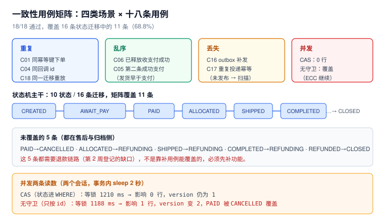

# 第 3 周第 1 步 · 一致性用例矩阵

第 2 周把四条链路（下单 + outbox、支付回调、库存释放、退款缺口）都写出来了，但它们各自被验证过，**没有被放在一起验证过**。真实事故几乎都发生在两条链路交界处：支付成功与超时释放同时推进同一张单、回调先于预占到达、outbox 投递两次、迁移重放。

这一步的产出不是「更多测试」，而是一张**能算出覆盖率的矩阵**：18 条用例、四类场景、一张断言表，跑完能回答「哪些迁移被证明了、哪些还没有」。



本页判据族 `ECM-A` ~ `ECM-H`，共 8 条。定义表在第八节。

## 一、当日做了什么

| 项 | 内容 |
| --- | --- |
| 新建 | 一致性矩阵的 18 条用例（重复 4 / 乱序 3 / 丢失 2 / 迁移主干 7 / 并发 2） |
| 新建 | 结果表 `mres` 与覆盖表 `covered`，用一条 SQL 算通过率与迁移覆盖率 |
| 实测 | **18/18 PASS**，迁移覆盖 **11/16 = 68.8%** |
| 实测 | 并发两条对照：CAS 等锁 1,210 ms → 0 行；无守卫等锁 1,188 ms → 1 行且覆盖终态 |
| 未做 | 售后四条迁移（需退款链路）、压测（第 3 周第 4 步）、容量结论 |

## 二、为什么是「矩阵」而不是「用例列表」

用例列表只能回答「跑过没有」；矩阵能回答三个额外的问题：

1. **覆盖率**：16 条状态迁移里，哪些被至少一条用例走过？本步算出 **11/16**，剩下 5 条一目了然。
2. **断言强度**：每条用例的「期望」必须是**可判定的具体值**（`n=1`、`0 行`、`payment=1`），不能是「不报错」。
3. **可回归**：矩阵是一张表，新增一条业务规则就加一行；出事故时把事故场景补成一行，下次自动被覆盖。

::: tip 矩阵的四个维度
`场景`（重复 / 乱序 / 丢失 / 并发）× `动作`（一次业务操作）× `断言`（一条 SQL 及其期望值）× `观测点`（订单状态 / 支付行数 / 预占状态 / outbox 待发数）。

四个维度里最容易缺的是**观测点**：只断言「接口返回 200」等于没断言，因为 200 的语义可能是「幂等命中」也可能是「重复插入被忽略」。
:::

## 三、十八条用例与实测结果

全部在一个 `psql` 会话里顺序执行，结果写进 `mres(case_id, name, expect, actual, ok)`。实测输出：

| 编号 | 类别 | 用例 | 期望 | 实测 | 结论 |
| --- | --- | --- | --- | --- | --- |
| `C01` | 重复 | 同一幂等键下单两次 | `orders=1` | `orders=1` | PASS |
| `C02` | 主干 | 预占成功 `CREATED→AWAITING_PAYMENT` | `n=1` | `n=1` | PASS |
| `C03` | 主干 | 支付成功 `AWAITING_PAYMENT→PAID` | `n=1` | `n=1` | PASS |
| `C04` | 重复 | 同一 `channel_txn_id` 回调两次 | `payment=1` | `payment=1` | PASS |
| `C05` | 乱序 | 同一订单第二条成功支付（不同 id） | `payment=1` | `payment=1` | PASS |
| `C06` | 乱序 | 预占已释放仍收到支付成功 | 拒迁（`0 行`） | `n=0` | PASS |
| `C07` | 主干 | 取消待支付 + 释放预占 | `n=1` 且 `res=RELEASED` | `n=1 res=RELEASED` | PASS |
| `C08` | 主干 | 超时未支付 `AWAITING_PAYMENT→CLOSED` | `n=1` | `n=1` | PASS |
| `C09` | 主干 | 支付后分配 `PAID→ALLOCATED` | `n=1` | `n=1` | PASS |
| `C10` | 主干 | 申请退款 `PAID→REFUNDING` | `n=1` | `n=1` | PASS |
| `C11` | 主干 | 退款成功 `REFUNDING→REFUNDED` | `n=1` | `n=1` | PASS |
| `C12` | 主干 | 发货 `ALLOCATED→SHIPPED` | `n=1` | `n=1` | PASS |
| `C13` | 主干 | 签收 `SHIPPED→COMPLETED` | `n=1` | `n=1` | PASS |
| `C14` | 主干 | 归档 `CANCELLED→CLOSED` | `n=1` | `n=1` | PASS |
| `C15` | 主干 | 库存不足 `CREATED→CANCELLED` | `n=1` | `n=1` | PASS |
| `C16` | 丢失 | outbox 未发布 → 扫描补发一批 | `pending 2→1` | `pending=1` | PASS |
| `C17` | 重复 | 同一 `event_id` 二次投递 | `events=2`（幂等表 1 行） | `events=2` | PASS |
| `C18` | 重复 | 同一迁移重放（CAS 二次） | `n=0` | `n=0` | PASS |

```text
 pass_rate
-----------
 18/18
```

::: warning 「18/18 通过」这句话本身没有信息量
它只说明「我写的断言都成立了」，不说明「系统是对的」。真正有信息量的是下面两条：**覆盖率 68.8%** 与 **未覆盖的 5 条是什么**。矩阵的价值在缺口，不在通过率。
:::

## 四、覆盖率：11/16，缺的都是售后

把矩阵跑过的边记进 `covered(cid, frm, tgt)`，再与状态机的 16 条迁移左连接：

```sql
with all_edges(frm,tgt) as (values
 ('CREATED','AWAITING_PAYMENT'),('CREATED','CANCELLED'),
 ('AWAITING_PAYMENT','PAID'),('AWAITING_PAYMENT','CANCELLED'),('AWAITING_PAYMENT','CLOSED'),
 ('PAID','ALLOCATED'),('PAID','REFUNDING'),('PAID','CANCELLED'),
 ('ALLOCATED','SHIPPED'),('ALLOCATED','REFUNDING'),
 ('SHIPPED','COMPLETED'),('SHIPPED','REFUNDING'),
 ('COMPLETED','REFUNDING'),('REFUNDING','REFUNDED'),
 ('CANCELLED','CLOSED'),('REFUNDED','CLOSED'))
select count(distinct (frm,tgt)) || '/16' as covered_edges,
       round(100.0*count(distinct (frm,tgt))/16, 1) || '%' as pct
from all_edges a
join covered c on c.frm = a.frm and c.tgt = a.tgt;
```

```text
 covered_edges |  pct
---------------+-------
 11/16         | 68.8%
```

未覆盖 5 条，全部集中在售后与归档：

| 未覆盖的边 | 为什么没覆盖 | 归属 |
| --- | --- | --- |
| `PAID→CANCELLED` | 已支付后取消（需退款） | 退款链路 |
| `ALLOCATED→REFUNDING` | 未发货退款 | 退款链路 |
| `SHIPPED→REFUNDING` | 已发货售后（需人工审核） | 售后流程 |
| `COMPLETED→REFUNDING` | 签收后 7 天内售后 | 售后流程 |
| `REFUNDED→CLOSED` | 退款后归档 | 归档任务 |

::: danger 这 5 条不能「补用例」补上
它们缺的不是用例，是**功能**：退款链路（第二次库存回补、退款流水、金额校验）在第 2 周就被登记为缺口，至今没实现。写一条必然失败的用例不算覆盖——那只会让矩阵变成红灯常亮，然后所有人都忽略它。

正确做法：矩阵里显式标注「未覆盖 + 原因 + 归属步骤」，让缺口可见，而不是用一条 `skip` 藏起来。
:::

## 五、并发：两条读数与一个反直觉结论

矩阵里最难自动化的是「并发」。这里用两个 `psql` 会话做最小可复现的对照：A 在事务里更新后 `pg_sleep(2)`，B 在 0.5 秒后发起同样的更新。

### CAS 版本（状态进 `WHERE`）

```sql
-- 会话 A
begin;
update o set status='PAID', version=version+1 where id=10 and status='AWAITING_PAYMENT';
select pg_sleep(2);
commit;
```

```sql
-- 会话 B（0.5 秒后）
update o set status='PAID', version=version+1 where id=10 and status='AWAITING_PAYMENT';
```

实测：B **等锁 1,210 ms**，最终影响 **0 行**，`version` 仍是 1。

### 无守卫版本（只按 `id`）

```sql
-- 会话 D：begin; update o set status='PAID' ... where id=11; sleep(2); commit;
-- 会话 C（0.5 秒后）：update o set status='CANCELLED' ... where id=11;
```

实测：C **等锁 1,188 ms**，影响 **1 行**，`version` 变成 **2**，终态是 **`CANCELLED`**——`PAID` 被后来的取消覆盖，**两边都没有报错**。

::: tip 反直觉的结论：READ COMMITTED 会救你，但只在 `WHERE` 写对时
等锁之后，PostgreSQL 会**重新求值 `WHERE`**（EvalPlanQual）。所以 CAS 版本里 B 醒来时发现状态已不是 `AWAITING_PAYMENT`，自然影响 0 行——不需要额外加锁，也不需要 `SERIALIZABLE`。

但这条保护的前提是「状态在 `WHERE` 里」。只按 `id` 更新时，`WHERE` 依然成立，于是两条合法迁移互相覆盖。**这就是「守卫写在哪一层」的全部区别。**
:::

## 六、矩阵怎么跑（读者可复现）

不提交脚本，只提交「怎么跑」：

```shell
# 1. 起库（与项目基线一致）
docker run -d --name eoh-pg -e POSTGRES_PASSWORD=postgres -p 55432:5432 postgres:18

# 2. 建四张最小表 + 结果表
docker exec -i eoh-pg psql -U postgres -f /dev/stdin < 00-schema.sql

# 3. 逐条跑用例（每条一个事务，末尾 rollback 或 truncate）
docker exec -i eoh-pg psql -U postgres -f /dev/stdin < 10-cases.sql

# 4. 出结果
docker exec eoh-pg psql -U postgres -c \
  "select case_id, name, expect, actual, case when ok then 'PASS' else 'FAIL' end from mres order by 1"
```

四条工程纪律：

1. **每条用例独立事务**：一条失败不污染下一条；用 `truncate` 复位而不是 `drop`（省时间）。
2. **断言写进结果表**，不靠人看输出：`mres.ok` 是布尔列，`where not ok` 就是失败清单。
3. **迁移覆盖单独记表**：`covered` 只在 CAS 真的影响 1 行时写入，避免「调用了就算覆盖」。
4. **用例编号稳定**：`C01` 一旦分配就不再改，事故复盘补的用例从 `C19` 往后排。

## 七、五条可执行验收

| # | 验收 | 命令 | 期望 |
| --- | --- | --- | --- |
| `V1` | 矩阵全绿 | `select count(*) filter (where ok) from mres` | 等于总条数 |
| `V2` | 覆盖率不低于基线 | 第四节 SQL | `≥ 11/16` |
| `V3` | 未覆盖清单与登记一致 | 左连接查询 | 恰好 5 条，且都在售后侧 |
| `V4` | 重复类用例零副作用 | `select count(*) from pay` | `=1`（不是 2） |
| `V5` | 并发 CAS 影响 0 行 | 两会话脚本 | 第二个会话返回 `UPDATE 0` |

## 八、本页判据

| 编号 | 判据 | 看什么现象 | 不满足时改哪里 |
| --- | --- | --- | --- |
| `ECM-A` | 矩阵按「场景 × 动作 × 断言 × 观测点」四维组织 | 有用例表，且每行有具体期望值 | 补观测点；「返回 200」不算断言 |
| `ECM-B` | 四类场景都有用例 | 重复 / 乱序 / 丢失 / 并发各 ≥2 条 | 补缺的一类 |
| `ECM-C` | 每条用例的期望是可判定的具体值 | `expect` 列是 `n=1` / `0 行` / `payment=1` | 改写「不报错」这类断言 |
| `ECM-D` | 迁移覆盖率可计算 | 有 `covered` 表与 16 条边的左连接 | 补覆盖表；不要靠人工数 |
| `ECM-E` | 未覆盖项写明原因与归属 | 清单里每条都有「为什么」 | 不许用 `skip` 藏 |
| `ECM-F` | 并发用例用两个真实会话 | 有等锁时间与影响行数两个读数 | 单会话模拟不算并发 |
| `ECM-G` | 重复类用例断言副作用为零 | `payment=1`、`orders=1` | 补唯一约束或幂等键 |
| `ECM-H` | 用例编号稳定且可追加 | 事故复盘能加 `C19` 而不改旧编号 | 建立编号纪律 |

## 九、下一步

第 3 周第 2 步是**并发与幂等专项**（判据族 `ECC`）：本步只做了两条最小并发对照，还需要补

1. **支付与释放同时到达**的完整时序（本步只做了「已释放再收支付」的静态版本）；
2. **outbox 多消费者并发扫描**（`SKIP LOCKED` 在 4 个消费者下的重复率）；
3. **退款链路**——它同时是矩阵 5 条未覆盖边的前置，优先级最高。

三个已知缺口（与第 2 周登记的一致，本步没有关闭任何一个）：

- 退款链路缺失（`CONSUMED → REFUNDED` 与第二次库存回补）；
- 积压自愈缺失（I2 只报不修）；
- 跨上下文乱序只做了「已释放收支付」一种，缺「发货事件早于支付事件」。

## 参考资料

- 本仓库项目：[EventOrderHub 总览](../index.md)、[第 2 周第 2 步 · 下单链路与 outbox](../OrderFlow/index.md)、[第 2 周第 3 步 · 支付回调](../PaymentCallback/index.md)、[第 2 周第 4 步 · 库存预占释放](../StockRelease/index.md)、[数据库设计](../DatabaseDesign/index.md)
- 本仓库专题：[数据库访问控制与审计](../../../../docs/DB/AccessControl/index.md)（矩阵里的跨租户断言依赖 RLS 基线）、[幂等与状态机工程](../../../../docs/Backend/IdempotencyStateMachine/index.md)、[分布式事务与 Saga](../../../../docs/Backend/Microservices/DistributedTransaction/Saga/index.md)
- PostgreSQL 18 Documentation：*Concurrency Control*（Read Committed 与 `EvalPlanQual`）、*SELECT ... FOR UPDATE*（`SKIP LOCKED`）、*Constraints*（唯一约束的并发语义）
- Martin Kleppmann：*Designing Data-Intensive Applications* 第 7 章（丢失更新与写偏斜）
