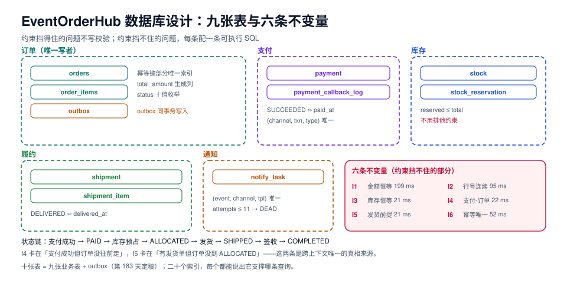

# 数据库设计：九张表与六条不变量

本页判据族 `EDB-A` ~ `EDB-H`，共 8 条。

第 183 天定下的架构是「一个写者、两条通道、三处事务」。今天把它落成**可以照着建的表**：九张业务表的完整 DDL、二十个索引、六条能用一条 SQL 验证的数据不变量，以及在 PostgreSQL 18.6 上逐条测过的读数。

这一章的目标不是「表建得漂亮」，而是**「数据错了能被一条查询抓出来」**——约束挡得住的问题不用校验，约束挡不住的问题必须有不变量。



检查项 `EDB-A` ~ `EDB-H`（8 条），每条都能在库里跑出结果。

## 一、九张表的分工与「为什么是九张」

| # | 表 | 拥有者上下文 | 一行代表什么 | 关键约束 |
| --- | --- | --- | --- | --- |
| 1 | `orders` | 订单 | 一笔订单的头 | 幂等键唯一、状态枚举、金额非负 |
| 2 | `order_items` | 订单 | 订单里的一行商品 | `(order_id, line_no)` 唯一、数量 > 0 |
| 3 | `payment` | 支付 | 一次支付尝试 | `SUCCEEDED` 与 `paid_at` 互为充要 |
| 4 | `payment_callback_log` | 支付 | 一条渠道回调原文 | `(channel, provider_txn, event_type)` 唯一 |
| 5 | `stock` | 库存 | 一个 SKU 的库存水位 | `reserved ≤ total`、`available` 生成列 |
| 6 | `stock_reservation` | 库存 | 一笔订单对一个 SKU 的占用 | `(order_id, sku_id)` 在 HELD 态唯一 |
| 7 | `shipment` | 履约 | 一张发货单 | `DELIVERED` 与 `delivered_at` 互为充要 |
| 8 | `shipment_item` | 履约 | 发货单里的一行 | `(shipment_id, order_item_id)` 唯一 |
| 9 | `notify_task` | 通知 | 一条待发的通知 | `(event_id, channel, template)` 唯一 |

::: warning 为什么没有 `order_events` 表
第 181 天的需求页把「订单事件」列为订单上下文拥有的数据。落地时它**没有单独建表**，理由有三条：

1. **事件已经在 `outbox` 里。** 第 183 天定稿的 `outbox` 就是订单事件的持久化形态（`aggregate_id` + `event_type` + `payload`），再建一张 `order_events` 等于同一份事实写两遍，两遍就会不一致。
2. **状态历史用 `orders.status` + `outbox` 回放就够了。** 需要「这单什么时候变成 PAID 的」时，查 `outbox` 里该聚合的最新 `order.*` 事件即可；真需要频繁查历史时再加投影表，而不是现在预先建。
3. **九张表已经覆盖了「写入路径」的全部。** 加一张纯历史表会把「谁有权写状态」这件事重新变模糊——这正是第 183 天刻意避免的。
:::

## 二、建表：十张表 + 二十个索引 = 45 毫秒

本机实测（`postgres:18` 容器，全新库，逐条 `\timing`）：

| 项 | 读数 |
| --- | --- |
| 单条 DDL 耗时范围 | **0.65 ~ 6.28 ms**（最慢的是 `stock_reservation`，带三个索引） |
| 十张表 + 二十个索引累计 | **约 45 ms** |
| 建库 + 两个扩展 + 全部 DDL 端到端 | **1.07 s**（含容器进程启动） |

所以「建表慢」在这套设计里不是问题；**真正花时间的是回填与索引**（见第六节的造数读数）。

### `orders`：三个值得单独说的决定

```sql
create table orders (
  id              uuid primary key default uuidv7(),
  tenant_id       text not null,
  order_no        text not null,
  buyer_id        text not null,
  status          text not null default 'CREATED',
  currency        char(3) not null default 'CNY',
  items_amount    numeric(14,2) not null default 0,
  freight_amount  numeric(14,2) not null default 0,
  discount_amount numeric(14,2) not null default 0,
  total_amount    numeric(14,2) generated always as
                    (items_amount + freight_amount - discount_amount) stored,
  idempotency_key text,
  version         integer not null default 0,
  created_at      timestamptz not null default now(),
  updated_at      timestamptz not null default now(),
  constraint orders_status_chk check (status in ('CREATED','AWAITING_PAYMENT','PAID','ALLOCATED',
      'SHIPPED','COMPLETED','CANCELLED','REFUNDING','REFUNDED','CLOSED')),
  constraint orders_amount_chk check (items_amount >= 0 and freight_amount >= 0
      and discount_amount >= 0 and total_amount >= 0),
  constraint orders_no_uk unique (tenant_id, order_no)
);
create unique index orders_idem_uk on orders (tenant_id, idempotency_key)
  where idempotency_key is not null;
create index orders_tenant_status_idx on orders (tenant_id, status, created_at desc);
create index orders_buyer_idx on orders (buyer_id, created_at desc);
```

| 决定 | 替代方案 | 实测依据 |
| --- | --- | --- |
| `uuidv7()` 主键 | `bigserial` / `gen_random_uuid()` | 20 万行实测：主键索引 **6,184 KB vs 8,752 KB（小 29.3%）**；按 `id` 排序取 1 万行只触达 **64 页 vs 1,274 页（少 19.9 倍）** |
| `total_amount` 用 stored 生成列 | 应用层算、触发器算 | 应用层算会漂移（见不变量 I1）；生成列的代价实测见下 |
| 幂等键用**部分唯一索引** | 普通唯一索引 | 普通唯一索引会让 `NULL` 语义复杂（多行 NULL 允许，但语义含糊）；部分索引只对「有幂等键」的行生效，且索引更小 |

::: danger 生成列不是免费的
两张结构完全相同的表，只有 `total` 一个是 `stored` 生成列，10 万行实测：

| 操作 | 普通列 | 生成列 | 代价 |
| --- | --- | --- | --- |
| 插入 10 万行 | 288.6 ms | **522.6 ms** | **+81%** |
| 更新 10 万行 | 30.1 ms | 40.9 ms | +36% |

结论：**金额这类「必须与明细一致」的字段值得付这个钱**（它换掉了 I1 这条不变量的一部分风险）；而「只是为了让查询少写一次 `+`」的计算列不值得。
:::

### `order_items`、`payment`、`payment_callback_log`

```sql
create table order_items (
  id uuid primary key default uuidv7(),
  tenant_id text not null,
  order_id uuid not null references orders(id) on delete cascade,
  line_no smallint not null,
  product_id text not null,
  sku_id text not null,
  title text not null,
  unit_price numeric(12,2) not null,
  quantity integer not null,
  amount numeric(14,2) generated always as (unit_price * quantity) stored,
  constraint order_items_qty_chk check (quantity > 0),
  constraint order_items_price_chk check (unit_price >= 0),
  constraint order_items_line_uk unique (order_id, line_no),
  constraint order_items_sku_uk unique (order_id, sku_id)
);
create index order_items_order_idx on order_items (order_id);

create table payment (
  id uuid primary key default uuidv7(),
  tenant_id text not null,
  order_id uuid not null references orders(id) on delete restrict,
  pay_no text not null,
  channel text not null,
  status text not null default 'INIT',
  amount numeric(14,2) not null,
  provider_txn text,
  idempotency_key text,
  paid_at timestamptz,
  created_at timestamptz not null default now(),
  constraint payment_status_chk check (status in ('INIT','PENDING','SUCCEEDED','FAILED','CLOSED','REFUNDED')),
  constraint payment_amount_chk check (amount > 0),
  constraint payment_no_uk unique (tenant_id, pay_no),
  constraint payment_succeeded_ck check ((status = 'SUCCEEDED') = (paid_at is not null))
);
create unique index payment_idem_uk on payment (tenant_id, idempotency_key)
  where idempotency_key is not null;
create unique index payment_provider_txn_uk on payment (channel, provider_txn)
  where provider_txn is not null;
create index payment_order_idx on payment (order_id);

create table payment_callback_log (
  id bigint generated always as identity primary key,
  channel text not null,
  provider_txn text not null,
  event_type text not null,
  payload jsonb not null,
  payload_sha256 text not null,
  signature_ok boolean not null,
  processed_at timestamptz,
  received_at timestamptz not null default now(),
  constraint callback_txn_uk unique (channel, provider_txn, event_type)
);
create index callback_unprocessed_idx on payment_callback_log (received_at)
  where processed_at is null;
```

三个要点：

1. **`payment` 对 `orders` 是 `on delete restrict`，而 `order_items` 是 `cascade`。** 删除订单时明细应该跟着走（它是订单的组成部分），支付流水**绝对不能**跟着走（它是账务证据）。这两条外键的方向性差异必须在 DDL 里体现，靠应用层记得住是不可靠的。
2. **`(status = 'SUCCEEDED') = (paid_at is not null)` 是一个双向断言。** 它同时挡住「标了成功但没时间戳」和「有时间戳但状态没改」——两个方向都是真实的线上错误。
3. **`payment_callback_log` 的唯一键是三元组。** 同一个 `provider_txn` 会推多次不同 `event_type`（支付成功、退款、撤销），只按 `provider_txn` 唯一会把正常回调当重复丢掉。

### `stock` 与 `stock_reservation`：为什么**不用**排他约束

```sql
create table stock (
  tenant_id text not null,
  sku_id text not null,
  total_qty integer not null default 0,
  reserved_qty integer not null default 0,
  available_qty integer generated always as (total_qty - reserved_qty) stored,
  version integer not null default 0,
  updated_at timestamptz not null default now(),
  primary key (tenant_id, sku_id),
  constraint stock_total_chk check (total_qty >= 0),
  constraint stock_reserved_chk check (reserved_qty >= 0 and reserved_qty <= total_qty)
);

create table stock_reservation (
  id uuid primary key default uuidv7(),
  tenant_id text not null,
  order_id uuid not null references orders(id) on delete cascade,
  sku_id text not null,
  quantity integer not null,
  status text not null default 'HELD',
  expires_at timestamptz not null,
  created_at timestamptz not null default now(),
  constraint reservation_qty_chk check (quantity > 0),
  constraint reservation_status_chk check (status in ('HELD','CONFIRMED','RELEASED','EXPIRED'))
);
create unique index reservation_order_sku_uk on stock_reservation (order_id, sku_id)
  where status = 'HELD';
create index reservation_expire_idx on stock_reservation (expires_at) where status in ('HELD');
create index reservation_sku_idx on stock_reservation (tenant_id, sku_id, status);
```

`stock_reservation` 上**没有** `EXCLUDE USING gist`。这不是遗漏，是一次实测后的决定：

```sql
-- 实验：在数量型库存上套用「时段排他」约束
create table slot_hold (
  tenant_id text, sku_id text, order_id uuid, qty int,
  slot tstzrange, status text default 'HELD',
  constraint slot_no_overlap exclude using gist
    (tenant_id with =, sku_id with =, slot with &&) where (status = 'HELD')
);
-- 第一条（占用 0~30 分钟）成功
insert into slot_hold values ('t1','skuX',gen_random_uuid(),2,tstzrange(now(), now()+interval '30 min'));
-- 第二条（占用 5~35 分钟，同一个 SKU，另一个订单）
insert into slot_hold values ('t1','skuX',gen_random_uuid(),1,tstzrange(now()+interval '5 min', now()+interval '35 min'));
-- ERROR: conflicting key value violates exclusion constraint "slot_no_overlap"
```

::: danger 排他约束只能表达「同一资源的时段独占」
上面第二条插入**在业务上是完全合法的**——两个订单同时占用同一个 SKU 的库存是正常的，只要总数不超卖。而 `EXCLUDE` 在这里表达的是「同一 SKU 同一时段只能有一个占用」，这是**座位/房间/时间段**这类「不可叠加资源」的语义，不是**数量型库存**的语义。

误用它的后果不是报错，而是**第二笔订单下不进去**：错误码 `23P01`，报错文字长得像「约束冲突」，很容易被当成偶发问题重试掉。数量型库存的正确做法是第三节的条件 UPDATE。
:::

### `shipment`、`shipment_item`、`notify_task`

```sql
create table shipment (
  id uuid primary key default uuidv7(),
  tenant_id text not null,
  order_id uuid not null references orders(id) on delete restrict,
  shipment_no text not null,
  carrier text not null,
  tracking_no text,
  status text not null default 'CREATED',
  shipped_at timestamptz,
  delivered_at timestamptz,
  constraint shipment_status_chk check (status in ('CREATED','SHIPPED','IN_TRANSIT','DELIVERED','REJECTED','LOST')),
  constraint shipment_no_uk unique (tenant_id, shipment_no),
  constraint shipment_delivered_ck check ((status = 'DELIVERED') = (delivered_at is not null))
);
create unique index shipment_tracking_uk on shipment (carrier, tracking_no)
  where tracking_no is not null;
create index shipment_order_idx on shipment (order_id);

create table shipment_item (
  id bigint generated always as identity primary key,
  shipment_id uuid not null references shipment(id) on delete cascade,
  order_item_id uuid not null references order_items(id) on delete restrict,
  quantity integer not null,
  constraint shipment_item_qty_chk check (quantity > 0),
  constraint shipment_item_uk unique (shipment_id, order_item_id)
);
create index shipment_item_orderitem_idx on shipment_item (order_item_id);

create table notify_task (
  id bigint generated always as identity primary key,
  tenant_id text not null,
  event_id uuid not null,
  channel text not null,
  template text not null,
  payload jsonb not null,
  status text not null default 'PENDING',
  attempts smallint not null default 0,
  next_at timestamptz not null default now(),
  created_at timestamptz not null default now(),
  constraint notify_status_chk check (status in ('PENDING','SENT','FAILED','DEAD')),
  constraint notify_attempts_chk check (attempts between 0 and 11),
  constraint notify_event_uk unique (event_id, channel, template)
);
create index notify_due_idx on notify_task (next_at) where status = 'PENDING';
```

`notify_task` 的三个细节都是踩出来的：`attempts between 0 and 11`（上限 11 次，超过进 `DEAD`，防止无限重试）、`(event_id, channel, template)` 唯一（同一条事件对同一个渠道同一个模板只发一次）、`next_at` 上的**部分索引**（扫描只覆盖待发任务，不会随历史增长变慢）。

## 三、幂等与并发：三个必须用两个会话才能测出来的行为

### ① 用唯一索引做幂等：不是「立刻失败」，是「被锁住」

会话 A 插入幂等键 `dup-test`，`pg_sleep(3)` 后提交；会话 B 在 0.8 秒后插入同一键：

```text
B 的耗时：real 2.30s
B 的结果：ERROR: duplicate key value violates unique constraint "orders_idem_uk"
         DETAIL: Key (tenant_id, idempotency_key)=(t1, dup-test) already exists.
```

**B 阻塞了 2.3 秒才失败。** 这意味着一个重复请求会占住数据库连接 2 秒多——高峰期这就是连接池打满的直接原因。正确写法是让数据库直接返回「已存在」而不是抛错：

```sql
-- 幂等创建：返回已存在的那张单，而不是报错
insert into orders (tenant_id, order_no, buyer_id, idempotency_key)
values ('t1', 'NO100000001', 'u1', 'req-8f2c')
on conflict (tenant_id, idempotency_key) where idempotency_key is not null do nothing
returning id;
-- 返回 0 行 → 应用层再用同一个幂等键查一次，拿到已有的订单
```

### ② 数量型库存：条件 UPDATE 才是原子的

```sql
-- 预留：条件写在 WHERE 里，靠行锁保证原子
update stock
   set reserved_qty = reserved_qty + 1
 where tenant_id = 't1' and sku_id = 'skuZ'
   and total_qty - reserved_qty >= 1;
```

两个会话同时执行（A 提交前持有行锁 2 秒），实测：

```text
A：UPDATE 1（改了 1 行），持有行锁 2s
B：等待 1.41s → UPDATE 0（0 行）
最终：total_qty=1, reserved_qty=1, available_qty=0   -- 零超卖
```

::: tip 关键在「0 行」的语义
条件 UPDATE 的返回值是**业务信号**，不是异常：`UPDATE 0` 就是「库存不足」，应该返回 409/业务错误码，而不是 500。把它当异常处理，监控上会看到一堆假 5xx。
:::

### ③ 三个方案对比

| 方案 | 并发下的结果 | 后到者的代价 | 结论 |
| --- | --- | --- | --- |
| 先查再改（check-then-act） | 双成功 → 超卖 | 无 | **禁止** |
| 唯一索引 + 直接 insert | 一个成功，另一个 23505 | 阻塞约 2.3s 后报错 | 配合 `on conflict` 才可用 |
| 条件 UPDATE | 一个成功，另一个 `UPDATE 0` | 阻塞约 1.4s 后返回 0 行 | **推荐** |

## 四、六条不变量：约束挡不住的，用一条 SQL 抓

| 编号 | 不变量 | 为什么约束挡不住 |
| --- | --- | --- |
| `I1` | `orders.items_amount = Σ order_items.amount`，且 `total = items + freight − discount` | 跨表求和，CHECK 不能引用其他表 |
| `I2` | 每张订单的 `line_no` 是 `1..n` 连续，无空洞无重复 | 唯一键挡重复，挡不住「1,3」这种空洞 |
| `I3` | `stock.reserved_qty = Σ 有效预留的 quantity`，且 `0 ≤ reserved ≤ total` | 跨表；后半个有 CHECK，前半个没有 |
| `I4` | 存在 `SUCCEEDED` 支付 ⇒ 订单状态不在 `CREATED/AWAITING_PAYMENT/CANCELLED` | 跨表状态联动 |
| `I5` | 存在发货单 ⇒ 订单状态 ∈ `ALLOCATED/SHIPPED/COMPLETED` | 同上 |
| `I6` | 同一 `(tenant_id, idempotency_key)` 只有一张单 | **这条有唯一索引**，SQL 只是兜底 |

### 可执行的六条 SQL

```sql
-- I1：金额恒等（分组版，比相关子查询快 1.87 倍）
select count(*) from (
  select o.id from orders o
  left join (select order_id, sum(amount) amt from order_items group by 1) s
    on s.order_id = o.id
  where o.total_amount <> o.items_amount + o.freight_amount - o.discount_amount
     or o.items_amount <> coalesce(s.amt, 0)
) x;

-- I2：行号连续
select count(*) from (
  select order_id from order_items group by order_id
  having max(line_no) <> count(*) or min(line_no) <> 1
) y;

-- I3：库存恒等（聚合 + hash join，别写成相关子查询）
select count(*) from (
  select s.tenant_id, s.sku_id from stock s
  left join (select tenant_id, sku_id, sum(quantity) q from stock_reservation
             where status in ('HELD','CONFIRMED') group by 1,2) r
    on r.tenant_id = s.tenant_id and r.sku_id = s.sku_id
  where s.reserved_qty <> coalesce(r.q, 0)
     or s.available_qty <> s.total_qty - s.reserved_qty
     or s.reserved_qty < 0 or s.reserved_qty > s.total_qty
) z;

-- I4：支付与订单状态
select count(*) from payment p join orders o on o.id = p.order_id
where p.status = 'SUCCEEDED' and o.status in ('CREATED','AWAITING_PAYMENT','CANCELLED');

-- I5：发货前提
select count(*) from shipment s join orders o on o.id = s.order_id
where o.status not in ('ALLOCATED','SHIPPED','COMPLETED');

-- I6：幂等唯一（唯一索引已经保证，这里兜底）
select count(*) from (
  select tenant_id, idempotency_key from orders
  where idempotency_key is not null group by 1,2 having count(*) > 1
) w;
```

### 实测：10 万单 / 30 万明细上的耗时

| 不变量 | 耗时（热） | 基线值 | 说明 |
| --- | --- | --- | --- |
| `I1` | **199 ms** | 0 | 分组版比相关子查询版（约 313~329 ms）快 |
| `I2` | **95 ms** | 0 | 走 `(order_id, line_no)` 唯一索引的 index-only scan |
| `I3` | **21 ms** | 0 | 聚合 + hash join |
| `I4` | **22 ms** | 0 | 走 `payment_order_idx` |
| `I5` | **21 ms** | 0 | 走 `shipment_order_idx` |
| `I6` | **52 ms** | 0 | 走部分唯一索引 |

::: danger I3 的写法差 783 倍——这一条最值得记
同一条不变量，写成**相关子查询**、`stock_reservation` 上**没有** `(tenant_id, sku_id, status)` 索引时，耗时 **9,381 ms**；

补上索引后降到 **458 ms**（快 20 倍），但仍然是逐行探查；

改成**聚合 + hash join** 后是 **12.0 ms**。

也就是说：**先改写法（783×），再补索引（20×）**。反过来的顺序是很多人踩过的坑——加了索引发现还是慢，就以为「数据库不行」。
:::

### 埋违反，验证六条都抓得到

在主键库上逐条埋一处违反，再跑校验：

| 埋的违反 | 校验结果 |
| --- | --- |
| 一笔订单 `items_amount + 0.01` | `I1 = 2`（另一条来自下面删除明细） |
| 删掉某单 `line_no = 2` 的明细 | `I2 = 1` |
| 某 SKU `reserved_qty + 1` | `I3 = 1` |
| 已支付订单改成 `CANCELLED` | `I4 = 1` |
| 已发货订单改成 `PAID` | `I5 = 1` |
| 用同一幂等键再插一单 | **被索引直接拒绝**：`23505`，`I6` 仍为 0 |

::: warning 埋违反时踩到的一个坑
第一次把「已支付改成 CANCELLED」和「已发货改成 PAID」埋在了**同一行**上：后一条 update 覆盖了前一条，`I4` 校验返回 0——看起来像「不变量失效」，其实是两处违反互相抵消。**埋违反的样本必须互不重叠**，否则你验证的是自己的脚本。
:::

## 五、索引与体积：10 万单 210 MB

造数完成后的实际体积（`pg_total_relation_size`，含索引与 TOAST）：

| 表 | 行数 | 总大小 | 每行约 |
| --- | --- | --- | --- |
| `orders` | 100,000 | **69 MB** | 724 B |
| `order_items` | 300,000 | **69 MB** | 241 B |
| `outbox` | 100,000 | 23 MB | 241 B |
| `payment` | 60,000 | 23 MB | 402 B |
| `notify_task` | 40,000 | 8.98 MB | 230 B |
| `shipment` | 30,000 | 8.76 MB | 299 B |
| `stock_reservation` | 40,000 | 7.42 MB | 190 B |
| `shipment_item` | 30,000 | 5.65 MB | 193 B |
| `stock` | 6,001 | 776 KB | 132 B |
| `payment_callback_log` | 0 | 32 KB | — |
| **合计** | — | **约 210 MB** | — |

`orders` 的 724 B/行 里，**大约一半是索引**（主键 + 三个二级索引）。这不是浪费：`orders_tenant_status_idx` 支撑「按租户查某状态的最新订单」这条最热的查询，`orders_buyer_idx` 支撑「我的订单」列表。**索引不是越少越好，是「每个索引都要能说出它支撑哪条查询」。**

## 六、造数脚本自己违反了 I3

这是本章最有价值的一次翻车：造数脚本给 `t1` 和 `t2` 两个租户都建了预留，但 `stock` 只给 `t1` 建了行。跑 I3 校验，**2,994 条违反**。

```sql
-- 造数脚本（错误版）
insert into stock (tenant_id, sku_id, total_qty, reserved_qty)
select 't1', 'sku'||g, 1000, 0 from generate_series(1,3000) g;   -- 只有 t1

insert into stock_reservation (tenant_id, order_id, sku_id, quantity, ...)
select o.tenant_id, o.id, i.sku_id, i.quantity, ...                -- t1 和 t2 都有
from orders o join order_items i on i.order_id = o.id and i.line_no = 1
where o.status in ('PAID','ALLOCATED','SHIPPED','COMPLETED');
```

修正只需要一行——**给两个租户都建库存行**：

```sql
insert into stock (tenant_id, sku_id, total_qty, reserved_qty)
select t, 'sku'||g, 1000, 0
from generate_series(1,3000) g, unnest(array['t1','t2']) t;
```

修正后基线 `I1..I6` 全部为 0。三件事值得写进纪律：

1. **造数脚本上线前先跑一遍不变量**，跑不通就不要拿它造的数据做任何结论。
2. **多租户的造数必须「按租户配对」生成**，不能按「全局唯一键」生成——`sku_id` 在业务上是租户内唯一的，造数时很容易当成全局唯一。
3. **不变量校验的第一次运行通常不是 0**，这时候先怀疑造数脚本，别急着怀疑业务代码。

## 七、本页判据

| 编号 | 判据 | 看什么现象 | 不满足时改哪里 |
| --- | --- | --- | --- |
| `EDB-A` | 六条不变量各有**一条可执行 SQL**，且基线为 0 | 校验脚本输出 | 缺哪条补哪条，基线不为 0 先查造数 |
| `EDB-B` | 跨表求和类校验用**聚合 + hash join**，不用相关子查询 | 校验 SQL 的写法 | 见第四节 I3（差 783 倍） |
| `EDB-C` | 数量型库存用**条件 UPDATE**，不用排他约束 | 库存更新语句 | 见第二节的 `23P01` 实测 |
| `EDB-D` | 幂等插入用 `on conflict ... do nothing/update`，不让请求阻塞后抛错 | 建单语句 | 见第三节① |
| `EDB-E` | 外键的删除行为按语义区分（明细 cascade / 账务 restrict） | DDL 里的 `on delete` | 逐表核对 |
| `EDB-F` | 状态与时间戳成对断言（`SUCCEEDED ⇔ paid_at`） | CHECK 约束 | 见 `payment_succeeded_ck` |
| `EDB-G` | 主键用 `uuidv7()`，且能说出索引体积/局部性的实测差 | 主键定义 | 见第二节的 29.3% / 19.9 倍 |
| `EDB-H` | 每个索引都能说出它支撑哪条查询 | 索引清单 | 删掉说不出的索引 |

## 如何验证

```shell
# 1) 建库与十张表（期望：无报错，端到端约 1 秒）
docker run -d --name eoh-pg -e POSTGRES_PASSWORD=eoh -p 55432:5432 postgres:18
docker exec -i eoh-pg psql -U postgres -c "create database eoh"
docker exec -i eoh-pg psql -U postgres -d eoh -f /path/to/001_schema.sql

# 2) 表与索引清点（期望：10 张表）
docker exec -i eoh-pg psql -U postgres -d eoh -Atc \
  "select count(*) from pg_class where relkind='r' and relnamespace='public'::regnamespace;"

# 3) 六条不变量（期望：全部 0）
docker exec -i eoh-pg psql -U postgres -d eoh -f /path/to/900_invariants.sql

# 4) 幂等：并发两个会话插同一个键
#    期望：后到者 2 秒左右返回 23505；换成 on conflict do nothing 则 0 行、不报错

# 5) 防超卖：两个会话同时执行条件 UPDATE
#    期望：一个 UPDATE 1，另一个 UPDATE 0；最终 reserved_qty = total_qty

# 6) 排他约束误用演示（期望：ERROR 23P01）
docker exec -i eoh-pg psql -U postgres -d eoh -f /path/to/910_slot_hold_demo.sql
```

## 下一步（第 185 天）

环境与工程骨架：目录结构（`api / domain / infra / worker` 四层与依赖方向）、配置分层（本地 / 测试 / 生产三套 profile 与密钥来源）、启动顺序（Flyway → 连接池预热 → Kafka consumer 就绪探针）、以及「一条命令起本地全栈」的 compose 与健康检查。验收标准是：`docker compose up` 后四个服务 healthy、`/actuator/health` 返回 `UP`、下单接口可调用并写出 outbox。

## 参考资料

- PostgreSQL 18 Documentation: `uuidv7()`、generated columns、`EXCLUDE` constraints、`ON CONFLICT`
- PostgreSQL 18 Documentation: *Partial Indexes*、*Index-Only Scans*
- 本仓库相邻章节：[需求拆分](../Requirements/index.md)、[技术选型](../TechBaseline/index.md)、[架构设计](../Architecture/index.md)
- 本仓库相邻专题：[数据库变更与在线 Schema 演进](../../../../docs/DB/SchemaEvolution/index.md)、[分区分表与冷热分离](../../../../docs/DB/PartitionArchival/index.md)
