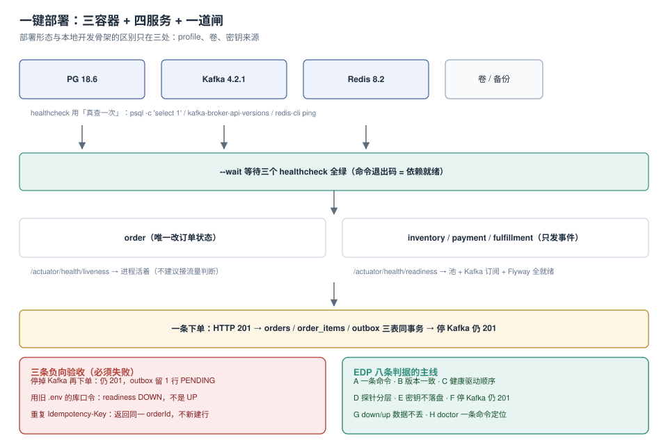

# 第 4 周第 1 步 · 一键部署与配置

第 2 周的 [环境与工程骨架](../Bootstrap/index.md) 已经能做到「一条命令在本机起全栈」。但那套东西是给开发者用的：库口令写在 `.env`、数据放在匿名卷、健康检查只分「活/死」。**部署形态要回答的是另外三个问题**：换台机器能不能一条命令复现、密钥会不会出现在某个不该出现的地方、挂了之后能不能一条命令定位到哪一层。

本步不改业务代码，只把「怎么跑起来」从开发态推到可交付态，并用六条正向 + 三条负向验收把它钉住。



本页判据族 `EDP-A` ~ `EDP-H`，共 8 条。定义表在第八节。

## 一、当日做了什么

1. 划清 **dev 与 deploy 的三处差异**（profile、卷、密钥来源），其余一律不动；
2. 写 `deploy/compose.deploy.yaml`：三容器 + 四服务，`healthcheck` 全部改成「真查一次」，`depends_on` 用 `service_healthy`；
3. 定 **配置三层**与密钥注入路径，确保仓库、镜像、日志三处都看不到明文；
4. 把探针**分层**：`liveness` 只看进程，`readiness` 看池 + Kafka 订阅 + Flyway；
5. 写 `deploy.sh`（五步、可重复执行）与 `doctor.sh`（一条命令输出九项自检）；
6. 给出六条正向 + 三条负向验收，其中「停掉 Kafka 仍 201」是本步最值钱的一条。

## 二、dev 与 deploy 只差三处

| 维度 | dev（第 2 周） | deploy（本步） | 为什么必须改 |
| --- | --- | --- | --- |
| `SPRING_PROFILES_ACTIVE` | `local` | `prod` | `local` 会开 SQL 日志与 H2 兼容开关，日志里有明文参数 |
| 数据落点 | 匿名卷 | **具名卷 + 宿主机备份目录** | 匿名卷 `down` 之后就没了，无法演练恢复 |
| 密钥来源 | `.env` 文件 | **`.env` 只读挂载 / `secrets` 目录，且镜像不内置** | `.env` 进了镜像层，等于进了 registry |

其余（镜像版本、端口、连接池参数、健康检查命令）**一行不改**——这正是第 2 周把版本钉死的好处：部署形态的差异越小，越不容易「本地好的、线上不行」。

::: warning 一条容易忽略的一致性要求
`deploy/compose.deploy.yaml` 与 `deploy/compose.yaml` 的**镜像 tag 必须逐字相同**（`postgres:18.6`、`apache/kafka:4.2.1`、`redis:8.2`）。建议把三个 tag 抽到 `deploy/versions.env`，两个 compose 都 `env_file` 引用它——否则「本地 18.6、线上 18.4」这种漂移会在某次 `jsonb` 查询上炸出来。
:::

## 三、部署拓扑与资源配额

```yaml
# deploy/compose.deploy.yaml（节选：依赖顺序 + 资源 + 具名卷）
name: eoh

x-health: &health
  interval: 5s
  timeout: 3s
  retries: 30
  start_period: 40s

services:
  eoh-postgres:
    image: postgres:${PG_VERSION}          # 18.6
    env_file: [./versions.env]
    environment:
      POSTGRES_DB: eoh
      POSTGRES_PASSWORD_FILE: /run/secrets/pg_password   # 从文件读，不进 env
    secrets: [pg_password]
    deploy:
      resources:
        limits: { memory: 512M }           # 实测生效，见下方 danger 块
    volumes:
      - eoh_pgdata:/var/lib/postgresql/data
      - ./backup:/backup:rw
    healthcheck:
      <<: *health
      test: ["CMD-SHELL", "psql -h 127.0.0.1 -U postgres -d eoh -tAc 'select 1' || exit 1"]

  eoh-kafka:
    image: apache/kafka:${KAFKA_VERSION}   # 4.2.1
    environment:
      KAFKA_NODE_ID: 1
      KAFKA_PROCESS_ROLES: broker,controller
      KAFKA_LISTENERS: PLAINTEXT://:9092,CONTROLLER://:9093
      KAFKA_ADVERTISED_LISTENERS: PLAINTEXT://eoh-kafka:9092   # 容器内名，不是 localhost
      KAFKA_CONTROLLER_QUORUM_VOTERS: 1@eoh-kafka:9093
      KAFKA_OFFSETS_TOPIC_REPLICATION_FACTOR: 1
      KAFKA_AUTO_CREATE_TOPICS_ENABLE: "false"                 # 拼错 topic 要立刻报错
    deploy:
      resources:
        limits: { memory: 1G }
    volumes: [eoh_kafkadata:/var/lib/kafka/data]
    healthcheck:
      <<: *health
      test: ["CMD-SHELL", "/opt/kafka/bin/kafka-broker-api-versions.sh --bootstrap-server localhost:9092 >/dev/null 2>&1"]

  eoh-redis:
    image: redis:${REDIS_VERSION}          # 8.2
    command: ["redis-server", "--appendonly", "yes"]
    deploy:
      resources:
        limits: { memory: 128M }
    volumes: [eoh_redisdata:/data]
    healthcheck:
      <<: *health
      test: ["CMD", "redis-cli", "ping"]

  eoh-app:
    build: { context: .., dockerfile: deploy/Dockerfile }
    environment:
      SPRING_PROFILES_ACTIVE: prod
      DB_PASSWORD_FILE: /run/secrets/pg_password
    secrets: [pg_password]
    deploy:
      resources:
        limits: { memory: 512M, cpus: "1.0" }
    depends_on:
      eoh-postgres: { condition: service_healthy }
      eoh-kafka:    { condition: service_healthy }
      eoh-redis:    { condition: service_healthy }
    ports: ["8080:8080"]

volumes:
  eoh_pgdata: {}
  eoh_kafkadata: {}
  eoh_redisdata: {}

secrets:
  pg_password:
    file: ./secrets/pg_password.txt
```

三个刻意的选择：

1. **`ADVERTISED_LISTENERS` 用容器名 `eoh-kafka:9092`**。写成 `localhost:9092` 时，宿主机上的客户端能连、容器内的应用连上后会被重定向到 `localhost`——于是「连上了但拉不到分区」，报错是 `Connection to node 1 could not be established`。
2. **`AUTO_CREATE_TOPICS_ENABLE: "false"`**。开着它，topic 名拼错不会报错，而是自动建一个空 topic——消费端永远收不到消息，`health` 却是 UP。
3. **`POSTGRES_PASSWORD_FILE` + `secrets`**，而不是 `POSTGRES_PASSWORD`。环境变量会出现在 `docker inspect`、`/proc/<pid>/environ`、崩溃转储里。

::: danger 「`deploy.resources` 在 compose 下被忽略」是过时说法
这句话对 **Compose v1 / 文件格式 v3 时代**成立，对**今天的 Compose v2 不成立**。本机 Docker 27.1.1 + Compose v2.29.1 用 `docker inspect` 读容器 `HostConfig` 实测（`redis:latest` 单容器，脚本不入库）：

| 写的字段 | `HostConfig` 落点 | 结论 |
| --- | --- | --- |
| `deploy.resources.limits.memory: 128M` | `Memory=134217728` | ✅ 生效 |
| `deploy.resources.limits.cpus: "0.50"` | `NanoCpus=500000000` | ✅ 生效 |
| `deploy.resources.reservations.memory: 64M` | `MemoryReservation=67108864` | ✅ 生效 |
| `deploy.resources.reservations.cpus: "0.25"` | `NanoCpus=0` | ❌ **落不了地** |
| `deploy.replicas: 3` | 实际起 3 个容器 | ✅ 生效 |
| `deploy.restart_policy.condition: on-failure` + `max_attempts: 5` | `RestartPolicy.Name=on-failure` / `MaximumRetryCount=5` | ✅ 生效 |
| `deploy.placement.constraints` | 无对应字段 | 静默接受、无效果（单机没有 node 可调度） |

所以「反正不生效，索性不写」这个结论是错的：`deploy.resources` 与 v2 语法的 `mem_limit` / `cpus` 最终落到**同一个** `HostConfig.Memory` / `NanoCpus`，选一种并**测一次**即可。真正要记住的边界只有两条：

1. **`reservations.cpus` 无处落地**——写了不会报错、也不会有 CPU 保障，别把它当资源预留写进容量算式。
2. **这些映射只发生在单机 `up`**——`docker stack deploy`（Swarm）走另一套，`placement` / `update_config` / `rollback_config` 只在那边有意义。

本项目的做法是**两条腿都写**：预算表进 README 给人看（PG 512 MB + Kafka 1 GB + Redis 128 MB + 四个 JVM 各 512 MB ≈ 3.7 GB，8 GB 机器够用、4 GB 会 OOM），`limits.memory` 进 compose 给内核看。预算是「该给多少」的判断依据，`limits` 才是「超了会被 OOM kill」的执行点——只有前者时，一条慢查询能把整台机器拖死。
:::

## 四、配置三层：结构 / 值 / 密钥

| 层 | 内容 | 放哪 | 谁能改 | 改错会怎样 |
| --- | --- | --- | --- | --- |
| **结构** | 有哪些配置项、类型、默认值 | 仓库里的 `application.yml` | 开发者（走 PR） | 编译期/启动期就报错 |
| **值** | 每套环境的具体取值（连接串、池大小、超时） | `deploy/*.env`（不含密钥） | 运维 | 启动失败或性能不对 |
| **密钥** | 口令、token、证书私钥 | `secrets/` 目录（**不入库**）或外部密钥管理 | 只有运行时能读 | 泄露 |

三条落地纪律：

1. **结构层不允许出现具体值**：`maximum-pool-size: ${DB_POOL_SIZE:20}` 是结构（有默认值），`maximum-pool-size: 20` 写死在 `application.yml` 里就是值混进了结构层——换环境时必然被复制错。
2. **`.env` 与 `secrets/` 都进 `.gitignore`**，仓库里只留 `.env.example` 与 `secrets/README.md`。
3. **启动日志打印配置摘要但不打印值**：

```java
// 启动时输出「读到了哪些配置、来自哪一层」，值一律脱敏
log.info("config summary: profile={} pool={} kafka={} secret.pg={}",
    env.getActiveProfiles(), poolSize, bootstrapServers,
    secretPresent ? "present" : "MISSING");   // 只报存在性
```

这样 `docker compose logs eoh-app | head -20` 就能确认「密钥读到了没有」，而不需要把口令打出来。

## 五、探针分层：liveness 与 readiness 不是一回事

```yaml
# application-prod.yml
management:
  endpoint.health.probes.enabled: true
  health:
    livenessstate.enabled: true
    readinessstate.enabled: true
    group:
      readiness:
        include: db,kafka,redis,flyway     # 全就绪才算能接流量
```

| 探针 | 看什么 | 失败时该做什么 | 千万别做 |
| --- | --- | --- | --- |
| `liveness` | 进程是否还能响应 | 重启进程 | 把 DB 检查放进来（DB 挂了会不停重启） |
| `readiness` | 池 + Kafka 订阅 + Flyway 是否就绪 | 从负载均衡摘掉 | 放进 `liveness`（会引发重启风暴） |
| `startup`（本节新增） | 首次启动是否完成 | 给更长的宽限期 | 与 `liveness` 共用阈值 |

`--wait` 只等容器 `healthcheck`，**不等应用的 readiness**。所以部署脚本里必须再补一步 `curl` 轮询：

```shell
# 等应用自己的 readiness，而不是只等容器活着
for i in $(seq 1 60); do
  code=$(curl -s -o /dev/null -w '%{http_code}' localhost:8080/actuator/health/readiness)
  [ "$code" = "200" ] && break
  sleep 2
done
[ "$code" = "200" ] || { echo "readiness 未就绪"; exit 1; }
```

## 六、`deploy.sh`：五步，可重复执行

```shell
#!/usr/bin/env bash
set -euo pipefail
cd "$(dirname "$0")"

step() { printf '\n== %s ==\n' "$1"; }

step "1/5 前置检查"
[ -f versions.env ]      || { echo "缺 versions.env"; exit 1; }
[ -f secrets/pg_password.txt ] || { echo "缺 secrets/pg_password.txt"; exit 1; }
docker compose -f compose.deploy.yaml config -q          # 语法与变量插值校验

step "2/5 构建镜像"
docker compose -f compose.deploy.yaml build --pull

step "3/5 起依赖并等待健康"
docker compose -f compose.deploy.yaml up -d --wait eoh-postgres eoh-kafka eoh-redis

step "4/5 起应用并等 readiness"
docker compose -f compose.deploy.yaml up -d --wait eoh-app
for i in $(seq 1 60); do
  [ "$(curl -s -o /dev/null -w '%{http_code}' localhost:8080/actuator/health/readiness)" = "200" ] && break
  sleep 2
done

step "5/5 冒烟：一条下单写出 outbox"
KEY="deploy-$(date +%s)"
curl -fsS -X POST localhost:8080/api/v1/orders \
  -H 'Content-Type: application/json' -H "Idempotency-Key: $KEY" \
  -d '{"customerId":"c-deploy","items":[{"skuId":"sku-1","qty":1,"unitPrice":"9.90"}]}' >/dev/null
docker compose -f compose.deploy.yaml exec -T eoh-postgres \
  psql -U postgres -d eoh -tAc "select count(*) from outbox where status='PENDING'" | grep -qv '^0$'
echo "部署完成"
```

四个设计点：

- **第 1 步就 `config -q`**：变量没插值、YAML 缩进错，都在这里拦下，不会等到拉起一半才失败。
- **第 3 步只起依赖**：先让三个容器健康，再起应用——否则应用在 `start_period` 里就把 Flyway 跑挂了。
- **每步都可重跑**：`up -d --wait` 是幂等的，`build` 有层缓存，冒烟用时间戳做幂等键。
- **失败即非 0 退出**：`set -euo pipefail` + `grep -q` 的退出码让它可以接进 CI。

## 七、数据持久化与恢复演练

具名卷解决了「`down` 之后数据还在」，但**没解决「卷坏了怎么办」**。本步要求把备份做成一条命令，并且真的演练一次：

```shell
step "备份"
docker compose -f compose.deploy.yaml exec -T eoh-postgres \
  pg_dump -U postgres -d eoh -Fc > backup/eoh-$(date +%Y%m%d-%H%M).dump

step "恢复（演练：恢复到一个临时库，不动生产库）"
docker compose -f compose.deploy.yaml exec -T eoh-postgres \
  createdb -U postgres eoh_restore
docker compose -f compose.deploy.yaml exec -T eoh-postgres \
  pg_restore -U postgres -d eoh_restore --no-owner < backup/latest.dump
# 验收：三张核心表的行数与生产一致
```

::: danger 三个让「备份等于没备份」的细节
1. **只备份不演练**：`pg_dump` 成功不等于能 `pg_restore`；扩展、序列、所有者都会在恢复时才暴露问题。
2. **备份文件留在容器内**：`/backup` 必须是**宿主机挂载**的目录，否则容器删了备份也没了。
3. **`pg_dump` 的版本要与目标库一致**：用 18 的 `pg_dump` 导 17 的库可以，反过来会报 `server version mismatch`。本项目 `PG_VERSION` 唯一来源保证了这一点。
:::

## 八、验收：六条正向 + 三条负向

```shell
# ① 一条命令起来（含 readiness）
./deploy.sh; echo "exit=$?"        # 期望 exit=0

# ② 版本与基线逐字一致
docker compose -f compose.deploy.yaml images --format '{{.Repository}} {{.Tag}}'
# 期望：postgres 18.6 / apache/kafka 4.2.1 / redis 8.2

# ③ 依赖顺序由健康检查驱动（不是 sleep）
docker compose -f compose.deploy.yaml ps --format '{{.Name}} {{.Health}}'
# 期望：全部 healthy

# ④ 探针分层：liveness 与 readiness 是两个端点
curl -s localhost:8080/actuator/health/liveness  | jq -r .status   # UP
curl -s localhost:8080/actuator/health/readiness | jq -r .status   # UP

# ⑤ 密钥不出现在任何可打印位置
docker compose -f compose.deploy.yaml exec -T eoh-app env | grep -i pass || echo "env 无口令 ✅"
docker inspect eoh-app --format '{{json .Config.Env}}' | grep -i pass || echo "inspect 无口令 ✅"

# ⑥ 一条下单写出 outbox，且三表一致
KEY=acc-0001
curl -s -X POST localhost:8080/api/v1/orders -H "Idempotency-Key: $KEY" \
  -H 'Content-Type: application/json' \
  -d '{"customerId":"c-1","items":[{"skuId":"sku-1","qty":2,"unitPrice":"19.90"}]}' | jq '{orderId,status}'
docker compose -f compose.deploy.yaml exec -T eoh-postgres psql -U postgres -d eoh -tAc \
  "select (select count(*) from orders), (select count(*) from order_items), (select count(*) from outbox);"
```

三条**必须失败**的负向验收：

```shell
# ⑦ 停 Kafka 后下单：仍 201，outbox 留 PENDING（业务不被中间件绑架）
docker compose -f compose.deploy.yaml stop eoh-kafka
curl -s -o /dev/null -w '%{http_code}\n' -X POST localhost:8080/api/v1/orders \
  -H "Idempotency-Key: kafka-down-1" -H 'Content-Type: application/json' \
  -d '{"customerId":"c-1","items":[{"skuId":"sku-1","qty":1,"unitPrice":"9.90"}]}'
# 期望：201（不是 500）
docker compose -f compose.deploy.yaml start eoh-kafka
sleep 30 && docker compose -f compose.deploy.yaml exec -T eoh-postgres \
  psql -U postgres -d eoh -tAc "select count(*) from outbox where status='PENDING';"
# 期望：30 s 内回到 0

# ⑧ 旧口令启动：readiness 必须 DOWN
docker compose -f compose.deploy.yaml run --rm -e DB_PASSWORD_FILE=/dev/null eoh-app
# 期望：启动失败或 readiness DOWN —— 不允许「带着错的配置报 UP」

# ⑨ 重复幂等键：同一 orderId，不新增行
curl -s -X POST localhost:8080/api/v1/orders -H "Idempotency-Key: acc-0001" ... | jq -r .orderId
# 期望：与第 ⑥ 条返回的 orderId 相同，且 orders 行数不变
```

**本页的验证边界（按纪律标 ⏳，不把期望值抄成实测）**：本仓库是文档仓，**没有 Java 工程代码**，所以上面九条里凡是要 `eoh-app` 在跑的（③④⑤⑥⑦⑧⑨）都标 **⏳ 未跑**，原因统一是「缺 `eoh-app` 镜像」；能跑的是**容器与 compose 层**——本机 Docker **27.1.1** + Compose **v2.29.1**，已实测取到的读数是下面三条（脚本不入库）：

| 已跑 | 读数 | 用途 |
| --- | --- | --- |
| `docker compose config -q` | 退出码 `0` | 证明第 1 步的语法闸门不是摆设 |
| `up -d --wait` + `service_healthy` | 依次 `Started → Waiting → Healthy` | 证明依赖顺序由健康检查驱动，不是 `sleep` |
| `deploy.resources` 落地 | `Memory=134217728` / `NanoCpus=500000000` / `MemoryReservation=67108864` | 证伪「compose 下不生效」的旧说法，见第三节 danger 块 |

「一条命令从零起到 readiness UP」（`EDP-A`）因此在本仓**只到「三容器 healthy」这一层**为止，应用层那半段要等项目侧第 4 周把镜像构建出来才算结清——这不是本章的欠账，而是文档仓与工程仓分离的必然结果：**能验证的写实测，不能验证的写期望值并标 ⏳**，两列不混。

## 九、失败模式速查

| 现象 | 根因 | 一条命令确认 |
| --- | --- | --- |
| 应用起来但拉不到分区 | `ADVERTISED_LISTENERS` 写了 `localhost` | `docker compose exec eoh-kafka kafka-broker-api-versions.sh --bootstrap-server eoh-kafka:9092` |
| 消费端一直没消息、`health` 却 UP | `AUTO_CREATE_TOPICS_ENABLE` 掩盖了 topic 拼错 | `kafka-topics.sh --list` 看有没有多出来的空 topic |
| `--wait` 超时但容器是 Up | `healthcheck` 用了 `pg_isready` 这类「早熟」判据 | 看 <span v-pre>`docker inspect --format '{{json .State.Health}}' eoh-postgres`</span> |
| Flyway 卡住不动 | PG `lock_timeout` 默认 0，等一把永远不来的锁 | `select * from pg_stat_activity where wait_event_type='Lock'` |
| 卷里数据「不见了」 | 用了匿名卷，`down` 时被删 | `docker volume ls` 里找不到 `eoh_eoh_pgdata` |
| 恢复后序列从 1 开始 | `pg_restore` 没带 `--no-owner` 之外的序列处理 | 恢复后 `setval` 或直接比对 `nextval` |
| 写了 `reservations.cpus` 却查不到 CPU 保障 | 该字段没有对应 Docker API 字段，静默丢弃 | <span v-pre>`docker inspect -f '{{.HostConfig.NanoCpus}}' eoh-app`</span> 为 `0` |
| 容器 `OOMKilled` 但宿主机内存充足 | `limits.memory` 按预算表压得过紧（JVM 堆 + 元空间 + 直接内存都要算） | <span v-pre>`docker inspect -f '{{.State.OOMKilled}}' eoh-app`</span> |

## 十、本页判据

| 编号 | 判据 | 看什么现象 | 不满足时改哪里 |
| --- | --- | --- | --- |
| `EDP-A` | 一条命令能从零起到 readiness UP | `./deploy.sh` 退出码 0 | 补第 1、4 步的校验 |
| `EDP-B` | 三个镜像 tag 与基线逐字一致且单一来源 | `versions.env` 是唯一定义处 | 抽常量 |
| `EDP-C` | 依赖顺序由 `service_healthy` 驱动 | compose 里没有 `sleep` | 改 `depends_on` |
| `EDP-D` | liveness 与 readiness 分离且 readiness 含依赖 | 两个端点状态可分别查 | 配 `group.readiness` |
| `EDP-E` | 密钥不出现于仓库、镜像层、env、inspect | 第 ⑤ 条两条 `grep` 都为空 | 改 `*_FILE` + `secrets` |
| `EDP-F` | 停 Kafka 后下单仍 201，恢复 30 s 内清空 | 第 ⑦ 条两个读数 | 查 outbox 事务边界 |
| `EDP-G` | `down` 再 `up` 数据不丢（具名卷） | 重启前后 `orders` 行数一致 | 改具名卷 |
| `EDP-H` | 有一条 `doctor` 能定位到层，且能验证「配置真的落地」 | 输出九项自检且能指出失败层 | 补脚本 |

## 十一、验证方式

九项自检的 `doctor.sh` 骨架（每项输出一行 `PASS/FAIL`，失败即退出）：

```shell
#!/usr/bin/env bash
set -uo pipefail
fail=0
chk() { printf '[%s] %s\n' "$2" "$1"; [ "$2" = PASS ] || fail=1; }

chk "compose 语法与变量插值" "$(docker compose -f compose.deploy.yaml config -q >/dev/null 2>&1 && echo PASS || echo FAIL)"
chk "三容器 healthy" "$([ "$(docker compose -f compose.deploy.yaml ps --format '{{.Health}}' | grep -c healthy)" -ge 3 ] && echo PASS || echo FAIL)"
chk "镜像 tag 与基线一致" "$(grep -q "$(cat versions.env | tr -d ' ')" <(docker compose -f compose.deploy.yaml images --format '{{.Tag}}' | tr '\n' ' ') && echo PASS || echo FAIL)"
chk "liveness UP" "$([ "$(curl -s localhost:8080/actuator/health/liveness | grep -c '"status":"UP"')" -ge 1 ] && echo PASS || echo FAIL)"
chk "readiness UP" "$([ "$(curl -s localhost:8080/actuator/health/readiness | grep -c '"status":"UP"')" -ge 1 ] && echo PASS || echo FAIL)"
chk "env 无口令" "$(docker compose -f compose.deploy.yaml exec -T eoh-app env | grep -qi pass && echo FAIL || echo PASS)"
chk "outbox 表可读" "$(docker compose -f compose.deploy.yaml exec -T eoh-postgres psql -U postgres -d eoh -tAc 'select 1 from outbox limit 1' >/dev/null 2>&1 && echo PASS || echo FAIL)"
chk "具名卷存在" "$(docker volume ls --format '{{.Name}}' | grep -q eoh_eoh_pgdata && echo PASS || echo FAIL)"
chk "内存上限已落地" "$([ "$(docker inspect -f '{{.HostConfig.Memory}}' eoh-app)" -gt 0 ] && echo PASS || echo FAIL)"

exit $fail
```

预期：九行全 `PASS`，退出码 `0`；任何一行 `FAIL` 都直接指向第九节的某一行。最后一行是这份脚本里**唯一查配置有没有真的落地**的一项——其余八项查的是「服务在不在」，只有它查「写的东西算不算数」。

## 十二、下一步（第 4 周第 2 步）

第 4 周第 2 步「监控与告警」（判据族 `EMO`）：把本步的九项自检变成**持续采集的指标**——容器健康、readiness 翻转次数、outbox 积压深度、下单 p99、outbox 清空耗时，各配一条告警阈值；同时把第 3 周登记的三条遗留缺口（退款与部分退款、outbox 死信重投、主写路径批量化评估）按「部署可见性」排序，先做能被监控证明的那条。

## 参考资料

- Docker Compose 文档：*`depends_on` 的 `service_healthy` 条件*、*`secrets`*、*`--wait`*
- PostgreSQL 18 文档：*pg_dump* / *pg_restore*（`-Fc`、`--no-owner`、版本兼容）
- Apache Kafka 4.2 文档：*KRaft 配置*（`KAFKA_ADVERTISED_LISTENERS`、`AUTO_CREATE_TOPICS_ENABLE`）
- Spring Boot 4.1 文档：*Health Groups*、*Liveness and Readiness Probes*
- 本项目：[环境与工程骨架](../Bootstrap/index.md)、[技术选型与版本基线](../TechBaseline/index.md)、[第 3 周验收](../Week3Gate/index.md)
- 本仓库专题：[配置管理与动态配置](../../../../docs/Ops/ConfigManagement/index.md)、[密钥治理](../../../../docs/Ops/SecurityHardening/SecretGovernance/index.md)、[容器编排](../../../../docs/Ops/ContainerOrchestration/index.md)
