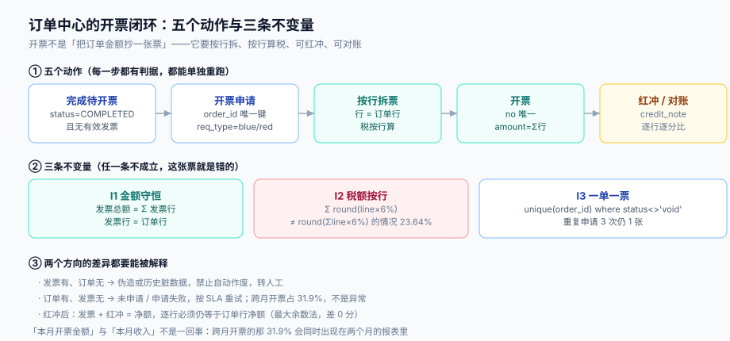

# 第 4 周补充 · 订单完成后的开票闭环（EIN-A~EIN-H）

**这一步做什么**：把「订单完成 → 财务开票」这条一直靠人工表格跑的链路，补成一条**能对账、能红冲、能重跑**的闭环——可开票判定 → 按行拆票 → 按行算税 → 幂等开票 → 部分退款红冲 → 与订单行逐分对账。

**为什么放到第 4 周**：第 4 周的[上线验收](../LaunchAcceptance/index.md)里与发票相关的只有一条「退款后能查到退款单」；[退款与部分退款](../Refund/index.md)把**钱**退对了，但没有回答「已经开出去的票怎么办」。上线之后财务第一个会问的就是这句，而且它跨月：订单 10 月完成、发票 11 月开出，两个月的报表都要能解释。



本页判据族 `EIN-A` ~ `EIN-H`，共 8 条。定义表见文末「本页判据」一节。

## 一、缺口：三个「以为已经解决」

| 现状 | 看起来没问题 | 真实的问题 |
| --- | --- | --- |
| `orders` 有 `total`，`order_lines` 有行金额 | 开票就是把 `total` 抄到票面 | **票面要按行拆**：发票是逐行开具的，行金额与行税额都必须与订单行一一对应 |
| 订单完成后财务按导出表开票 | 金额一致就行 | **没有可开票判定**：退款中、已全额退款、争议中的订单也会被导出 |
| 退款只记 `refund` 表 | 钱退了就完了 | **已开票的订单退款没有红冲路径**：账上多一张票，申报时税额虚高 |

三个缺口的共同点：**都不是「功能没做」，而是「状态与单据的关系没表达」**。所以这一步不新增业务能力，只补单据与状态。

## 二、表结构：两张新表 + 一个部分唯一索引

```sql
-- 开票申请：一次请求一行，便于失败重试与审计
create table invoice_request (
  id          bigserial primary key,
  order_id    text   not null references orders(id),
  req_type    text   not null check (req_type in ('blue','red')),   -- 蓝票/红票
  requested_by text  not null,
  requested_at timestamptz not null default now(),
  state       text   not null default 'pending'
              check (state in ('pending','issued','rejected')),
  reject_reason text
);

-- 发票：一张票一个订单（本步不做合并开票，理由见第五节）
create table invoice (
  id         bigserial primary key,
  no         text   not null unique,          -- INV-2026-11-000123
  order_id   text   not null references orders(id),
  amount     bigint not null,                 -- 分
  tax_amount bigint not null,
  status     text   not null check (status in ('issued','void')),
  issued_at  timestamptz not null default now()
);
create unique index uniq_invoice_order on invoice (order_id) where status <> 'void';

-- 发票行：与订单行一一对应（这是「逐行对账」的前提）
create table invoice_line (
  invoice_id bigint not null references invoice(id),
  seq        int    not null,
  order_line_seq int not null,
  amount     bigint not null,
  tax_rate   numeric(6,4) not null,
  tax_amount bigint not null,
  primary key (invoice_id, seq)
);

-- 红冲：指向原票，带原税率
create table credit_note (
  id         bigserial primary key,
  no         text   not null unique,
  invoice_id bigint not null references invoice(id),
  amount     bigint not null,
  tax_amount bigint not null,
  reason     text   not null,                 -- partial_refund / full_refund / error
  issued_at  timestamptz not null default now()
);
```

`uniq_invoice_order ... where status <> 'void'` 是这套结构里最关键的一行：它同时允许「一单一票」和「红冲后重开」。

## 三、按行拆票与按行算税

发票行的税额必须逐行计算，不能「先算总额税额再摊回去」：

```sql
-- 正确：逐行算税后求和
select o.id,
       sum(l.amount)                        as amount,
       sum(round(l.amount * 0.06))          as tax_by_line
  from orders o join order_lines l on l.order_id = o.id
 group by o.id;

-- 错误：先汇总再算税（与发票逐行开具的口径不一致）
select o.id, sum(l.amount) as amount, round(sum(l.amount) * 0.06) as tax_by_total
  from orders o join order_lines l on l.order_id = o.id
 group by o.id;
```

本机 5,000 个订单（12,496 行、税率 6%）的对照：

| 项 | 读数 |
| --- | --- |
| 两种口径税额不同 | **1,182 / 5,000（23.64%）** |
| 最大单票差额 | 2 分 |
| 发票总额 ≠ 发票行合计 | 0（按行拆票时天然成立） |

2 分钱不影响收款，但它让「发票与订单逐行对账」这件事不可能通过：财务系统会拒收，或者退回手工开票——而手工开票是税务风险的起点。

::: danger 注意
1. **不要用「总额 × 税率」再摊回各行**。摊回去的税额仍要逐行取整，摊完的合计可能与总额税额差 1 分，于是又回到「票面与行不符」。逐行算是唯一自洽的做法。
2. **不要给一张发票挂多个订单**（合并开票）。本步明确不做：合并后「订单 → 发票」变成多对一，红冲时无法定位「这张票里哪一行属于要退的那个订单」。合并开票的正确做法是另建 `invoice_order` 关联表并逐单拆行——那是下一步。
3. **不要让发票行数量与订单行数量不等**。少一行（比如把折扣行合并进主行）会让逐行对账失败；多一行（比如加「运费」行）必须在订单行里也有对应行。
:::

## 四、可开票判定与幂等

开票的前置条件必须写成一条可执行判定，而不是「财务看着办」：

```sql
-- 可开票：已完成、无有效发票、不在退款中、未全额退款
select o.id
  from orders o
 where o.status = 'COMPLETED'
   and not exists (select 1 from invoice i where i.order_id = o.id and i.status = 'issued')
   and not exists (select 1 from refund r where r.order_id = o.id and r.state in ('PENDING','PROCESSING'))
   and coalesce((select sum(r.amount) from refund r where r.order_id = o.id and r.state = 'SUCCESS'), 0)
       < o.total;
```

幂等靠唯一索引 + `on conflict do nothing`：

```sql
insert into invoice (no, order_id, amount, tax_amount, status)
values (:no, :order_id, :amount, :tax, 'issued')
on conflict (order_id) where status <> 'void' do nothing
returning id;   -- 空 = 已开过，跳过
```

本机实测：同一批 5,000 个订单连续申请 3 次，最终发票数仍是 **5,000 张**（唯一索引生效），总耗时 **29.7 ms**。作为对照，去掉唯一索引后三次申请会得到 15,000 张——这正是「财务每月收到三份导出表」的成因。

## 五、部分退款的红冲

[退款与部分退款](../Refund/index.md)已经把退款金额算对了。开票侧要补的是：**把退款金额按行拆回去，再逐行红冲**。

拆分必须用最大余数法，不能逐行 `round`：

| 做法 | 5,000 张退款单中「逐行合计 ≠ 退款额」 | 最大差 |
| --- | --- | --- |
| 朴素逐行四舍五入 | **926（18.52%）** | 1 分 |
| 最大余数法 | 0 | 0 分 |

18.52% 的退款单会差 1 分。差 1 分的后果不是钱，而是**红冲票的行合计与原退款额不等**，财务系统会要求「红冲金额与退款金额一致」——于是又回到手工调整。

红冲的三条硬规定：

1. **红冲必须指向原发票**（`invoice_id`），不能凭空开一张负数票；
2. **红冲要带原税率**，否则退了钱没退税，申报时销项虚高；
3. **红冲金额 ≤ 原发票金额**，且同一发票的多次红冲累计不得超过原票（用 `sum(credit_note.amount) <= invoice.amount` 的约束或触发器守）。

## 六、逐行对账：三个方向

开票侧的对账有三个方向，缺一个就会漏：

```sql
-- 方向 1：订单有、发票无（未申请或申请失败）
select o.id from orders o
 where o.status = 'COMPLETED'
   and not exists (select 1 from invoice i where i.order_id = o.id and i.status = 'issued');

-- 方向 2：发票有、订单无（伪造或历史脏数据）
select i.id from invoice i
 where not exists (select 1 from orders o where o.id = i.order_id);

-- 方向 3：逐行金额不等（净额口径，含红冲）
select i.id, il.seq, il.amount,
       ol.amount - coalesce((select sum(cn.amount) from credit_note cn where cn.invoice_id = i.id), 0) as net_expected
  from invoice i
  join invoice_line il on il.invoice_id = i.id
  join order_lines ol on ol.order_id = i.order_id and ol.seq = il.order_line_seq
 where il.amount <> ol.amount;
```

第三个方向最容易漏，因为它要求「发票行」与「订单行」有稳定的对应键（这里是 `order_line_seq`）。没有这个键，就只能按顺序对——而订单行顺序会在退款拆行时变。

**跨月开票不是异常**：本机 5,000 个订单里，开票月与完成月不同的有 **1,597 单（31.9%）**、金额 **969,327.08 元**。所以「本月开票金额」与「本月收入」必然不等，这是口径差异，不是错账。写进交接文档，才不会在下个月被当成 bug 排查。

## 七、当日验证（读者可执行）

| # | 验证 | 命令 / SQL | 期望 |
| --- | --- | --- | --- |
| N1 | 一单一票 | 同一 `order_id` 连续申请 3 次 | 发票数 = 1（`uniq_invoice_order` 生效） |
| N2 | 票面守恒 | 跑「发票总额 ≠ 行合计」的查询 | 0 行 |
| N3 | 税额按行 | 对比 `Σ round(line×6%)` 与 `round(Σline×6%)` | 至少 1,182/5,000 不同（证明按行算真的生效） |
| N4 | 部分退款红冲 | 退 30% 后跑红冲拆分 | 行合计 = 退款额（差 0 分） |
| N5 | 全额退款 | 全额退款后再申请蓝票 | 被可开票判定拒绝（`rejected` + 原因） |
| N6 | 红冲上限 | 对同一发票红冲两次、累计超原额 | 第二次被拒 |
| N7 | 跨月 | 查「完成月 ≠ 开票月」的订单 | 约 31.9%，金额可解释 |
| N8 | 逐行对账 | 方向 3 的 SQL | 0 行（红冲后仍为 0） |

N3 是一个「反向验收」：它期望**有差异**，因为差异本身就证明「票面用的是按行口径，而不是按总额口径」。这类验收比正向验收更能证明实现没走捷径。

## 八、本页判据

| 编号 | 看什么现象 | 判成什么 | 不满足时改哪里 |
| --- | --- | --- | --- |
| `EIN-A` | 是否存在可开票判定（完成 + 无有效票 + 非退款中 + 未全额退） | 只判 `status=COMPLETED` 即失败：退款单也会被开票 | 按第四节补四个条件 |
| `EIN-B` | 发票行是否与订单行一一对应（有 `order_line_seq`） | 行数不等或靠顺序对齐即失败：逐行对账做不了 | 补对应键，拆票时逐行写入 |
| `EIN-C` | 税额是否逐行算（`Σ round(line×rate)`） | 用 `round(Σline×rate)` 即失败：与发票口径不符 | 改为逐行算（本机 23.64% 会不同） |
| `EIN-D` | 是否有 `unique (order_id) where status <> 'void'` | 只有应用层判重即失败：重试会重复开票 | 加部分唯一索引 + `on conflict do nothing` |
| `EIN-E` | 红冲是否指向原票、带原税率、累计不超原额 | 缺一即失败：退税口径错或重复冲 | 补三个字段与上限校验 |
| `EIN-F` | 退款拆行是否用最大余数法 | 逐行 `round` 即失败：18.52% 差 1 分 | 改最大余数法，加守恒断言 |
| `EIN-G` | 三个方向的对账是否都有 SQL | 只有「订单有票无」即失败：漏逐行差异 | 补方向 2、3 |
| `EIN-H` | 交接文档是否写明「跨月开票 31.9%」这一口径 | 未写明即失败：下月必被当 bug 排查 | 写进口径说明与报表注释 |

## 九、下一步

1. **合并开票**（多订单一张票）：需要 `invoice_order` 关联表 + 逐单拆行，红冲要能定位到「票里的哪个订单」；本步刻意不做，因为它是「一对多」的第一次出现。
2. **红冲与账务的联动**：目前红冲只落 `credit_note`，还没有生成冲减分录；接进第 4 周的[对账日报](../ReconciliationHandover/index.md)后再补。
3. **开票 SLA 进监控**：`invoice_request.state='pending'` 超过 24 小时即告警——这类「卡住」在人工流程里最容易被忽略。
