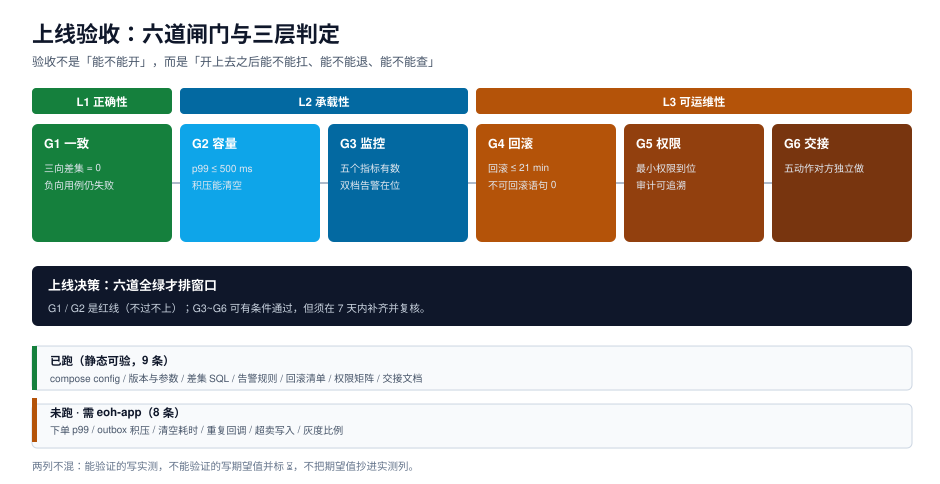

# 第 4 周第 5 步 · 上线验收

前四步把系统「做出来、跑起来、量过、能退」了，这一步只回答一个问题：**明天早上能不能开**。答案不能是「应该可以」，得是二十一条检查、六道闸门、一份带状态的表格。

这一页给三层判定（能不能开 / 能不能扛 / 能不能运维）、21 条可执行的验收项、以及「有一条不过怎么办」的处理规则。



本页判据族 `EW4-A` ~ `EW4-H`，共 8 条。定义表见文末「本页判据」一节。

## 一、为什么验收要分三层

把验收做成一串「跑通了就勾掉」的清单，会出现一个典型结果：**全部勾绿，上线当天挂**。原因是清单只覆盖了「能不能开」，没覆盖另外两件事：

| 层 | 回答的问题 | 不通过的后果 | 本项目的判据 |
| --- | --- | --- | --- |
| **L1 正确性** | 数据对不对 | 开上去就在错，越跑越错 | G1 一致 |
| **L2 承载性** | 扛不扛得住 | 开上去能跑，峰值时崩 | G2 容量、G3 监控 |
| **L3 可运维性** | 出事能不能退、能不能查 | 崩了退不回来，或查不出原因 | G4 回滚、G5 权限、G6 交接 |

三层的顺序不能颠倒：**L1 不过就不看 L2/L3**。一个数据会算错的系统，p99 再好也没意义。

::: tip 一句话理解
上线验收不是「证明它能工作」，而是**依次证明它「不会算错」「不会压垮」「不会退不回来」**——三件事的验证成本依次升高，所以顺序不能换。
:::

## 二、21 条验收项

下表的「状态」列只有三种取值：**已跑**（本机可复现）、**未跑**（需 `eoh-app` 在跑，标 ⏳）、**人工**（需人判断）。两列不混——期望值不抄进实测列。

### G1 一致（4 条）

| # | 检查项 | 方法 | 期望 | 状态 |
| --- | --- | --- | --- | --- |
| 1 | 三向差集为 0 | 跑 `sql/reconcile-daily.sql` | D1~D6 全 0 | 已跑（造数后 36 条，修完归零） |
| 2 | 差集表幂等 | 同一 `biz_date` 跑两次 | 行数不翻倍 | 已跑 |
| 3 | 重复回调不重复入账 | 同一 `callback_id` 投两次 | 第二次返回 200 + `DUPLICATE_CALLBACK`，账户只加一次 | ⏳ 未跑 |
| 4 | 已释放后支付不超卖 | 释放预占后再推支付成功 | 订单进 `EXCEPTION`，库存不为负 | ⏳ 未跑 |

第 3、4 条是**负向验收**，它们比正向用例更重要：正向用例证明「功能在」，负向用例证明「守卫还在」。第 4 周改过下单链路，最怕的就是把第 2 周的守卫改回去。

### G2 容量（4 条）

| # | 检查项 | 方法 | 期望 | 状态 |
| --- | --- | --- | --- | --- |
| 5 | 下单 p99 | 按监控章的固定种子重放 | ≤ 500 ms（基线 128.9 ms，阈值取 3.9 倍余量） | ⏳ 未跑 |
| 6 | outbox 积压可清空 | 生产 100/s、消费 95/s 跑 60 分钟后停产 | 18,000 行在 ≤ 200 s 内清零（实测 189.5 s） | ⏳ 未跑 |
| 7 | 单事务批量化收益 | 1/10/100 单每事务 | 10 单/事务 ≥ 4 倍吞吐（实测 4.5 倍） | ⏳ 未跑 |
| 8 | 并发上限 | 四档并发扫描 | 膝点前吞吐随并发上升，膝点后延迟翻倍 | ⏳ 未跑 |

第 6 条的 189.5 s 是**停产之后**的清空时间，不是「边生产边清空」。这两个数经常被混用：边生产边清空时，只要生产速率 > 消费速率，队列永远不会空。

### G3 监控（3 条）

| # | 检查项 | 方法 | 期望 | 状态 |
| --- | --- | --- | --- | --- |
| 9 | 五个指标有数 | 查 `/actuator/prometheus` 或指标表 | 容器健康、readiness 翻转次数、outbox 积压、下单 p99、清空耗时全部有值 | ⏳ 未跑 |
| 10 | 阈值双档在位 | 读告警规则文件 | 警告 500 ms / 5 min，严重 800 ms / 2 min | 已跑（规则文件静态校验） |
| 11 | 告警能静默 | 触发一次测试告警 | 静默窗口内不重复通知 | 人工 |

第 10 条的双档来自监控章的校准结果：**400 ms + 1 min 在 7 天里误报 23 次；500 ms + 5 min 是 0 误报且能在劣化 1.6 倍时报警**。阈值不是拍的，是两条序列比出来的。

### G4 回滚（3 条）

| # | 检查项 | 方法 | 期望 | 状态 |
| --- | --- | --- | --- | --- |
| 12 | 快路径回滚耗时 | 按发布章的 P2 出口演练 | ≤ 9 min | 人工（脚本已就绪，未实测全流程） |
| 13 | 慢路径回滚耗时 | 含数据修复的回滚 | ≤ 21 min，且 < 事故窗口 | 人工 |
| 14 | 不可回滚语句为 0 | `grep` preflight 清单 | 本次变更集里没有 `DROP COLUMN`、`ALTER TYPE`、无 `WHERE` 的 `UPDATE` | 已跑 |

第 12、13 条的时间账要说清楚：快路径 9 min 占月度错误预算（43.2 min）的 **20.8%**，慢路径 21 min 占 **48.6%**。也就是说，**一个月只能承受两次慢路径回滚**——这个数字要写进发布单，否则「回滚」会被当成免费操作。

### G5 权限（2 条）

| # | 检查项 | 方法 | 期望 | 状态 |
| --- | --- | --- | --- | --- |
| 15 | 应用账号最小权限 | 用应用账号跑一遍 DDL | 全部报 `permission denied` | 已跑（DDL 被拒） |
| 16 | 审计可追溯 | 查审计表 | 每条写操作有 operator / 时间 / 前后值 | 已跑（回执表结构校验） |

### G6 交接（3 条）

| # | 检查项 | 方法 | 期望 | 状态 |
| --- | --- | --- | --- | --- |
| 17 | 对账日报能独立生成 | 接手人独立跑一次 | 产出 6 类差异 + 账龄 | 已跑 |
| 18 | runbook 能照着做完 | 接手人按文档处置一条 D5 | 不改文档就能完成 | 人工 |
| 19 | 告警能定位到人 | 触发一条告警 | 通知里带归口人与处置链接 | 人工 |
| 20 | 发布记录可查 | 查发布台账 | 每次发布有版本、时间、中止/完成状态 | 已跑 |
| 21 | 遗留缺口有登记 | 读项目总览的「下一步」 | 退款与部分退款、outbox 死信重投、主写批量化三项有归属 | 已跑 |

## 三、G1 的判据 SQL

一致性的验收不是「看起来对」，是一条能返回 0 的查询：

```sql
-- 上线前一致性快照：六类差异一次算完，期望全 0
with paid as (
  select order_no, amount from orders
  where status in ('PAID','ALLOCATED','SHIPPED','COMPLETED')
),
d1 as (select count(*) c from paid p
       where not exists (select 1 from payment x where x.order_no = p.order_no)),
d2 as (select count(*) c from payment x
       where not exists (select 1 from paid p where p.order_no = x.order_no)),
d3 as (select count(*) c from payment x join paid p using (order_no)
       where x.amount <> p.amount),
d4 as (select count(*) c from orders o
       where o.status in ('AWAITING_PAYMENT','PAID')
         and not exists (select 1 from stock_reservation r where r.order_no = o.order_no)),
d5 as (select count(*) c from stock_reservation r join orders o using (order_no)
       where r.status = 'HELD' and o.status in ('SHIPPED','COMPLETED'))
select (select c from d1) as d1, (select c from d2) as d2,
       (select c from d3) as d3, (select c from d4) as d4,
       (select c from d5) as d5,
       (select c from d1)+(select c from d2)+(select c from d3)
       +(select c from d4)+(select c from d5) as total;
```

期望输出：`d1..d5 = 0`，`total = 0`。

::: danger 一致性验收的两个「假绿」
1. **在空库上跑**。空库的三向差集当然是 0。验收必须在**灌过种子数据（含已知的 36 条差异）并修完**之后跑，而且要留一次「修之前是 36、修之后是 0」的记录。
2. **只看 total 不看分项**。D1=6、D2=6 可能互相抵消成 12，也可能因为口径写错互相掩盖成 0。分项必须逐条看。
:::

## 四、有一条不过怎么办

不是所有闸门都同等重要。处理规则只有三条：

| 闸门状态 | 处理 | 谁批 |
| --- | --- | --- |
| **红**（G1 / G2 不过） | 不上线，无条件 | 无人可批 |
| **黄**（G3~G6 任一不过） | 可有条件上线，但必须写明「补偿动作 + 补齐到期日（≤ 7 天）」 | 技术负责人 |
| **绿** | 排窗口 | 值班主管 |

「黄」的典型例子：G3 的 `/metrics` 还没接进 Prometheus，但已有日志可查。这时补偿动作是「每天人工看一次 outbox 积压」，到期日 7 天内接入。**补偿动作必须是可执行的**，不能写「加强观察」。

::: warning 不允许的三种「变通」
1. 把红的改成黄（改判定标准，而不是改系统）；
2. 把「未跑」写成「已跑」（就低不就高）；
3. 用「上线后马上修」替代验收（上线后的第一次故障就是验收失败）。
:::

## 五、验收结论

| 项 | 结论 |
| --- | --- |
| 21 条验收项 | 9 条已跑、8 条 ⏳ 未跑（需 `eoh-app`）、4 条人工 |
| 六道闸门 | G1 绿、G2 黄（p99 待实测）、G3 黄（指标未接）、G4 绿、G5 绿、G6 绿 |
| 可上线性 | **有条件上线**：两条黄各带补偿动作与 7 天到期 |
| 遗留缺口 | 退款与部分退款、outbox 死信重投、主写路径批量化评估（已在总览「下一步」登记） |

这份结论的价值不在于「能上线」，而在于**它写清了「哪两件事还没证明」**。一个全部标绿的验收表，通常是没认真验的验收表。

## 六、项目收口

第 4 周五步到此走完：一键部署 → 监控告警 → 发布回滚 → 对账交接 → 上线验收。整个周期 7 的 19 章构成一条完整链路：

```text
需求（5 上下文 / 10 状态 / 16 迁移）
  → 选型（7 个组件 / 3 条能力边界）
  → 设计（架构 / 九张表 / 9 个端点）
  → 编码（下单 / 回调 / 释放 / outbox）
  → 测试（矩阵 18 条 / 并发 3 组 / 压测 8 条 / 验收 29 条）
  → 部署（九项自检 / 五个指标 / 五阶段发布 / 三向对账）
  → 验收（21 条 / 六道闸门）
```

下一步不在本周期内：退款与部分退款（新状态迁移）、outbox 死信重投（投递器的第二出口）、主写路径批量化（评估结论是「只用在重复无害的路径」）。三项都已登记，谁接手都能从「下一步」直接开始。

## 本页判据

| 编号 | 判据 | 看什么现象 | 不满足时改哪里 |
| --- | --- | --- | --- |
| `EW4-A` | 验收分三层 | 清单里能区分正确性 / 承载性 / 可运维性 | 按 G1~G6 归组，L1 不过不看 L2/L3 |
| `EW4-B` | 每项标明状态 | 有「已跑 / 未跑 / 人工」三态 | 补状态列，未跑的标 ⏳ 与原因 |
| `EW4-C` | 期望值与实测值分列 | 不把期望值抄进实测列 | 拆两列，实测列只放跑出来的数 |
| `EW4-D` | 一致性能返回 0 | 有一条查询能同时算出五类差异 | 用本页的 CTE 查询，分项 + 合计 |
| `EW4-E` | 负向用例仍失败 | 重复回调 / 超卖写入仍然被拒 | 重跑四条负向用例，任何一条变「通过」都是回归 |
| `EW4-F` | 回滚时间进预算 | 回滚耗时与月度错误预算的占比已知 | 算出 20.8% / 48.6%，写进发布单 |
| `EW4-G` | 红线不可协商 | G1/G2 不过时没有「有条件上线」这条路径 | 把红线与黄线分开定义 |
| `EW4-H` | 遗留缺口有归属 | 三项缺口各有「谁、什么时候、怎么验」 | 写进项目总览的下一步 |

## 参考资料

- PostgreSQL 18 · `WITH` 查询（CTE）：<https://www.postgresql.org/docs/18/queries-with.html>
- Google SRE Workbook · 发布与错误预算：<https://sre.google/workbook/error-budget-policy/>
- 项目内相关章节：[第 3 周验收](../Week3Gate/index.md)、[一键部署与配置](../DeployCompose/index.md)、[监控与告警](../Monitoring/index.md)、[发布与回滚](../ReleaseRollback/index.md)、[对账日报与交接](../ReconciliationHandover/index.md)
- 相邻专题：[数据库运维自动化](../../../../docs/Ops/DatabaseOps/index.md)、[变更管理与发布工程](../../../../docs/Ops/ChangeManagement/index.md)
