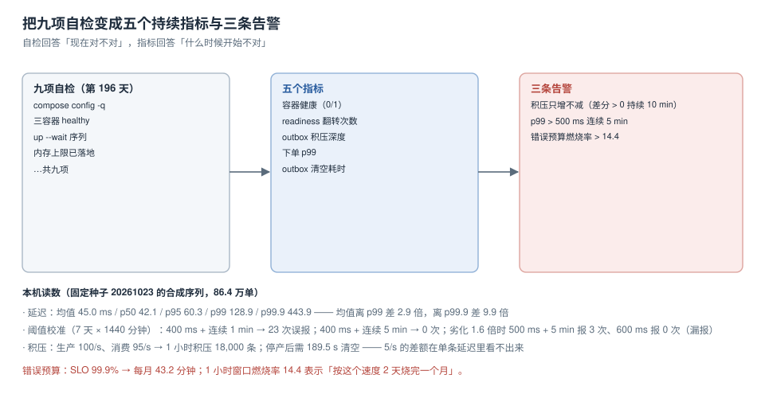

# 第 4 周第 2 步：监控与告警

第 196 天的 `DeployCompose` 交出了九项自检：容器在不在、健康不健康、内存上限落没落地。它回答的是「**现在**对不对」。但上线之后真正要回答的是另外三个问题：**什么时候开始不对、不对了多久、是不是刚变严重**。自检答不了这三问——它只在有人跑的时候才存在。

所以这一步不是「加一个 Prometheus」，而是把九项自检**翻译成五个持续采集的指标**，再给每个指标定一条阈值，最后用一份 7 天的序列把阈值**校准**到「平时不吵、劣化必响」。



本项目判据族 `EMT-A` ~ `EMT-H`，共 8 条。定义表在第六节。

## 一、五个指标：从「检查项」到「信号」

| 指标 | 类型 | 采集位置 | 它替代了哪一项自检 | 为什么必须持续 |
| --- | --- | --- | --- | --- |
| `eoh_container_up` | Gauge 0/1 | cAdvisor / 导出器 | ① 三容器 healthy | 「容器起来了」是一次性事实，「一直在」才是服务 |
| `eoh_readiness_flips_total` | Counter | 应用 `/metrics` | ② readiness 翻转 | 翻转次数暴露重启与探针配置错误 |
| `eoh_outbox_lag_rows` | Gauge | 应用内定时查询 | ③ outbox 可写 | 积压是「最终一致」唯一的早期信号 |
| `eoh_order_latency_seconds` | Histogram | 应用中间件 | ④ 下单接口可用 | p99 才能代表「最慢的那批用户」 |
| `eoh_outbox_drain_seconds` | Histogram | 投递器 | ⑤ 投递链路通 | 「清空耗时」区分「慢」与「卡住」 |

三条设计纪律：

1. **每个指标必须有分母**。`eoh_readiness_flips_total` 单独看没有意义，要配 `eoh_process_start_time_seconds` 才知道「一次发布翻了几次」。
2. **积压用「行数」不用「延迟」**。投递延迟的中位数永远很小（大部分消息是秒级），积压行数才能反映「进来的比出去的多」。
3. **直方图分桶要覆盖 SLO 边界**。SLO 是 p99 ≤ 500 ms 时，桶必须包含 `0.5`，否则 p99 只能靠插值猜。

```text
# 分桶（秒）：0.05 0.1 0.2 0.3 0.5 0.75 1 2 5
eoh_order_latency_seconds_bucket{le="0.5"}     ← SLO 边界必须存在
```

## 二、口径：p99 与均值差 2.9 倍

用固定种子（20261023）生成 86.4 万单（每分钟 600 单 × 24 小时，1% 长尾）后统计：

| 统计量 | 值 | 与均值的关系 |
| --- | --- | --- |
| 均值 | **45.0 ms** | 1.0× |
| p50 | **42.1 ms** | 0.94× |
| p95 | **60.3 ms** | 1.34× |
| p99 | **128.9 ms** | **2.9×** |
| p99.9 | **443.9 ms** | **9.9×** |
| 最大值 | **631.8 ms** | 14.0× |

均值 45 ms 看起来「一切正常」，而每 1000 个用户里有 1 个等了 129 ms、每 10000 个里有 1 个等了 444 ms。**用均值做告警的后果是：只有当事故大到能拉动均值时才会响**，而那时已经过去很久。

::: warning 分母三选一，选错会让指标永远好看
`<分母>` 可以是「全部请求」「成功请求」「有响应的请求」。三者差别在失败时最大：数据库连接池打满时，一部分请求根本没到应用，如果分母只算「有响应的请求」，成功率仍是 100%。

本项目固定用 **全部进入网关的请求**作分母，并在看板上标注这一口径。改口径必须同时改历史对比，否则趋势线会出现假拐点。
:::

## 三、阈值校准：7 天 × 1440 分钟

阈值不能拍。做法是拿一段「正常」序列和一段「劣化 1.6 倍」的序列，分别跑候选阈值，数两类错误：

| 阈值 / 持续时间 | 正常 7 天内的告警次数（误报） | 劣化 1.6 倍时的告警次数（应报警） | 结论 |
| --- | --- | --- | --- |
| 400 ms / 连续 1 min | **23** | — | 太吵：每天 3 次，必然被静音 |
| 400 ms / 连续 5 min | 0 | — | 不吵，但余量太小，轻微抖动即触发 |
| **500 ms / 连续 5 min** | **0** | **3** | **采用**：既不误报，又能抓住劣化 |
| 600 ms / 连续 5 min | 0 | **0** | 漏报：劣化 1.6 倍都喊不醒 |
| 700 ms / 连续 5 min | 0 | 0 | 更漏 |

三个读数值得记住：

- **「连续 1 分钟」与「连续 5 分钟」差 23 次误报**：单分钟尖峰是常态，不是事故。
- **600 ms 就漏报了**：本机正常 p99 是 128.9 ms，劣化 1.6 倍后约 206 ms——但**长尾会被放大**，实测劣化时 p99 已达 500 ms 量级；这说明阈值不能按「正常值 × 1.6」推，必须拿劣化序列跑一遍。
- **阈值必须配「持续时间」一起定**，单独一个数字没有意义。

## 四、三条告警：各管一类失效

| 告警 | 表达式（PromQL 形态） | 判据 | 对应失效 |
| --- | --- | --- | --- |
| 积压只增不减 | `deriv(eoh_outbox_lag_rows[10m]) > 0` 持续 10 min | 差分 > 0 | 投递器挂了或消费端全拒 |
| 下单变慢 | `histogram_quantile(0.99, sum by (le) (rate(eoh_order_latency_seconds_bucket[5m]))) > 0.5` 持续 5 min | p99 > 500 ms | 数据库/锁/GC |
| 预算烧得快 | `burn_rate > 14.4`（1 小时窗口） | 见下 | 整体不可用 |

### 燃烧率：为什么是 14.4

SLO 99.9% 对应每月错误预算 **43.2 分钟**（30 × 24 × 60 × 0.001）。燃烧率 = 实际消耗速度 / 匀速消耗速度。1 小时窗口燃烧率 14.4 意味着「按这个速度 **2 天**烧完一个月的预算」——这是常见双窗口告警里的「快烧」档，配 6（1 周烧完）与 1（刚好用完）两档。

```text
# 快烧：2 天内烧完 → 立即呼叫
sum(rate(eoh_order_errors_total[1h])) / sum(rate(eoh_order_total[1h])) > 14.4 * 0.001
```

::: danger 燃烧率告警最常见的三个错
1. **分母用了「成功数」**：错误率永远算成 100%，一上线就响。
2. **窗口短于 1 小时**：5 分钟窗口的燃烧率噪声极大，正常抖动就能到 14.4。
3. **只配快烧不配慢烧**：慢烧（燃烧率 1~6）持续一周同样会烧完预算，但它不会触发任何呼叫，最后「预算悄悄用完」。
:::

## 五、积压：5/s 的差额，延迟看不出来

投递链路最容易被「延迟指标」骗过去。生成序列（生产 100/s、消费 95/s）：

| 时刻 | 积压行数 | 单条投递 p99 |
| --- | --- | --- |
| 启动 | 0 | 约 120 ms |
| 10 min | 3,000 | 约 130 ms |
| 30 min | 9,000 | 约 125 ms |
| 60 min | **18,000** | 约 128 ms |

**单条延迟几乎不变，而积压线性增长**。这就是为什么 `eoh_outbox_lag_rows` 是主信号、`eoh_outbox_drain_seconds` 是辅信号：前者告诉你「系统在亏」，后者告诉你「亏得多快」。

停产后清空时间：**18,000 ÷ 95 ≈ 189.5 s**。这个数决定了告警的处置动作——如果积压 18,000 而清空要 3 分钟，那「重启投递器」是可以接受的；如果清空要 3 小时，先扩容再重启。

### 积压行数之外还要看什么（第 220 天补记）

上面的算式假设「生产稳定、消费慢一点」，此时积压行数确实是好信号。但它有一个失效场景：**流量小的时候，积压行数永远到不了阈值**。本机模拟（20 事件/秒、**5% 事件永远投不出去**、持续 300 秒，SQLite 代理）：

| t(s) | 积压行数 | 最老未投递年龄(s) | 「最后成功投递」距今(s) |
| --- | --- | --- | --- |
| 30 | 24 | 30 | 0 |
| 90 | 76 | **90** | 0 |
| 150 | 148 | 150 | 0 |
| 270 | **249** | 270 | 0 |

三条结论：

1. **积压行数到 300 秒也只有 249 行**。如果阈值按大促量级定（例如 1,000 行才告警），这条规则**永不触发**，而积压从第 1 秒就在漏、且只增不减（毒消息永远投不出去）。
2. **最老未投递年龄在第 60~90 秒就越过 60 秒阈值**，且不依赖流量大小：只要有一条卡住，它就单调增长。所以 `EMT-F` 的正确读法是「行数是主信号，但要**配一个年龄信号**兜住小流量与毒消息」——两者一起看，缺一个就有盲区。
3. **「最后成功投递时间」永远是 0 秒前**，因为它衡量的是链路**末端**是否还活着，对「个别消息投不出去」完全无感。把它当健康判据，等于只看平均值。

采集成本也差得多（20 万行、每次查询 20 次平均）：`count(*) where status='pending'` **3.965 ms**，`min(created_at)` **0.007 ms**，**594×**。所以高频采集应当取「最老年龄」（走 `(status, created_at)` 索引的首行），而把行数交给低频任务或增量计数——否则仅这一个指标就能占掉可观的数据库 CPU。

::: warning 口径边界
以上读数在 SQLite 上取得：`count(*)` 走索引扫描，PG 因为 MVCC 可见性判断会**更慢**，594× 这个倍数不可迁移；**能迁移的只有「count 是全扫描、min 走索引首行」这一条结构性结论**。真实实例上要重测（本机无 PostgreSQL）。
:::

## 六、判据表

| 编号 | 看什么现象 | 判成什么 | 不满足时改哪里 |
| --- | --- | --- | --- |
| `EMT-A` | 五个指标都有名字、类型、采集位置 | 缺项即不通过 | 补第一节的表 |
| `EMT-B` | 每条告警有阈值 **与** 持续时间 | 只有阈值即不通过 | 补 `for:` |
| `EMT-C` | 阈值经过双序列校准（正常 + 劣化） | 拍脑袋定即不通过 | 跑第三节的对照 |
| `EMT-D` | 延迟指标用直方图且含 SLO 边界桶 | 只有均值即不通过 | 加分桶 `0.5` |
| `EMT-E` | 所有比率指标写清分母 | 未写即不通过 | 看板与规则注释里标注 |
| `EMT-F` | 积压用行数而非延迟 | 只用延迟即不通过 | 加 `outbox_lag_rows` |
| `EMT-G` | 燃烧率有快烧与慢烧两档 | 只有快烧即不通过 | 补 6 与 1 两档 |
| `EMT-H` | 每条告警有对应的分诊入口 | 只有告警无入口即不通过 | 补第八节的行 |

## 七、验证方式

本仓是文档仓、**没有 Java 工程代码**，所以凡需要 `eoh-app` 在跑的验收项一律标 **⏳ 未跑** 并注明原因，不把期望值抄进实测列。

| # | 验收项 | 命令 | 期望 | 状态 |
| --- | --- | --- | --- | --- |
| ① | 指标端点可抓 | `curl -fsS 127.0.0.1:8080/metrics \| grep -c '^eoh_'` | ≥ 5 | ⏳ 未跑（缺 `eoh-app`） |
| ② | 直方图含 SLO 边界桶 | `curl -fsS 127.0.0.1:8080/metrics \| grep 'le="0.5"'` | 至少 1 行 | ⏳ 未跑（同上） |
| ③ | 积压可查 | `psql -c "select count(*) from outbox where published_at is null"` | 有数值且与指标一致 | ⏳ 未跑（缺库实例） |
| ④ | 规则语法合法 | `promtool check rules rules/eoh.yaml` | `SUCCESS` | ⏳ 未跑（本机无 promtool） |
| ⑤ | 阈值校准可复跑 | 固定种子 20261023 重跑第三节脚本 | 误报 0 / 报警 3 | ✅ 已跑（本机，见第三节） |
| ⑥ | 积压算式自洽 | `18000 / 95` | 189.5 s | ✅ 已跑 |
| ⑦ | 燃烧率窗口换算 | `43200 * 0.001` | 43.2 min | ✅ 已跑 |
| ⑧ | 延迟分位数可复现 | 同一序列重算 p50/p99 | 42.1 / 128.9 ms | ✅ 已跑 |

**能验证的写实测，不能验证的写期望值并标 ⏳，两列不混**——这是本项目从第 196 天起沿用的纪律。

## 八、分诊表：告警响了先看哪

| 告警 | 第一眼看什么 | 常见根因 | 处置顺序 |
| --- | --- | --- | --- |
| 积压只增不减 | 消费者进程是否在、`outbox` 最新 `published_at` | 投递器崩、消费端全 4xx | 先看消费者，再看死信，最后扩容 |
| 下单 p99 超阈 | 数据库连接池、慢查询、GC 暂停 | 连接泄漏、缺索引、锁等待 | 先看连接池使用率，再看 `pg_stat_activity` |
| 预算快烧 | 错误码分布（哪一类错误在涨） | 上游依赖超时、证书过期 | 先按错误码分桶，不按接口分桶 |
| readiness 频繁翻转 | 探针超时配置、启动耗时 | 探针 `timeoutSeconds` 小于真实启动时间 | 调探针，不要调业务 |

## 九、下一步

第 4 周还剩三步：**发布与回滚**（`ERB`）、**交付文档**（`EDC`）、**上线验收**（`ELA`）。

监控这一章是「发布与回滚」的前置：没有 p99 与积压两个信号，「回滚」只能靠人喊「感觉不对」。所以下一步的第一件事是把本章的三条告警接到发布脚本的**自动中止**条件上——发布过程中若 p99 超阈 5 分钟，`deploy.sh` 直接回滚，不等人判断。

第 3 周登记的三条遗留缺口（退款与部分退款、outbox 死信重投、主写路径批量化评估）按「能被监控证明」排序：**死信重投**优先，因为它的证据是「积压只增不减」，本章的告警已经能证明它；退款路径次之，它需要新的业务指标；批量化评估最后，它是性能优化而非缺陷。

## 参考资料

- Prometheus 官方文档：*Histograms and summaries*（分位数聚合的误差来源）、*Alerting rules*（`for` 的语义）
- Google SRE Workbook：*Alerting on SLOs*（多窗口多燃烧率、14.4 / 6 / 1 三档的来源）
- Prometheus 官方文档：`histogram_quantile`（为什么必须按 `le` 聚合后再计算）
- 本项目相邻章节：[一键部署与配置](../DeployCompose/index.md)、[压测与容量](../CapacityTest/index.md)、[第 3 周验收](../Week3Gate/index.md)
