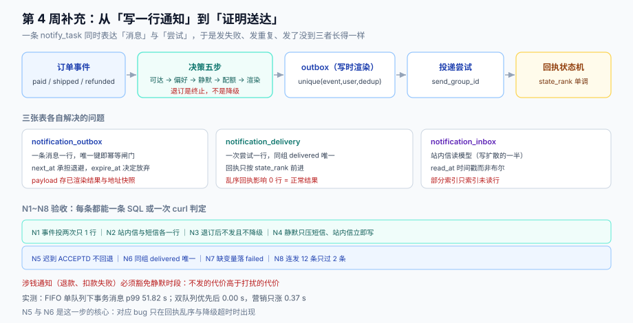

# 第 4 周补充 · 交易通知的触达闭环（ENT-A~ENT-H）

**这一步做什么**：把订单侧一直只做到「消费事件、往 `notify_task` 写一行」的通知链路，补成一条**能证明送达**的闭环——决策（该不该发）→ 渲染（写时）→ 投递（至少一次）→ 回执（单调状态机）→ 收件箱（未读与游标）→ 频控与退订（发送时刻复核）。

**为什么放到第 4 周**：第 2 周的[下单链路](../OrderFlow/index.md)与[支付回调](../PaymentCallback/index.md)已经会写 outbox，第 3 周的[一致性用例矩阵](../ConsistencyMatrix/index.md)证明了事件不丢不重——但**「事件不丢」不等于「用户收到」**。上线验收（`EW4`）的 21 条里，与通知相关的只有一条「发货后能查到通知记录」，它验的是**写库**，不是送达。



本页判据族 `ENT-A` ~ `ENT-H`，共 8 条。定义表见文末「本页判据」一节。

## 一、缺口：三个「看起来没问题」

| 现状 | 看起来的问题 | 真实的问题 |
| --- | --- | --- |
| `notify_task` 只记「要发一条」 | 有记录就说明会发 | **没有状态机**：发失败、发重复、发了没到，三者在这张表里长得一样 |
| 消费事件时判定一次收件人 | 判定过就不会错 | **退订与静默发生在入队之后**：入队判定通过的营销消息会在用户退订后照发 |
| 发货后有 `notify_task` 行 | 用户能收到通知 | **站内信与短信走同一行**：短信失败时站内信也跟着标失败，或两条都发 |

三条缺口的共同点：**它们都不是「功能没做」，而是「状态没表达」**。所以这一章不新增业务能力，只把状态补上。

## 二、表结构：一张变三张

原来的 `notify_task`（第 2 周建）：

```sql
-- 第 2 周的版本（保留，不删，作为历史表）
create table notify_task (
  id bigserial primary key,
  event_id text not null,
  order_id text not null,
  channel text not null,
  payload jsonb not null,
  created_at timestamptz not null default now()
);
```

它的问题不是缺列，是**一行同时表达「一条消息」和「一次尝试」**。拆成三张：

```sql
-- 1. 发件箱：一条消息一行，唯一键即幂等闸门
create table notification_outbox (
  id          bigserial primary key,
  event_id    text not null,
  user_id     bigint not null,
  category    text not null check (category in ('transactional','collaborative','system','marketing')),
  dedup_key   text not null,              -- (order_id, template_key, 折叠窗口)
  channel     text not null check (channel in ('inbox','sms','push','email')),
  target      text not null,              -- 地址快照：手机号/邮箱/token
  body        text not null,              -- 写时渲染结果
  state       text not null default 'pending'
              check (state in ('pending','sending','sent','failed','dead')),
  attempts    smallint not null default 0,
  next_at     timestamptz not null default now(),
  expire_at   timestamptz not null,
  last_error  text,
  created_at  timestamptz not null default now(),
  unique (event_id, user_id, dedup_key)
);

-- 2. 投递：一次尝试一行，回执状态机挂在这里
create table notification_delivery (
  id            bigserial primary key,
  outbox_id     bigint not null references notification_outbox(id),
  send_group_id uuid not null,
  attempt_no    smallint not null,
  channel       text not null,
  state         text not null default 'accepted'
                check (state in ('accepted','delivered','read','failed','complaint','unknown')),
  state_rank    smallint not null default 1,
  provider_msg_id text,
  error_code    text,
  updated_at    timestamptz not null default now(),
  unique (send_group_id, attempt_no)
);

-- 3. 收件箱：站内信的读模型（写扩散的那一半）
create table notification_inbox (
  user_id    bigint not null,
  notif_id   bigint not null,             -- = notification_outbox.id
  created_at timestamptz not null default now(),
  read_at    timestamptz,
  primary key (user_id, notif_id)
);
create index notification_inbox_unread on notification_inbox (user_id, created_at desc) where read_at is null;
```

迁移只做「读旧写新」，不做回填：

```sql
-- 一次幂等的迁移：把历史 notify_task 转成 outbox 的 sent 记录（只为了可查，不再投递）
insert into notification_outbox
  (event_id, user_id, category, dedup_key, channel, target, body, state, expire_at, created_at)
select t.event_id, 0, 'transactional', t.event_id || ':' || t.channel, t.channel,
       'legacy', t.payload::text, 'sent', t.created_at + interval '1 day', t.created_at
  from notify_task t
 where not exists (select 1 from notification_outbox o where o.event_id = t.event_id and o.channel = t.channel);
```

`where not exists` 让这段可以重跑——迁移脚本也必须幂等，否则一次回滚重跑就会插两份。

## 三、事件到通知的映射

| 事件 | 类别 | 模板 | 主通道 | 降级 | 豁免 |
| --- | --- | --- | --- | --- | --- |
| `order.paid` | transactional | `order_paid` | 站内信 | 不做（可在 App 内查看） | 静默时段照发 |
| `order.shipped` | transactional | `order_shipped` | 短信 | 推送 | 静默时段压后，站内信立即写 |
| `shipment.delivered` | transactional | `order_delivered` | 站内信 | 推送 | 同上 |
| `order.refunded` | transactional | `order_refunded` | 短信 | 站内信 | 静默时段照发（涉钱） |
| `payment.failed` | transactional | `payment_failed` | 短信 | 推送 | **永不压后** |

::: danger 注意
1. **退款到账不能被静默时段压后**。它涉及资金，用户会主动去查；延后到早上 8 点会制造「钱是不是没退」的工单。判断标准不是「是否打扰」，而是「不发的代价是否高于打扰」。
2. **`order.shipped` 的主通道不选推送**。发货通知的价值在「可回溯的物流信息」，推送一划就没；短信虽然贵，但它带一个可点的短链，且失败形态（号码失效）与站内信不同。
3. **映射表要进代码而不是配置中心**。这张表决定「哪条通道发哪类消息」，改它等于改合规边界（事务/营销的分界），必须走评审与发版。
:::

## 四、决策五步：把「该不该发」从业务代码里拿出来

```text
1. 地址可达？         target 为空 / token 失效 → 不发（reason=no_target），不降级
2. 偏好允许？         off / suppressed → 不发（reason=unsubscribed），**不降级**
3. 静默时段？         非豁免类且落在 22:00–08:00（用户时区） → 不发（reason=quiet_hours），站内信已写
4. 频控有配额？       (user, category, channel) 三维计数超限 → 不发（reason=throttled）
5. 渲染成功？         缺变量 → 落 failed 进死信（不是「发一条残缺的」）
```

第 2 步是这一章最容易做错的一步：**退订是终止，不是降级**。把「用户退了短信」实现成「改发推送」，在监管口径下仍然是一次未经同意的发送。

## 五、幂等：两个键，两个粒度

| 场景 | 键 | 效果 |
| --- | --- | --- |
| 上游重复投递（Kafka 重平衡 / 手动重放） | `unique(event_id, user_id, dedup_key)` | 第二次插入被唯一键拦下，当成功返回 |
| 投递重试（超时、限流） | `(send_group_id, attempt_no)` | 是「同一条的第 N 次尝试」，不是新消息 |

本机用 5 次投递模拟（同一事件被消费两次 + 手动重放三次）：按 `event_id` 去重后只产生 **2 条**通知（两个不同事件），不去重则是 **5 条**——重复率 60%，而这正是消费组重平衡时的常态。

## 六、降级与回执：一个组、一条单调链

降级的三条约束（详见[通道矩阵](../../../../docs/Backend/NotificationDelivery/Channels/index.md)）：

1. 同一 `send_group_id` 下 `delivered` 唯一；
2. 主通道**超时**（不确定）时先查回执，不直接降级；
3. 降级有最小间隔（短信 60 秒、推送 30 秒）。

回执更新只用一条 SQL，把乱序变成「影响 0 行」的正常结果：

```sql
update notification_delivery
   set state = $1, state_rank = $2, updated_at = now()
 where id = $3 and state_rank < $2;
```

## 七、验收 N1~N8（每条都能一条 SQL 或一次 curl 判定）

| # | 动作 | 期望 |
| --- | --- | --- |
| N1 | `order.paid` 事件投两次（同 `event_id`） | `notification_outbox` 只有 1 行，第二次返回 `accepted:true` |
| N2 | 同一个 `order_id` 触发 `order.shipped`，站内信 + 短信各一条 | 两行的 `channel` 不同、`dedup_key` 不同，都能各自投递 |
| N3 | 用户关闭短信偏好后再触发 `order.refunded` | 不放行，`reason=unsubscribed`，**且不产生推送行** |
| N4 | 23:30 触发 `order.shipped`（非豁免类） | 短信行 `state=pending` 且 `next_at` 在次日 08:00 之后；站内信行已 `sent` |
| N5 | 短信回执先 `DELIVRD` 再补一条 `ACCEPTD` | `state` 停在 `delivered`，第二条影响 0 行 |
| N6 | 主通道超时后触发降级 | 同 `send_group_id` 下 `delivered` 行数 = 1（`select count(*) ... where state='delivered' group by send_group_id`） |
| N7 | 删除模板里的 `amount` 声明后触发事件 | 落 `failed`，`last_error` 含缺失字段名，**没有发出任何消息** |
| N8 | 连发 12 条营销通知（日上限 2） | 前 2 条放行，第 3 条起 `reason=throttled`，且**不是** `unsubscribed` |

N5 与 N6 是这一步的核心：它们对应的 bug 只在回执乱序与降级超时时出现，正常路径永远测不到。

## 八、三个读数

| 读数 | 数字 | 出处 |
| --- | --- | --- |
| 频控边界行为 | 跨 24h 边界发 20 条：固定窗口放行 **20**，滑动窗口与令牌桶各 **10** | [频控与折叠](../../../../docs/Backend/NotificationDelivery/Throttling/index.md) |
| 事务消息排队延迟 | FIFO 单队列 p99 **51.82 s** → 双队列优先 **0.00 s**（营销 p99 只涨 0.37 s） | 同上 |
| 未读数成本 | 5 万行 `count(*)` **0.402 ms**、计数器 **0.014 ms**（29×） | [收件箱读模型](../../../../docs/Backend/NotificationDelivery/Inbox/index.md) |

第一条决定了订单通知的**配额实现**：不要用自然日固定窗口，否则跨零点的两批消息会翻倍打扰。第二条决定了**投递 worker 的队列结构**：`order.paid` 这类消息必须走事务优先队列，否则大促期间会被营销消息拖到 50 秒以上。

## 九、下一步

1. **把 N5/N6 接进第 3 周的一致性用例矩阵**（当前只有 N1 在第 3 周覆盖过）；
2. **`notification_inbox` 的清理任务分批化**（按主键区间，每批 5,000 行），并用 `oldest pending` 年龄做告警；
3. **回执到达率进监控**（`EMT` 的五个指标从 5 个扩到 6 个），它是唯一能发现「受理成功但不投递」的信号。

## 十、本页判据

| 编号 | 看什么现象 | 判成什么 | 不满足时改哪里 |
| --- | --- | --- | --- |
| `ENT-A` | 通知是否有独立的状态机（outbox + delivery 两张表） | 一行同时表达「消息」与「尝试」即失败 | 拆三表，`delivery` 按尝试一行 |
| `ENT-B` | 去重键是否为 `(event_id, user_id, dedup_key)` | 沿用写侧单键即失败：第二个收件人被吞 | 三元组唯一键 |
| `ENT-C` | 退订是否实现为「终止」而非「降级」 | 退订后改发别的通道即失败 | 决策第 2 步短路 |
| `ENT-D` | 涉钱通知（退款、扣款失败）是否豁免静默时段 | 被压后即失败：制造资金类工单 | 豁免表按模板粒度 |
| `ENT-E` | 主通道超时（不确定）是否先查回执再降级 | 直接降级即失败：双发 | `send_group_id` + 回执查询闸门 |
| `ENT-F` | 回执更新是否带 `state_rank` 条件 | 覆盖写即失败：乱序回退 | `where state_rank < ?` |
| `ENT-G` | 渲染缺变量是否落 `failed` 而不是发出残缺内容 | 静默发空即失败 | 严格模式 + 死信 |
| `ENT-H` | 频控是否在放行时计数，且用滑动窗口/令牌桶 | 按发送成功计数或用自然日窗口即失败 | 放行即计数 + 滑动窗口 |

## 十一、参考资料

- [消息通知与触达工程](../../../../docs/Backend/NotificationDelivery/index.md)（本页依赖的机制与实测读数）
- [通道矩阵](../../../../docs/Backend/NotificationDelivery/Channels/index.md)（降级与回执语义）
- [投递与回执](../../../../docs/Backend/NotificationDelivery/Delivery/index.md)（outbox 与状态机）
- [第 2 周第 5 步 · outbox 死信与重投](../OutboxDeadLetter/index.md)（本页复用的死信与重投机制）
- [上线验收](../LaunchAcceptance/index.md)（21 条验收项，本页补的是其中「通知只验写库」的缺口）
- RFC 8058（一键退订）：<https://www.rfc-editor.org/rfc/rfc8058>
