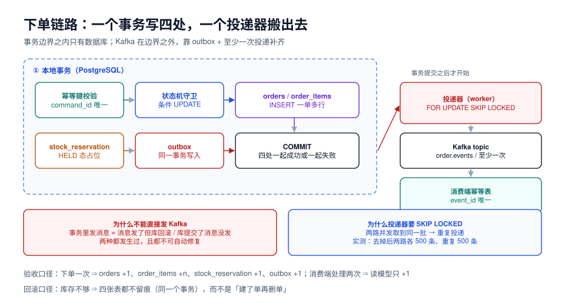

# 第 2 周第 2 步 · 下单链路与 outbox 的第一次真实写入（EOR-A~EOR-H）

本页判据族 `EOR-A` ~ `EOR-H`，共 8 条。

第 1 周把「设计」定完了（9 张表、6 条不变量、9 个端点），第 2 周第 1 步把「骨架」立起来了（四层目录、三套 profile、六步启动）。这一步开始写**第一条真正产生数据的链路**：一次下单请求，要在**一个事务**里落下四处痕迹——订单头、订单行、库存预占、outbox 事件，并且证明这四处**要么全有、要么全无**。

::: tip 一句话理解
下单这一步真正的验收不是「接口返回 201」，而是**「把 Kafka 停掉，下单照样成功；把库打回滚，一张表都不留痕」**——前者证明业务不被中间件绑架，后者证明事务边界画对了。
:::



## 一、当日做了什么

1. 定下**下单链路的五步顺序**（幂等键 → 状态机入口 → 订单写入 → 库存预占 → outbox 落库），并说明每一步失败时的回滚点；
2. 把「库存不够」写成**条件 `UPDATE` + 返回行数判定**，不用 `SELECT` 先查再改（并发下必超卖）；
3. 定下 `outbox` 的写入格式与**聚合 ID 分区键**，与第 183 天的事件信封对齐；
4. 给出**投递器**的取件 SQL（`FOR UPDATE SKIP LOCKED`）与「已发送」的标记方式，并说明为什么至少一次而不是恰好一次；
5. 给出**六条可执行验收断言**：四次计数、一次回滚、一次幂等重投。

## 二、五步顺序与回滚点

| # | 步骤 | 做什么 | 失败时 | 回滚点 |
| --- | --- | --- | --- | --- |
| 1 | 幂等键校验 | `INSERT INTO idempotency_key … ON CONFLICT DO NOTHING`，影响 0 行则返回上次结果 | `23505` 被吞掉，返回 0 行 | 无（幂等键本身是第一个写） |
| 2 | 商品与价格快照 | 读 `product_snapshot`（只读，不锁） | 商品下架 → 400 | 无写入，直接返回 |
| 3 | 订单头 + 订单行 | `INSERT INTO orders …` / `INSERT INTO order_items …` | 约束冲突 → 409 | 事务回滚 |
| 4 | 库存预占 | 对每个 SKU 条件 `UPDATE stock SET reserved = reserved + :qty WHERE … AND available >= :qty` | 影响 0 行 → 抛 `InsufficientStock` | 事务回滚（前面全部撤销） |
| 5 | outbox 落库 | `INSERT INTO outbox (aggregate_id, event_type, payload) …` | 唯一冲突（同一 `event_id`） → 幂等忽略 | 事务回滚 |

::: danger 顺序不能换的两处
1. **幂等键必须在最前面**：放在最后意味着重复请求会先把库存占了，再发现是重复单，然后回滚——高并发下这段时间足够把库存锁死。
2. **outbox 必须在同一个事务的最后**：放事务外（提交后再写）就会出现「订单成功但事件丢了」；放最前面则事件可能先于订单可见。
:::

## 三、库存预占：条件 UPDATE，不查后改

```sql
-- 正确：一条语句同时完成「判断 + 扣减」，并发安全
UPDATE stock
   SET reserved = reserved + :qty,
       updated_at = now()
 WHERE tenant_id = :tenant
   AND sku_id = :sku
   AND available - reserved >= :qty
RETURNING reserved, available;
```

```java
var rows = jdbc.update(SQL_RESERVE, tenant, sku, qty);
if (rows == 0) throw new InsufficientStock(sku);   // 0 行 = 库存不够，不是「没这个 SKU」
```

三种写法的差别（第 184 天的实测结论，这里只复述判据）：

| 写法 | 并发下会不会超卖 | 说明 |
| --- | --- | --- |
| `SELECT` 查可用量 → `UPDATE` 设新值 | **会** | 两个事务都读到「够」，都写成功 |
| `SELECT … FOR UPDATE` → `UPDATE` | 不会 | 正确但要两次往返，热点 SKU 上排队明显 |
| **条件 `UPDATE` + `RETURNING`** | 不会 | 一条语句，推荐 |

::: warning `available - reserved >= :qty` 里两个列都是「当前值」
写成 `available >= :qty` 就漏掉了已预占的量——这是现场最容易出的错，而且只在「同 SKU 有并发预占」时才暴露，测试环境很难复现。第 184 天的不变量 `I2`（`reserved <= available`）就是为这个准备的。
:::

### 为什么不用排他约束

第 184 天试过 `EXCLUDE USING gist` 来防超卖，结果是**第二笔订单直接下不进去**（`23P01`）：排他约束适用于「时段独占」型资源（同一会议室不能两个会议），不适用于「数量递减」型资源。数量型的正确工具是**条件更新 + `CHECK (reserved <= available)` 兜底**。

## 四、outbox：事务内的最后一笔

```sql
CREATE TABLE outbox (
  id            bigint GENERATED ALWAYS AS IDENTITY PRIMARY KEY,
  event_id      uuid        NOT NULL UNIQUE,
  aggregate_id  uuid        NOT NULL,
  event_type    text        NOT NULL,
  payload       jsonb       NOT NULL,
  headers       jsonb       NOT NULL DEFAULT '{}'::jsonb,
  created_at    timestamptz NOT NULL DEFAULT now(),
  published_at  timestamptz
);

-- 投递器只扫未发送的，部分索引让这个扫描与表大小无关
CREATE INDEX outbox_unpublished_idx ON outbox (id) WHERE published_at IS NULL;
CREATE INDEX outbox_aggregate_idx   ON outbox (aggregate_id, id);
```

```java
@Transactional
public OrderCreated handle(CreateOrderCommand cmd) {
    idempotency.acquire(cmd.commandId(), cmd.requestHash());      // ① 幂等键
    var snapshot = product.snapshot(cmd.sku());                   // ② 只读快照
    var order = Order.create(cmd, snapshot);                      // ③ 订单头 + 行
    orderRepository.insert(order);
    stock.reserve(cmd.tenantId(), cmd.sku(), cmd.qty());           // ④ 条件 UPDATE
    outbox.append(EventEnvelope.of(                                // ⑤ 同事务写事件
        order.id(), "order.created", 1, order.toPayload(), cmd.traceId()));
    return order.toView();
}
```

`outbox.append` 内部只做一件事：把 `event_id`（UUIDv7）、`aggregate_id`（订单 ID，也是 Kafka 分区键）、`event_type`、`payload`、`headers.trace_id` 写进去。**不碰 Kafka**——这就是「业务不被中间件绑架」的具体形态。

## 五、投递器：SKIP LOCKED 与至少一次

```sql
-- 取件：两路并发各拿各的，不会重叠
SELECT id, event_id, aggregate_id, event_type, payload, headers
FROM outbox
WHERE published_at IS NULL
ORDER BY id
LIMIT 500
FOR UPDATE SKIP LOCKED;
```

第 183 天的实测（2,000 条未发布、limit 500、两路并发）：

| 写法 | 两路各拿到的条数 | 重复条数 |
| --- | --- | --- |
| 带 `FOR UPDATE SKIP LOCKED` | 500 / 500 | **0** |
| 去掉 `SKIP LOCKED` | 500 / 500 | **500**（两路抓到同一批） |

去掉 `SKIP LOCKED` 时两路会**互相等待对方提交**再拿到同一批——这就是消费端幂等表必须存在的理由，也是本步判据 `EOR-F` 的由来。

投递语义定的是**至少一次**：

1. 发送 Kafka 成功 → `UPDATE outbox SET published_at = now() WHERE id = ANY(:ids)`；
2. 如果「发送成功但标记失败」，下一轮会重发 → 消费端可能收到两次；
3. 如果「标记成功但发送实际失败」（极少见，取决于 Kafka 的 ack 配置），会丢——所以必须是 `acks=all` + 幂等生产者。

::: danger 不要试图做「恰好一次」
跨 PostgreSQL 与 Kafka 没有分布式事务，任何「恰好一次」的承诺最终都靠**消费端幂等**实现。写清楚「至少一次 + 幂等消费」，比在文档里写「保证 exactly-once」诚实得多，也少一次线上事故。
:::

## 六、六条验收断言

| # | 操作 | 期望 | 判定方式 |
| --- | --- | --- | --- |
| 1 | 正常下单 | `orders` +1、`order_items` +n、`stock_reservation` +1、`outbox` +1 | 四条 `count(*)` 前后差 |
| 2 | 库存不足下单 | 四张表**都不留痕**，接口返回 409 | 同上，差全为 0 |
| 3 | 同 `command_id` 重投 | `orders` 不增，接口返回与首次相同 | 比对响应体 + `count(*)` |
| 4 | 停掉 Kafka 再下单 | 接口**成功**，`outbox` 有 1 行 `published_at IS NULL` | `curl` + 查询 |
| 5 | 起 Kafka 与投递器 | 30 秒内 `published_at` 不再为空 | 轮询查询 |
| 6 | 同一事件投两次给消费端 | 读模型只 +1 行 | 幂等表 `event_id` 唯一 |

```sql
-- 断言 1 / 2：一次下单之后的四处计数（$1 = order_no）
SELECT
  (SELECT count(*) FROM orders             WHERE order_no = $1) AS orders,
  (SELECT count(*) FROM order_items        WHERE order_no = $1) AS items,
  (SELECT count(*) FROM stock_reservation  WHERE order_no = $1) AS reservations,
  (SELECT count(*) FROM outbox             WHERE aggregate_id = (SELECT id FROM orders WHERE order_no = $1)) AS outbox;
-- 正常下单期望：1 / n / 1 / 1
-- 库存不足期望：0 / 0 / 0 / 0
```

```shell
# 断言 4：把 Kafka 停掉，下单仍应成功
docker compose -f deploy/compose.yaml stop kafka
curl -s -o /dev/null -w '%{http_code}\n' -X POST localhost:8080/api/orders \
  -H 'Content-Type: application/json' -H 'Idempotency-Key: eoc-001' \
  -d '{"sku":"SKU-1","qty":1}'
# 期望：201

docker exec eoh-postgres psql -U postgres -d eoh -c \
  "SELECT count(*) FROM outbox WHERE published_at IS NULL;"
# 期望：>= 1

# 断言 5：恢复 Kafka 与投递器
docker compose -f deploy/compose.yaml start kafka
docker compose -f deploy/compose.yaml up -d worker
sleep 10
docker exec eoh-postgres psql -U postgres -d eoh -c \
  "SELECT count(*) FROM outbox WHERE published_at IS NULL;"
# 期望：0
```

## 七、本页判据

| 编号 | 判据 | 看什么现象 | 不满足时改哪里 |
| --- | --- | --- | --- |
| `EOR-A` | 下单链路五步在**一个事务**内完成，事务内无 Kafka/HTTP 调用 | 代码里 `@Transactional` 范围内无 `kafkaTemplate`/`restTemplate` | 挪到 outbox + 投递器 |
| `EOR-B` | 库存预占用条件 `UPDATE` + 影响行数判定，无「先查后改」 | `SQL_RESERVE` 带 `available - reserved >= :qty` | 改写 |
| `EOR-C` | `orders`、`order_items`、`stock_reservation`、`outbox` 四处计数同增同减 | 断言 1/2 通过 | 检查是否漏写或跨事务 |
| `EOR-D` | `outbox.event_id` 有唯一约束，`aggregate_id` 作为分区键 | `\d outbox` | 补约束 |
| `EOR-E` | 投递器取件带 `FOR UPDATE SKIP LOCKED` 与部分索引 | `EXPLAIN` 走 `outbox_unpublished_idx` | 补 |
| `EOR-F` | 消费端有幂等表（`event_id` 唯一），重复投递不改变读模型 | 断言 6 通过 | 补幂等表 |
| `EOR-G` | Kafka 停机时下单仍成功（业务不被中间件绑架） | 断言 4 通过 | 去掉事务内发送 |
| `EOR-H` | 回滚时四张表**都不留痕**，不是「先建后删」 | 断言 2 通过 | 合并事务；禁止补偿式删除 |

## 八、下一步

第 2 周第 3 步做**支付回调：验签、幂等与对账三件事**：

- 回调可能重复、可能乱序、可能伪造——验签通过之后还要过幂等（`payment_callback_log` 的唯一键）；
- 支付成功事件必须与订单状态更新在**同一个事务**里落 `outbox`，和今天这条链路同构；
- 需要一条**对账 SQL**：以支付流水为准，找出「已支付但订单还是 `PENDING_PAYMENT`」的单——这是跨上下文最终一致的唯一兜底。

判据前缀用 `EPY`（支付，与项目总览预留的一致），与今天的 `EOR`（下单）分开，便于按链路追。

## 参考资料

- 本仓库项目：[EventOrderHub 项目总览](../index.md)、[第 1 周第 4 步·数据库设计](../DatabaseDesign/index.md)、[第 2 周第 1 步·工程骨架](../Bootstrap/index.md)
- 本仓库专题：[事件溯源与 CQRS](../../../../docs/Backend/EventSourcing/index.md)、[消息队列](../../../../docs/Backend/MessageQueue/index.md)、[幂等与状态机工程](../../../../docs/Backend/IdempotencyStateMachine/index.md)
- PostgreSQL 18 Documentation: *SELECT … FOR UPDATE*（`SKIP LOCKED`）、*Partial Indexes*
