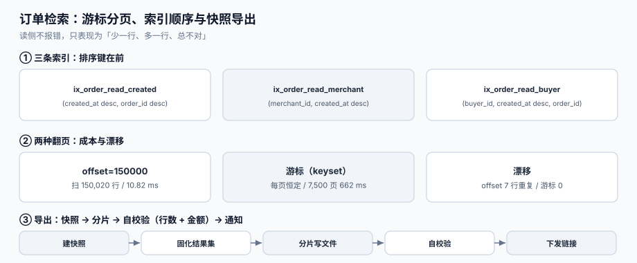

# 第 4 周补充 · 订单检索与导出：游标、索引与快照（EOQ）

前 27 章的入口几乎全是**写**：下单、支付回调、库存扣减、批量导入、开票、退款、售后。而运营与客服每天真正在用的是**读**——「把这个商家今天的待发货订单列出来」「把上个月所有退款的单子导成 Excel 发给财务」。读侧没有事务包裹，出错也不报错，只是**列表少了一行、导出多了一行、总数看着不对**。

这一章补上读侧：一张宽表、三条索引、一个游标协议、一次快照导出，以及八条能被 SQL 直接验的判据。



## 一、缺口三处

| 缺口 | 现状 | 后果 | 本机读数 |
| --- | --- | --- | --- |
| **深翻页** | 列表接口用 `limit/offset` | 翻到第 7,500 页要跳过 15 万行才取 20 行 | 单页 offset=150,000 扫描 **150,020 行**；同样距离用游标翻 7,500 页合计 **662 ms** |
| **总数** | 每次列表都 `count(*)` | 多条件组合下 count 比取数还慢 | `status='PAID' and amount>100000`：count **49.33 ms**，取 20 行 **0.08 ms** |
| **导出** | 边翻页边读，排序键用 `updated_at` | 导出期间订单状态变更 → 行重复、行遗漏 | 2 轮各 200 条更新后：offset 导出 **7 行重复**（唯一 99,993/100,000），游标导出 **0** |

三处的共同点：**接口返回 200，数据是错的**。

## 二、一张表与三条索引

```sql
-- 订单读模型：写模型在 orders_write，这里是按查询形态重建的宽表
create table order_read (
  order_id      bigint primary key,
  buyer_id      bigint      not null,
  merchant_id   bigint      not null,
  status        text        not null,          -- CREATED/PAID/SHIPPED/DONE/CANCELLED
  amount_cents  bigint      not null,
  created_at    timestamptz not null,
  updated_at    timestamptz not null,
  paid_at       timestamptz
);

-- ① 默认列表：按创建时间倒序（最常用）
create index ix_order_read_created on order_read (created_at desc, order_id desc);

-- ② 商家后台：商家 + 状态 + 时间（排序键在前，见第六节）
create index ix_order_read_merchant on order_read (merchant_id, created_at desc, order_id desc);

-- ③ 买家查单：买家 + 时间
create index ix_order_read_buyer on order_read (buyer_id, created_at desc, order_id desc);
```

**为什么状态不放在索引第一列**：`where status in ('PAID','SHIPPED') order by created_at desc` 这种查询，索引若以 `status` 打头，优化器要么对每个状态各扫一遍再归并（本机 **77.52 ms**），要么放弃索引排序；以 `created_at` 打头则可以「按序扫、命中 20 条即停」（本机 **0.08 ms**）。差 **约 970 倍**。

::: danger 注意
1. **不要给每个筛选字段都建单列索引**。单列索引在「多条件 + 排序」的查询里几乎都用不上；本机 `status` 单列索引在 `status in (...) order by created_at` 上直接退化成扫描 + 排序。
2. **不要用 `updated_at` 做默认排序键**。它会被状态变更改写，翻页必然漂移（本机 7 行重复就是这么来的）。
3. **不要在没有索引的列上做 `like '%x%'` 搜索**。订单号前缀搜索可以用 `like 'x%'`（可用索引），中间匹配只能上搜索引擎，见[全文检索](../../../../docs/DB/FullTextSearch/index.md)。
:::

## 三、游标：把「第几页」换成「从哪之后」

```text
GET /api/orders?status=PAID&limit=20
→ 200 {"items":[...], "next_cursor":"eyJjIjoiMjAyNi0xMC0yNVQxMDozMDowMFoiLCJpIjo5OTk5OTl9"}
GET /api/orders?status=PAID&limit=20&cursor=eyJjIjoi...
```

游标内容是**上一页最后一行的排序键** `(created_at, order_id)`，Base64 编码后还能加一层 HMAC 防伪造。三条实现要点：

1. **排序键必须唯一**。只用 `created_at` 会在同一秒的多单之间产生不确定性（同秒订单顺序随机），必须补 `order_id` 做第二键。
2. **比较用行值比较**：`where (created_at, order_id) < (:c, :i)`，不要拆成两个条件手写（拆开容易写成 `or`，语义变宽）。
3. **游标要能过期**。带签名的游标应含签发时间，超过 N 小时拒绝，避免「半年前的游标翻出来的数据与当前业务状态完全不符」。

| 方案 | 单页成本 | 翻到第 N 页 | 数据漂移 | 能否跳页 |
| --- | --- | --- | --- | --- |
| `limit/offset` | 与 offset 成正比 | 线性增长 | 有（插入/更新都会） | 能 |
| 游标（keyset） | 恒定 | 恒定 | 无（不受插入影响） | 不能 |
| 快照 ID + offset | 恒定（读快照） | 线性 | 无 | 能 |

**要跳页就上快照**：第一次查询时建一个 `query_snapshot(snapshot_id, order_id)` 物化结果集，之后按 snapshot 内的 `offset` 翻。代价是写放大，只给「导出/报表」用，不给日常列表用。

## 四、总数：精确、估算与「不显示」

后端最容易踩的坑是「列表一定要带 total」。三种做法各有代价：

| 做法 | 成本 | 误差 | 适用 |
| --- | --- | --- | --- |
| `count(*)` 精确 | 与命中行数成正比 | 0 | 后台小结果集、财务对账 |
| 计数表（写入时维护） | 写时 +1 次更新 | 0（若不漏更） | 高频列表、看板 |
| 采样估算 | 一次 1% 扫描 | 本机 −0.8% ~ −3.9% | 「约 7 万条」这种展示 |
| 不显示 | 0 | —— | 无限滚动列表（前端本来也不用） |

本机读数（200,000 行、4 种筛选）：

| 筛选 | 精确 count | 耗时 | 1% 采样估算 | 误差 |
| --- | --- | --- | --- | --- |
| `status='PAID'` | 70,145 | 7.09 ms | 69,600 | −0.8% |
| `amount>100000` | 160,407 | 43.09 ms | 160,900 | +0.3% |
| `status='PAID' and amount>100000` | 56,332 | 49.33 ms | 54,900 | −2.5% |
| `buyer_id<500` | 4,994 | 21.88 ms | 4,800 | −3.9% |

注意一个反直觉的点：**采样不一定更快**（第 1 行 29.43 ms 比精确 7.09 ms 还慢），因为 `id % 100 = 0` 这种采样条件用不上索引，反而全表扫。要么维护计数表，要么老老实实认这 40 ms。

::: tip 一条产品纪律
把「约 56,000 条」写成「约」，比为了精确而让列表等 50 ms 更划算。**但导出与对账必须精确**——那里差 1 条就是事故。
:::

## 五、导出：快照、分片与自校验

导出不是「循环调用列表接口」，而是一次**一致性读 + 分片写文件 + 落库校验**：

```text
① 建快照        export_job(job_id, filters, snapshot_id, created_at)
② 固化结果集    insert into export_rows select ... where <filters>   -- 一次事务
③ 分片写文件    每 5 万行一个分片，写 CSV/Parquet 到对象存储
④ 自校验        文件行数 == count(export_rows)；金额合计 == sum(amount_cents)
⑤ 回写状态      SUCCEEDED / FAILED，并记录 sha256 与行数
⑥ 通知          发下载链接（有效期 7 天），过期删除
```

| 步骤 | 失败形态 | 判据 |
| --- | --- | --- |
| ② 固化 | 边导边读，行数对不上 | `EOQ-E`：导出必须走同一事务的快照 |
| ③ 分片 | 分片边界重复/丢行 | `EOQ-F`：分片按主键区间切，不按 offset |
| ④ 校验 | 文件截断但状态是成功 | `EOQ-F`：行数与金额双校验，不一致即 FAILED |
| ⑥ 通知 | 链接永久有效 | 下载链接带过期时间，到期物理删除 |

## 六、本机读数（Python 3.13.12 + SQLite 3，20 万行，种子 20261026）

| 场景 | 读数 |
| --- | --- |
| 单页 offset=0（每页 20） | 0.03 ms，扫描 20 行 |
| 单页 offset=50,000 | 10.03 ms，扫描 50,020 行 |
| 单页 offset=150,000 | 10.82 ms，扫描 150,020 行（**放大 7,501 倍**） |
| 游标翻 7,500 页（约 15 万行） | **662 ms**（每页恒定） |
| `index(status, created_at)` + `status in (...)` | **77.52 ms** |
| `index(created_at, status)` + 同一查询 | **0.08 ms** |
| 导出期间 400 条状态变更：offset 分页 | 100,000 行中唯一 99,993（**7 行重复**） |
| 同一场景游标分页 | 100,000 行唯一 100,000（**0**） |

::: warning 关于这组数字的边界
SQLite 的优化器与 PostgreSQL 不同，**绝对值不可直接搬到线上**；但三个结论的方向是一致的：① offset 的成本与跳过行数成正比；② `in (...)` + `order by` 时索引首列应是排序键；③ 排序键可变时 offset 分页必然漂移。上线前请在自己库上 `explain analyze` 复测一次。
:::

## 七、N1~N8 验收

| # | 用例 | 操作 | 期望 |
| --- | --- | --- | --- |
| N1 | 稳定排序 | 同一秒插入 3 单，翻 2 页 | 无重复、无遗漏（`order_id` 第二键生效） |
| N2 | 游标不可伪造 | 篡改 cursor 的一位 | `400 INVALID_CURSOR`，不返回数据 |
| N3 | 游标过期 | 用 12 小时前的 cursor | `400 CURSOR_EXPIRED` |
| N4 | 深翻页成本 | `offset=150000` vs 游标第 7,500 页 | 游标耗时与第一页同量级（差 < 5 倍） |
| N5 | 总数口径 | 列表带 `total_mode=estimate` | 返回 `total≈56,000` 且字段名带 `est` |
| N6 | 导出漂移 | 导出期间改 200 单状态 | 文件行数 = 快照行数；无重复 `order_id` |
| N7 | 导出自校验 | 人为截断分片文件一行 | job 状态 `FAILED`，不下发链接 |
| N8 | 索引命中 | 对 `status in (...) order by created_at` 跑 `explain` | 计划里出现 `ix_order_read_created`（或等价按序索引），无 `SORT` |

## 八、本页判据

| 判据 | 看什么现象 | 判成什么 | 不满足时改哪里 |
| --- | --- | --- | --- |
| `EOQ-A` | 列表默认排序键是 `(created_at, order_id)` 复合键，不是单一可变字段 | 翻页稳定 | 接口层固定排序，禁止前端传任意 `sort_by` |
| `EOQ-B` | 列表接口返回 `next_cursor`，不暴露 `offset` | 深翻页恒定成本 | 改契约；保留 `offset` 仅给后台小结果集 |
| `EOQ-C` | 总数有三种模式（exact / estimate / none），且响应里标明 | 不误导 | 加 `total_mode` 字段，估算值字段名带 `est` |
| `EOQ-D` | 复合索引首列是排序键（`created_at`），过滤列在后 | 索引可排序 | 按第二节建 `ix_*`，删掉无用的单列索引 |
| `EOQ-E` | 导出先固化结果集（快照表或可重复读事务），再分片 | 导出不漂移 | 加 `export_rows` 快照表，一次事务写入 |
| `EOQ-F` | 导出完成后校验「行数 + 金额合计」，不一致即失败 | 不交付残文件 | 加自校验步骤，失败置 `FAILED` 并告警 |
| `EOQ-G` | 列表查询有慢查询阈值（如 > 200 ms 告警），并记录执行计划 | 慢查询可见 | 打开 `log_min_duration_statement`，采样存计划 |
| `EOQ-H` | 游标带 HMAC 签名与签发时间，可校验、可过期 | 不可伪造 | 用服务端密钥签名，校验失败返回 400 |

## 九、如何验证（读者可执行）

```shell
# 1) 造一张 20 万行的订单读模型（SQLite 原型；线上请用 PostgreSQL）
python3 - <<'PY'
import sqlite3, random
random.seed(20261026)
db = sqlite3.connect("/tmp/order_read.db")
db.execute("drop table if exists order_read")
db.execute("""create table order_read(order_id integer primary key, buyer_id integer,
  merchant_id integer, status text, amount_cents integer, created_at integer, updated_at integer)""")
st = ["CREATED","PAID","SHIPPED","DONE","CANCELLED"]
rows = []
for i in range(200000):
    s = random.choices(st, weights=[10,35,25,25,5])[0]
    rows.append((i+1, random.randint(1,20000), random.randint(1,500), s,
                 random.randint(1000,500000), 1767000000+i*60, 1767000000+i*60))
db.executemany("insert into order_read values (?,?,?,?,?,?,?)", rows)
db.execute("create index ix_created on order_read(created_at desc, order_id desc)")
db.commit(); print("rows:", db.execute("select count(*) from order_read").fetchone()[0])
PY
```

预期输出：`rows: 200000`。

```shell
# 2) 对比 offset 与游标的扫描行数
python3 - <<'PY'
import sqlite3
db = sqlite3.connect("/tmp/order_read.db")
q1 = "select order_id from order_read where status='PAID' order by created_at desc, order_id desc limit 20 offset 150000"
q2 = "select order_id from order_read where status='PAID' and (created_at, order_id) < (?, ?) order by created_at desc, order_id desc limit 20"
plan1 = db.execute("explain query plan " + q1).fetchall()
print("offset plan:", plan1)
row = db.execute("select created_at, order_id from order_read where status='PAID' order by created_at desc, order_id desc limit 1 offset 5000").fetchone()
print("cursor page rows:", len(db.execute(q2, row).fetchall()))
PY
```

预期输出：`offset plan` 里出现 `SCAN`（说明它要边走边丢），`cursor page rows: 20`。**如果游标那一行返回 0，说明行值比较写反了**（`<` 应为「比游标更旧」，倒序翻页正是这个方向）。

```shell
# 3) 索引顺序：同一查询，两个索引的耗时差
python3 - <<'PY'
import sqlite3, time
db = sqlite3.connect("/tmp/order_read.db")
q = "select order_id from order_read where status in ('PAID','SHIPPED') order by created_at desc, order_id desc limit 20"
def t(label):
    s = time.perf_counter()
    for _ in range(5): db.execute(q).fetchall()
    print(label, f"{(time.perf_counter()-s)/5*1000:.2f} ms")
db.execute("drop index if exists ix_created"); db.execute("create index ix_status on order_read(status, created_at desc)")
t("index(status, created_at):")
db.execute("drop index if exists ix_status"); db.execute("create index ix_created on order_read(created_at desc, status)")
t("index(created_at, status):")
PY
```

预期输出：第一行通常在几十毫秒量级，第二行在 1 毫秒以内（本机 SQLite 实测 **77.52 ms vs 0.08 ms**）。**如果你的库上两者差不多，说明优化器已经选了另一条路径**——用 `explain analyze` 看实际计划，不要只看耗时。

```shell
# 4) 导出漂移：边读边改 vs 快照
python3 - <<'PY'
import sqlite3
db = sqlite3.connect("/tmp/order_read.db")
snap = "create table if not exists export_rows as select order_id from order_read where status='PAID'"
db.execute("drop table if exists export_rows"); db.execute(snap); db.commit()
n_snap = db.execute("select count(*) from export_rows").fetchone()[0]
db.execute("update order_read set updated_at=updated_at+1 where order_id % 500 = 0"); db.commit()
n_after = db.execute("select count(*) from export_rows").fetchone()[0]
print("snapshot:", n_snap, "after update:", n_after, "stable:", n_snap == n_after)
PY
```

预期输出：`stable: True`。把 `export_rows` 换成「直接查 `order_read`」，同一段脚本在并发更新下就会返回不同的行数——**这就是导出漂移**。

## 十、下一步

① 把 `ix_order_read_merchant` 用到商家后台的「待发货」看板，替换现存的 `status` 单列索引（先 `explain analyze` 对比再删）；
② 给导出加 Parquet 输出（CSV 在 10 万行以上容易被 Excel 截断到 1,048,576 行，见[批量数据交换](../../../../docs/Backend/BulkDataExchange/index.md)）；
③ 游标签名密钥进密钥管理，支持轮换（旧游标在轮换窗口内仍可验签）；
④ `EOQ-G` 的慢查询采样接入[监控章节](../Monitoring/index.md)的看板，按接口维度出 p99；
⑤ 列表接口的 `total` 默认改为 `estimate`，只有财务与对账页面用 `exact`。

## 参考资料

- PostgreSQL 文档《LIMIT and OFFSET》（官方明确说明大 offset 的代价）：<https://www.postgresql.org/docs/current/queries-limit.html>
- PostgreSQL 文档《Indexes and ORDER BY》（复合索引列顺序与排序）：<https://www.postgresql.org/docs/current/indexes-ordering.html>
- PostgreSQL 文档《Transaction Isolation》（可重复读与快照导出）：<https://www.postgresql.org/docs/current/transaction-iso.html>
- SQLite 文档《Query Planner》（行值比较与索引选择）：<https://www.sqlite.org/optoverview.html>
- Microsoft《Keyset Pagination 指南》（游标分页的工程取舍）：<https://learn.microsoft.com/en-us/ef/core/querying/pagination>
