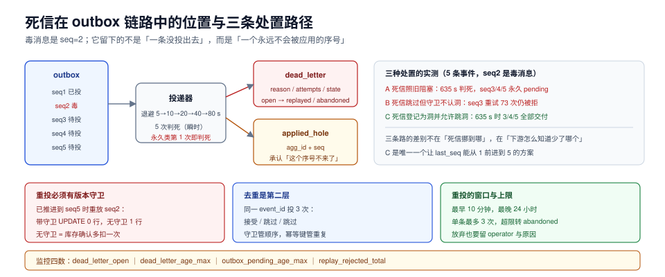

# 第 2 周第 5 步 · outbox 死信与重投

outbox 的前四步（[下单链路](../OrderFlow/index.md)、[支付回调](../PaymentCallback/index.md)、[库存释放](../StockRelease/index.md)、[发货签收](../ShipmentFulfillment/index.md)）都假设「消息迟早能投出去」。这一步处理剩下那一小撮：**反复投不出去的消息**。

这里最容易犯的错，是把死信当成「投递失败的一个终态」，于是设计出「失败了就挪到死信表，运维再去重投」。实测表明这条路的三个变体里**有两个会把整条聚合的事件流卡死**：一个卡在投递层，一个卡在应用层。真正要解决的从来不是「挪到哪里」，而是**「顺序里少了一个，后面的人怎么知道」**。



本章判据族 `EDL-A` ~ `EDL-H`，共 8 条。判定表见文末「本章判据」一节。

## 一、死信从哪来：四类原因、两种性质

「重试仍失败」不是一种情况，而是四种。分类的意义在于**只有一类该继续重试**：

| 原因 | 典型报错 | 性质 | 正确处置 |
| --- | --- | --- | --- |
| 下游暂时不可用 | 连接超时、503、连接池耗尽 | 瞬时 | 指数退避重试 |
| 本端资源不足 | 磁盘满、线程池满 | 瞬时（但可能持续很久） | 退避 + 告警，不判死 |
| 消息本身非法 | 缺字段、金额为负、JSON 解析失败 | **永久** | **立即判死**，不要重试 |
| 业务前置不满足 | 引用的订单不存在、状态已变 | **永久**（对该事件） | 判死 + 登记洞 |

第三、四类如果按前两类重试，代价可以直接算：

| 重试次数 | 白等多久 |
| --- | --- |
| 3 次 | 35 s |
| 5 次 | 155 s |
| 8 次 | **1275 s ≈ 21.2 分钟** |

`base 5 s / factor 2` 的退避，8 次累计 1275 秒。一个「金额字段为负」的永久错误，如果被当成瞬时错误，会白白占住这条聚合的事件流 **21 分钟**——而它永远不会成功。

::: danger 三条判定纪律
1. **按错误类型分流，不按错误次数分流**。「重试 5 次都失败」不是判死条件，「异常类型属于永久类」才是。
2. **永久错误不进退避队列**，直接判死并产生一条 `dead_letter` 记录，同时把 `applied_hole` 的洞登记上（见第三节）。
3. **瞬时错误的退避上限要小于业务容忍窗口**。第 4 周定的对账日报是 T+1，退避总时长必须远小于 24 小时；累计 21 分钟的量级是合适的，累计 21 小时不是。
:::

## 二、退避曲线与判死边界

本项目的退避参数：`base = 5 s`、`factor = 2`、`max_attempts = 5`（瞬时类），永久类第 1 次即判死。

```text
attempt 1  →  等 5 s      累计 5 s
attempt 2  →  等 10 s     累计 15 s
attempt 3  →  等 20 s     累计 35 s
attempt 4  →  等 40 s     累计 75 s
attempt 5  →  等 80 s     累计 155 s    ← 到此判死（瞬时类上限）
```

三个参数各自的理由：

- **base 5 s**：小于「用户刷新页面的间隔」，让绝大多数瞬时抖动在用户察觉前自愈。
- **factor 2**：单次等待翻倍，5 次就能跨越 2 个数量级（5 s → 80 s）；factor 1.5 需要 8 次才能达到同样跨度。
- **max_attempts 5**：累计 155 s，约等于「支付回调渠道的最长重推间隔」的一半——超过这个时间还没成功，说明不是网络抖动。

**抖动（jitter）不是可选项**。同一批 outbox 记录的下次执行时间如果没有抖动，会在同一秒集中醒来，形成「重试风暴」；本项目用 `±20%` 均匀抖动。

## 三、三种处置方式，两种会把链路卡死

这是本章的核心。用 SQLite 模拟一条聚合（订单 A）的 5 个事件，其中 `seq=2` 是永久非法消息（毒消息），其余 4 条正常。三种处置方式的实测结果：

| 方案 | 投递层 | 应用层守卫 | 结果 | eA3 尝试次数 |
| --- | --- | --- | --- | --- |
| A：死信照旧阻塞 | 前序未 `delivered` 即阻塞 | 不适用 | **卡死**：eA2 在 635 s 判死，之后 eA3/eA4/eA5 永久 `pending` | 0 |
| B：死信视为已投递 | 死信也跳过 | `last_seq = seq - 1` 才接受 | **换个地方卡死**：eA3 重试 **73 次**仍被守卫拒绝，到 1000 s 仍未交付 | 73 |
| C：死信登记为洞 | 死信跳过 | 洞已登记则允许跳洞 | **通过**：eA3/eA4/eA5 在 635 s 全部交付，每条 `attempts=1` | 1 |

三行读下来，结论比「要处理死信」具体得多：

1. **方案 A 的死锁是投递层的**。`blocked()` 只认 `delivered`，`dead` 不算「已了结」，于是 `seq=2` 永远挡住 3、4、5。这条聚合**永久停摆**，而且监控上只看到「积压不降」，看不出根因。
2. **方案 B 的死锁是应用层的**。投递层放行了，但消费侧守卫要求 `last_seq = seq - 1`：`seq=3` 等 `last_seq=2`，而 `seq=2` 永远不会被应用。于是 eA3 每 5 秒重试一次，73 次、1000 秒，全被守卫拒。**这就是「死信处理了但业务没动」的经典形态**——运维看到死信表里只有 1 条，觉得处理完了。
3. **方案 C 让「洞」成为一等公民**。判死的同时写一行 `applied_hole(agg_id, seq)`，守卫的接受条件是「`seq = last_seq + 1`」**或**「`last_seq+1 .. seq-1` 全部在 `applied_hole` 里」。于是 eA3 可以跳过 2 直接应用，`last_seq` 从 1 前进到 3，4、5 依次通过。

::: tip 一句话理解
**死信的本质不是「一条消息丢了」，而是「一个序号永远不会被应用」。** 系统必须能表达「这里有个已知的洞」，否则它会一直等一个永不到来的序号。
:::

## 四、表结构：三张表各管一件事

```sql
-- 1) outbox 增加两列：判死要知道「为什么」与「何时」
ALTER TABLE outbox ADD COLUMN dead_reason text;
ALTER TABLE outbox ADD COLUMN dead_at     timestamptz;
-- state 取值扩展为：pending | delivered | dead

-- 2) 死信表：一行一条，重投是「状态推进」不是「删除」
CREATE TABLE dead_letter (
  event_id   text PRIMARY KEY REFERENCES outbox(event_id),
  agg_id     text NOT NULL,
  seq        integer NOT NULL,
  reason     text NOT NULL,                 -- invalid_payload | missing_ref | state_conflict
  attempts   integer NOT NULL,
  dead_at    timestamptz NOT NULL DEFAULT now(),
  state      text NOT NULL DEFAULT 'open',  -- open | replayed | abandoned
  replayed_at timestamptz,
  operator   text
);
CREATE INDEX dead_letter_open ON dead_letter (state, dead_at);

-- 3) 洞表：应用侧承认「这个序号不会来了」
CREATE TABLE applied_hole (
  agg_id      text NOT NULL,
  seq         integer NOT NULL,
  resolved_at timestamptz NOT NULL DEFAULT now(),
  reason      text NOT NULL,                -- dead_letter | manual_skip | backfilled
  PRIMARY KEY (agg_id, seq)
);

-- 4) 消费去重：重投会重复投递，靠这张表兜底
CREATE TABLE consume_log (
  event_id   text PRIMARY KEY,
  consumed_at timestamptz NOT NULL DEFAULT now()
);
```

四张表的分工不能混：`outbox.dead_reason` 回答「为什么死」，`dead_letter.state` 回答「处理到哪一步」，`applied_hole` 回答「下游怎么继续」，`consume_log` 回答「重复投递怎么不去重副作用」。

## 五、重投的四条纪律

### 纪律一：重投必须带版本守卫，且守卫要认洞

守卫的完整形式：

```sql
-- 接受条件：紧邻上一个，或中间的洞全部已登记
UPDATE applied
   SET last_seq = :seq
 WHERE agg_id = :agg
   AND last_seq = :seq - 1
   AND NOT EXISTS (
     SELECT 1 FROM generate_series(:last_seq_hint + 1, :seq - 1) g
      WHERE NOT EXISTS (SELECT 1 FROM applied_hole h WHERE h.agg_id = :agg AND h.seq = g)
   );
```

**没有守卫的重投会重复执行副作用**。实测：`applied.last_seq` 已推进到 5 时重放 `seq=2`——

| 做法 | `UPDATE` 行数 | `seq=2` 的副作用条数 |
| --- | --- | --- |
| 带守卫（`WHERE last_seq = 1`） | **0** | 0 |
| 不带守卫 | 1 | **1（重复执行一次）** |

在本项目里，`seq=2` 的副作用是「库存预占确认」。重复执行一次，`reserved` 就会多扣一次——这类错误在账上表现为「库存少了但订单没多」，很难反查。

### 纪律二：消费侧还要有一层去重

版本守卫挡住的是「过期的序号」，挡不住「同一个序号被投两次」（比如重投成功后 outbox 状态没更新，下一轮又投一次）。所以消费侧必须有 `consume_log`：

```text
同一 event_id 重投 3 次 → 接受 / 跳过 / 跳过
```

这一层是**幂等键**，和版本守卫是两件事：守卫管顺序，幂等键管重复。

### 纪律三：重投的时间窗口

重投不是任何时候都能做。三条边界：

| 边界 | 值 | 理由 |
| --- | --- | --- |
| 最早重投时间 | 判死后 **≥ 10 分钟** | 给下游恢复留时间，避免「刚判死就重投」的空转 |
| 最晚重投时间 | 事件产生后 **24 小时** | 超过 T+1 的事件重投会打乱对账口径 |
| 单条重投上限 | **3 次** | 3 次仍失败，说明是数据问题，转人工 |

超过窗口的处置是 `abandoned`，不是继续重投。**放弃也要留痕**：`dead_letter.state='abandoned'` + `operator` + 原因，否则半年后没人说得清「这条为什么没处理」。

### 纪律四：手动接管要有上下文

人工接管界面必须显示四样东西，缺一样就会误操作：

1. **事件原文**（含 `event_id` / `agg_id` / `seq` / payload）。
2. **该聚合的 `last_seq` 与已登记的洞**——否则操作员不知道重投会不会被守卫拒。
3. **下游当前状态**（该订单现在的 `status` 与 `version`）——判断「这个事件还有没有意义」。
4. **重投的两种结果**：`replayed`（成功应用）与 `rejected`（被守卫拒，说明洞已补或序号已过期）。

## 六、监控：四个数能定位到具体一条

| 指标 | 口径 | 阈值（本项目） | 说明 |
| --- | --- | --- | --- |
| `dead_letter_open` | `state='open'` 的行数 | > 0 告警 | 任何一条未处理的死信都要人看一眼 |
| `dead_letter_age_max` | `now() - min(dead_at)` | > 30 分钟告警 | 处理时效 |
| `outbox_pending_age_max` | `now() - min(created_at) where state='pending'` | > 5 分钟告警 | 积压不降的第一信号 |
| `replay_rejected_total` | 重投被守卫拒的次数 | > 0 关注 | 被拒说明洞已补或序号过期，属正常但要看原因 |

第三条是关键：**方案 A 的死锁在监控上只表现为「`outbox_pending_age_max` 持续上涨」**，如果不看这个数，会一直以为是下游慢。

## 七、如何验证

```shell
# S1 永久错误立即判死（不进退避）
# 构造一条金额为负的事件，投递一次后检查
docker exec -i eoh-pg psql -U postgres -d eoh -Atc \
"select state, dead_reason from outbox where event_id='evt_bad_1';"
# 期望：dead | invalid_payload（attempts=1）

# S2 瞬时错误按退避重试，5 次后判死
docker exec -i eoh-pg psql -U postgres -d eoh -Atc \
"select attempts, state, dead_at - created_at from outbox where event_id='evt_flaky_1';"
# 期望：5 | dead | 约 00:02:35

# S3 洞被登记，后续事件继续（核心）
docker exec -i eoh-pg psql -U postgres -d eoh -Atc \
"select seq from applied_hole where agg_id='SO0000123' order by seq;"
docker exec -i eoh-pg psql -U postgres -d eoh -Atc \
"select last_seq from applied where agg_id='SO0000123';"
# 期望：洞里有 2；last_seq 已推进到 5（不是停在 1）

# S4 重投被守卫拒（不重复副作用）
docker exec -i eoh-pg psql -U postgres -d eoh -Atc \
"select count(*) from stock_reservation where agg_id='SO0000123' and seq=2;"
# 期望：1（重投一次后仍是 1，不是 2）

# S5 同一 event_id 投三次，副作用只有一次
docker exec -i eoh-pg psql -U postgres -d eoh -Atc \
"select count(*) from consume_log where event_id='evt_bad_1';"
# 期望：1

# S6 积压年龄可查（方案 A 的死锁靠这个数发现）
docker exec -i eoh-pg psql -U postgres -d eoh -Atc \
"select coalesce(max(extract(epoch from now()-created_at))::int, 0) from outbox where state='pending';"
# 期望：稳态 < 60（秒）
```

## 八、这一步与相邻章节的分工

| 章节 | 它回答什么 | 本章不重复的部分 |
| --- | --- | --- |
| [下单链路与 outbox 首次写入](../OrderFlow/index.md) | outbox 怎么写、怎么用 `SKIP LOCKED` 投 | 只补「投不出去之后」 |
| [支付回调](../PaymentCallback/index.md) | 渠道回调的验签、幂等、乱序 | 渠道侧的乱序是「外部乱」，本章是「内部死信」 |
| [并发与幂等专项](../../EventOrderHub/ConcurrencyIdempotency/index.md) | 三组竞态、CAS 与唯一键 | 本章只在重投路径上复用这两层守卫 |
| [对账日报与交接](../ReconciliationHandover/index.md) | 三向差集、六类差异归口 | 死信造成的洞是 D3 类差异的来源之一 |

## 本章判据

| 编号 | 判据 | 看什么现象 | 不满足时改哪里 |
| --- | --- | --- | --- |
| `EDL-A` | 错误按性质分流 | 永久类 `attempts=1` 就 `dead` | 在投递器里按异常类型分支 |
| `EDL-B` | 瞬时类退避有上限且短于业务窗口 | 5 次累计 155 s 量级 | 调 `max_attempts`，别用 8 次 |
| `EDL-C` | 退避带抖动 | `next_at` 不是整齐的 5/15/35 | 加 ±20% 抖动 |
| `EDL-D` | 死信不阻塞投递 | 判死后同聚合后续事件能继续 | 投递层把 `dead` 视为已了结 |
| `EDL-E` | 洞被显式登记 | `applied_hole` 有对应行 | 判死同事务写洞 |
| `EDL-F` | 守卫认洞且防重复 | 重投已应用序号时 `UPDATE 0` | 守卫加 `applied_hole` 判断 |
| `EDL-G` | 重投有窗口与上限 | 有 `≥10 min`、`≤24 h`、`≤3 次` 三条约束 | 在重投接口前置校验 |
| `EDL-H` | 积压年龄可观测 | `outbox_pending_age_max` 有告警 | 补指标，别只看积压条数 |

## 参考资料

- Chris Richardson, *Pattern: Transactional outbox*：<https://microservices.io/patterns/data/transactional-outbox.html>
- PostgreSQL 18, *`FOR UPDATE SKIP LOCKED`*（投递器并发领取）：<https://www.postgresql.org/docs/18/sql-select.html#SQL-FOR-UPDATE-SHARE>
- AWS, *Exponential Backoff and Jitter*（抖动为什么必要）：<https://aws.amazon.com/blogs/architecture/exponential-backoff-and-jitter/>
- Apache Kafka, *Dead Letter Channel* 模式说明：<https://camel.apache.org/components/latest/eips/dead-letter-channel.html>
