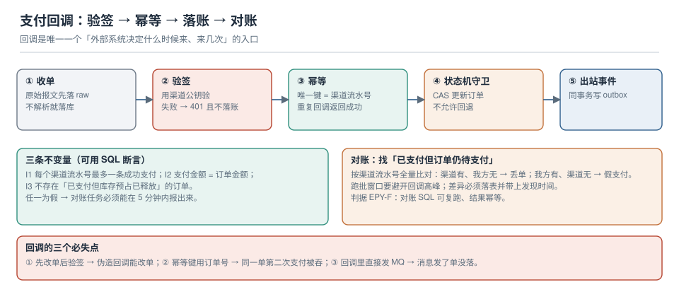

# 第 2 周第 3 步 · 支付回调：验签、幂等与对账（EPY-A~EPY-H）

本页判据族 `EPY-A` ~ `EPY-H`，共 8 条。

第 2 周前两步解决了「下单」和「事件怎么出去」。这一步处理整个系统里**唯一一个「外部系统决定什么时候来、来几次、内容长什么样」的入口**：支付渠道的回调。

它和前面的链路有一个本质区别：下单链路的触发方是自己，可以控制速率、可以重试；回调的触发方是别人，它会重发、会乱序、会在你发布的时候来、也会被伪造。所以这一步的验收标准不是"回调能成功处理"，而是**"在回调重复、乱序、伪造、丢失四种情况下，账都对得上"**。

::: tip 一句话理解
回调处理只有一条铁律：**先验签，再幂等，最后才改状态**。顺序反了，任何一条都能单独造成资损——先改状态再验签等于给伪造回调开后门；没有幂等键等于渠道重发一次就多一笔账。
:::



## 一、当日做了什么

1. 定下回调入口的**五步顺序**（收单落 raw → 验签 → 幂等 → 状态机守卫 → outbox），并说明每一步失败时的可见结果；
2. 给出 `payment_callback_log` 的完整 DDL，**唯一键是「渠道 + 渠道流水号 + 回调类型」**，不是订单号；
3. 把订单状态推进写成 **CAS**（`WHERE status = 'PENDING_PAYMENT' AND version = :v`），不用「先查后改」；
4. 写出**三条可用 SQL 断言**的不变量（I1/I2/I3），并把它们做成对账任务的输入；
5. 给出一条**对账 SQL**：以渠道流水为准找出「已支付但订单仍 `PENDING_PAYMENT`」的单；
6. 给出**五条可执行验收**：伪造签名、重复回调、乱序回调、金额不符、渠道流水缺失。

## 二、五步顺序与「失败时看见什么」

| # | 步骤 | 做什么 | 失败时的外部表现 | 内部留痕 |
| --- | --- | --- | --- | --- |
| 1 | 收单落 raw | 原始报文**先落库**（不解析、不校验） | 200（收到即应答，避免渠道重发） | `payment_callback_log.raw_body` |
| 2 | 验签 | 用渠道公钥验 `sign` | **401**，且**不落账** | `verify_result=FAIL` + 原因 |
| 3 | 幂等 | `INSERT … ON CONFLICT DO NOTHING`，影响 0 行 = 重复 | 200（重复也要回成功，否则渠道一直重试） | 重复次数 +1 |
| 4 | 状态机守卫 | CAS 更新订单（状态 + 版本都进 `WHERE`） | 200（乱序/已终态都不该报错） | `from_status → to_status` |
| 5 | 出站事件 | 同事务写 `outbox`（`PaymentSucceeded`） | — | `outbox` 一行 |

::: danger 顺序错了会怎样（每一种都单独造成过资损）
1. **先改状态后验签**：伪造一个回调就能把订单改成已支付。验签必须发生在任何写业务表之前。
2. **用订单号做幂等键**：同一订单第二次支付（换渠道/换卡重试）会被当成重复回调吞掉，钱收了、单没变。
3. **重复回调返回 500**：渠道认为你没收到，会一直重试，直到把重试次数耗尽并转入人工——本来一次就完事的事，变成一张工单。
4. **回调里直接发 Kafka**：消息发出去了、事务回滚了，下游收到一条"支付成功"，而订单表里没有这次支付。
:::

## 三、回调日志表：唯一键决定一切

```sql
CREATE TABLE payment_callback_log (
  id              bigserial PRIMARY KEY,
  channel         text        NOT NULL,              -- alipay / wechat / stripe
  channel_txn_no  text        NOT NULL,              -- 渠道流水号（不是订单号）
  callback_type   text        NOT NULL,              -- pay / refund / close
  raw_body        text        NOT NULL,              -- 原始报文，排障用
  sign            text        NOT NULL,
  verify_result   text        NOT NULL DEFAULT 'PENDING',  -- PENDING/PASS/FAIL
  verify_reason   text,
  amount_cents    bigint,                            -- 验签通过后才可信
  order_id        bigint,
  seq_no          bigint,                            -- 渠道侧序号，用于识别乱序
  received_at     timestamptz NOT NULL DEFAULT now(),
  processed_at    timestamptz,
  CONSTRAINT uq_callback UNIQUE (channel, channel_txn_no, callback_type)
);

CREATE INDEX idx_callback_order   ON payment_callback_log (order_id);
CREATE INDEX idx_callback_pending ON payment_callback_log (received_at)
  WHERE processed_at IS NULL;
```

三个设计决定及其理由：

| 决定 | 理由 | 换掉的写法会怎样 |
| --- | --- | --- |
| 唯一键含 `channel_txn_no` | 渠道流水号才是"这笔钱"的唯一标识 | 用 `order_id`：二次支付被吞 |
| 唯一键含 `callback_type` | 同一笔支付的 `pay` 与 `refund` 是两条合法记录 | 不含：退款回调被当重复 |
| `raw_body` 在第一步就落 | 验签失败时也能复盘"他到底发了什么" | 验签后才存：伪造攻击无从分析 |

::: warning `raw_body` 是排查的唯一证据
验签失败的回调，90% 不是攻击而是「签名域拼接错了」（比如把 `&` 转义了、把空字段丢了）。没有原始报文，你只能看到"验签失败"，看不到"他签的是哪段字符串"。
:::

## 四、状态机守卫：CAS，不是「先查后改」

```sql
-- 正确：状态与版本都进 WHERE；影响 0 行说明状态已经变了（被别的回调推进过）
UPDATE orders
   SET status = 'PAID',
       paid_at = now(),
       version = version + 1
 WHERE id = :order_id
   AND status = 'PENDING_PAYMENT'
   AND version = :expected_version;
-- 影响 1 行 → 继续写 outbox；影响 0 行 → 读当前状态，按「幂等成功」返回
```

为什么不用 `SELECT status` 再 `UPDATE`：两个回调同时到达（渠道重试 + 用户刷新页面触发的补单查询）时，`check-then-act` 会让**两个请求都成功**——第 181 天的实测里，这种写法 1000 次并发双成功 1000 次，终态被覆盖；CAS 是 0/1000。

三条与订单上下文共享的不变量（来自[第 1 周第 1 步的不变量清单](../Requirements/index.md)），这一步要保证它们仍然成立：

| 不变量 | 断言 SQL | 违反时说明 |
| --- | --- | --- |
| I1 每单最多一条成功支付 | `select order_id, count(*) from payments where status='SUCCESS' group by 1 having count(*)>1` | 幂等键用错了 |
| I2 支付金额 = 订单金额 | `select p.id from payments p join orders o on o.id=p.order_id where p.amount_cents <> o.total_cents` | 验签后没校验金额 |
| I3 无「已支付但预占已释放」 | `select o.id from orders o join stock_reservation r on r.order_id=o.id where o.status='PAID' and r.status='RELEASED'` | 回调把库存释放了（跨上下文越界） |

## 五、对账：以渠道为准，找我方的「漏」

对账分两个方向，优先级完全不同：

| 方向 | 含义 | 危害 | 处置 |
| --- | --- | --- | --- |
| **渠道有、我方无**（漏单） | 用户付了钱，订单还是 `PENDING_PAYMENT` | **资损 + 客诉**，最高优先级 | 主动补单（走同一条回调链路，不手工改库） |
| **我方有、渠道无**（假支付） | 订单已 `PAID`，渠道查不到这笔 | 财务对不上账 | 冻结订单 + 人工核查，禁止自动回退 |

```sql
-- 漏单：已支付但订单仍待支付（按天跑，结果落 reconciliation_diff 表）
select c.channel, c.channel_txn_no, c.order_id, c.amount_cents, c.received_at
  from payment_callback_log c
  join orders o on o.id = c.order_id
 where c.verify_result = 'PASS'
   and c.callback_type = 'pay'
   and c.processed_at is null
   and o.status = 'PENDING_PAYMENT'
   and c.received_at < now() - interval '2 minutes'   -- 留出正常处理的窗口
 order by c.received_at;

-- 假支付：订单已支付但没有任何一条通过验签的回调
select o.id, o.paid_at
  from orders o
 where o.status = 'PAID'
   and not exists (
     select 1 from payment_callback_log c
      where c.order_id = o.id and c.verify_result = 'PASS' and c.callback_type = 'pay');
```

`2 minutes` 这个窗口不是拍出来的：**回调正常处理是毫秒级**，留 2 分钟是为了避开「正在处理中」的假阳性。窗口太短会把正常单报成漏单，太长则漏单发现得晚。判据是「跑批结果里假阳性为 0」，一旦有假阳性，人就会开始忽略这张表。

## 六、五条可执行验收

| # | 场景 | 怎么做 | 期望 |
| --- | --- | --- | --- |
| 1 | **伪造签名** | 改 `raw_body` 里一个金额字符，签名不变 | `401`，`payment_callback_log.verify_result='FAIL'`，`orders` 无变化 |
| 2 | **重复回调** | 同一报文连发 5 次 | 5 次都返回 200；`payments` 只有 1 行；`callback_log` 1 行，重复计数 +4 |
| 3 | **乱序回调** | 先发 `refund` 再发 `pay` | `refund` 记录入库但 `processed_at` 为 `null`（等 `pay`）；`pay` 到达后两者都处理完，终态正确 |
| 4 | **金额不符** | 签名正确但 `amount_cents` 比订单少 1 分 | 拒绝并告警；`orders` 不变；差异进对账表 |
| 5 | **漏单补偿** | 手工把某单的 `processed_at` 置空、状态回 `PENDING_PAYMENT`，再跑对账 | 对账 SQL 能查出这一行（证明它能发现真问题） |

第 3 条是这一步最容易做错的地方：**乱序不是"错误"，是正常现象**。渠道的 `pay` 和 `refund` 可能因为网络原因倒序到达，正确做法是**按渠道流水号 + `seq_no` 排序后按序应用**，而不是"后来的覆盖前面的"。

::: danger 三个必失点
1. **回调用 GET 处理**：渠道重试时可能带不同参数，`GET` 会被缓存/被日志记全量（含签名）。只用 `POST`。
2. **验签通过就信任金额**：签名只证明"这个报文是渠道发的"，不证明"金额等于订单金额"——必须再比一次 `orders.total_cents`。
3. **对账任务自动改单**：对账应该只产出"差异表"和"补偿请求"，补偿也要走同一条回调链路。直接 `UPDATE orders SET status='PAID'` 会绕过 outbox，下游永远收不到事件。
:::

## 七、验证方式（本机可复跑的部分）

```shell
# ① 起依赖
docker compose -f deploy/compose.yaml up -d postgres kafka

# ② 迁移（Flyway 到 V7，本步新增两张表）
docker exec eoh-app ./mvnw -q flyway:migrate
docker exec eoh-postgres psql -U postgres -d eoh -c "\d payment_callback_log"

# ③ 伪造签名：应 401 且不留账
curl -s -o /dev/null -w "%{http_code}\n" -X POST http://localhost:8080/api/payments/callback \
  -H "Content-Type: application/json" \
  -d '{"channel":"mock","channel_txn_no":"T-1","callback_type":"pay","amount_cents":9999,"sign":"bad"}'
# 期望：401
docker exec eoh-postgres psql -U postgres -d eoh -c \
  "select verify_result, count(*) from payment_callback_log group by 1;"
# 期望：FAIL | 1

# ④ 重复回调：同一报文 5 次，payments 应只有 1 行
for i in $(seq 1 5); do
  curl -s -o /dev/null -X POST http://localhost:8080/api/payments/callback \
    -H "Content-Type: application/json" --data @scripts/fixtures/pay-ok.json
done
docker exec eoh-postgres psql -U postgres -d eoh -c \
  "select count(*) from payments where status='SUCCESS';"
# 期望：1

# ⑤ 对账 SQL 能查出人为制造的漏单
docker exec eoh-postgres psql -U postgres -d eoh -c \
  "update payment_callback_log set processed_at=null where order_id=1001; update orders set status='PENDING_PAYMENT' where id=1001;"
docker exec eoh-postgres psql -U postgres -d eoh -f sql/reconcile_missing.sql
# 期望：列出 order_id=1001
```

::: warning 有两条本机跑不了
`scripts/fixtures/pay-ok.json` 需要**真实的渠道签名**（用 mock 渠道的测试私钥签），本仓不提供私钥，只给出签名字段的拼接顺序：`channel|txn_no|type|amount_cents|timestamp`。第 3 条乱序验收需要构造两条不同 `seq_no` 的报文，同样依赖签名能力。

这两条按「**能验证的写实测、不能验证的写明前置条件**」处理：页面给出执行命令与期望值，签名由读者用 mock 渠道的密钥生成——**不把"应该会通过"写成"实测通过"**。
:::

## 八、本页判据

| 编号 | 判据 | 看什么现象 | 不满足时改哪里 |
| --- | --- | --- | --- |
| `EPY-A` | 先落 raw、后验签 | `verify_result` 为 `FAIL` 的记录里 `raw_body` 非空 | 把落库提到验签之前 |
| `EPY-B` | 唯一键是 `(channel, channel_txn_no, callback_type)` | `\d payment_callback_log` 可见 `uq_callback` | 改唯一键；不要用 `order_id` |
| `EPY-C` | 状态推进用 CAS（状态 + 版本进 `WHERE`） | 更新语句带 `and version = :expected` | 改写；禁止先查后改 |
| `EPY-D` | 重复回调返回 200 且不改变账 | 连发 5 次后 `payments` 仍 1 行 | 幂等键或响应码错了 |
| `EPY-E` | 验签后再校验金额 | 有 `amount_cents <> total_cents` 的拒绝分支 | 补校验 |
| `EPY-F` | 对账 SQL 双向且可复跑 | 漏单 / 假支付两条查询都存在 | 补另一方向 |
| `EPY-G` | 乱序按 `seq_no` 应用 | `refund` 早到时不覆盖 `pay` 的终态 | 加序号判定 |
| `EPY-H` | 补偿走同一条回调链路 | 补偿会产生 `callback_log` 与 `outbox` | 禁止直接 UPDATE 订单 |

## 九、下一步

第 2 周第 4 步做**库存预占的释放与超时回滚**：

- 订单超时未支付要把 `stock_reservation` 从 `HELD` 改成 `RELEASED`，这一步必须**先发事件再改状态**，还是反过来？——这是本周期要回答的第一个问题（答案与 outbox 的顺序约束同构）；
- 定时任务扫超时单时，要处理「同时被支付回调推进」的竞态（又是 CAS，但这次是跨上下文的双向竞争）；
- 需要一条**容量验收**：1 万笔超时单同时释放，`stock` 表的行锁会不会互相等待（`ORDER BY id` 排序释放可以显著降低死锁率）。

判据前缀建议 `EPR`（预占释放），与今天的 `EPY` 分开。

## 参考资料

- 本仓库项目：[EventOrderHub 项目总览](../index.md)、[第 1 周第 1 步·需求与订单状态机](../Requirements/index.md)、[第 2 周第 2 步·下单链路与 outbox](../OrderFlow/index.md)
- 本仓库专题：[幂等与状态机工程](../../../../docs/Backend/IdempotencyStateMachine/index.md)、[事件溯源与 CQRS](../../../../docs/Backend/EventSourcing/index.md)、[消息队列](../../../../docs/Backend/MessageQueue/index.md)
- PostgreSQL 18 Documentation：*INSERT … ON CONFLICT*、*Partial Indexes*、*Transaction Isolation*
- 支付宝开放平台：*异步通知*（验签、重试策略、`notify_id` 幂等）；微信支付：*支付结果通知*（`transaction_id` 唯一性）
