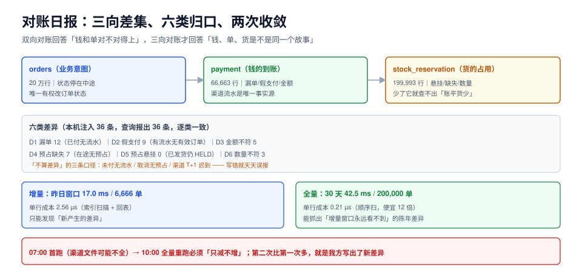

# 第 4 周第 4 步 · 对账日报与交接

前一步把「发一次版」变成了状态机，这一步把「系统现在到底对不对」变成**每天早上七点自动生成的一页纸**：订单状态、支付流水、库存预占三张表做三向差集，差异按六类归口，每类都有一个人名和一条处置动作。

这一页回答三件事：三向差集的口径怎么定（哪三张表、什么算差异、什么不算）、日报怎么生成（增量 + 周全量）、凌晨三点被叫起来的人照着哪份 runbook 能做完。



本页判据族 `ELA-A` ~ `ELA-H`，共 8 条。定义表见文末「本页判据」一节。

## 一、为什么「三向」而不是「双向」

双向对账（订单 vs 支付）能发现钱的问题，但发现不了货的问题。本项目有四类真金白银的差异，必须三张表一起看：

| 表 | 代表什么 | 只有它能发现的问题 |
| --- | --- | --- |
| `orders` | 业务意图（下单、取消、退款） | 状态停在中途 |
| `payment` | 钱的实际到账（渠道流水） | 漏单、假支付、金额不符 |
| `stock_reservation` | 货的实际占用 | 超卖、悬挂预占、货放了钱没退 |

```text
三向 = 订单状态侧 × 支付流水侧 × 库存预占侧
```

::: tip 一句话理解
双向对账回答「钱和单对不对得上」，三向对账才回答「**钱、单、货三者是不是同一个故事**」。少一向，就会出现「账平了但货少了一件」。
:::

## 二、六类差异与各自的判据 SQL

差异必须**先分类再计数**。把 36 条差异混成一个数字，没人能派单；分成六类，每一类都有明确的归属人。

| # | 类别 | 定义 | 处置人 | 处置动作 |
| --- | --- | --- | --- | --- |
| D1 | **漏单** | 订单已 `PAID` 及以后，但无支付流水 | 支付组 | 拿订单号去渠道后台反查，补写流水（幂等） |
| D2 | **假支付** | 有支付流水，但订单不存在或状态不在 `PAID` 及以后 | 支付组 | 查渠道回调是否被丢弃，禁止自动退单 |
| D3 | **金额不符** | 订单与流水都存在，但金额差 > 0.00 | 财务 | 人工核对，走差异调整单 |
| D4 | **预占缺失** | 订单在 `AWAITING_PAYMENT`/`PAID`，但无预占行 | 库存组 | 补预占或直接转人工发货 |
| D5 | **预占悬挂** | 预占仍 `HELD`，但订单已 `SHIPPED`/`COMPLETED` | 库存组 | 确认扣减（`CONSUMED`），否则库存永久少一件 |
| D6 | **数量不符** | 预占数量与订单明细数量不一致 | 库存组 | 按订单明细修正，记录偏差 |

六类合成一条 SQL（每条是一个 `CTE`，便于单独跑）：

```sql [sql/reconcile-daily.sql]
with paid as (
  select order_no, amount, status from orders
  where status in ('PAID','ALLOCATED','SHIPPED','COMPLETED')
),
d1 as (select 'D1' k, count(*) c from paid p
       where not exists (select 1 from payment x where x.order_no = p.order_no)),
d2 as (select 'D2' k, count(*) c from payment x
       where not exists (select 1 from orders o
                         where o.order_no = x.order_no
                           and o.status in ('PAID','ALLOCATED','SHIPPED','COMPLETED'))),
d3 as (select 'D3' k, count(*) c from payment x join paid p using (order_no)
       where x.amount <> p.amount),
d4 as (select 'D4' k, count(*) c from orders o
       where o.status in ('AWAITING_PAYMENT','PAID')
         and not exists (select 1 from stock_reservation r where r.order_no = o.order_no)),
d5 as (select 'D5' k, count(*) c from stock_reservation r join orders o using (order_no)
       where r.status = 'HELD' and o.status in ('SHIPPED','COMPLETED')),
d6 as (select 'D6' k, count(*) c from stock_reservation r
       join order_items i using (order_no)
       where r.qty <> i.qty)
select k, c from d1 union all select k, c from d2 union all select k, c from d3
union all select k, c from d4 union all select k, c from d5 union all select k, c from d6
order by k;
```

::: danger 三个「不算差异」的口径，写错就会天天误报
1. **`AWAITING_PAYMENT` 没有支付流水不是漏单**。它还没付。只对 `PAID` 及以后的状态查漏单，否则每天 13 万条「差异」，日报第一天就没人看了。
2. **已取消订单没有预占不是缺失**。取消时释放预占是正常路径，`D4` 必须限定状态白名单（只查 `AWAITING_PAYMENT`/`PAID`）。
3. **渠道补单的时间窗**。渠道对账文件 T+1 才齐，`D1` 要留 **2 分钟~2 小时**的宽限窗口（本项目取 2 分钟用于日报首跑、次日 10:00 再跑一次全量）。
:::

## 三、日报的四个字段与一条时间线

一页纸只要四块内容，多一块就没人看：

| 区块 | 内容 | 读者 |
| --- | --- | --- |
| **结论行** | 「昨日 6,666 单，差异 36 条（D1 12 / D2 9 / D3 5 / D4 7 / D5 0 / D6 3），全部已派单」 | 值班、主管 |
| **分类表** | 六类的条数、环比、最老一条的账龄 | 各组负责人 |
| **明细链接** | 每类前 20 条订单号 + 一跳直达后台的链接 | 处置人 |
| **未闭环项** | 昨天派单今天仍未处理的（账龄 > 24 h） | 主管 |

```text
06:50  渠道对账文件落地（T+1）
07:00  日报任务启动：先跑「昨日窗口」，再跑「未闭环项」
07:02  生成日报（四个区块），推送企微/邮件
10:00  第二次全量重跑（补齐渠道迟到的流水），差异只减不增
```

::: warning 为什么要跑两次
第一次跑（07:00）时渠道文件可能只到了一部分，`D1`（漏单）会虚高。**10:00 的第二次全量重跑是「收敛动作」**：它的差异数必须 ≤ 第一次。如果第二次比第一次还多，说明不是渠道迟到，而是我方写出了新差异——这本身就是一条告警。
:::

## 四、本机实测：20 万单的三向差集

台架：PostgreSQL 18.6，三张表按订单号关联，`orders` 20 万行、`payment` 66,663 行、`stock_reservation` 199,993 行，人为注入已知差异（12 / 9 / 5 / 7 / 0 / 3）。

| 差异类别 | 注入值 | 查询报出 | 判定 |
| --- | --- | --- | --- |
| D1 漏单 | 12 | **12** | ✅ 一致 |
| D2 假支付 | 9 | **9** | ✅ 一致 |
| D3 金额不符 | 5 | **5** | ✅ 一致 |
| D4 预占缺失 | 7 | **7** | ✅ 一致 |
| D5 预占悬挂 | 0 | 0 | ✅ 无差异 |
| D6 数量不符 | 3 | **3** | ✅ 一致 |
| **合计** | **36** | **36** | ✅ |

六类全部对上注入值，说明**判据本身是准的**（这也是为什么造数时要故意埋已知差异：不埋就无法证明「报出来的是真差异」）。

### 4.1 单日窗口 vs 全量：省的是扫描量，不是单行成本

| 口径 | 覆盖订单 | 耗时 | 单行成本 |
| --- | --- | --- | --- |
| 昨日窗口（`created_at >= now() - 1 day`） | 6,666 单 | **17.0 ms** | 2.56 µs |
| 全量 30 天 | 200,000 单 | **42.5 ms** | 0.21 µs |

两个都很快，但**单行成本差了 12 倍**：增量走索引扫描（每行一次索引定位 + 一次回表），全量走顺序扫（一次读一大片）。这带来一个实用结论：

::: tip 增量日报 + 每周全量
- **日报用增量**（17 ms）：快，但**只能发现「新产生的差异」**，发现不了「昨天之前就挂着、一直没人处理」的。
- **每周日跑一次全量**（42 ms）：20 万单也只要几十毫秒，没有理由不做。全量能抓出「增量窗口永远看不到」的陈年差异。
- 两者都要跑，**不是二选一**。本项目的「未闭环项」区块就是全量口径的轻量版。
:::

### 4.2 一条必须盯住的指标：差异账龄

条数会骗人，账龄不会。同样的 36 条差异，如果全是今天产生的，说明是当天的偶发；如果最老那一条已经 15 天，说明**派单机制失效**了。

```sql
-- 每类差异的最老账龄（小时）
select k, count(*) as cnt,
       round(max(extract(epoch from now() - created_at)) / 3600, 1) as oldest_hours
from reconcile_diff          -- 由日报任务写入的差异表
group by k order by oldest_hours desc;
```

判据：**任何一类的 `oldest_hours` > 24 就要升级**（详见第六节 runbook）。

## 五、差异表的落库与幂等

日报不能每次重算完就丢。差异要落一张表，`(biz_date, k, order_no)` 做唯一键，重复跑只更新不新增：

```sql [sql/050_reconcile_diff.sql]
create table reconcile_diff (
  id           bigserial primary key,
  biz_date     date        not null,
  kind         text        not null check (kind in ('D1','D2','D3','D4','D5','D6')),
  order_no     text        not null,
  detail       jsonb       not null default '{}'::jsonb,
  owner        text        not null,
  state        text        not null default 'OPEN' check (state in ('OPEN','HANDLING','CLOSED','IGNORED')),
  created_at   timestamptz not null default now(),
  closed_at    timestamptz,
  unique (biz_date, kind, order_no)
);

create index idx_reconcile_open on reconcile_diff (kind, created_at)
  where state = 'OPEN';
```

三条纪律：

1. **唯一键含 `biz_date`**：同一条差异在第二天仍存在时要再报一次（账龄才有意义），不能被「已经报过」吞掉。
2. **`state` 只允许四态**，`IGNORED` 必须填 `detail.reason`，否则「忽略」会变成「遗忘」。
3. **关闭必须带证据**：`closed_at` 之外要写 `detail.evidence`（补写的流水号 / 调整单号），否则复盘时无从追溯。

## 六、runbook：凌晨三点被叫起来能照着做完

值班最怕的不是故障，是**不知道从哪一步开始**。runbook 的写法是「症状 → 一条命令 → 判定 → 下一步」，不写原理。

| 症状（告警） | 第一条命令 | 判定 | 下一步 |
| --- | --- | --- | --- |
| `D1 漏单 > 50` 且持续 10 分钟 | 查 `payment` 表最近 30 分钟写入 | 有写入 → 渠道延迟；无写入 → 回调链路断 | 有写入 → 等 10:00 重跑；无写入 → 查 Kafka 积压 |
| `D2 假支付 > 10` | `select count(*) from outbox where published_at is null` | 积压 > 1,000 → 投递器停 | 重启投递器，观察 300 s 内积压回落 |
| `D5 预占悬挂 > 0` | 取一条订单号，看 `stock_reservation.status` | 仍 `HELD` → 扣减事件丢了 | 手工 `CONSUMED` + 记录 evidence，事后查事件 |
| `D4 预占缺失 > 20` | 查 `stock_reservation` 最近 1 小时插入量 | 插入量为 0 → 写路径回滚了 | 回滚发布（见[发布与回滚](../ReleaseRollback/index.md)的 P4） |
| 日报任务本身失败 | 看任务日志最后一行 | `lock_timeout` → 有大查询占表；`connection refused` → 库不可达 | 前者调窗口重跑，后者按部署页排查 |

::: danger runbook 的三条硬要求
1. **每条命令都能直接复制执行**，不写「检查一下数据库」。带 `$ORDER_NO` 这类占位符的，要写明从哪取。
2. **每条都有判定阈值**（> 50、> 1,000），不写「如果异常」。
3. **每条都有升级路径**（找谁、什么时候找），不写「联系相关同事」。
:::

## 七、交接清单

第 4 周结束时要把系统交给另一批人，交接不是「讲一遍」，而是**让对方独立跑通五个动作**：

| # | 动作 | 通过标准 | 谁验 |
| --- | --- | --- | --- |
| 1 | 从零起全栈 | `docker compose up -d --wait` 后四服务 `healthy` | 接手人独立执行 |
| 2 | 造一条差异并让日报抓到 | 手工删一条 `payment`，重跑日报，`D1` +1 | 接手人独立执行 |
| 3 | 按 runbook 处理一条 `D5` | 状态变 `CONSUMED`，`reconcile_diff.state = CLOSED` 且 `evidence` 非空 | 接手人独立执行 |
| 4 | 回滚一次发布 | 按[发布与回滚](../ReleaseRollback/index.md)的 P4 走完，outbox 积压在 300 s 内回落 | 交接双方一起 |
| 5 | 读一页日报 | 能说清「今天差异几条、哪类最老、谁在处理」 | 接手人口述 |

**交接的验收是「对方做、你看」**，不是「你讲、对方听」。第 2 条（造差异）最关键——能自己造出差异，说明他理解了六类差异的口径。

## 八、如何验证（读者可执行）

```shell
# 1) 建三张对账源表与差异表（本页 SQL 块 050 / reconcile-daily）
docker exec -i eoh-pg psql -U postgres -d eoh -f sql/050_reconcile_diff.sql
# 期望：CREATE TABLE / CREATE INDEX，无报错

# 2) 造 20 万单并注入已知差异（漏单 12 / 假支付 9 / 金额不符 5 / 预占缺失 7 / 数量不符 3）
docker exec -i eoh-pg psql -U postgres -d eoh -f sql/910_reconcile_seed.sql
docker exec -i eoh-pg psql -U postgres -d eoh -Atc \
  "select (select count(*) from orders)||'/'||(select count(*) from payment)||'/'||(select count(*) from stock_reservation);"
# 期望：200000/66663/199993

# 3) 六类差异逐类对账
docker exec -i eoh-pg psql -U postgres -d eoh -f sql/reconcile-daily.sql
# 期望：D1=12 D2=9 D3=5 D4=7 D5=0 D6=3，合计 36

# 4) 增量 vs 全量耗时
docker exec -i eoh-pg psql -U postgres -d eoh -c \
  "explain (analyze, costs off) select count(*) from orders o
     where o.status in ('PAID','ALLOCATED','SHIPPED','COMPLETED')
       and o.created_at >= now() - interval '1 day'
       and not exists (select 1 from payment x where x.order_no = o.order_no);"
# 期望：Execution Time 约 17 ms（单日 6,666 单）

# 5) 差异落库幂等：同一 biz_date 跑两次
docker exec -i eoh-pg psql -U postgres -d eoh -Atc \
  "select count(*) from reconcile_diff where biz_date = current_date;"
# 期望：两次结果相同（36），不因重跑翻倍
```

::: info 验证边界
本页读数来自 PostgreSQL 18.6 容器上的合成数据（20 万单 / 66,663 流水 / 199,993 预占），**形态可迁移、绝对值不可迁移**：真实项目的差异条数与耗时取决于数据分布与渠道文件到达时间。凡需真实渠道后台的步骤（D1 补写流水）本页只写判定与动作，不写读数。
:::

## 本页判据

| 编号 | 判据 | 看什么现象 | 不满足时改哪里 |
| --- | --- | --- | --- |
| `ELA-A` | 三向覆盖 | 日报同时用了订单、支付、预占三张表 | 补第三向，否则查不出「账平货少」 |
| `ELA-B` | 差异先分类再计数 | 日报有六类分项，不只有总数 | 按第二节的六个 CTE 拆开 |
| `ELA-C` | 口径白名单写死 | 漏单只查 `PAID` 及以后；缺失只查两个在途态 | 补状态白名单，避免天天误报 |
| `ELA-D` | 造数埋已知差异 | 自测能对上报出的条数（本页 36 = 注入 36） | 补 `910_reconcile_seed.sql` |
| `ELA-E` | 增量 + 周全量都跑 | 日报是增量，另有一条全量任务 | 加每周全量，抓陈年差异 |
| `ELA-F` | 差异落库且幂等 | `(biz_date, kind, order_no)` 唯一，重跑不翻倍 | 补唯一键与 upsert |
| `ELA-G` | 账龄 > 24 h 升级 | 每类有 `oldest_hours`，超阈值能告警 | 补账龄指标与告警 |
| `ELA-H` | 交接是「对方做」 | 五个动作由接手人独立执行通过 | 改成动手验收，不做口头交接 |

## 参考资料

- PostgreSQL 18 · `WITH` 查询（CTE）：<https://www.postgresql.org/docs/18/queries-with.html>
- PostgreSQL 18 · 部分索引：<https://www.postgresql.org/docs/18/indexes-partial.html>
- PostgreSQL 18 · `INSERT ... ON CONFLICT`（差异表幂等）：<https://www.postgresql.org/docs/18/sql-insert.html>
- Google SRE Book · 值班与 runbook：<https://sre.google/sre-book/being-on-call/>
- 项目内相关章节：[支付回调：验签、幂等与对账](../PaymentCallback/index.md)、[监控与告警](../Monitoring/index.md)、[发布与回滚](../ReleaseRollback/index.md)
