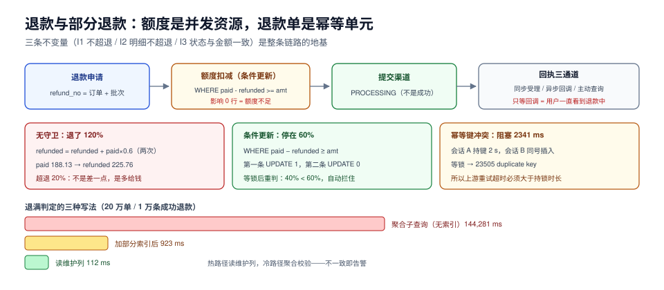

# 第 4 周补充 · 退款与部分退款：钱退回去，账还要对得上（ERC-A~ERC-H）

本页判据族 `ERC-A` ~ `ERC-H`，共 8 条。

> 编号说明：`ERC` 在第 200 天的总览里已预留为「补偿与对账」，本页按预留前缀落地。退款是周期 7 里**唯一会让已完成的订单反向流动**的动作，也是三项遗留缺口里风险最高的一项。

前 19 章把「钱收进来、货发出去」走完了，但交易系统还有一半：**钱要能退回去，而且退回去之后账还要平**。退款看起来只是「反向一笔」，实际有三处会出事：退多了（超退）、退重了（重复退款）、退完账不平（订单状态与金额不一致）。

::: tip 一句话理解
退款不是「把订单改成已退款」，而是**在「已付金额」这个额度上做受控的扣减**。额度是并发资源，扣减必须带条件；退款单是幂等单元，重试必须撞同一个键。
:::



## 一、当日做了什么

1. 定死四张表：`refund`（退款单）、`refund_item`（按明细退）、`refund_callback`（渠道回执）、`refund_ledger`（资金流水）；
2. 给退款单定**七态状态机**，并写清「哪些状态可以重试、哪些必须人工」；
3. 把「不超退」落成**一条带条件的 UPDATE**（而不是应用层先查后写），并用双会话验证；
4. 幂等键改为「订单号 + 退款批次」，重试撞同一个唯一键；
5. 渠道回调定**三态 + 主动查询兜底**（不能只等回调）；
6. 定**部分退款后订单状态**的口径：部分退款不回退订单状态，只有退满才 `REFUNDED`；
7. 库存回补加**条件更新**，并区分可售与残次；
8. 用 20 万单实测三种「退满判定」写法的成本差。

## 二、四张表

```sql [sql/060_refund.sql]
CREATE TABLE refund (
  id             bigserial PRIMARY KEY,
  refund_no      text        NOT NULL UNIQUE,          -- 幂等键：SO{order}-R{batch}
  order_no       text        NOT NULL,
  amount         numeric(12,2) NOT NULL CHECK (amount > 0),
  reason         text        NOT NULL,                 -- 用户取消/少件/质量问题/拒收
  status         text        NOT NULL DEFAULT 'CREATED'
                 CHECK (status IN ('CREATED','PROCESSING','SUCCESS','FAILED','CANCELED','MANUAL')),
  channel        text        NOT NULL,                 -- alipay / wechat / balance
  channel_refund_id text,                              -- 渠道侧单号，成功后回填
  version        int         NOT NULL DEFAULT 0,
  created_at     timestamptz NOT NULL DEFAULT now(),
  updated_at     timestamptz NOT NULL DEFAULT now()
);

CREATE TABLE refund_item (
  refund_id      bigint NOT NULL REFERENCES refund(id),
  order_item_id  bigint NOT NULL,
  qty            int    NOT NULL CHECK (qty > 0),
  amount         numeric(12,2) NOT NULL CHECK (amount >= 0),
  PRIMARY KEY (refund_id, order_item_id)
);

CREATE TABLE refund_callback (
  channel_refund_id text        NOT NULL,
  event             text        NOT NULL,              -- SUCCESS / FAILED / CLOSED
  amount            numeric(12,2) NOT NULL,
  occurred_at       timestamptz NOT NULL,
  received_at       timestamptz NOT NULL DEFAULT now(),
  PRIMARY KEY (channel_refund_id, event, occurred_at)
);

CREATE TABLE refund_ledger (
  id         bigserial PRIMARY KEY,
  refund_no  text NOT NULL,
  direction  text NOT NULL CHECK (direction IN ('OUT','IN')),  -- 出账/回滚入账
  amount     numeric(12,2) NOT NULL CHECK (amount > 0),
  created_at timestamptz NOT NULL DEFAULT now()
);
```

四个设计决定：

1. **`refund_no` 是业务键，不是自增 ID**。格式 `SO0000123-R2`，其中 `R2` 是「这张订单的第 2 次退款」。重试时它不变，天然幂等。
2. **`refund_item` 用 `(refund_id, order_item_id)` 作主键**，保证一次退款里同一条明细只出现一次；数量校验靠不变量而不是列约束（列约束管不了跨行）。
3. **`refund_callback` 的主键是三元组** `(channel_refund_id, event, occurred_at)`。只用 `channel_refund_id` 去重会把「先失败后成功」的第二次回执吃掉——这是本步最容易写错的一行 DDL。
4. **`refund_ledger` 记资金流水，方向两态**。渠道失败后的资金回滚是 `IN`，不是删掉原来的 `OUT`——账本只能追加。

## 三、七态状态机

```text
CREATED ──提交渠道──▶ PROCESSING ──回执 SUCCESS──▶ SUCCESS
   │                     │  ▲
   │                     │  └──回执 CLOSED（渠道关单）──▶ FAILED
   │                     └──超时 30 min 无回执──▶ 主动查询 ──▶ SUCCESS / FAILED
   └──用户撤回（未提交）──▶ CANCELED

任意态 ──金额或明细对不上──▶ MANUAL（人工，不自动重试）
```

三条纪律：

- **`MANUAL` 是终态，不是中间态**。进了人工就必须有人处理，任何自动任务不得把 `MANUAL` 改回去。
- **`FAILED` 可以重试，但必须用新的 `refund_no`（批次 +1）**。复用旧单号会让渠道侧认为「同一笔」，可能返回上一次的失败结果。
- **`SUCCESS` 之后不允许任何状态迁移**，只允许追加 `refund_ledger`。

## 四、部分退款的三条不变量

部分退款的难点不在「退多少」，而在「三处金额必须同时成立」：

| 编号 | 不变量 | 违反后的现象 |
| --- | --- | --- |
| I1 | `Σ refund.amount(SUCCESS+PROCESSING) ≤ orders.paid_amount` | 超退，资损 |
| I2 | `Σ refund_item.qty ≤ order_item.qty`（按明细） | 同一件商品退两次 |
| I3 | 订单 `REFUNDED` ⟺ `refunded_amount = paid_amount` | 状态与金额不一致，对账天天报差异 |

I1 与 I2 都是**跨行约束**，数据库的 `CHECK` 管不了，只能用「条件更新 + 唯一键 + 巡检 SQL」三件套：

```sql [sql/061_refund_guard.sql]
-- 不超退：把「判断」放进 WHERE，让数据库在行锁内做决定
UPDATE orders
   SET refunded_amount = refunded_amount + :amount,
       status = CASE WHEN refunded_amount + :amount >= paid_amount
                     THEN 'REFUNDED' ELSE status END,
       version = version + 1
 WHERE order_no = :order_no
   AND paid_amount - refunded_amount >= :amount;
-- 影响 0 行 = 额度不足，直接返回业务错误，不要重试
```

## 五、并发：无守卫的增量更新会退到 120%

本机实测（PG 18.6，同一订单两次「各退 60%」）：

```text
=== 无守卫：refunded_amount = refunded_amount + paid_amount * 0.6（执行两次）===
 paid_amount | refunded_amount |  pct
-------------+-----------------+-------
      188.13 |          225.76 | 120.0

=== 有守卫：... WHERE paid_amount - refunded_amount >= paid_amount * 0.6 ===
 paid_amount | refunded_amount |  pct
-------------+-----------------+-------
      696.19 |          417.71 |  60.0
（第二条 UPDATE 影响 0 行）
```

`120.0%` 这个数不是「差一点」，而是**退了比收到的还多 20%**。它的成因很简单：两个请求各自读到「还剩 100%」，各自认为「60% 没问题」，然后都执行了增量更新。

双会话再验一次（两个事务同时提交，一个有 `pg_sleep(1.5)`）：

```text
会话 A：UPDATE 1（拿到行锁，剩余额度 100% → 40%）
会话 B：UPDATE 0（等锁释放后重新判断，40% < 60%，条件不成立）
最终：paid_amount 543.98 / refunded_amount 326.39 / 60.0%
```

**说明**：条件更新在 `READ COMMITTED` 下会「等锁 → 重新读取最新行 → 重新判断条件」，所以第二个事务看到的是已扣减后的余额。这正是它比应用层「先查后写」强的地方——后者在等锁这件事上什么都没做。

::: danger 三个退款相关的必失点
1. **用 `SELECT` 查余额、在应用里算、再 `UPDATE`**。查与写之间没有任何保护，并发下必超退（实测 120%）。正确做法：把条件写进 `WHERE`，用影响行数判断成败。
2. **用自增 ID 或 UUID 作幂等键**。每次重试都生成新键，等于没有幂等。正确做法：`订单号 + 批次`，重试时原样带上。
3. **部分退款后把订单改成 `REFUNDED`**。用户只退了一件，订单却显示「已全额退款」，客服与对账都会疯。正确做法：只有 I3 成立才改状态。
:::

## 六、幂等：重试撞同一个键，而不是「查一下有没有」

幂等有三种实现，成本与正确性差别很大：

| 做法 | 并发下的行为 | 结论 |
| --- | --- | --- |
| 先 `SELECT` 再 `INSERT` | 两个请求都查不到，都插入 | 不可用（除非加锁） |
| `INSERT` 唯一键 | 后者**阻塞**至前者提交，然后报 23505 | 可用，需处理冲突 |
| `INSERT ... ON CONFLICT DO NOTHING` | 后者立即返回 0 行 | 可用，需读回原单 |

实测第二种的代价（会话 A 持键 2 s，会话 B 同时插入同号）：

```text
第二个插入阻塞 2341 ms（含连接建立）
ERROR:  duplicate key value violates unique constraint "refund_refund_no_key"
```

**2341 ms 这个数是设计约束，不是性能问题**：它意味着「同一个退款请求的重试必须能等」，所以上游的重试超时必须大于「对手事务的最长持锁时间」。如果渠道提交事务里还套了 HTTP 调用（常见错误），持锁时间会到秒级，重试就会集体超时。

## 七、渠道回执：三态 + 主动查询

渠道回执有三种到达方式，缺一不可：

1. **同步返回**：提交时拿到 `channel_refund_id` 与「受理成功」，此时状态是 `PROCESSING`，**不是成功**。
2. **异步回调**：`SUCCESS` / `FAILED` / `CLOSED` 三态。重复回调靠唯一键去重，第二次影响 0 行是正常返回。
3. **主动查询**：30 分钟无回调就查一次。**不能只等回调**——渠道侧丢回调是常态，而用户看到「退款中」超过一小时就会来投诉。

```sql [sql/062_refund_scan.sql]
-- 超时未回执的退款单：交给主动查询任务
SELECT refund_no, channel_refund_id, amount
FROM refund
WHERE status = 'PROCESSING'
  AND updated_at < now() - interval '30 minute'
ORDER BY updated_at
LIMIT 200;
```

## 八、库存回补：只回补「确定回到仓」的部分

退款不等于退货。三者的关系必须先定死：

| 场景 | 钱 | 货 | 库存回补 |
| --- | --- | --- | --- |
| 未发货取消 | 全退 | 未出库 | 立即回补预占 |
| 已发货拒收 | 全退 | 回仓后质检 | 质检通过才回补，残次进 `damaged` |
| 部分退款（少件） | 按件退 | 货已收 | 不回补（货在用户手里） |
| 质量问题退货 | 全退 | 回仓 | 可售回补，残次不回补 |

回补同样要条件更新，否则并发下 `reserved` 会变成负数：

```sql [sql/063_stock_back.sql]
UPDATE stock
   SET reserved = reserved - :qty,
       available = available + :qty
 WHERE sku = :sku AND reserved >= :qty;
-- 影响 0 行 = 没有可回补的预占（可能已被别的流程回补），记日志不报错
```

实测连续四次「回补 30」：

```text
UPDATE 1
UPDATE 1
UPDATE 1
UPDATE 0
 sku   | reserved | available
-------+----------+-----------
 SKU-1 |       10 |       990
```

预占 100，回补 3 次到 10，第 4 次影响 0 行——**没有变成负数**。如果没有 `reserved >= :qty` 这个条件，第 4 次会把 `reserved` 写成 -20，而 `available` 变成 1020，凭空多出 20 件库存。

## 九、退满判定：三种写法的成本差 1,290 倍

「这张订单退满了吗」有三种写法，实测成本（20 万订单、1 万条成功退款）：

```text
聚合子查询（refund 无索引）  ：144,281 ms
聚合子查询（建部分索引后）    ：    923 ms
维护列 orders.refunded_amount ：    112 ms
```

三个数各有用途：

1. **144 s** 说明「缺索引的聚合子查询」在生产上等于不可用——它会拖垮整个对账任务。
2. **923 ms** 是建了 `refund(order_no) WHERE status='SUCCESS'` 部分索引之后的成本，可接受但不宜高频跑。
3. **112 ms** 是读维护列的成本，适合放进「每次退款后立即判定」的热路径。

结论：**热路径读维护列，冷路径（对账）用聚合校验维护列**。两者互为对照——如果维护列与聚合结果不一致，说明有一条退款路径漏了更新，这正是对账日报要抓的 D1 类差异。

## 十、如何验证

```shell
# 1) 超退巡检：应返回 0
docker exec -i eoh-pg psql -U postgres -d eoh -Atc \
"select count(*) from orders o
   join (select order_no, sum(amount) s from refund where status in ('SUCCESS','PROCESSING') group by 1) r
     on r.order_no = o.order_no
  where r.s > o.paid_amount;"
# 期望：0

# 2) 状态与金额一致（I3）：退满但状态没改，或没退满却改了，都应返回 0
docker exec -i eoh-pg psql -U postgres -d eoh -Atc \
"select count(*) from orders
  where (status = 'REFUNDED') <> (refunded_amount >= paid_amount);"
# 期望：0

# 3) 明细不超退（I2）：应返回 0
docker exec -i eoh-pg psql -U postgres -d eoh -Atc \
"select count(*) from (
   select ri.order_item_id, sum(ri.qty) q
   from refund_item ri join refund r on r.id = ri.refund_id
   where r.status in ('SUCCESS','PROCESSING')
   group by 1) t
 join order_item oi on oi.id = t.order_item_id
 where t.q > oi.qty;"
# 期望：0

# 4) 幂等：同一 refund_no 提交两次，退款单只有一行、额度只扣一次
curl -s -X POST localhost:8080/api/refund -d '{"order_no":"SO0000123","batch":2,"amount":59.90,"reason":"少件"}'
curl -s -X POST localhost:8080/api/refund -d '{"order_no":"SO0000123","batch":2,"amount":59.90,"reason":"少件"}'
docker exec -i eoh-pg psql -U postgres -d eoh -Atc \
"select count(*), sum(amount) from refund where refund_no = 'SO0000123-R2';"
# 期望：1 | 59.90

# 5) 条件更新在并发下只有一次成功（两个会话各退 60%）
#    期望：一个 UPDATE 1、一个 UPDATE 0，最终 refunded_amount / paid_amount = 60.0%
```

## 十一、下一步（第 203 天）

三项遗留缺口还剩两项，下一轮取**「outbox 死信重投」**（判据族 `EDL`）：死信的产生条件、重投的退避曲线、重投上限与人工接管、以及「重投会不会破坏顺序」这个必须先回答的问题。退款侧留一条待办：**渠道对账单（T+1）与 `refund` 表的自动核对**——它属于第 199 天那套对账日报的第六类差异，等 `EDL` 落地后一起接进日报。

## 本页判据

| 编号 | 判据 | 看什么现象 | 不满足时改哪里 |
| --- | --- | --- | --- |
| `ERC-A` | 不超退靠条件更新 | 退款 SQL 的 `WHERE` 里有余额条件 | 禁止「先查后写」，改成条件更新并看影响行数 |
| `ERC-B` | 幂等键是业务键 | `refund_no = 订单号 + 批次`，重试不变 | 换掉 UUID/自增，冲突按业务成功处理 |
| `ERC-C` | 幂等键冲突可等待 | 上游重试超时 > 对手事务最长持锁 | 把 HTTP 调用移出事务，缩短持锁 |
| `ERC-D` | 部分退款不改订单状态 | 只有 I3 成立才置 `REFUNDED` | 修正状态迁移，部分退款保持原状态 |
| `ERC-E` | 明细级不超退 | `Σ qty ≤ order_item.qty` 巡检为 0 | 按明细校验，别只校验总额 |
| `ERC-F` | 回执有主动查询兜底 | 30 分钟无回执进入查询队列 | 加扫描任务，别只依赖回调 |
| `ERC-G` | 库存回补带条件 | `WHERE reserved >= qty`，影响 0 行不报错 | 加条件，防止 `reserved` 变负 |
| `ERC-H` | 退满判定分冷热路径 | 热路径读维护列，冷路径聚合校验 | 两者并存，不一致即告警 |

## 参考资料

- PostgreSQL 文档：`UPDATE ... WHERE` 与 `READ COMMITTED` 下的行锁与重判：<https://www.postgresql.org/docs/18/transaction-iso.html>
- PostgreSQL 文档：`INSERT ... ON CONFLICT` 与唯一约束冲突处理：<https://www.postgresql.org/docs/18/sql-insert.html>
- PostgreSQL 文档：部分索引（`WHERE status='SUCCESS'`）：<https://www.postgresql.org/docs/18/indexes-partial.html>
- 微信支付退款 API（受理与回调的异步语义）：<https://pay.weixin.qq.com/doc/v3/merchant/4012791897>
- 支付宝退款接口（`out_request_no` 作为幂等键）：<https://opendocs.alipay.com/open/02e7gq>
