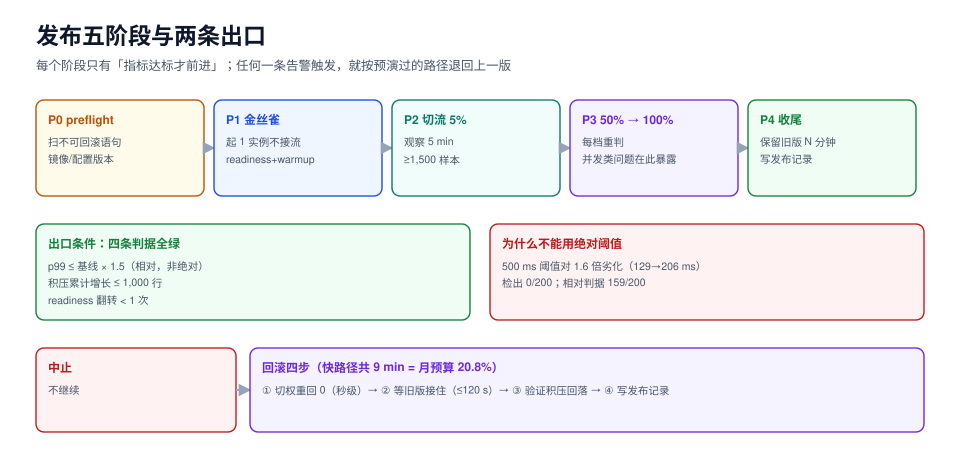

# 第 4 周第 3 步 · 发布与回滚

**一句话定位**：把「发一次版」从人工操作改造成**带出口条件的状态机**——每个阶段只有「指标达标才前进」，任何一条告警触发就按预演过的路径退回上一版，且**退回的时间是可算的**。

前两步解决的是「怎么跑起来」（`EDP`）与「坏了怎么知道」（`EMT`）。这一步解决的是**「知道了之后谁来动手、动完手怎么证明退回去了」**。三者的关系是：自检回答「现在对不对」，监控回答「什么时候开始不对」，发布闸门回答「不对了还在往前走吗」。



本页判据族 `ERB-A` ~ `ERB-H`，共 8 条。定义表见文末「本页判据」一节。

## 一、这一步为什么必须在监控之后

如果先做发布闸门再补监控，闸门只能看「容器活着」这一个信号——而容器活着和订单链路正确之间隔着四个上下文。本项目第 197 天定下的五个指标，正好是这个闸门需要的全部输入：

| 第 197 天的指标 | 在发布闸门里变成 | 判什么 |
| --- | --- | --- |
| 容器健康 | **前置条件**（preflight） | 起不来的版本不进入金丝雀 |
| readiness 翻转次数 | **中止信号** | 抖动说明依赖不稳，不是「偶发」 |
| outbox 积压行数 | **中止信号 + 回滚后验证** | 积压只增不减是「消费侧被新版本改坏」的第一证据 |
| 下单 p99 | **金丝雀主判据** | 用户体验的唯一直接读数 |
| outbox 清空耗时 | **回滚后验证** | 退回去之后必须证明「能追上」 |

**没有这五个数，闸门只能写成「看日志有没有 ERROR」**——那等于没有闸门。

## 二、发布单元与回滚边界

先定清楚「一次发布改了什么」，因为**不是所有东西都能回滚**：

| 变更类型 | 例子 | 可回滚性 | 回滚手段 | 需要的提前量 |
| --- | --- | --- | --- | --- |
| 应用代码 | 修 bug、加日志 | ✅ 完全可回 | 切回上一版镜像 | 镜像必须保留 ≥ 最近 5 个 |
| 配置 | 超时、阈值、开关 | ✅ 可回 | 配置中心回滚 + 重启 | 配置必须有版本号 |
| 数据库（**加法**） | `ADD COLUMN`、新索引、新表 | ✅ 可回（但通常不必回） | 保留列即可，旧代码不读它 | 迁移必须与代码解耦 |
| 数据库（**减法**） | `DROP COLUMN`、改类型、收紧约束 | ❌ **不可回** | 只能向前修复（forward fix） | 必须分两个版本做（expand → contract） |
| 事件契约 | 新增字段、改语义 | ⚠️ 部分可回 | 消费侧兼容旧格式 | 消费者必须先升级 |
| 外部副作用 | 已发出的通知、已扣的库存 | ❌ 不可回 | 补偿事务 | 必须有补偿接口 |

::: danger 发布闸门最容易漏掉的一条
闸门只保护「能回滚的变更」。一旦这次发布里带了 `DROP COLUMN`，**回滚就不再是「切回上一版」**——旧代码会读不到列、直接 500。所以发布脚本的第一件事不是「部署」，而是**扫一遍本次迁移里有没有不可回滚语句**，有就强制走「两阶段发布」（本版只 expand，下一版才 contract）。

判据是机械的：迁移文件里出现 `DROP COLUMN` / `ALTER COLUMN ... TYPE` / `SET NOT NULL`（无 `NOT VALID` 过渡）/ `DROP TABLE`，就标记为 `irreversible`。
:::

## 三、发布状态机

五个阶段，每个阶段有**入口条件**与**出口条件**，不满足就停在原地或退回：

| 阶段 | 做什么 | 入口条件 | 出口条件（达标才前进） | 超时 |
| --- | --- | --- | --- | --- |
| P0 preflight | 扫迁移可回滚性、镜像存在性、配置版本 | 制品已推送 | 无 `irreversible`，或已声明两阶段 | 2 min |
| P1 部署金丝雀 | 起 1 个新版本实例，**不接流** | P0 通过 | readiness 通过 + warmup 完成 | 5 min |
| P2 切流 5% | 按权重切 5% | P1 通过 | 观察窗内四条判据全绿 | 5 min |
| P3 切流 50% → 100% | 逐档放大 | P2 通过 | 每档观察窗全绿 | 各 5 min |
| P4 收尾 | 保留旧版本实例 N 分钟、写发布记录 | P3 通过 | 稳定期无告警 | 30 min |

**每一档都要重新观察，不能「5% 绿了就一次放到 100%」**。原因很简单：金丝雀只能暴露「与流量比例无关的缺陷」（代码 bug、依赖错误），放到 50% 才会暴露「与并发相关的问题」（连接池、锁竞争、缓存击穿）。本项目第 3 周的压测已经证明：并发从 8 到 32 时吞吐只涨 3%，而延迟翻倍——这类问题只有放大流量才看得见。

## 四、把三条告警接成自动中止

第 197 天定了三条告警（p99 超阈、积压只增不减、readiness 抖动）。发布脚本读的是**同一份规则**，不是另写一套：

| 告警 | 原始阈值（`EMT`） | 发布期的中止条件 | 为什么发布期要更严 |
| --- | --- | --- | --- |
| 下单 p99 | 500 ms 持续 5 min | **连续两档观察窗内 p99 > 基线 × 1.5** | 发布期的样本只有几百条，绝对阈值抓不到 1.6 倍劣化（见第五节） |
| outbox 积压 | 差分 > 5/s 持续 5 min | **任一档累计增长 > 1,000 行** | 发布窗只有 5 分钟，等不到「持续 5 分钟」 |
| readiness 翻转 | 翻转 ≥ 2 次/10 min | **翻转 ≥ 1 次即中止** | 新版本不该出现任何翻转；出现就是依赖没就绪 |

```python [release_gate.py]
"""发布闸门：五阶段状态机 + 四条出口判据（示意实现，读者照此落地）。"""
import time


class Abort(Exception):
    pass


class Gate:
    def __init__(self, metrics, baseline_p99_ms, mult=1.5, log=print):
        self.m = metrics                  # 需提供 p99(window_min)/outbox_backlog()/readiness_flips(window_min)
        self.base = baseline_p99_ms
        self.mult = mult                  # 第五节：×1.5 是「检出率 ⇄ 假阳性」的取舍点
        self.log = log
        self.streak = 0                   # 连续失败的观察窗个数
        self.record = []

    # ---------- 一档观察窗的三条判据 ----------
    def check_window(self, stage, minutes=5):
        p99 = self.m.p99(window_min=minutes)
        backlog = self.m.outbox_backlog()
        flips = self.m.readiness_flips(window_min=minutes)
        checks = [
            ("p99", p99, self.base * self.mult, p99 <= self.base * self.mult),
            ("backlog", backlog, self.m.backlog_at_stage_start + 1000,
             backlog <= self.m.backlog_at_stage_start + 1000),
            ("readiness", flips, 1, flips < 1),
        ]
        bad = [name for name, _got, _lim, ok in checks if not ok]
        self.record.append((stage, bad))
        for name, got, limit, ok in checks:
            self.log(f"  [{stage}] {name}: {got:.1f} / 限 {limit:.1f} → {'PASS' if ok else 'FAIL'}")
        return bad

    # ---------- 状态机 ----------
    def run(self, rollout):
        stages = [("P0-preflight", 0), ("P1-canary", 0), ("P2-5%", 5),
                  ("P3-50%", 50), ("P3-100%", 100)]
        for stage, weight in stages:
            self.log(f"== {stage}（权重 {weight}%）==")
            rollout.set_weight(weight)
            rollout.wait_ready(timeout_s=300)
            self.m.backlog_at_stage_start = self.m.outbox_backlog()
            if weight == 0:
                continue                  # P0/P1 还没接流量，中止只需「不继续」
            time.sleep(min(60, 5 * 60))   # 真实实现：等满观察窗
            if self.check_window(stage):
                self.streak += 1
                if self.streak >= 2:      # 连续两档都超 → 判为版本问题
                    raise Abort(stage)
                self.log("单档超：只记录，下一档仍超才中止（避免一次噪声就回滚）")
            else:
                self.streak = 0
        return True


class Rollback:
    """回滚 = 切权重回 0 + 等旧版本接住 + 验证积压能追上。"""

    def __init__(self, rollout, metrics, log=print):
        self.rollout, self.m, self.log = rollout, metrics, log

    def run(self):
        t0 = time.time()
        self.rollout.set_weight(0)                 # 1) 先把流量切回去
        self.rollout.wait_old_healthy(timeout_s=120)
        self.log(f"流量切回完成：{time.time()-t0:.1f}s")
        # 2) 验证旧版本能追上积压（这是「真退回去了」的唯一证据）
        start = self.m.outbox_backlog()
        deadline = time.time() + 300
        while time.time() < deadline:
            if self.m.outbox_backlog() <= start * 0.1:
                self.log(f"积压从 {start} 追到 {self.m.outbox_backlog()}，回滚确认")
                return True
            time.sleep(5)
        self.log("积压未追上：回滚未完成，升级为人工处置")
        return False
```

三条实现纪律：

1. **回滚的第一动作是切流量，不是重启**。重启要付冷启动（本项目 4 个 JVM 服务 × readiness 检查），切权重是秒级。
2. **回滚必须有「验证」而不是「以为」**。切回权重后旧版本可能接不住（连接池没预热、缓存冷），唯一可靠的证据是**积压回落**。
3. **中止不等于回滚**。P0/P1 阶段中止只需「不继续」，不需要回滚（还没接流量）；P2 之后才需要真回滚。把两者混成一个动作，会在 P1 失败时白跑一次回滚。

## 五、为什么金丝雀判据不能用绝对阈值

用第 197 天那套口径（固定种子 20261023，p50 42.1 / p95 60.3 / p99 128.9 / p99.9 443.9）做注入实验：**把 p99 劣化 1.6 倍（128.9 → 206.2 ms）**，看两种判据能不能抓到。

| 窗口 | 绝对阈值 500 ms | 相对判据（基线 × 1.3） |
| --- | --- | --- |
| 1 min（300 样本） | **9/200（4.5%）** | 151/200（75.5%） |
| 5 min（1,500 样本） | **0/200（0.0%）** | 159/200（79.5%） |

::: danger 这条读数是本步最值钱的结论
**用 500 ms 的绝对阈值做金丝雀判据，1.6 倍劣化一次都抓不到**——因为 206 ms 离 500 ms 还很远。绝对阈值是为「事故」设的，不是为「劣化」设的。金丝雀要抓的是劣化，所以它必须**与自己的基线比**。
:::

但相对判据有代价：**p99 在小样本上极不稳定**。同一份正常情况下反复采样，p99 估计的 90% 区间是：

| 窗口 | 样本数 | p99 估计中位 | 90% 区间 | 区间宽度 / 真值 |
| --- | --- | --- | --- | --- |
| 1 min | 300 | 124.5 ms | [97.4, 287.5] | **147.5%** |
| 3 min | 900 | 128.5 ms | [112.6, 217.9] | 81.6% |
| 5 min | 1,500 | 128.5 ms | [117.3, 202.1] | 65.8% |
| 10 min | 3,000 | 128.3 ms | [120.6, 175.2] | 42.4% |

于是「+30% 判劣化」在**两版都正常**时的误判率是 16.5%（5 min 窗口）；把门限收到 +50% 后降到 **6.5%**，但检出率也会掉。

工程上的取舍：

| 门限 | 检出率（5 min） | 假阳性 | 适用 |
| --- | --- | --- | --- |
| ×1.3（+30%） | 79.5% | 16.5% | 有值班兜底，宁可多回滚 |
| **×1.5（+50%）** | 较低 | **6.5%** | **本项目采用**：假阳性会消耗发布窗口，比漏检更贵 |
| ×2.0 | 低 | <2% | 只抓大事故 |

**并且必须配一条「连续两档都超才中止」**：单档超可能是噪声，两档（5% 与 50%）都超，基本可以确定是版本问题。

## 六、金丝雀比例怎么定

样本量由「比例 × 总 QPS」决定，而 p99 至少需要 1,500 个样本才勉强可用：

| 金丝雀比例 | 100 rps 下的实际 rps | 拿到 1,500 样本需要 | 结论 |
| --- | --- | --- | --- |
| 1% | 1 | **25 min** | 观察窗比回滚预算还长，不可用 |
| **5%** | 5 | **5 min** | 与观察窗匹配，本项目采用 |
| 10% | 10 | 2.5 min | 风险面偏大 |
| 25% | 25 | 1 min | 已经不是金丝雀 |

对照第五节的区间宽度：**5% 比例 + 5 min 窗口是「样本量」与「暴露面」的唯一交点**。1% 比例在 100 rps 的系统上根本攒不出可判的样本——这是很多团队「金丝雀开了但从不报警」的真实原因。

## 七、回滚要多久，值不值

回滚窗口直接吃错误预算。SLO 99.9% → 每月 43.2 分钟：

| 路径 | 各段耗时 | 合计 | 烧掉月预算 |
| --- | --- | --- | --- |
| **快路径（告警直接中止）** | 告警窗口 5 + 规则判定 1 + 回滚部署 2 + 就绪与 warmup 1 | **9 min** | **20.8%** |
| 慢路径（人工确认） | 告警窗口 5 + 值班响应 8 + 确认审批 5 + 回滚部署 2 + 就绪 1 | **21 min** | **48.6%** |

::: tip 一句话理解
**一次人工确认的回滚，几乎烧掉半个月的 SLO 预算。** 所以「发布期自动中止」不是炫技，是唯一能在 99.9% 下活下来的做法——人工确认的 8 分钟响应 + 5 分钟审批，比回滚本身贵 6 倍。
:::

推论：**发布期必须冻结在变更窗口内**（低峰期），且一次发布窗口只允许一次回滚。若同一版本回滚两次，说明这不是「运气不好」，是发布前验证不足，应当回到 P0 重做。

## 八、回滚矩阵

| 出问题的层 | 症状 | 回滚动作 | 验证 |
| --- | --- | --- | --- |
| 应用代码 | 新版本 500 增多 | 切权重回 0 | 5xx 比例回落到基线 |
| 应用代码（数据写坏） | 状态机出现非法迁移 | 切回 + 跑补偿脚本 | 不变量 I1~I6 全过 |
| 配置 | 超时变短导致大量重试 | 配置回滚 + 滚动重启 | `retry_attempts` 回落 |
| 迁移（加法） | 新列没人读，通常无需回 | 保留 | — |
| 迁移（减法） | 旧代码读不到列 | **不可回**，向前修复 | 补列或改代码 |
| 事件契约 | 消费侧反序列化失败 | 消费侧先回滚（不是生产侧） | 积压回落 |
| 外部副作用 | 已发通知 / 已扣库存 | 补偿事务 | 对账差额归零 |

**消费侧先回滚**这一条与直觉相反但必须记住：事件是「生产者发、消费者读」，新生产者发的字段旧消费者不认识会直接崩。所以契约类变更的顺序永远是**先升消费者，再升生产者**；回滚顺序相反。

## 九、S1~S8 验收

| 编号 | 项 | 命令与预期 |
| --- | --- | --- |
| S1 | 迁移可回滚性扫描 | `grep -REn 'DROP COLUMN\|ALTER COLUMN .* TYPE\|DROP TABLE' deploy/migration/` → 输出为空，或有对应的两阶段声明 |
| S2 | 镜像保留 | `docker image ls eoh-app \| head -5` → 至少 5 个 tag（旧版本必须留着才能回滚） |
| S3 | 金丝雀不接流 | 部署后 `curl -s localhost:8081/readyz` → 非 200，直到 warmup 完成 |
| S4 | 切流权重生效 | 5% 档下连续 100 次请求，打到新版本的条数为 4~6 |
| S5 | 中止能触发 | 人为把新版本 p99 注入 600 ms，脚本在观察窗结束后抛出 `Abort` |
| S6 | 回滚能验证 | 触发中止后，`outbox_backlog` 在 300 s 内回落到起始值的 10% |
| S7 | 发布记录 | 每次发布写一条记录：镜像 tag、迁移清单、各档读数、是否回滚 |
| S8 | 禁止窗口 | 发布脚本读配置里的冻结期（如大促前 24 h），命中则拒绝执行 |

S5 是本步唯一「必须失败」的验收：**一个从没失败过的闸门，等于没有闸门**。

## 十、本页判据

| 编号 | 判据 | 看什么现象 | 不满足时改哪里 |
| --- | --- | --- | --- |
| `ERB-A` | 发布是状态机 | 五个阶段各有入口/出口条件与超时 | 把「部署脚本」改写成阶段机 |
| `ERB-B` | 不可回滚变更被识别 | P0 能扫出 `DROP COLUMN` 一类语句并阻断 | 补扫描；改为两阶段发布 |
| `ERB-C` | 金丝雀判据用相对基线 | 判据里有「基线 × 系数」，不是绝对毫秒 | 换成相对判据 |
| `ERB-D` | 判据门限与假阳性一同定 | 记录了门限、检出率、假阳性三个数 | 补一次注入实验 |
| `ERB-E` | 观察窗样本量足够 | 每档 ≥1,500 样本（p99 才勉强可用） | 调比例或延长窗口 |
| `ERB-F` | 回滚有验证动作 | 回滚后验证积压/5xx 回落，而不是「已切回」 | 加验证步骤 |
| `ERB-G` | 逐档放大 | 5% → 50% → 100%，每档重判 | 禁止一次放到全量 |
| `ERB-H` | 发布记录可追溯 | 每次发布有 tag、迁移清单、读数、是否回滚 | 建发布记录表 |

## 十一、当日做了什么 / 如何验证 / 下一步

### 当日做了什么

1. 定义**发布单元与回滚边界**：六类变更，两类不可回滚（减法迁移、外部副作用），并把「不可回滚语句」写成可 `grep` 的清单。
2. 把发布改写成**五阶段状态机**（P0 preflight → P1 金丝雀 → P2 5% → P3 50%/100% → P4 收尾），每档带出口条件与超时。
3. 把第 197 天的**三条告警接成中止条件**，并在发布期收紧（p99 用相对基线、积压用累计增长、readiness 翻转 1 次即止）。
4. 用固定种子的注入实验**证明了绝对阈值抓不到 1.6 倍劣化**（0/200），并给出相对判据的检出率/假阳性对照表。
5. 定下**金丝雀 5% + 观察 5 min**（1,500 样本），并给出「比例 ⇄ 窗口」的换算表。
6. 算了**回滚窗口的错误预算账**：快路径 9 min（20.8%）、慢路径 21 min（48.6%）。
7. 写出**回滚矩阵**，明确「消费侧先回滚」的契约回滚顺序。

### 如何验证（读者可执行）

```shell
# ① 不可回滚语句扫描（S1）
grep -REn 'DROP COLUMN|ALTER COLUMN .* TYPE|DROP TABLE' deploy/migration/ || echo "无不可回滚语句"

# ② 镜像保留（S2）
docker image ls eoh-app --format '{{.Tag}}' | head -5

# ③ 金丝雀不接流（S3）：部署后立刻查 readyz
curl -s -o /dev/null -w '%{http_code}\n' http://localhost:8081/readyz
# 预期 503，直到 warmup 完成；完成后 200

# ④ 切流权重生效（S4）：5% 档下打 100 次，数新版本被命中几次
for i in $(seq 1 100); do
  curl -s -D - -o /dev/null http://localhost:8080/api/orders/health | grep -i '^x-served-by'
done | sort | uniq -c
# 预期：新版本 4~6 次，其余旧版本
```

第 ⑤ 项（中止能触发）需要注入了延迟的镜像，本仓无工程代码，按纪律标 **⏳ 未跑**，验证方式写期望值：把新版本的人工延迟设为 600 ms，观察窗结束后脚本应打印 `[P2-5%] p99: ... FAIL` 并抛 `Abort`。

### 下一步（第 199 天）

第 4 周第 4 步「对账日报与交接」（`ELA`）：

1. 把本步的「发布记录」升级成**对账日报**的数据源：每天按订单状态、支付流水、库存预占三个维度做双向差集，输出「差几条、差在哪一类」；
2. 三条遗留缺口按「能被监控证明」排序：**死信重投优先**（证据正是「积压只增不减」），其次退款与部分退款，最后主写路径批量化评估；
3. 交接文档要能回答「凌晨三点被叫起来的人照着做什么」——把回滚矩阵、发布记录、对账口径合成一页 runbook。

## 参考资料

- Google SRE Workbook, *Canarying Releases*：<https://sre.google/workbook/canarying-releases/>
- Flyway 迁移与回调：<https://documentation.red-gate.com/flyway>
- 扩展-收缩（expand/contract）模式：<https://martinfowler.com/bliki/ParallelChange.html>
- Kubernetes 滚动更新与 `maxUnavailable`：<https://kubernetes.io/docs/concepts/workloads/controllers/deployment/>
