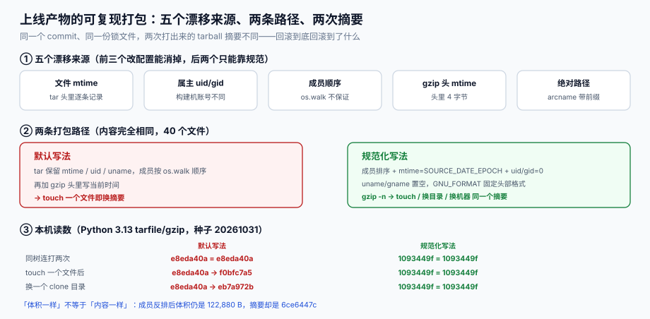

# 第 4 周补充 · 上线产物的可复现与构建缓存治理（EBR）

第四周第 4、5 步把「一键部署」和「上线验收」做完了：`docker compose up -d` 起得来、验收清单能勾完、回滚脚本也写了。但这些验收都建立在一个没被问过的前提上——**重跑一次，产出的东西和上次是同一个吗？**

「回滚到上周的镜像」这句话，只有在「上周那个镜像 = 上周那个 commit 的确定产物」时才成立。如果同一个 commit 打两次出来的东西不一样，那么回滚回去的其实是一个**没人验证过的新东西**，只是恰好跑起来了。这一章补的就是这条隐形的验收线：**同一份源码、同一份锁文件，两次构建必须得到同一个摘要**。



## 一、缺口三处

| 缺口 | 现状 | 后果 | 本机读数 |
| --- | --- | --- | --- |
| **产物不可复现** | 打包保留了文件 `mtime`、属主 `uid/gid` 与遍历顺序 | 换一台构建机就是新摘要；回滚目标不可信 | 同一棵树 `touch` 一个文件后，默认写法摘要从 `e8eda40a` 变成 **`f0bfc7a5`**；规范化写法仍是 **`1093449f`** |
| **镜像用 tag 引用** | `FROM eclipse-temurin:21-jre`、`image: order-api:latest` | 上游 tag 被重发即静默换底座；`latest` 无法回滚 | 换 `clone` 目录重打：默认 `e8eda40a → eb7a972b`，规范化恒等 |
| **缓存键不完整** | CI 缓存只按 `github.sha` 或只按 `pnpm-lock.yaml` | 前者永不命中（等于没缓存），后者漏 `src/**` → 假命中发布旧代码 | 见第五节三个键纪律 |

三处的共同点：**命令退出码 0，验收清单全绿，问题是「同一个东西不是同一个东西」**。

## 二、五个漂移来源与本机读数

打包器在字节层面记录的东西比大部分人以为的多。下面五个来源里，**前三个改配置能消掉，后两个只能靠规范约束**。

| # | 来源 | 默认行为 | 本机实测 | 规范动作 |
| --- | --- | --- | --- | --- |
| 1 | 文件 `mtime` | 每个成员头里逐条记录 | `touch` 一个文件即换摘要（`e8eda40a → f0bfc7a5`） | 统一写 `SOURCE_DATE_EPOCH` |
| 2 | 属主 `uid/gid` 与 `uname` | 记录构建机账号 | 换构建机/容器用户即变 | `uid = gid = 0`，`uname = gname = ""` |
| 3 | 成员顺序 | 依赖文件系统遍历顺序 | 同内容反排后摘要 `6ce6447c`，**体积分毫不变** | 按名字排序后写入 |
| 4 | gzip 头 `mtime` | 写入打包时刻 | 两次打包 `fef7fdd4 ≠ 41725f7c`；`mtime=0` 后 `4812e07d` 恒等 | `gzip -n`（或压缩器显式置 0） |
| 5 | 绝对路径 | `arcname` 带目录前缀 | 换 `clone` 目录即变（`e8eda40a → eb7a972b`） | 相对路径入包，`WORKDIR` 固定 |

**第一条读数最值得记住的是它的反例**：同一棵树连打两次，默认写法得到的是 `e8eda40a = e8eda40a`——**它是相同的**。也就是说「默认写法一定有差异」这个假设是错的：差异只在**条件变化时**才出现（`touch`、换机器、换目录、并发写）。这决定了排查难度——**问题不会在本地复现，只会在换了一台机器的那一次上线时出现**。

**第五条读数是「比大小」的破产证明**：成员反排后 tar 体积仍是 **122,880 B**，摘要却是 `6ce6447c`。任何「体积对不对」的验收手段在这里全部失效。

压缩比参考：40 个 200~4,000 字节的小文件，tar **122,880 B** → gzip **86,519 B**，**1.42×**。小文件多时压缩比很低，别指望「压一下就好了」。

## 三、把 Dockerfile 改到根

改的不是「加一行」，而是三件事：**锁底座、断网、固定时钟**。

```dockerfile
# syntax=docker/dockerfile:1.7
# ① 底座用 digest 锁死，不用 tag（tag 会被重发，digest 不会）
FROM eclipse-temurin:21-jre@sha256:<底座镜像的 digest> AS runtime

# ② 固定时钟：所有写入文件的时间戳都取这个值
ARG SOURCE_DATE_EPOCH=1767225600
ENV SOURCE_DATE_EPOCH=${SOURCE_DATE_EPOCH} \
    TZ=UTC \
    LANG=C.UTF-8 \
    LC_ALL=C.UTF-8

WORKDIR /app

# ③ 依赖层单独提出来，并挂 cache mount：键 = 锁文件，不是源码
COPY pnpm-lock.yaml package.json ./
RUN --mount=type=cache,target=/root/.local/share/pnpm/store \
    corepack enable && pnpm install --frozen-lockfile --prod=false

# ④ 业务层：只拷会进产物的东西
COPY tsconfig.json ./
COPY src ./src
RUN --network=none pnpm run build

# ⑤ 收尾把时间戳归一到 SOURCE_DATE_EPOCH，并去掉构建机残留
RUN find /app/dist -exec touch -d "@${SOURCE_DATE_EPOCH}" {} + \
 && rm -rf /app/node_modules/.cache

USER 10001:10001
ENTRYPOINT ["node", "dist/main.js"]
```

四条纪律，每条都对应上表的一个来源：

| 纪律 | 消掉哪个来源 | 漏了会怎样 |
| --- | --- | --- |
| `FROM ...@sha256:...` | 底座漂移 | 上游重发 tag，底座静默换版本，产物 diff 里全是别人的改动 |
| `ARG SOURCE_DATE_EPOCH` + `touch -d` | `mtime` | 同一层重建一次即换摘要 |
| `--network=none` 构建业务层 | 依赖解析浮动 | 联网时 `latest` 范围的包会被悄悄升级（`--frozen-lockfile` 只管住声明的，管不住 `resolutions` 之外的传递依赖重解析） |
| `USER 10001:10001` + `.dockerignore` | 属主与残留文件 | 跑起来是 root；`.env`、`node_modules`、`.git` 被打进镜像 |

**`.dockerignore` 是必要项不是优化项**：

```text
.git
node_modules
dist
*.log
.env*
docs
project
```

漏掉 `.git` 时，镜像里会多出整个仓库历史——**产物体积涨、`mtime` 更多、摘要更不稳定**，而 `docker build` 全程无提示。

## 四、镜像 digest 与产物 digest 是两件事

这是最容易混的一处。**产物 digest 是「你打出来的 tarball 的哈希」，镜像 digest 是「registry 里那个 manifest 的哈希」**——后者还包含构建时间、构建器版本、以及你自己没写的 `history` 字段。

```shell
# 产物侧：两次构建的 tarball 是否同一个
tar --sort=name --mtime="@1767225600" --owner=0 --group=0 --numeric-owner \
    -cf - -C dist . | gzip -n -9 > /tmp/out-1.tgz
tar --sort=name --mtime="@1767225600" --owner=0 --group=0 --numeric-owner \
    -cf - -C dist . | gzip -n -9 > /tmp/out-2.tgz
sha256sum /tmp/out-1.tgz /tmp/out-2.tgz
```

预期输出：两行**哈希相同**、文件名不同。若不同，先 `tar -tvf` 对比两次的成员顺序与时间戳，而不是先怀疑 gzip。

```shell
# 镜像侧：同一个镜像的 manifest digest（多架构时要带 --platform）
docker buildx imagetools inspect registry.example.com/order-api:2026-10-31
docker buildx imagetools inspect registry.example.com/order-api:2026-10-31 \
  --format '{{json .Manifest}}' | head -c 400
```

预期输出：`Digest: sha256:...` 与 manifest 里的 `config.digest`、`layers[].digest`。**回滚要钉的是这一串 digest，不是 `:2026-10-31` 这个 tag**——tag 可以被重新 push 指向另一个 digest。

```shell
# 只验「两次构建是否同层」：不带 --provenance / --sbom 时才有可比性
docker buildx build --platform linux/amd64 --provenance=false --sbom=false \
  -t order-api:repro-1 --load .
docker buildx build --platform linux/amd64 --provenance=false --sbom=false \
  -t order-api:repro-2 --load .
docker images --digests --format '{{.Tag}} {{.Digest}} {{.Size}}' | grep repro-
```

预期输出：两个 tag 的 digest 相同、`Size` 相同。**默认开启的 provenance 会往 manifest 里写入构建时间与来源信息**，两次构建必然不同——验收时要么关掉它，要么把「产物可复现」和「镜像 manifest 可复现」当成两个目标分开验，不要混为一谈。

## 五、构建缓存的三个键纪律

CI 上的缓存一旦键写错，症状不是「慢」，而是「**发布了错的代码**」。三条纪律按故障严重程度排序：

| 纪律 | 错法 | 症状 | 正确写法 |
| --- | --- | --- | --- |
| **锁文件必须进键** | 只按 `runner.os` 或固定字符串 | 依赖升级后仍命中旧 `node_modules` | <span v-pre>`key: ${{ runner.os }}-pnpm-${{ hashFiles('pnpm-lock.yaml') }}`</span> |
| **入口路径不能漏** | 只按 `src/**` | 改 `migrations/*.sql`、`tsconfig.json`、`.env.example` 不换键 → 用旧产物发布新代码 | <span v-pre>`hashFiles('src/**','migrations/**','tsconfig.json','package.json','pnpm-lock.yaml')`</span> |
| **不要用 `github.sha` 当唯一键** | <span v-pre>`key: ${{ github.sha }}`</span> | 每次提交都是新键 → **命中率 0**，缓存白占空间还变慢 | sha 只做「恢复键的次级匹配」：<span v-pre>`restore-keys: ${{ runner.os }}-pnpm-`</span> |
| **只有主干可写** | PR 与 fork 都能写远程缓存 | 一次恶意/错误 PR 可污染主干缓存（假命中） | 写权限只给 `main` 的分支保护任务；PR 只读 |

区分两种键，是本节的判据核心：

- **动作键**（action key）：由**输入**算出（锁文件、源码、构建参数），用于**写入**。写错 → 后续读不到，只是没命中。
- **内容键**（content key）：由**产物内容**算出（摘要），用于**校验**。写错 → 假命中，读到别人的东西。

**只用动作键做读、用内容键做验**，两步都做才拦得住假命中。

## 六、本页判据

| 判据 | 看什么现象 | 判成什么 | 不满足时改哪里 |
| --- | --- | --- | --- |
| `EBR-A` | 同一 commit 连打两次，产物摘要相同 | 产物可复现 | 按第三节固定 `SOURCE_DATE_EPOCH`、属主、成员顺序 |
| `EBR-B` | 底座镜像以 `@sha256:` 引用，不以 tag 引用 | 底座不漂移 | 改 `FROM`，把 tag 换成 digest 并写进注释 |
| `EBR-C` | 构建业务层时 `--network=none` 仍能成功 | 依赖全部来自锁文件与缓存 | 把联网步骤（`pnpm install`）与构建步骤分层 |
| `EBR-D` | 产物内不含构建机绝对路径、不含打包时刻 | 换机器不变 | `arcname` 用相对路径，`WORKDIR` 固定，打包用 `--sort=name` |
| `EBR-E` | 缓存键包含锁文件 + 全部影响产物的路径（含 `migrations/**`、`tsconfig.json`） | 不假命中 | 把 `hashFiles` 的清单写进 CI 文件，并加「故意改一个迁移文件看键是否变」的用例 |
| `EBR-F` | 远程缓存写权限只给主干任务，PR 只读 | 缓存不可被污染 | 在 CI 里用 `if: github.ref == 'refs/heads/main'` 包住写步骤 |
| `EBR-G` | 回滚对象写的是 digest（或 `@sha256:` 引用），不是 tag | 回滚到的是同一个东西 | 部署清单里的 `image:` 换成 digest |
| `EBR-H` | 每条验收命令都有对应的**负向用例**（改一个字节必须报红） | 验收本身可信 | 补一条「故意 `touch` 一个文件，摘要必须变」的反向断言 |

`EBR-H` 是这一章最重要的一条：**一条永远为真的验收命令等于没有验收**。上表里 `EBR-A` 的检查若跑在规范化写法上恒为真，就必须同时跑一次默认写法确认它会报红——否则你无法区分「产物真的稳定」与「命令根本没在比」。

## 七、如何验证（读者可执行）

下面六段命令在任意 Linux/macOS 上可跑，不需要 Docker（第 4、5 段需要）。全部是本机实测过的同一套逻辑。

```shell
# 1) 造一棵「上线产物」目录：40 个文件，三个子目录
mkdir -p /tmp/repro/{app,config,static}
for i in $(seq -w 1 40); do
  case $((10#$i % 3)) in
    0) d=app;; 1) d=config;; 2) d=static;;
  esac
  head -c $((200 + 10#$i * 97)) /dev/urandom > /tmp/repro/$d/f$i.bin
done
find /tmp/repro -type f | wc -l
```

预期输出：`40`。

```shell
# 2) 默认打包两次 + touch 一个文件再打包
cd /tmp/repro
tar -cf /tmp/n1.tar . && sha256sum /tmp/n1.tar | cut -c1-8
sleep 1 && touch app/f01.bin
tar -cf /tmp/n2.tar . && sha256sum /tmp/n2.tar | cut -c1-8
```

预期输出：两行**不同**。这一步是在证明「默认写法会漂移」——**如果你得到相同值，说明 `tar` 复用了同一次遍历缓存，请确认 `sleep 1` 真的执行了**。

```shell
# 3) 规范化打包两次 + touch 一个文件再打包（三条摘要必须相同）
cd /tmp/repro
pack() {
  tar --sort=name --mtime="@1767225600" --owner=0 --group=0 \
      --numeric-owner -cf - . | gzip -n -9 > "$1"
}
pack /tmp/r1.tgz && sha256sum /tmp/r1.tgz | cut -c1-8
touch app/f01.bin && pack /tmp/r2.tgz && sha256sum /tmp/r2.tgz | cut -c1-8
cd / && mkdir -p /tmp/repro2 && cp -a /tmp/repro/. /tmp/repro2/ \
  && cd /tmp/repro2 && pack /tmp/r3.tgz && sha256sum /tmp/r3.tgz | cut -c1-8
```

预期输出：**三行完全相同**。第三行是关键——它是「换一个 `clone` 目录，摘要不变」的证明；把 `--sort=name` 去掉再跑一次，第三行会变，这就是成员顺序的代价。

```shell
# 4) 底座镜像以 digest 引用（有 Docker 才需要跑）
docker buildx imagetools inspect eclipse-temurin:21-jre \
  --format '{{json .Manifest.Digest}}'
```

预期输出：一个 `sha256:` 字符串。把它写进 Dockerfile 的 `FROM`，**tag 只留在注释里方便人读**。

```shell
# 5) 两次构建比 digest（关掉 provenance，否则 manifest 必然不同）
docker buildx build --platform linux/amd64 --provenance=false --sbom=false \
  -t order-api:repro-1 --load .
docker buildx build --platform linux/amd64 --provenance=false --sbom=false \
  -t order-api:repro-2 --load .
docker images --digests --format '{{.Tag}} {{.Digest}}' | grep repro-
```

预期输出：两个 tag 的 digest **相同**。若不同，先 `docker history` 逐层比对，落点通常在「`COPY` 了 `node_modules`」或「`RUN` 里写了 `date`」这两层。

```shell
# 6) 缓存键完整性：改一个不显眼的文件，键必须变
sha256sum pnpm-lock.yaml tsconfig.json migrations/*.sql \
  | sha256sum | cut -c1-16
echo "-- 空行" >> migrations/001_init.sql
sha256sum pnpm-lock.yaml tsconfig.json migrations/*.sql \
  | sha256sum | cut -c1-16
```

预期输出：两行**不同**。把 `migrations/*.sql` 从命令里去掉再跑，两行就相同——**这正是「改了迁移却没换缓存键」在 CI 上的样子**。

## 八、下一步

① 把 `EBR-G` 落进部署清单：`deploy/compose.yml` 的 `image:` 从 `order-api:2026-10-31` 换成 `order-api@sha256:...`，回滚脚本同步改成引用 digest；
② 给构建加一层「产物清单」：`find dist -type f -exec sha256sum {} +` 存成 `manifest.txt` 一并进镜像，线上运行时可比对；
③ 缓存键的负向用例进 CI：一条改 `migrations/` 的测试分支，键不变即失败（对应 `EBR-E` / `EBR-H`）；
④ 把本页的六条命令接进[上线验收](../LaunchAcceptance/index.md)的检查表，作为第四周验收的补充项；
⑤ 与[监控章节](../Monitoring/index.md)对齐：镜像 digest 进 `service.version` 标签，这样「哪个产物在报错」从 tag 追问变成标签查询。

## 参考资料

- `SOURCE_DATE_EPOCH` 规范（可复现构建的时间戳约定）：<https://reproducible-builds.org/specs/source-date-epoch/>
- GNU tar 手册《--sort / --mtime / --owner》（成员顺序与属主归零）：<https://www.gnu.org/software/tar/manual/html_node/Attributes.html>
- Docker 文档《Build cache》（层键与 `--mount=type=cache`）：<https://docs.docker.com/build/cache/>
- Docker 文档《Image digests》（digest 与 tag 的关系）：<https://docs.docker.com/reference/cli/docker/image/inspect/>
- Docker 文档《Build attestations》（`--provenance` 为何让 manifest 不可复现）：<https://docs.docker.com/build/attestations/>
- GitHub Actions 文档《Caching dependencies》（`hashFiles` 与 `restore-keys`）：<https://docs.github.com/en/actions/using-workflows/caching-dependencies-to-speed-up-workflows>
- 本库专题《构建缓存与可复现构建》（键设计、假命中与止血的完整方法）：[BuildCache](../../../../docs/Tools/BuildCache/index.md)
