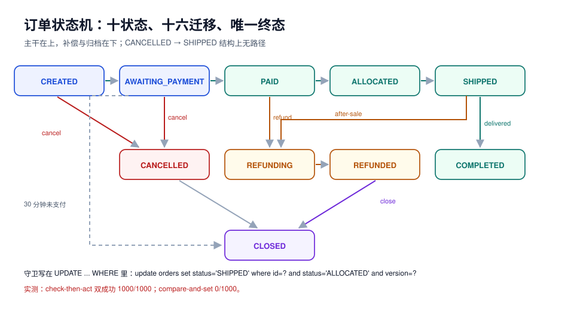

# 需求拆分：五个上下文、十个故事与订单状态机

第 1 周第 1 步。这一页要交出三样东西，缺一样第 2 周就写不下去：

1. **边界**：五个上下文各自拥有什么、明确不拥有什么；
2. **故事**：十条用户故事，每条带可判定的验收条件；
3. **状态机**：十个状态、十六条迁移、六条不变量——**这是整个项目的宪法**，后面所有代码都在它的约束下写。



## 一、五个上下文与它们的「不拥有」

| 上下文 | 拥有的表 | 明确不拥有 | 只发这些事件 |
| --- | --- | --- | --- |
| 订单 Order | `orders`、`order_items`、`order_events`、`outbox` | 库存数量、支付流水、运单号 | `order.created`、`order.cancelled`、`order.completed` |
| 库存 Inventory | `stock`、`stock_reservation` | 订单金额、买家信息 | `stock.reserved`、`stock.released`、`stock.rejected` |
| 支付 Payment | `payment`、`payment_callback_log` | 订单状态 | `payment.succeeded`、`payment.failed`、`payment.refunded` |
| 履约 Fulfillment | `shipment`、`shipment_item` | 支付金额 | `shipment.created`、`shipment.delivered` |
| 通知 Notify | `notify_task` | 任何业务状态 | 无（纯消费者） |

::: danger 「不拥有」比「拥有」更重要
上面第三列是这一页最值钱的部分。真实项目里 80% 的跨服务事故，都来自某个服务「顺手」改了别人的字段：

- 支付服务在回调里直接 `update orders set status='PAID'` → 订单状态出现两个写者，取消与支付并发时必然互相覆盖；
- 库存服务在预占失败时把订单标成 `CANCELLED` → 订单侧不知道这笔取消是谁做的，补偿逻辑无处安放。

**判据**：每条 SQL 只能改自己上下文拥有的表。跨上下文只能发事件。
:::

## 二、十条用户故事与验收条件

| 编号 | 故事 | 验收条件（可判定） |
| --- | --- | --- |
| US-01 | 买家提交订单 | 返回 `order_id` 与 `status=CREATED`；`order_items` 行数 = 请求行数；金额 = Σ(单价 × 数量) |
| US-02 | 系统为订单预占库存 | 预占成功后订单进入 `AWAITING_PAYMENT`；库存可用量减少且 `stock_reservation` 有对应行 |
| US-03 | 库存不足时下单失败 | 返回 409 + `code=STOCK_SHORTAGE`；订单停在 `CANCELLED`；不产生支付单 |
| US-04 | 买家支付 | 支付成功后订单进入 `PAID`；`payment` 表恰好一行 `status=SUCCEEDED` |
| US-05 | 支付回调重复到达 | 同一个 `channel_txn_id` 重复 10 次，订单只前进一次，`payment` 仍只有一行 |
| US-06 | 买家在待支付时取消 | 订单进入 `CANCELLED`，库存预占被释放，`stock.reservation_released` 事件可查 |
| US-07 | 已支付订单申请退款 | 订单进入 `REFUNDING`；退款成功后 `REFUNDED`；金额不超过原支付额 |
| US-08 | 仓库发货 | 订单进入 `SHIPPED`；`shipment` 有运单号；同一订单不能有两张未取消的发货单 |
| US-09 | 买家签收 | 订单进入 `COMPLETED`；`completed_at` 非空；通知任务入队一次 |
| US-10 | 支付成功但库存预占超时 | 系统自动退款并进入 `REFUNDED`，**不允许**停在 `PAID`（这是最典型的中间态泄漏） |

US-10 是本项目的「必失点」：它要求订单侧能处理「先成功后失败」的乱序事件。设计上的答案是**状态机只认当前状态允许的迁移**，越权事件进死信表而不是硬改状态。

## 三、状态机：十个状态

| 状态 | 含义 | 允许的人工操作 | 终态 |
| --- | --- | --- | --- |
| `CREATED` | 已落库，尚未预占库存 | 取消 | 否 |
| `AWAITING_PAYMENT` | 库存已预占，等支付 | 取消 | 否 |
| `PAID` | 支付成功 | 申请退款 | 否 |
| `ALLOCATED` | 已通知仓库拣货 | 申请退款 | 否 |
| `SHIPPED` | 已发货 | 确认收货（超时自动） | 否 |
| `COMPLETED` | 已签收 | 申请退款（售后） | 否 |
| `CANCELLED` | 已取消（未支付或已退款） | 关闭 | 否 |
| `REFUNDING` | 退款处理中 | 无 | 否 |
| `REFUNDED` | 已退款 | 关闭 | 否 |
| `CLOSED` | 归档，不再变化 | 无 | **是** |

**终态只有一个**（`CLOSED`），这是刻意设计：如果允许多个终态，对账时就要为每种终态写一套「是否还需要处理」的判断，漏一种就会永久卡住。

## 四、十六条迁移与它们的守卫

| # | 从 | 到 | 触发 | 守卫（不满足则拒绝） |
| --- | --- | --- | --- | --- |
| 1 | `CREATED` | `AWAITING_PAYMENT` | `stock.reserved` | 预占行存在且未过期 |
| 2 | `CREATED` | `CANCELLED` | 用户取消 / 预占失败 | 无 |
| 3 | `AWAITING_PAYMENT` | `PAID` | `payment.succeeded` | 支付金额 = 订单金额 |
| 4 | `AWAITING_PAYMENT` | `CANCELLED` | 用户取消 | 无（需释放预占） |
| 5 | `AWAITING_PAYMENT` | `CLOSED` | 超时未支付 | 创建时间超过 30 分钟 |
| 6 | `PAID` | `ALLOCATED` | 仓库接单 | 无 |
| 7 | `PAID` | `REFUNDING` | 用户申请退款 | 退款金额 ≤ 支付金额 |
| 8 | `PAID` | `CANCELLED` | 预占超时（US-10） | 必须先发起退款 |
| 9 | `ALLOCATED` | `SHIPPED` | `shipment.created` | 运单号非空 |
| 10 | `ALLOCATED` | `REFUNDING` | 用户申请退款 | 未发货 |
| 11 | `SHIPPED` | `COMPLETED` | `shipment.delivered` | 签收时间 ≥ 发货时间 |
| 12 | `SHIPPED` | `REFUNDING` | 售后 | 需人工审核标记 |
| 13 | `COMPLETED` | `REFUNDING` | 售后 | 距签收 ≤ 7 天 |
| 14 | `REFUNDING` | `REFUNDED` | `payment.refunded` | 退款流水存在 |
| 15 | `CANCELLED` | `CLOSED` | 归档任务 | 无未结清退款 |
| 16 | `REFUNDED` | `CLOSED` | 归档任务 | 无 |

::: tip 守卫写在哪一层，决定了并发下会不会错
守卫必须**和状态更新在同一个 `UPDATE` 的 `WHERE` 里**，而不是「先查状态、再判断、再更新」。下一节的实测就是这件事的量化。
:::

## 五、六条不变量

| 编号 | 不变量 | 怎么验证（一条 SQL） |
| --- | --- | --- |
| I1 | 库存可用量永不为负 | `select count(*) from stock where available < 0;` → 0 |
| I2 | 已取消的订单不存在发货单 | `select count(*) from shipment s join orders o on o.id=s.order_id where o.status in ('CANCELLED') and s.status<>'CANCELLED';` → 0 |
| I3 | 每个订单最多一条成功支付 | `select order_id from payment where status='SUCCEEDED' group by order_id having count(*)>1;` → 空 |
| I4 | 订单金额 = 明细金额之和 | `select count(*) from orders o where o.amount <> (select sum(amount) from order_items where order_id=o.id);` → 0 |
| I5 | 预占总量 ≤ 库存总量 | `select count(*) from (select sku_id, sum(qty) q from stock_reservation where state='HELD' group by sku_id) r join stock s using (sku_id) where r.q > s.total;` → 0 |
| I6 | 不存在「已支付但预占已释放」的订单 | `select count(*) from orders o join stock_reservation r on r.order_id=o.id where o.status in ('PAID','ALLOCATED','SHIPPED','COMPLETED') and r.state='RELEASED';` → 0 |

I6 是最难守的一条：它跨越两个上下文，只能靠「事件顺序 + 状态守卫」保证，不能靠单表约束。

## 六、本机实测一：状态机可达性

把上面两张表抄成代码，用 BFS 从 `CREATED` 出发：

```python
states = ["CREATED","AWAITING_PAYMENT","PAID","ALLOCATED","SHIPPED",
          "COMPLETED","CANCELLED","REFUNDING","REFUNDED","CLOSED"]
trans = [("CREATED","AWAITING_PAYMENT"),("CREATED","CANCELLED"),
         ("AWAITING_PAYMENT","PAID"),("AWAITING_PAYMENT","CANCELLED"),("AWAITING_PAYMENT","CLOSED"),
         ("PAID","ALLOCATED"),("PAID","REFUNDING"),("PAID","CANCELLED"),
         ("ALLOCATED","SHIPPED"),("ALLOCATED","REFUNDING"),
         ("SHIPPED","COMPLETED"),("SHIPPED","REFUNDING"),
         ("COMPLETED","REFUNDING"),("REFUNDING","REFUNDED"),
         ("CANCELLED","CLOSED"),("REFUNDED","CLOSED")]
```

实测读数（Python 3.13.12，本机）：

```text
states: 10 transitions: 16 reachable: 10 unreachable: []
terminal: ['CLOSED']
CANCELLED->SHIPPED: None
```

三条结论：

1. **十个状态全部可达**——没有「写了但永远进不去」的死状态（死状态会让文档和代码对不上）；
2. **终态只有一个**（出度为 0 的只有 `CLOSED`）；
3. **`CANCELLED → SHIPPED` 无路径**——这条最值钱：它证明「已取消不能发货」不是靠代码里的 `if`，而是结构上不存在这条边。

::: danger 状态机设计里最常见的两个漏洞
1. **用 `status != 'CANCELLED'` 代替白名单**：等于允许「任何状态 → 任何状态」，只要不是取消就行。`COMPLETED → AWAITING_PAYMENT` 这种倒流会通过。
2. **迁移表里有、代码里没有**：文档写了 16 条，代码只实现了 13 条，剩下 3 条永远走不到——**判据是「迁移表条数 = 代码里迁移定义条数」**，可以用一条 `grep -c` 对齐。
:::

## 七、本机实测二：守卫写在哪一层

同一笔 `PAID` 订单，两个请求同时到达：一个要取消，一个要发货。两种写法各跑 1,000 次：

```python
# 写法 A：check-then-act（先查状态，再无条件更新）
s1 = select status, version from orders where id=1
s2 = select status, version from orders where id=1     # 两个请求都读到 PAID
update orders set status='CANCELLED' where id=1         # 1 行
update orders set status='SHIPPED'   where id=1         # 又 1 行

# 写法 B：compare-and-set（状态与版本都进 WHERE）
update orders set status='CANCELLED', version=version+1
 where id=1 and version=0 and status='PAID'             # 1 行
update orders set status='SHIPPED',   version=version+1
 where id=1 and version=0 and status='PAID'             # 0 行 → 冲突可见
```

实测读数（SQLite 3，单机，1,000 次重复）：

| 写法 | 「两个请求都成功」的次数 | 最终状态样本 |
| --- | --- | --- |
| A：`check-then-act` | **1000 / 1000** | `SHIPPED`（取消被覆盖） |
| B：`compare-and-set` | **0 / 1000** | `CANCELLED`（第二个请求被拒） |

::: warning 为什么 A 是 100% 而不是「偶尔」
因为这不是「概率性竞态」，而是**确定性错误**：只要两个请求都在更新前读到了 `PAID`，两次无守卫的 `UPDATE` 一定都会成功。真实系统的窗口可能只有几毫秒，但「订单取消后又被发货」这类事故一旦发生就是资损。

所以守卫的正确位置是**数据库的 `WHERE`**，不是应用层的 `if`——应用层的判断只负责给出友好错误，不负责保证正确性。
:::

## 八、非功能需求（第 1 周就要定，后面才有验收标准）

| 维度 | 目标 | 验收方式 |
| --- | --- | --- |
| 下单 TPS | 单实例 200，水平扩到 1,000 | 压测脚本（第 3 周） |
| 下单 P99 | ≤ 300 ms（含库存预占） | 压测读数 |
| 事件投递延迟 | P99 ≤ 2 s（订单 → 通知） | `order_events.created_at` 与消费时间差 |
| 幂等 | 同一幂等键重复 10 次，业务效果 1 次 | 专项用例（第 3 周） |
| 数据不丢 | 订单落库成功率 100%，事件至少一次 | outbox 对账（第 4 周日报） |
| 可观测 | 每条订单全链路可追（`order_id` 为 trace 属性） | 追踪面板截图 |

## 九、本页判据

| 编号 | 判据 | 看什么现象 | 不满足时改哪里 |
| --- | --- | --- | --- |
| `EOH-A` | 五个上下文都有「明确不拥有」列 | 本文第一节表格第三列非空 | 补；缺这一列等于没划边界 |
| `EOH-B` | 每条写 SQL 只碰自己上下文的表 | 代码评审/检索 `update orders` 出现在非订单模块 | 改成发事件 |
| `EOH-C` | 十条故事都有可判定验收条件 | 验收列是数字/状态/行数，不是形容词 | 重写验收条件 |
| `EOH-D` | 状态机终态唯一且有出度检查 | BFS 输出 `terminal: ['CLOSED']` | 合并终态或补归档迁移 |
| `EOH-E` | 迁移表条数 = 代码迁移定义条数 | 两处计数一致（16 = 16） | 补齐；文档写了代码没写最危险 |
| `EOH-F` | 禁止路径在结构上不存在 | `CANCELLED → SHIPPED` 查无路径 | 删边；不要靠 `if` 兜 |
| `EOH-G` | 状态守卫写在 `UPDATE ... WHERE` 里 | SQL 里有 `and status=? and version=?` | 改写法；`check-then-act` 必错 |
| `EOH-H` | 六条不变量各有一条可跑 SQL | 六条查询可执行且返回 0/空 | 补 SQL；无 SQL 的不变量等于没有 |

## 十、下一步

第 182 天：**技术选型与版本基线**。要做三件事：

1. 定稿 Java 25 / Spring Boot 4.1 / PostgreSQL 18 / Kafka 4.1 的**具体小版本**，并记录每一条「为什么不是别的版本」；
2. 划清「用库实现」与「用中间件实现」的边界（例如：事件表用 PG 的 `outbox` 还是直接上 Kafka？本项目的答案是**先 outbox 再投 Kafka**，理由写进下一章）；
3. 给出本地最小可跑集的资源清单（三个容器：PG 18、Kafka 4.1、Redis 8），并验证 `docker compose config` 能通过。

## 参考资料

- PostgreSQL 18 Documentation: *Explicit Locking*、`SELECT ... FOR UPDATE SKIP LOCKED`
- Martin Kleppmann《Designing Data-Intensive Applications》第 11 章（流处理与 exactly-once 的现实含义）
- Chris Richardson: *Pattern: Saga*、*Pattern: Transactional outbox*
- [数据库变更与在线 Schema 演进](../../../../docs/DB/SchemaEvolution/index.md)：本项目第 4 周加字段时会直接用到那套流程
