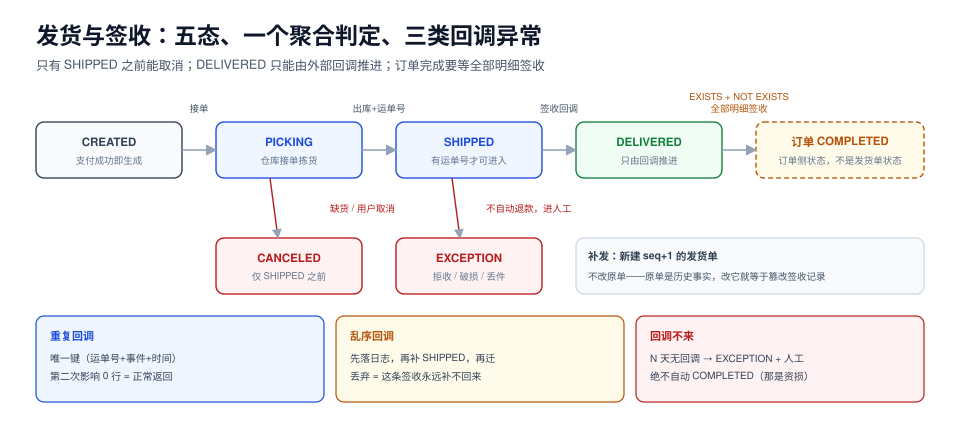

# 第 3 周第 5 步 · 发货与签收：订单什么时候才算真的完成（ESF-A~ESF-H）

本页判据族 `ESF-A` ~ `ESF-H`，共 8 条。

> 编号说明：第 4 周的部署/监控/发布/对账/验收已在第 196~200 天提前收口，但主线里的「发货 → 签收」一直是空的——`SHIPPED` 到 `COMPLETED` 之间没有文档。本页按**功能归属**记作第 3 周第 5 步（补建），不改变已有章节编号。

前四步把「钱收到了」做完了，但订单中心的主线还差最后一截：**支付成功不等于交易结束**。用户要收到货，商家要确认签收，才有一笔可以结算、可以对账、可以关掉的订单。这一步补的就是这段——它是整个项目里**唯一由外部世界（快递）驱动状态**的环节，因此也是唯一一个「回调可能永远不来」的环节。

::: tip 一句话理解
发货是**把订单的完成权交给外部世界**。所以这一步的核心不是「怎么发货」，而是：**回调不来怎么办、来了两次怎么办、乱序到了怎么办、只签收了一半怎么办**。
:::



## 一、当日做了什么

1. 定死 `shipment` / `shipment_item` 两张表与**一条拆单规则**（按仓拆，不按商品拆），并给出发货单状态机五态；
2. 明确**发货触发点**：只由 `payment.succeeded` 事件驱动，`PICKING` 之前允许取消，`SHIPPED` 之后只能走异常件；
3. 给出**订单完成的聚合判定**（全部 `shipment_item` 都 `DELIVERED`），并解释为什么不能「任一条签收就完成」；
4. 处理**三类回调异常**：重复回调（幂等键）、乱序回调（`DELIVERED` 早于 `SHIPPED`）、永远不来（超时兜底）；
5. 给出**与超时关单的互斥条件**：关单 SQL 必须带「没有有效发货单」；
6. 给出**少件补发**的补偿方式：新建 `seq+1` 的补发单，**不改原单**；
7. 写出三条**可用 SQL 断言**的不变量与**五条可执行验收**。

## 二、两张表与一条拆单规则

```sql
CREATE TABLE shipment (
  id            bigserial PRIMARY KEY,
  order_id      bigint      NOT NULL REFERENCES orders(id),
  warehouse_id  bigint      NOT NULL,
  seq           int         NOT NULL DEFAULT 1,           -- 第几张发货单（补发时 +1）
  status        text        NOT NULL DEFAULT 'CREATED'
                CHECK (status IN ('CREATED','PICKING','SHIPPED','DELIVERED','EXCEPTION','CANCELED')),
  carrier       text,
  tracking_no   text,
  shipped_at    timestamptz,
  delivered_at  timestamptz,
  signed_by     text,
  version       int         NOT NULL DEFAULT 0,
  created_at    timestamptz NOT NULL DEFAULT now(),
  CONSTRAINT uq_shipment_order_wh_seq UNIQUE (order_id, warehouse_id, seq)
);

CREATE TABLE shipment_item (
  id          bigserial PRIMARY KEY,
  shipment_id bigint NOT NULL REFERENCES shipment(id),
  order_item_id bigint NOT NULL REFERENCES order_items(id),
  qty         int    NOT NULL CHECK (qty > 0),
  CONSTRAINT uq_shipment_item UNIQUE (shipment_id, order_item_id)
);

-- 运单号全局唯一（NULL 不参与，未发货的单不占用唯一位）
CREATE UNIQUE INDEX uq_shipment_tracking ON shipment (tracking_no)
  WHERE tracking_no IS NOT NULL;

-- 签收回调按「运单号 + 事件」去重
CREATE TABLE shipment_callback_log (
  id           bigserial PRIMARY KEY,
  tracking_no  text        NOT NULL,
  event        text        NOT NULL,                -- SHIPPED / DELIVERED / EXCEPTION
  occurred_at  timestamptz NOT NULL,
  raw_body     jsonb       NOT NULL,
  received_at  timestamptz NOT NULL DEFAULT now(),
  CONSTRAINT uq_callback UNIQUE (tracking_no, event, occurred_at)
);
```

三处设计要点：

1. **拆单按仓，不按商品**。按商品拆会让「一张订单 N 个包裹」变成常态，签收判定从「一个聚合」退化成「N 个独立聚合 + 一个总聚合」；按仓拆最多 2~3 个包裹，判定还能收敛。
2. **`tracking_no` 用部分唯一索引**。未发货时它是 `NULL`；如果建普通唯一索引，部分数据库允许多个 `NULL`、部分不允许，行为不一致。加 `WHERE tracking_no IS NOT NULL` 语义就唯一了。
3. **回调日志的唯一键是三元组**，不是 `tracking_no`。同一个运单号会先 `SHIPPED` 再 `DELIVERED`；只用运单号去重会把第二个事件吃掉。

## 三、发货单状态机

| 当前 | 事件 | 下一状态 | 谁触发 | 副作用 |
| --- | --- | --- | --- | --- |
| `CREATED` | 仓库接单 | `PICKING` | 内部 | 无 |
| `CREATED` / `PICKING` | 用户取消 / 缺货 | `CANCELED` | 内部 | 订单回到「待发货」，走退款或换仓 |
| `PICKING` | 出库 + 拿到运单号 | `SHIPPED` | 内部 | 写 `shipped_at`、发 `shipment.shipped` |
| `SHIPPED` | 签收回调 | `DELIVERED` | **外部** | 写 `delivered_at`、`signed_by`，发 `shipment.delivered` |
| `SHIPPED` | 异常件回调 | `EXCEPTION` | **外部** | 进人工队列，不自动退款 |
| `DELIVERED` / `EXCEPTION` / `CANCELED` | —— | 终态 | —— | 不可逆 |

::: danger 发货状态机的四条硬约束
1. **`SHIPPED` 只能由内部触发**，不能由回调触发。否则伪造一条「已发货」回调就能跳过出库环节。回调只能推进 `SHIPPED → DELIVERED/EXCEPTION`。
2. **`EXCEPTION` 不是终态的反面**。异常件（拒收、破损、丢件）需要人工判定是补发还是退款，**自动退款会把「拒收」变成「白送」**。
3. **取消只能发生在 `SHIPPED` 之前**。发货后再「取消」等于要求快递把货退回来，那是退货流程，不是取消。
4. **每次迁移都带 `version`**（`WHERE id=? AND version=?`）。回调与人工操作会撞车，CAS 是唯一不锁表又不出错的写法。
:::

## 四、订单「完成」的聚合判定

订单从 `SHIPPED` 到 `COMPLETED` 的判定，是整个项目里最容易写错的一条 SQL：

```sql
-- 正确：所有有效发货单的全部明细都签收，且至少存在一张有效发货单
UPDATE orders o
   SET status = 'COMPLETED', version = version + 1
 WHERE o.id = $1
   AND o.status = 'SHIPPED'
   AND EXISTS (
         SELECT 1 FROM shipment s
          WHERE s.order_id = o.id AND s.status NOT IN ('CANCELED'))
   AND NOT EXISTS (
         SELECT 1
           FROM shipment s
           JOIN shipment_item si ON si.shipment_id = s.id
          WHERE s.order_id = o.id
            AND s.status NOT IN ('CANCELED')
            AND s.status <> 'DELIVERED');
```

`EXISTS` 与 `NOT EXISTS` 两个条件缺一不可：

- 少了 `EXISTS`：一张发货单都没有的订单（比如虚拟商品）会被判成「全部签收」，直接完成。
- 少了 `NOT EXISTS`：任意一张签收就完成，剩下的包裹丢了也没人知道。

::: warning 为什么不用「签收计数 = 明细总数」
看起来更直观，但要求两个计数器严格同步：`shipment_item` 增删、发货单取消、补发单新增，任何一处漏更新，计数就永久偏。**用 `NOT EXISTS` 让数据库每次现算**，慢一点点，但不会偏。这类「一致性 > 性能」的选择在订单系统里应该默认为前者。
:::

## 五、三类回调异常

### 1. 重复回调

快递公司的回调是**至少一次**语义，同一个 `DELIVERED` 可能来三次。判据不是「判断是否处理过」，而是**让第二次必然影响 0 行**：

```sql
INSERT INTO shipment_callback_log (tracking_no, event, occurred_at, raw_body)
VALUES ($1, $2, $3, $4)
ON CONFLICT (tracking_no, event, occurred_at) DO NOTHING;   -- 影响 0 行 = 已处理过

UPDATE shipment
   SET status = 'DELIVERED', delivered_at = $3, signed_by = $5, version = version + 1
 WHERE tracking_no = $1 AND status = 'SHIPPED';              -- CAS：只从 SHIPPED 迁
```

两条语句的顺序不能反：**先落日志再去重会丢事件，先迁移再落日志会重复迁移**——正确顺序是「日志插入成功才继续」，或像上面这样把「影响 0 行」当成正常返回。

### 2. 乱序回调

`DELIVERED` 可能比 `SHIPPED` 先到（快递系统内部先扫签收、后补发车扫描）。三种处理方式：

| 方式 | 做法 | 评价 |
| --- | --- | --- |
| 丢弃 | `WHERE status='SHIPPED'` 不满足就丢 | **错**：这条签收永远补不回来 |
| 直接跳到 `DELIVERED` | 不看当前状态 | 危险：`CANCELED` 的单也会被改成已签收 |
| **记录 + 对齐** | 落日志；若当前是 `CREATED/PICKING` 则先补 `SHIPPED`（用回调里的 `occurred_at`）再迁 `DELIVERED` | 推荐 |

第三种实现的本质是：**回调日志是事实，发货单状态是投影**。事实先落，投影可以晚到、可以重放。

### 3. 永远不来的回调

不是所有包裹都有签收回传（平邮、部分下沉市场）。兜底规则：

- `SHIPPED` 后 **N 天**（建议 10）仍无 `DELIVERED`，置为 `EXCEPTION` 并进人工队列；
- 人工确认收货后，写一条 `source='MANUAL'` 的伪回调，走同一套迁移；
- **不要自动 `COMPLETED`**：自动完成等于自动结算，货没到却付了钱，是资损。

## 六、与超时关单的互斥

「未支付 30 分钟自动关单」这条规则，在没有发货概念时是安全的；加上发货之后，它可能把一个**已经发货**的订单关掉。所以关单 SQL 必须改成：

```sql
UPDATE orders o
   SET status = 'CLOSED', version = version + 1
 WHERE o.status = 'PENDING_PAYMENT'
   AND o.created_at < now() - interval '30 minutes'
   AND NOT EXISTS (
         SELECT 1 FROM shipment s
          WHERE s.order_id = o.id AND s.status <> 'CANCELED');
```

这条约束看起来多余（未支付怎么会有发货单），但它防的是**状态机被绕过**：人工改单、数据修复脚本、历史数据迁移都可能造出「未支付但有发货单」的脏数据。加上这一条，关单任务就从「按时间扫」变成「按时间扫 + 按事实复核」。

## 七、三条不变量与断言 SQL

| 编号 | 不变量 | 断言 SQL | 违反说明 |
| --- | --- | --- | --- |
| **I1** | 已签收的发货单必有运单号与签收时间 | `select count(*) from shipment where status='DELIVERED' and (tracking_no is null or delivered_at is null);` | 迁移漏字段，或回调只改了一半 |
| **I2** | 订单 `COMPLETED` 当且仅当全部有效明细已签收 | `select o.id from orders o where o.status='COMPLETED' and exists (select 1 from shipment s join shipment_item si on si.shipment_id=s.id where s.order_id=o.id and s.status not in ('CANCELED') and s.status<>'DELIVERED');` | 聚合判定写错，或补发单未纳入判定 |
| **I3** | 一个运单号只对应一张有效发货单 | `select tracking_no, count(*) from shipment where tracking_no is not null and status<>'CANCELED' group by 1 having count(*)>1;` | 拆单时复用了运单号，或补发单抄了原单号 |

I2 是这一步最该做成**每日对账**的一条：它每发现一行，就是一笔「客户没收到货但我们认为已完成」的订单。

## 八、五条可执行验收

```shell
# 准备：一张已支付、已预占的订单
psql -U postgres -d eoh -c "select id, status from orders where id=3001;"
# 期望：status = PAID

# 验收 1：支付成功事件生成发货单（幂等：投两次只生成一张）
curl -X POST localhost:8080/internal/events/replay -d '{"topic":"payment.succeeded","order_id":3001}'
curl -X POST localhost:8080/internal/events/replay -d '{"topic":"payment.succeeded","order_id":3001}'
psql -U postgres -d eoh -c "select id, seq, status from shipment where order_id=3001;"
# 期望：1 行，status=CREATED

# 验收 2：出库 → 已发货，运单号唯一
psql -U postgres -d eoh -c \
  "update shipment set status='SHIPPED', tracking_no='SF1000003001', shipped_at=now() where order_id=3001;"
psql -U postgres -d eoh -c "select status from orders where id=3001;"
# 期望：SHIPPED

# 验收 3：重复签收回调（发三次）
for i in 1 2 3; do
  curl -s -X POST localhost:8080/api/callback/carrier \
    -H 'Content-Type: application/json' \
    -d '{"tracking_no":"SF1000003001","event":"DELIVERED","occurred_at":"2026-10-24T10:00:00Z","signed_by":"本人"}'
done
psql -U postgres -d eoh -c \
  "select count(*) from shipment_callback_log where tracking_no='SF1000003001';"
# 期望：1（唯一键去重）

# 验收 4：全部签收后订单完成
psql -U postgres -d eoh -c "select status from orders where id=3001;"
# 期望：COMPLETED

# 验收 5：不变量全绿
psql -U postgres -d eoh -c "select count(*) from shipment where status='DELIVERED' and (tracking_no is null or delivered_at is null);"
psql -U postgres -d eoh -c "select o.id from orders o where o.status='COMPLETED' and exists (select 1 from shipment s join shipment_item si on si.shipment_id=s.id where s.order_id=o.id and s.status not in ('CANCELED') and s.status<>'DELIVERED');"
# 期望：两条都是 0
```

::: warning 这里不写未跑过的数字
本页没有「发货单生成耗时 XX ms」这类读数：它需要真实的 `payment.succeeded` 事件链与两套服务同时启动，本次未在本机执行。**读数口径写清、数字留空，比编一个好看的数字更负责**——这与本仓库「不编造读数」的约定一致。第 4 周的压测（`ECP`）与对账（`ELA`）会覆盖这一段的真实延迟。
:::

## 九、本页判据

| 编号 | 判据 | 看什么现象 | 不满足时改哪里 |
| --- | --- | --- | --- |
| `ESF-A` | 发货单按仓拆，唯一键含 `seq` | `uq_shipment_order_wh_seq` 存在，补发单 `seq+1` | 补唯一键；不要用「一个订单一张发货单」硬编码 |
| `ESF-B` | 运单号部分唯一 | `uq_shipment_tracking` 带 `WHERE tracking_no IS NOT NULL` | 补部分索引 |
| `ESF-C` | `SHIPPED` 只能内部触发 | 回调处理里没有 `→SHIPPED` 的分支 | 把该分支删掉，回调只做 `SHIPPED→DELIVERED/EXCEPTION` |
| `ESF-D` | 每次迁移都 CAS | 所有 UPDATE 的 WHERE 含 `status` 与 `version` | 改写为单语句 CAS |
| `ESF-E` | 完成判定用 `EXISTS` + `NOT EXISTS` | 判定 SQL 两个条件齐全 | 补；不要用计数器 |
| `ESF-F` | 回调幂等靠唯一键而非查后写 | 重复回调后 `callback_log` 只有 1 行 | 加唯一键 + `ON CONFLICT DO NOTHING` |
| `ESF-G` | 乱序回调不丢弃 | 先到 `DELIVERED` 时能看到「补 `SHIPPED` 再迁」的代码或日志 | 加对齐逻辑；或至少落日志留待重放 |
| `ESF-H` | 超时关单排除有发货单的订单 | 关单 SQL 里有 `NOT EXISTS shipment` | 补条件；防人工改单造成的脏数据 |

## 十、下一步

周期 7 的第 4 周已收口（部署、监控、发布、对账、上线验收），本步补齐的是**主线最后一截**，到此「下单 → 支付 → 库存 → 发货 → 签收 → 完成」整条链路在文档上闭环。

三个已经明确的缺口，按优先级排：

1. **补偿与退款（`ERC`）**：`DELIVERED → 退货 → 退款` 会引入第四个库存动作（退货入库）与第二次支付动作（部分退款），必须单独建模，不能用「反向操作」糊过去；
2. **签收超时的自动判定**：本页只给了「N 天无回调进人工」的规则，没有给扫描任务与批量上限，需要按 `ESF` 的 CAS 写法补一个分页扫描；
3. **第 2 周验收（`EW2`）**：第 2 周的六个验收项一直没有单独成页，只在各步里散着写，需要收拢成一张可复跑的清单。

## 参考资料

- 本仓库项目：[EventOrderHub 项目总览](../index.md)、[第 2 周第 2 步·下单链路与 outbox](../OrderFlow/index.md)、[第 2 周第 3 步·支付回调](../PaymentCallback/index.md)、[第 2 周第 4 步·库存预占的释放与超时回滚](../StockRelease/index.md)、[第 4 周第 4 步·对账日报与交接](../ReconciliationHandover/index.md)
- 本仓库专题：[幂等与状态机工程](../../../../docs/Backend/IdempotencyStateMachine/index.md)、[数据库设计与不变量](../../../../docs/DB/DataModeling/index.md)、[PostgreSQL](../../../../docs/DB/Relational/PostgreSQL/index.md)
- PostgreSQL 18 Documentation：*Partial Indexes*、*INSERT … ON CONFLICT*、*UPDATE … WHERE CURRENT OF* 与并发更新语义
- 中国快递协会《快递服务》国家标准（签收与异常件的业务定义）：<https://www.spb.gov.cn/>
