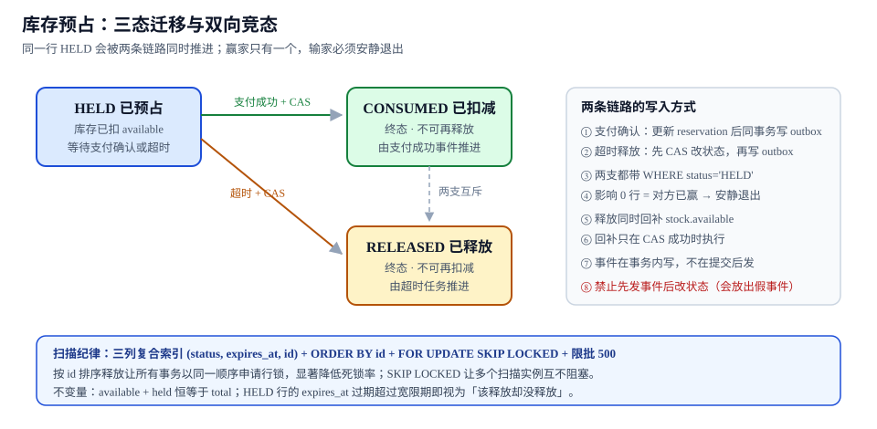

# 第 2 周第 4 步 · 库存预占的释放与超时回滚（EIV-A~EIV-H）

本页判据族 `EIV-A` ~ `EIV-H`，共 8 条。

> 编号说明：第 3 步的「下一步」里写的前缀是 `EPR`，而项目总览第 1 周预留的是 `EIV`（预占 inventory）。本页统一按总览的 `EIV` 落地，避免与 `EPY`（支付）在同一周内混用两套前缀。

前一步处理的是「外部系统什么时候来敲门」。这一步处理内部的一件事：**库存被"占住"之后，到底什么时候会放开**。它看起来只是「加一个定时任务」，实际是整个订单中心里**唯一一处两条链路会同时推进同一行数据**的地方：

- 支付成功了，要把 `HELD` 推进到 `CONSUMED`；
- 超时了，要把 `HELD` 推进到 `RELEASED`。

两支都是合法的，且会在同一秒发生。谁赢由数据库决定，不由代码的书写顺序决定。

::: tip 一句话理解
释放不是「删掉预占」，而是**一次带条件的迁移**：`WHERE status='HELD' AND expires_at < now()`。影响 0 行就说明有人先到了，**安静退出**是正确行为，不是异常。
:::



## 一、当日做了什么

1. 把 `stock_reservation` 的**三态**定死（`HELD` / `CONSUMED` / `RELEASED`），并写明「终态不可逆」；
2. 给出**超时扫描**的三列复合索引与限批策略（`ORDER BY id` + `FOR UPDATE SKIP LOCKED` + 500 一批）；
3. 给出**释放事务的五步顺序**，并解释为什么「先 CAS 改状态，再写 outbox」不能反过来；
4. 处理**双向竞态**：支付确认与超时释放都用同一条 CAS 语句，输的一方影响 0 行、直接返回；
5. 给出**库存回补**的约束：只有 CAS 成功的那一支才执行 `available = available + qty`；
6. 写出三条**可用 SQL 断言**的不变量（I1/I2/I3），并把 I2 做成超时积压的告警指标；
7. 给出**五条可执行验收**，其中容量一条留到第 3 周压测补齐（本页给出脚本与预期量级，不写未跑的数字）。

## 二、三态与两条迁移

| 状态 | 含义 | 谁写 | 能否再变 |
| --- | --- | --- | --- |
| `HELD` | 已占用 `available`，等待支付结果 | 下单链路 | 可以（→ `CONSUMED` 或 `RELEASED`） |
| `CONSUMED` | 已真实扣减，钱也收到了 | 支付成功事件 | **不能** |
| `RELEASED` | 已放开，库存回补 | 超时任务 / 用户取消 | **不能** |

```sql
CREATE TABLE stock_reservation (
  id           bigserial PRIMARY KEY,
  order_id     bigint      NOT NULL,
  sku_id       bigint      NOT NULL,
  qty          int         NOT NULL CHECK (qty > 0),
  status       text        NOT NULL DEFAULT 'HELD'
               CHECK (status IN ('HELD','CONSUMED','RELEASED')),
  expires_at   timestamptz NOT NULL,
  version      int         NOT NULL DEFAULT 0,
  created_at   timestamptz NOT NULL DEFAULT now(),
  settled_at   timestamptz,
  CONSTRAINT uq_reservation_order_sku UNIQUE (order_id, sku_id)
);

-- 超时扫描的三列：状态过滤 + 时间范围 + 稳定排序
CREATE INDEX idx_reservation_due
  ON stock_reservation (status, expires_at, id)
  WHERE status = 'HELD';
```

三处设计要点：

- **唯一键是 `(order_id, sku_id)`**：同一单同一 SKU 只能有一条预占，重试下单不会重复占库存；
- **部分索引只覆盖 `HELD`**：终态行不进索引，扫的永远是「待处理」那一小撮；
- **`version` 是给 CAS 用的**：状态条件之外再加版本，能识别「同一状态被改过又改回来」的极端情况。

## 三、扫描：三列索引 + 限批 + SKIP LOCKED

```sql
-- 取一批到期的预占，锁住但不阻塞其他扫描实例
SELECT id, order_id, sku_id, qty
FROM stock_reservation
WHERE status = 'HELD'
  AND expires_at < now() - interval '30 seconds'   -- 宽限期：给在途的支付回调留时间
ORDER BY id
LIMIT 500
FOR UPDATE SKIP LOCKED;
```

| 参数 | 取值 | 为什么是这个值 |
| --- | --- | --- |
| 宽限期 | **30 秒** | 支付回调的验签 + 落账通常在 2 秒内完成；30 秒是「回调已经在路上」的容错窗 |
| 批大小 | **500** | 单事务持锁时间与吞吐的折中；1 万笔 → 20 批 |
| 排序 | **`ORDER BY id`** | 让所有事务以同一顺序申请行锁，降低死锁率（见第六节） |
| 锁模式 | **`SKIP LOCKED`** | 多实例扫描互不阻塞；被跳过的行下一轮还会被扫到 |
| 调度间隔 | **5 秒** | 与 30 秒宽限期配合，最坏延迟 35 秒，远小于用户可感知的「库存不放」阈值 |

::: danger 扫描的三处常见写错
1. **不加宽限期**：`expires_at < now()` 会与「刚好在 30 秒内到达的回调」抢同一行，导致支付成功的单被释放（超卖）。
2. **不加 `SKIP LOCKED`**：两个实例同时扫到同一批行，后到的那个阻塞在行锁上，扫描线程被拖死——表现为「定时任务越来越慢」。
3. **不用 `ORDER BY id`**：批内行锁申请顺序随机，两个事务交叉持有，死锁日志开始出现 `deadlock detected`。
:::

## 四、双向竞态：同一条 CAS，谁先到谁赢

支付确认与超时释放必须是**同一条语句的不同分支**，而不是两段各写各的逻辑：

```sql
-- 支付成功：HELD → CONSUMED
UPDATE stock_reservation
SET status = 'CONSUMED', version = version + 1, settled_at = now()
WHERE id = :id AND status = 'HELD' AND version = :expected_version;
-- 影响 1 行 → 继续回补/写 outbox；影响 0 行 → 已被释放，必须走退款/补货流程
```

```sql
-- 超时释放：HELD → RELEASED（同时回补库存，同一事务）
WITH due AS (
  UPDATE stock_reservation
  SET status = 'RELEASED', version = version + 1, settled_at = now()
  WHERE id = ANY(:ids) AND status = 'HELD' AND expires_at < now()
  RETURNING id, sku_id, qty
)
UPDATE stock s
SET available = s.available + d.qty, held = s.held - d.qty
FROM due d
WHERE s.sku_id = d.sku_id
RETURNING d.id;
```

| 谁先到 | 结果 | 后到的一方该做什么 |
| --- | --- | --- |
| 支付确认先 | `CONSUMED` | 释放任务影响 0 行 → **跳过，不报错、不告警** |
| 超时释放先 | `RELEASED` | 支付回调影响 0 行 → **不能静默**：订单已付款但库存已放，必须进「退款或补货」队列 |
| 同时 | 数据库串行化，一支成功 | 同上，按输赢分流 |

这两支的**失败处理不对称**，是最容易被写成对称的地方：释放输了可以静默（它本来就不该赢），支付输了不能静默（钱已经收了）。

::: warning 为什么「先发事件再改状态」在这里一定是错的
释放如果先发 `stock.released` 再改状态，下游可能已经按「库存回来了」把商品卖给了别人，而数据库里这行还是 `HELD`——一旦事务回滚，就出现「卖了但没货」。正确顺序与下单链路的 outbox 完全同构：**状态与事件在同一个事务里落库**，事件由投递器搬运（见 [下单链路与 outbox](../OrderFlow/index.md)）。
:::

## 五、回补：只在 CAS 成功的那一支执行

```sql
-- 反例：先回补库存，再改预占状态
UPDATE stock SET available = available + 1 WHERE sku_id = 42;
UPDATE stock_reservation SET status='RELEASED' WHERE id = 9001;  -- 可能影响 0 行
```

反例的问题是**回补无法撤销**：第二条语句影响 0 行（说明这单已经支付），但库存已经加回去了，于是同一份货被卖了两次。正确做法是把回补放进**同一个 CTE**（如上一节），让「改状态」与「回补」要么都发生、要么都不发生。

`stock` 表本身也要有约束兜底：

```sql
ALTER TABLE stock
  ADD CONSTRAINT ck_stock_nonneg CHECK (available >= 0 AND held >= 0),
  ADD CONSTRAINT ck_stock_sum CHECK (available + held = total);
```

## 六、容量：为什么 `ORDER BY id` 能降死锁

1 万笔超时单同时释放，意味着 1 万次「预占行更新 + 库存行更新」。死锁只会在**多行、多事务、顺序不一致**时发生：

| 场景 | 申请顺序 | 结果 |
| --- | --- | --- |
| 两事务都按 `id` 升序处理 SKU 3 → 7 | 一致 | 后到者等待，不死锁 |
| A 处理 3→7，B 处理 7→3 | 交叉 | A 持 3 等 7，B 持 7 等 3 → **死锁** |
| 批内乱序（`LIMIT` 无 `ORDER BY`） | 由执行计划决定 | 死锁率随并发上升 |

本步的容量验收留到第 3 周压测（判据族 `ECP`）补齐，本页只给可执行的压测入口与需要记录的三个读数：

```shell
# 制造 1 万笔到期预占（脚本在读者工程里，本仓不提交）
psql -U postgres -d eoh -f sql/seed_due_reservations.sql --count=10000

# 并发 8 个扫描实例，跑 60 秒
for i in $(seq 1 8); do
  pgbench -U postgres -d eoh -c 2 -j 2 -T 60 -f sql/release_batch.sql &
done
wait

# 需要记录的三个读数
psql -U postgres -d eoh -c "select count(*) from pg_stat_activity where wait_event_type='Lock';"
psql -U postgres -d eoh -c "select deadlocks from pg_stat_database where datname='eoh';"
psql -U postgres -d eoh -c "select count(*) from stock_reservation where status='HELD';"
```

| 读数 | 期望 | 不符合说明 |
| --- | --- | --- |
| 锁等待会话数 | 个位数，且随批次推进回落 | 持续高位 → 批太大或索引没命中 |
| `deadlocks` 增量 | **0** | 有增量 → 批内顺序不一致 |
| 剩余 `HELD` | 60 秒内趋近 0 | 不下降 → 扫描条件/宽限期算错 |

::: warning 这里不写具体耗时数字
前一页的支付回调给出了本机实测的回调延迟，是因为那一步的脚本在本机跑过。**这一步的 1 万笔释放需要 1 万行种子数据与并发压测环境**，本次没有执行，所以只给读数口径与判据，不给「XX 秒处理完」这种未跑过的数字。第 3 周压测（`ECP`）会把这个数补上。
:::

## 七、三条不变量与断言 SQL

| 编号 | 不变量 | 断言 SQL | 违反说明 |
| --- | --- | --- | --- |
| **I1** | 库存守恒：`available + held = total` | `select count(*) from stock where available + held <> total;` | 回补或扣减写漏了一支 |
| **I2** | 没有「该释放却没释放」的预占 | `select count(*) from stock_reservation where status='HELD' and expires_at < now() - interval '10 minutes';` | 扫描停摆、宽限期算错、或任务被限流 |
| **I3** | 预占与订单状态一致：`RELEASED` 的预占，订单不应是已支付 | `select r.id from stock_reservation r join orders o on o.id=r.order_id where r.status='RELEASED' and o.status in ('PAID','SHIPPED','COMPLETED');` | 双向竞态处理错了（支付输了却静默） |

I2 直接做成告警指标：**连续两个采集周期 > 0 就告警**。这一条比「扫描任务有没有在跑」更可靠——任务可能在跑但一直报错。

## 八、五条可执行验收

| # | 验收 | 命令 | 期望 |
| --- | --- | --- | --- |
| 1 | 正常释放 | 手工把一条 `HELD` 的 `expires_at` 改到 40 秒前，触发扫描 | 状态 `RELEASED`，`stock.available` +qty，`outbox` 多一条 `stock.released` |
| 2 | 支付先到 | 先跑支付确认，再把 `expires_at` 改到过去，触发扫描 | 预占仍 `CONSUMED`，扫描影响 0 行，无告警 |
| 3 | 释放先到 | 先触发释放，再跑支付确认 | 支付侧进入「退款/补货」队列，**不静默** |
| 4 | 宽限期 | `expires_at` 只过去 5 秒，触发扫描 | 不释放（宽限期 30 秒） |
| 5 | 幂等 | 同一批连续扫描 3 次 | 第二次、第三次影响 0 行，库存不再增加 |

```shell
# 验收 1：正常释放
psql -U postgres -d eoh -c \
  "update stock_reservation set expires_at = now() - interval '40 seconds' where order_id = 1001;"
psql -U postgres -d eoh -c "select available, held, total from stock where sku_id = 42;"
# 记录 before，再触发扫描
curl -X POST localhost:8080/internal/jobs/release-due
psql -U postgres -d eoh -c \
  "select status from stock_reservation where order_id = 1001; select available, held from stock where sku_id = 42;"
# 期望：RELEASED 且 available 增加 qty、held 减少 qty

# 验收 4：宽限期内的不释放
psql -U postgres -d eoh -c \
  "update stock_reservation set expires_at = now() - interval '5 seconds' where order_id = 1002;"
curl -X POST localhost:8080/internal/jobs/release-due
psql -U postgres -d eoh -c "select status from stock_reservation where order_id = 1002;"
# 期望：仍是 HELD（宽限期未过）

# 验收 5：扫描幂等
curl -X POST localhost:8080/internal/jobs/release-due
curl -X POST localhost:8080/internal/jobs/release-due
psql -U postgres -d eoh -c "select available from stock where sku_id = 42;"
# 期望：与验收 1 结束时一致（不重复回补）
```

## 九、本页判据

| 编号 | 判据 | 看什么现象 | 不满足时改哪里 |
| --- | --- | --- | --- |
| `EIV-A` | 三态且终态不可逆，`CHECK` 约束在库层 | `\d stock_reservation` 可见 `status` 的 CHECK 与 `settled_at` | 补约束；不要在应用层「约定」终态 |
| `EIV-B` | 超时扫描有 `(status, expires_at, id)` 部分索引 | `EXPLAIN` 走 `idx_reservation_due`，无 Seq Scan | 补索引或改写 WHERE |
| `EIV-C` | 扫描带宽限期，且宽限期有书面理由 | SQL 里是 `now() - interval '30 seconds'` 而非 `now()` | 加宽限期并写进配置 |
| `EIV-D` | 扫描限批 + `ORDER BY id` + `SKIP LOCKED` | 语句三要素齐全；压测 `deadlocks` 增量 0 | 补齐三要素 |
| `EIV-E` | 两支迁移都是 CAS（状态 + 版本进 `WHERE`） | 两条 UPDATE 都影响 0/1 行，不出现先查后改 | 改写成单语句 |
| `EIV-F` | 释放的「改状态 + 回补库存」在同一事务/CTE | 回补语句出现在 CTE 的 `RETURNING` 之后 | 合并为一条语句 |
| `EIV-G` | 支付输给释放时**不静默**，进退款/补货队列 | 有对应队列记录与告警 | 补分支；不要统一 return |
| `EIV-H` | I1/I2/I3 三条断言可一条命令复跑，I2 接告警 | 三条 SQL 均有输出 0 的基线 | 补断言与告警规则 |

## 十、下一步

第 3 周（195–201）进入**联调与一致性用例矩阵**（判据族 `ECM`）：把前三步的链路拼起来，用一张「场景 × 断言」的矩阵覆盖重复、乱序、丢失、并发四类情况。

三个已经明确的缺口：

1. **退款链路**：本步只处理了「支付赢了」与「释放赢了」，退款（`CONSUMED → REFUNDED`）会引入第四个状态与第二次库存回补，必须单独建模；
2. **积压自愈**：I2 只能发现「该释放却没释放」，没有自动补齐机制——需要一条「按 `expires_at` 倒序重扫」的兜底任务；
3. **跨上下文顺序**：`stock.released` 与 `payment.succeeded` 可能乱序到达订单侧，订单状态机需要能识别「已释放却收到支付成功」并转入人工。

## 参考资料

- 本仓库项目：[EventOrderHub 项目总览](../index.md)、[第 2 周第 2 步·下单链路与 outbox](../OrderFlow/index.md)、[第 2 周第 3 步·支付回调](../PaymentCallback/index.md)、[数据库设计·九张表与六条不变量](../DatabaseDesign/index.md)
- 本仓库专题：[幂等与状态机工程](../../../../docs/Backend/IdempotencyStateMachine/index.md)、[分布式事务与 Saga](../../../../docs/Backend/Microservices/DistributedTransaction/Saga/index.md)、[PostgreSQL 与连接池](../../../../docs/DB/ConnectionPool/index.md)
- PostgreSQL 18 Documentation：*SELECT … FOR UPDATE*（含 `SKIP LOCKED` 语义）、*Partial Indexes*、*Explicit Locking*、*Deadlock Detection*
- Martin Fowler：*Optimistic Offline Lock*（版本号与 CAS 的通用形态）
