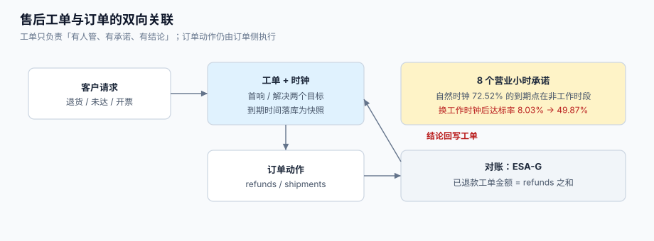

# 第 4 周补充 · 售后工单受理与 SLA 时钟

**一句话定位**：给订单中心补一个**外部客户能看见的入口**——「我要退货 / 我的货没到 / 我要开发票」这类请求不再进客服邮箱，而是落成工单、挂到订单上、并按一份**可解释的时钟**计时与升级。

前 26 章覆盖了下单、支付、库存、发货、开票、盘点，但所有入口都是**系统对系统**或**运营对系统**。真实客户不会调 API，他会发一条消息说「我的订单 20261001 一直没发货」。这条消息如果只进邮箱，订单中心就永远不知道「这个客户在等」——而**等待**恰恰是这一章要解决的问题。



本页判据族 `ESA-A` ~ `ESA-H`，共 8 条。定义表在第七节。

## 一、缺口三处

| # | 缺口 | 现象 | 后果 |
| --- | --- | --- | --- |
| ① | 没有「客户请求」这个对象 | 售后请求散落在邮箱、IM、电话里 | 无法统计「多少单在等回复」，也无法回答「这个客户提过几次」 |
| ② | 没有对外的时钟 | 内部有「支付超时 15 分钟」「发货 48 小时」，但没有一个时钟是**对客户承诺**的 | 客户体感与内部指标脱节：内部全绿，客户在群里骂 |
| ③ | 工单与订单是两套时间 | 订单侧说「已发货」，客服侧说「客户还在问货在哪」 | 谁都不知道「这次到底卡在哪一段」，两边各有一套口径 |

三处都不是「功能没做」，而是**表达不足**：订单表能表达「货到哪了」，表达不了「客户等了多久、我们承诺到什么时候」。

::: tip 一句话
这一章不做「客服系统」，只做**订单侧的售后入口 + 一个能和订单对账的 SLA 时钟**。完整的客服工程（会话、合并、分派、值班、度量口径）在[客服工单与 SLA 履约工程](../../../../docs/Backend/SupportTicket/index.md)，本章只取其中与订单强相关的四段。
:::

## 二、两张表：工单与时钟

```sql
-- [migrations/0025_after_sales_ticket.sql]
create table after_sales_ticket (
  id             bigserial primary key,
  tenant_id      bigint not null,
  ticket_no      text   not null,
  order_id       bigint not null references orders(id),
  kind           text   not null,          -- RETURN / NOT_DELIVERED / INVOICE / OTHER
  status         text   not null default 'NEW',
  priority       text   not null default 'NORMAL',
  requester_id   bigint not null,
  assignee_id    bigint,
  resolution_type text,                    -- REFUNDED / RESHIPPED / REJECTED / ANSWERED
  first_response_at timestamptz,
  resolved_at    timestamptz,
  closed_at      timestamptz,
  created_at     timestamptz not null default now(),
  unique (tenant_id, ticket_no),
  -- 一条硬约束：解决必须有类型，否则「已解决」没有意义
  constraint resolved_needs_type
    check (status <> 'RESOLVED' or resolution_type is not null)
);

create index idx_ast_open on after_sales_ticket (created_at)
  where status not in ('RESOLVED', 'CLOSED');

create table ticket_sla (
  id           bigserial primary key,
  ticket_id    bigint not null references after_sales_ticket(id),
  metric       text   not null,             -- first_reply / resolution
  started_at   timestamptz not null,
  target_at    timestamptz not null,        -- 按营业日历算出的到期时刻（落库快照）
  paused_total interval not null default '0',
  achieved_at  timestamptz,
  unique (ticket_id, metric, started_at)
);

create index idx_ticket_sla_due on ticket_sla (target_at) where achieved_at is null;
```

两张表的分工：`after_sales_ticket` 表达**处境**（谁在等、谁负责、怎么解决的），`ticket_sla` 表达**承诺**（哪一刻到期、是否达成）。把它们合成一张表是最常见的偷懒，代价是：客户一催问，`target_at` 就被业务同学「顺手往后调一天」，而系统里没有任何痕迹。

## 三、三条硬规定

::: danger 三条不可让步的规定
1. **工单必须挂在订单上**（`order_id not null`）。理由不是「方便查询」，而是**一致性**：任何售后动作（退款、补发、开票）都要回到订单上下文去校验（是否已退款、是否已发货、是否超过售后窗口）。没有 `order_id` 的工单只能靠人工去「找那个订单」，而在 1.2 万单/天的量级上，人工找单必然错。
2. **SLA 到期时间必须落库为快照**，且能从「起点 + 日历版本」重算。日历会被改（加节假日、调班次），现算的到期时间会让历史报表每天都变——而客户手里的承诺是**当时**那一刻。
3. **首响只由客户可见的回复回填**，内部备注不算。这一条决定了「达标率」是否可信：如果内部备注也算首响，坐席只要在工单里写一句「我看下」，首响就成了 2 分钟。
:::

营业日历的实现细节（多段工作时段、节假日与补班、夏令时）在[客服工单 · SLA 时钟](../../../../docs/Backend/SupportTicket/SLAClock/index.md)，本章直接用它的函数签名：

```python
# [app/sla.py]
def compute_target(start, hours, calendar) -> datetime:
    """在给定日历上把 hours 个营业小时加到 start 上，返回到期时刻。"""
    return add_business_hours(start, hours, calendar)
```

## 四、五步流水

| 步 | 动作 | 写哪些表 | 关键守卫 |
| --- | --- | --- | --- |
| S1 | 受理：写工单 + 两条 SLA 快照 | `after_sales_ticket`、`ticket_sla` | `order_id` 必须存在且属于该租户 |
| S2 | 分派：按 `kind` 路由到售后组 | `after_sales_ticket.assignee_id` | 必须落到**具体的人**，不是「售后组」 |
| S3 | 首响：坐席公开回复 | `first_response_at`、`ticket_sla.achieved_at` | `coalesce` 幂等，第二次回复不覆盖 |
| S4 | 处理：退款 / 补发 / 驳回（都要回写订单） | `refunds` / `shipments` 等 | 退款必须走已有的幂等键 `(order_id, refund_no)` |
| S5 | 关闭：解决 → 关单（保留重开窗口） | `resolution_type`、`closed_at` | 无 `resolution_type` 不得进 `RESOLVED` |

S4 是本章与订单中心真正的接缝：**工单不是另一个世界**。客户要退款，最终落的是 `refunds` 表；客户说没收到货，最终查的是 `shipments`。工单只负责「这件事有人管、有承诺、有结论」，不重复实现订单动作。

```sql
-- [app/s4_resolve.sql]
-- 一条 SQL 同时做两件事：写结论 + 把工单推到 RESOLVED
update after_sales_ticket
   set status = 'RESOLVED',
       resolution_type = $2,          -- REFUNDED / RESHIPPED / REJECTED / ANSWERED
       resolved_at = now()
 where id = $1
   and status in ('OPEN', 'PENDING')
   and resolution_type is null;       -- 幂等：重复调用第二次影响 0 行
```

## 五、时钟的两个读数（本机，Python 3.13.12 标准库）

承诺是「**8 营业小时内首响**」，团队 9:00–18:00 工作、周末双休。造 6,000 张工单，到达时间均匀分布在一周的自然时间里：

| 观察 | 读数 |
| --- | --- |
| 自然时钟的到期点落在非工作时段（夜里 / 周末） | **4,351 / 6,000 = 72.52%** |
| 同一批单的实际首响时刻，按自然时钟判超时 | **91.97%** |
| 同一批单的实际首响时刻，按工作时钟判超时 | **50.13%** |

差出来的约 42 个百分点不是「算法误差」，而是「**我们下班了**」被算成了「我们违约」。第五章的 N4 就用这组数做验收：同一批数据换一把尺，达标率必须从 8.03% 变成 49.87%，且**变化方向只能是这个方向**。

## 六、N1~N8 验收

| # | 验收项 | 做法 | 期望 |
| --- | --- | --- | --- |
| N1 | 工单必挂订单 | 造一条 `order_id` 不存在的工单 | 外键报错，工单不落库 |
| N2 | 首响幂等 | 同一工单连续两次公开回复 | `first_response_at` 只写一次 |
| N3 | 内部备注不算首响 | 只写 `visibility='internal'` 的备注 | `first_response_at is null`，且 SLA 未达成 |
| N4 | 时钟口径 | 对同一批 6,000 单分别用自然/工作时钟算达标率 | 自然 **8.03%**、工作 **49.87%** |
| N5 | 解决必须有类型 | `status='RESOLVED'` 但不填 `resolution_type` | `check` 约束拒绝 |
| N6 | 重复关闭幂等 | 对同一工单调两次 `s4_resolve` | 第二次 `UPDATE 0` |
| N7 | 到期扫描不重复升级 | 同一工单同一 metric 连扫 5 次 | 升级事件只 1 条 |
| N8 | 与订单对账 | 统计「已退款工单」与 `refunds` 表金额 | 两者相等，差 0 |

**N4 与 N8 是核心**：N4 证明时钟是「对客户承诺的那把尺」，N8 证明工单没有变成第二个真相源。N1/N3/N5 是守卫，N2/N6/N7 是幂等，缺任何一条都会在两周内长出「工单说已退、账上没退」这类事故。

## 七、本页判据

| 判据 | 看什么现象 | 判成什么 | 不满足时改哪里 |
| --- | --- | --- | --- |
| `ESA-A` | 工单 `order_id` 非空且有外键 | 工单不脱离订单 | 补外键与 `not null` |
| `ESA-B` | 两条 SLA 快照（首响 / 解决）在建单同事务内写入 | 无「无时钟工单」 | 把写快照放进 S1 事务 |
| `ESA-C` | 首响只由 `visibility='public'` 回填，且 `coalesce` 幂等 | 首响可信 | 改回填逻辑 |
| `ESA-D` | `RESOLVED` 必须有 `resolution_type`（`check` 约束） | 解决可解释 | 加约束 |
| `ESA-E` | 到期的扫描走部分索引，且有 `limit` | 扫描可控 | 建 `idx_ticket_sla_due` |
| `ESA-F` | 升级事件 `(ticket_id, metric, level)` 唯一 | 不重复打扰 | 加唯一约束 |
| `ESA-G` | 已退款工单金额 = `refunds` 金额之和 | 无双真相源 | 加对账 SQL 到日报 |
| `ESA-H` | 关单后可在窗口内重开，`reopened_count` 递增 | 重开可见 | 补重开流程与字段 |

## 八、如何验证（读者可执行）

```shell
# 1) 建表（读者自己的工程里执行迁移后）
psql "$DSN" -c "\d after_sales_ticket" | head -20
```

期望：能看到 `order_id`、`resolution_type`、`first_response_at`、`resolved_needs_type` 检查约束。

```shell
# 2) 造一张订单，再建一张售后工单（S1）
psql "$DSN" -c "insert into after_sales_ticket(tenant_id,ticket_no,order_id,kind,requester_id) \
  values (1,'T-20261025-0001',1,'RETURN',42);"
psql "$DSN" -c "select ticket_no, metric, target_at from ticket_sla where ticket_id=1 order by metric;"
```

期望：返回两行（`first_reply` / `resolution`），`target_at` 都不是「创建时间 + 8 小时」的自然结果——若你 17:00 建单，`target_at` 应落在**下一个工作日**。

```shell
# 3) 首响幂等 + 内部备注不算首响（N2 / N3）
psql "$DSN" -c "insert into ticket_message(ticket_id,author_type,visibility,channel,body) \
  values (1,'agent','internal','web','我看下');"
psql "$DSN" -c "select first_response_at from after_sales_ticket where id=1;"
```

期望：第一行为 `NULL`（内部备注不算首响）。再插一条 `public` 的消息，`first_response_at` 才有值，且第二次公开回复不改变它。

```shell
# 4) 解决必须有类型（N5）
psql "$DSN" -c "update after_sales_ticket set status='RESOLVED' where id=1;"
```

期望：`ERROR: new row for relation "after_sales_ticket" violates check constraint "resolved_needs_type"`。

```shell
# 5) 与订单对账（N8）
psql "$DSN" -c "select (select coalesce(sum(amount),0) from refunds where order_id in \
  (select order_id from after_sales_ticket where resolution_type='REFUNDED')) as refund_sum, \
  (select coalesce(sum(r.amount),0) from refunds r join after_sales_ticket t on t.order_id=r.order_id \
   where t.resolution_type='REFUNDED') as ticket_sum;"
```

期望：两列相等。不相等说明有人在工单侧「标记已退款」但没真正调退款接口——这正是本章要拦的形态。

```shell
# 6) 到期扫描不重复升级（N7）
for i in 1 2 3 4 5; do psql "$DSN" -f jobs/sla_due_scan.sql >/dev/null; done
psql "$DSN" -c "select ticket_id, metric, count(*) from ticket_escalation group by 1,2 having count(*)>1;"
```

期望：`0 rows`。

## 九、下一步

1. **把「待客户回复」纳入时钟**：当前只在首响与解决两处计时，客户回一句「好的」之后如果还有追问，需要「下次响应」时钟（口径见[客服工单 · SLA 时钟](../../../../docs/Backend/SupportTicket/SLAClock/index.md)的四个时钟对比）。
2. **与通知中心接上**：工单的受理回执、升级提醒走已有的 outbox，不新建通道（见[通知触达闭环](../NotifyFulfillment/index.md)）。
3. **售后原因结构化**：`kind` 现在只有四类，退货需要细分「质量问题 / 尺码不符 / 不想要」，否则退款率无法归因。
4. **进对账日报**：`ESA-G` 的两条 SQL 并入第 4 周的对账日报，避免订单侧与工单侧两套口径。

::: tip 本章的产出边界
本章只产出**文档**：DDL、时钟算法、五步流水、八条判据与六段可执行验证。读者照此在自己的工程里建表、写代码、跑命令；本仓库不提供示例工程（见 `AGENTS.md` 第 9 节）。
:::

## 参考资料

- [客服工单与 SLA 履约工程 · 总览](../../../../docs/Backend/SupportTicket/Overview/index.md)（七段链与三个时间）
- [客服工单与 SLA 履约工程 · 工单模型](../../../../docs/Backend/SupportTicket/TicketModel/index.md)（六态与审计）
- [客服工单与 SLA 履约工程 · SLA 时钟](../../../../docs/Backend/SupportTicket/SLAClock/index.md)（日历、暂停、夏令时）
- Zendesk《Defining and using SLA policies》：<https://support.zendesk.com/hc/en-us/articles/4408822163738>
- PostgreSQL 文档《Constraints》（`check` 与外键）：<https://www.postgresql.org/docs/current/ddl-constraints.html>
