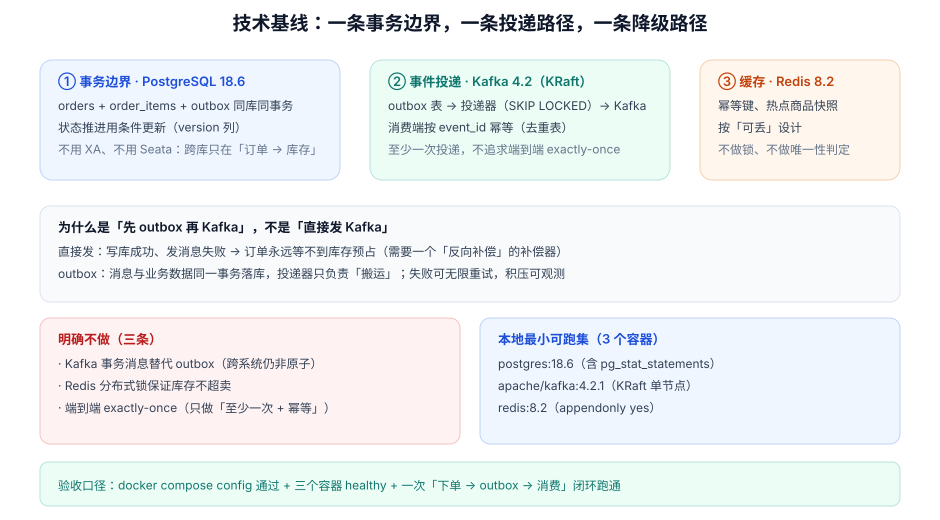

# 技术选型与版本基线

本页判据族 `ETS-A` ~ `ETS-H`，共 8 条。

第 181 天定下了「要做哪五个上下文、订单状态机怎么走」。这一步要回答的是**更硬的问题**：每个组件定到哪个小版本、为什么不是另一个、哪些能力用库实现、哪些必须上中间件，以及本地要跑起几个容器。

::: tip 一句话理解
技术选型文档的价值不在「选了谁」，而在**「为什么不是另一个」与「它已知会在哪里坏」**。没有这两段，三个月后没人敢升级，也每人说得清当初为什么这么定。
:::



## 一、当日做了什么

1. 定稿 **7 个组件的小版本**，并逐条写明「为什么不选相邻版本」；
2. 划清 **「用库实现」与「用中间件实现」** 的边界：事务内一致性交给 PostgreSQL，跨上下文一致性交给 outbox + Kafka，缓存只做可丢的加速；
3. 给出 **本地最小可跑集**（3 个容器）与资源配额，以及一条可执行的验收命令；
4. 把每个组件的 **已知坑** 落成表格（这一节是后面 12 章排障的索引）。

## 二、版本清单与「为什么不是别的版本」

| 组件 | 定稿版本 | 为什么是这个 | 为什么不是相邻版本 | 已知坑 |
| --- | --- | --- | --- | --- |
| JDK | **Java 25（LTS）** | 虚拟线程 GA 后的第一个 LTS，`ScopedValue` 预览转正路线清晰 | 不用 21：虚拟线程在 21 需 pinning 规避；不用 26：非 LTS，容器基础镜像跟进慢 | `synchronized` 块内仍可能 pinning 载体线程；`ThreadLocal` 在虚拟线程上按「每线程」复制，数量大时内存上涨 |
| 框架 | **Spring Boot 4.1.1**（Spring Framework 7.0.9） | 4.1.x 为当前推荐版本（4.1.0 GA 2026-06-10，4.1.1 2026-08-21），OSS 支持到 2027-07 | 不用 4.0.x：4.0 的 OSS 支持 2026-12-31 结束；不用 3.5：OSS 已于 2026-06-30 EOL | Boot 4 起 `spring-boot-starter-*` 的自动配置有包路径调整，`@ConfigurationProperties` 校验失败会抛带 cause 的新异常；`@Async` 的上下文传播在 4.1 才补齐 |
| 数据库 | **PostgreSQL 18.6** | 需要 `FOR UPDATE SKIP LOCKED`（outbox 扫描）、`jsonb`（事件载荷）、`RETURNING`（条件更新回读） | 不用 17：18 起 `uuidv7()` 内置，省掉应用侧生成；不用 MySQL：本项目跨上下文靠事件，不需要 XA，但需要 `SKIP LOCKED` 的稳定语义与部分索引 | 18 起 `VACUUM`/`ANALYZE` 默认处理继承子表；分区表禁止 `UNLOGGED`；`lock_timeout` 默认 0（无限等） |
| 消息 | **Kafka 4.2.1（KRaft）** | 4.x 起 ZooKeeper 已移除，单节点 KRaft 足够验证语义 | 不用 3.x：3.x 的 KRaft 仍是「预览/迁移」形态，配置项与 4.x 不同 | 单节点 `replication.factor` 只能为 1，`min.insync.replicas` 的语义验不出来；`auto.create.topics.enable` 必须关掉，否则拼错 topic 会静默创建 |
| 缓存 | **Redis 8.2** | 幂等键与热点快照，`SET NX PX` + Lua 足够 | 不用 7.x：8.x 的单机内存效率与 `HGETDEL` 一类命令更省往返 | 按「可丢」设计：命中率下降只能变慢，不能变错；不拿它做唯一性判定 |
| 迁移 | **Flyway 11.x** | 与 Boot 4.1 的自动配置兼容，SQL 迁移可读可评审 | 不用 Liquibase：本项目的迁移以手写 SQL + 索引为主，XML/YAML 抽象收益低 | `afterMigrate` 回调**无待执行迁移时不触发**；SQL 回调不在迁移事务内 |
| 可观测 | **OpenTelemetry 1.62 + Prometheus** | Boot 4.1 的 OTel 起步依赖已内置，事件延迟与积压必须能看见 | 不用纯日志：跨上下文的事件链无法用日志串联 | 虚拟线程下 span 的父子关系依赖上下文传播，`@Async` 需显式开启 |

::: info 版本口径
上表的版本号按 **2026-10** 的官方发布信息核对：Spring Boot 4.1.0 GA 于 2026-06-10、4.1.1 于 2026-08-21；Spring Boot 3.5 的 OSS 支持已于 2026-06-30 结束；Kafka 4.x 起不再包含 ZooKeeper。项目**不追求「最新」，只追求「在支持窗口内 + 已知坑可接受」**。
:::

## 三、三条能力边界

### 边界一：事务内一致性归数据库

订单、订单项、outbox 三张表在**同一个库、同一个事务**里写。这不是「偷懒」，而是**唯一能让「订单已创建」与「事件已登记」同时成立的做法**。

```sql
-- 一个事务里做完三件事
BEGIN;

INSERT INTO orders (id, tenant_id, buyer_id, status, amount_cents, version)
VALUES ($1, $2, $3, 'AWAITING_PAYMENT', $4, 0);

INSERT INTO order_items (order_id, sku, qty, unit_price_cents)
SELECT $1, sku, qty, unit_price_cents FROM unnest($5::order_item_input[]);

INSERT INTO outbox (id, aggregate_type, aggregate_id, event_type, payload, created_at)
VALUES ($6, 'order', $1, 'order.created', $7::jsonb, now());

COMMIT;
```

### 边界二：跨上下文一致性归 outbox

「写库成功、发消息失败」是分布式事务最经典的缺口。outbox 把这个缺口变成**「投递器可能重复搬」**，而重复是可以幂等消费掉的：

| 方案 | 缺口在哪 | 谁来兜 |
| --- | --- | --- |
| 直接发 Kafka | 写库成功、发送失败 | 需要反向补偿器（谁都没订阅到，靠扫描补） |
| Kafka 事务消息 | 跨系统（库 +  broker）仍非原子 | 仍需「本地状态表 + 对账」 |
| **outbox + 投递器** | 投递可能重复、可能延迟 | 消费端按 `event_id` 幂等；积压可观测、可重放 |

### 边界三：缓存只做加速，不做判定

| 想用 Redis 做的事 | 能不能 | 原因 |
| --- | --- | --- |
| 幂等键去重（短窗口） | ✅ | 丢了最多多一次请求，服务端唯一约束兜底 |
| 热点商品快照 | ✅ | 丢了回源查库 |
| 「库存是否充足」的最终判定 | ❌ | 缓存与库不一致时，超卖 |
| 分布式锁防重复下单 | ❌ | 锁失效即重复；正确做法是唯一约束 + 幂等键 |

## 四、本地最小可跑集

三个容器，资源按「一台 16 GB 的开发机」估算：

| 容器 | 镜像 | 端口 | 内存上限 | 用途 |
| --- | --- | --- | --- | --- |
| `eoh-pg` | `postgres:18.6` | 55432 | 1 GB | 业务库 + outbox；`shared_preload_libraries=pg_stat_statements` |
| `eoh-kafka` | `apache/kafka:4.2.1` | 59092 | 1.5 GB | KRaft 单节点；`auto.create.topics.enable=false` |
| `eoh-redis` | `redis:8.2` | 56379 | 256 MB | 幂等键与热点快照；`appendonly yes` |

```yaml [deploy/compose.yaml]
services:
  eoh-pg:
    image: postgres:18.6
    environment:
      POSTGRES_DB: eoh
      POSTGRES_USER: eoh
      POSTGRES_PASSWORD: eoh_local_only
    ports: ["55432:5432"]
    command: >
      postgres -c shared_preload_libraries=pg_stat_statements
               -c lock_timeout=3s -c statement_timeout=30s
    healthcheck:
      test: ["CMD-SHELL", "pg_isready -U eoh -d eoh"]
      interval: 5s
      retries: 10
    deploy: { resources: { limits: { memory: 1g } } }

  eoh-kafka:
    image: apache/kafka:4.2.1
    ports: ["59092:9092"]
    environment:
      KAFKA_NODE_ID: 1
      KAFKA_PROCESS_ROLES: broker,controller
      KAFKA_LISTENERS: PLAINTEXT://:9092,CONTROLLER://:9093
      KAFKA_ADVERTISED_LISTENERS: PLAINTEXT://localhost:59092
      KAFKA_CONTROLLER_QUORUM_VOTERS: 1@eoh-kafka:9093
      KAFKA_CONTROLLER_LISTENER_NAMES: CONTROLLER
      KAFKA_LISTENER_SECURITY_PROTOCOL_MAP: CONTROLLER:PLAINTEXT,PLAINTEXT:PLAINTEXT
      KAFKA_OFFSETS_TOPIC_REPLICATION_FACTOR: 1
      KAFKA_TRANSACTION_STATE_LOG_REPLICATION_FACTOR: 1
      KAFKA_AUTO_CREATE_TOPICS_ENABLE: "false"
    healthcheck:
      test: ["CMD-SHELL", "/opt/kafka/bin/kafka-broker-api-versions.sh --bootstrap-server localhost:9092 >/dev/null 2>&1"]
      interval: 10s
      retries: 10
    deploy: { resources: { limits: { memory: 1536m } } }

  eoh-redis:
    image: redis:8.2
    ports: ["56379:6379"]
    command: ["redis-server", "--appendonly", "yes", "--maxmemory", "256mb", "--maxmemory-policy", "allkeys-lru"]
    healthcheck:
      test: ["CMD", "redis-cli", "ping"]
      interval: 5s
      retries: 10
```

::: danger 本地编排的四个坑
1. **`deploy.resources` 在非 Swarm 的 `docker compose up` 下被忽略**：要真正限制内存，用 `mem_limit`（Compose V2 支持）或 `docker compose --compatibility up`。
2. **Kafka 的 `ADVERTISED_LISTENERS` 写容器名**：宿主机客户端会拿到 `eoh-kafka:9092` 这个解析不了的主机名。必须写 `localhost:宿主端口`。
3. **`auto.create.topics.enable=true`（默认）会掩盖拼写错误**：消费者订阅 `order.created` 而生产发到 `orders.created`，两边都不报错，只是永远没消息。
4. **PG 的 `lock_timeout` 默认是 0（无限等）**：本地跑迁移时一个未提交事务能把后续所有 DDL 挂住，必须显式设成 3s。
:::

## 五、如何验证

### 5.1 编排文件本身

```shell
cd deploy
docker compose config >/dev/null && echo "COMPOSE_OK"
# 期望输出：COMPOSE_OK（有语法错会直接报 yaml 解析错误）
```

### 5.2 三个容器都健康

```shell
docker compose up -d
docker compose ps --format 'table {{.Name}}\t{{.Status}}'
# 期望：三行都是 (healthy)
```

### 5.3 版本与关键参数逐个核对

```shell
# PostgreSQL：版本 + 三个关键参数
docker exec eoh-pg psql -U eoh -d eoh -Atc "select version();"
docker exec eoh-pg psql -U eoh -d eoh -Atc "show lock_timeout; show statement_timeout; show shared_preload_libraries;"
# 期望：18.6 / 3s / 30s / pg_stat_statements

# Kafka：版本 + KRaft 模式 + 自动建 topic 已关闭
docker exec eoh-kafka /opt/kafka/bin/kafka-broker-api-versions.sh --bootstrap-server localhost:9092 | head -3
docker exec eoh-kafka grep -E "auto.create.topics.enable|process.roles" /opt/kafka/config/server.properties || true

# Redis：版本 + 淘汰策略
docker exec eoh-redis redis-cli INFO server | grep redis_version
docker exec eoh-redis redis-cli CONFIG GET maxmemory-policy
# 期望：8.2.x / allkeys-lru
```

### 5.4 一次最小闭环（不写业务代码也能验）

```shell
# ① 建 topic（3 分区，与后续消费并发度对齐）
docker exec eoh-kafka /opt/kafka/bin/kafka-topics.sh \
  --bootstrap-server localhost:9092 --create --topic order.created \
  --partitions 3 --replication-factor 1

# ② 造一条 outbox 记录并手工投递一条消息
docker exec eoh-pg psql -U eoh -d eoh -c "
  create table if not exists outbox_probe (id uuid primary key, payload jsonb, sent boolean default false);
  insert into outbox_probe (id, payload) values (gen_random_uuid(), '{\"type\":\"order.created\"}');"
echo '{"type":"order.created","probe":true}' | \
  docker exec -i eoh-kafka /opt/kafka/bin/kafka-console-producer.sh \
  --bootstrap-server localhost:9092 --topic order.created

# ③ 读回来
docker exec eoh-kafka /opt/kafka/bin/kafka-console-consumer.sh \
  --bootstrap-server localhost:9092 --topic order.created --from-beginning --max-messages 1 --timeout-ms 10000
# 期望：打印出 {"type":"order.created","probe":true}
```

三步都通过，才算「基线可跑」。任何一步失败，先修基线，不要开始写业务代码。

## 六、判据 `ETS-A` ~ `ETS-H`

| 编号 | 判据 | 怎么验证 |
| --- | --- | --- |
| `ETS-A` | 每个组件都定到具体小版本，且写明「为什么不是相邻版本」 | 读本页第二节表格，缺「为什么不是」一列的组件即不合格 |
| `ETS-B` | 所有版本都在官方支持窗口内 | 对照 Spring Boot / PostgreSQL / Kafka / Redis 的支持周期表；出现 EOL 版本即不合格 |
| `ETS-C` | 事务边界明确：哪些表必须同库同事务 | `orders` / `order_items` / `outbox` 三表在同一 schema，且写入在同一条 `BEGIN…COMMIT` |
| `ETS-D` | 跨上下文一致性只走 outbox，不存在「直接发消息 + 期望成功」的路径 | `grep -rn "kafkaTemplate.send" src/` 只允许出现在投递器里 |
| `ETS-E` | 缓存不参与任何「是否允许」的判定 | 搜索 Redis 读写点，每处都能说明「丢了会变慢不会变错」 |
| `ETS-F` | 本地编排可通过 `docker compose config` | 见 5.1，输出 `COMPOSE_OK` |
| `ETS-G` | 三个容器 healthy，且版本与上表一致 | 见 5.3，逐条比对输出 |
| `ETS-H` | 一次最小闭环（建 topic → 生产 → 消费）跑通 | 见 5.4，消费者打印出探针消息 |

## 七、下一步

**第 183 天**（第 1 周第 3 步）：**架构设计：事件流与一致性边界**。要做四件事：

1. 画出五条事件的完整流向（`order.created` / `stock.reserved` / `payment.succeeded` / `shipment.delivered` / `refund.requested`），标出每一段的「谁写、谁读、失败谁兜」；
2. 定下 **outbox 投递器的三个参数**：扫描批量、空转间隔、最大重试，并说明取值依据；
3. 定 **消费端幂等键**（`event_id` + `consumer_group`）与去重表的清理窗口；
4. 给出「事件丢失 / 事件重复 / 事件乱序」三种故障的检测手段（各自一条 SQL 或一个指标）。

## 八、相关页面

- 上一篇：[需求拆分：五个上下文、十个故事与订单状态机](../Requirements/index.md)（`EOH-A` ~ `EOH-H`）。
- 下一篇：架构设计：事件流与一致性边界（第 183 天）。
- 相邻必读：[数据库变更与在线 Schema 演进](../../../../docs/DB/SchemaEvolution/index.md)（第 4 周加字段时的流程）、[分布式事务](../../../../docs/Backend/Microservices/DistributedTransaction/index.md)（为什么不选 Seata）、[Kafka](../../../../docs/Backend/MessageQueue/Kafka/index.md)（KRaft 与分区语义）。

## 与本专题（数据库大版本升级）的分工

| 问题 | 看哪里 |
| --- | --- |
| 为什么定 PG 18.6、Kafka 4.2.1、Redis 8.2 | 本页 |
| 以后从 18 升到 19 要走什么路径 | [数据库大版本升级与切换](../../../../docs/Ops/DatabaseUpgrade/index.md)、[PostgreSQL 17 → 18](../../../../docs/Ops/DatabaseUpgrade/PostgreSQL17To18/index.md) |
| 升级时 outbox 与序列要怎么处理 | [逻辑复制迁移](../../../../docs/Ops/DatabaseUpgrade/LogicalMigration/index.md) |

**这一页特有的坑：把「PG 18.6」写进基线，就要同时写下它的升级出口。** 本项目的 outbox 依赖「序列不随逻辑复制同步」这一事实来设计修序列步骤；而 PG 19 起 sequence 值会被复制，届时这一步会从「必须手工修」变成「仍要核对但一般自动同步」。**基线文档里不写升级出口，两年后接手的人会以为那套手工步骤永远成立。**

## 参考资料

- [Spring Boot 4.1.0 发布公告](https://spring.io/blog/2026/06/10/spring-boot-4-1-0-available-now)
- [Spring Boot 支持周期](https://spring.io/projects/spring-boot#support)
- [PostgreSQL 18 文档 · `SELECT … FOR UPDATE`](https://www.postgresql.org/docs/18/sql-select.html)
- [Apache Kafka 4.x 文档 · KRaft 模式](https://kafka.apache.org/documentation/#kraft)
- [Chris Richardson · Pattern: Transactional outbox](https://microservices.io/patterns/data/transactional-outbox.html)
