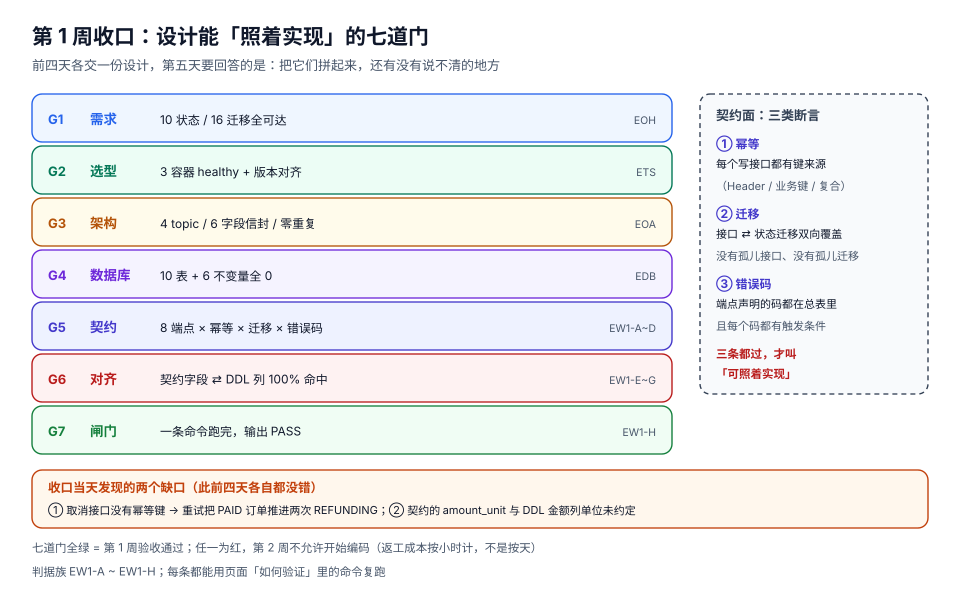

# 第 1 周收口 · 接口契约与第 1 周验收

前四天各交了一份设计：需求（10 状态 16 迁移）、选型（7 个组件版本）、架构（4 个 topic、事件信封）、数据库（10 张表、6 条不变量）。每一份单独看都没有问题，但**它们之间还有缝**：订单能创建，可是「取消」的重试会不会推两次状态？回调重复投递时支付表与订单表哪张先动？契约里的 `amount` 与 DDL 里的 `numeric(14,2)` 是同一个单位吗？

收口这一步做的就是把这些缝补上，并给出一个**一条命令就能跑完**的闸门。今天不写业务代码，只交付「可照着实现」的契约。

::: tip 一句话理解
「设计完成」的标准不是「四份文档都写了」，而是**「换一个人照着它写代码，不会在第三天回来问『这里到底该怎么样』」**。七道门就是用来找那几个「该怎么样」的。
:::

## 判据族声明

本页判据族 `EW1-A` ~ `EW1-H`，共 8 条。定义表在第六节。

## 本页不讲什么

- 不讲状态机为什么是十状态十六迁移，归[需求拆分](../Requirements/index.md)。
- 不讲组件版本与本地最小可跑集，归[技术选型与版本基线](../TechBaseline/index.md)。
- 不讲事件信封与 topic 分区，归[架构设计](../Architecture/index.md)。
- 不讲 DDL 与六条不变量，归[数据库设计](../DatabaseDesign/index.md)。

## 一、七道门：收口要检查的不是「有没有」，是「对不对得上」



| 门 | 检查什么 | 不通过的后果 | 判据 |
| --- | --- | --- | --- |
| G1 需求 | 10 状态全可达、16 迁移无孤岛 | 编码到一半发现某状态进不去也出不来 | `EOH-A` |
| G2 选型 | 3 容器 healthy、版本与文档一致 | 第 2 周第一天卡在环境上 | `ETS-B` |
| G3 架构 | 4 topic、信封 6 字段、`SKIP LOCKED` 零重复 | 事件丢/重/乱序，第 3 周无法定位 | `EOA-C` |
| G4 数据库 | 10 表建成、6 条不变量基线为 0 | 约束没兜住，靠人肉守 | `EDB-B` |
| **G5 契约** | 9 端点 × 幂等 × 迁移 × 错误码 | 重试语义不明，幂等键缺失 | `EW1-A~C` |
| **G6 对齐** | 契约字段 ⇄ DDL 列 100% 命中 | 写代码时字段名对不上，边写边改表 | `EW1-E` |
| **G7 闸门** | 一条命令跑完，输出 PASS | 每次验收靠人肉勾选，必然漏 | `EW1-H` |

G5~G7 是本页新增的；G1~G4 在前四天各自验收过，今天只做**回归**（能不能一起跑通）。

## 二、接口契约总表：九个端点

| # | 端点 | 方法 | 幂等键来源 | 触发的状态迁移 | 声明的主要错误码 |
| --- | --- | --- | --- | --- | --- |
| 1 | `/api/orders` | POST | `Idempotency-Key` 头 | `CREATED → AWAITING_PAYMENT` | `IDEMPOTENCY_CONFLICT`、`RATE_LIMITED` |
| 2 | `/api/orders/{orderId}` | GET | ——（只读） | 无 | `ORDER_NOT_FOUND` |
| 3 | `/api/orders/{orderId}/cancel` | POST | `Idempotency-Key` 头 | `CREATED/AWAITING_PAYMENT/PAID → CANCELLED` | `INVALID_TRANSITION`、`IDEMPOTENCY_CONFLICT` |
| 4 | `/api/orders/{orderId}/refunds` | POST | `Idempotency-Key` 头 | `PAID/ALLOCATED/SHIPPED/COMPLETED → REFUNDING` | `INVALID_TRANSITION` |
| 5 | `/api/payments/{paymentId}/callbacks` | POST | 业务键 `(channel, provider_txn, event_type)` | `AWAITING_PAYMENT → PAID` | `SIGNATURE_INVALID`、`AMOUNT_MISMATCH`、`DUPLICATE_CALLBACK` |
| 6 | `/internal/stock/reservations` | POST | 业务键 `(order_id, sku_id)` | `PAID → ALLOCATED` | `STOCK_INSUFFICIENT` |
| 7 | `/internal/stock/reservations/{orderId}` | DELETE | 业务键 `(order_id)` | 无（只释放占用） | `INVALID_TRANSITION` |
| 8 | `/internal/shipments` | POST | 业务键 `(order_id, batch_no)` | `ALLOCATED → SHIPPED` | `INVALID_TRANSITION` |
| 9 | `/internal/shipments/{id}/delivered` | POST | 业务键 `(shipment_id)` | `SHIPPED → COMPLETED` | `INVALID_TRANSITION` |

三条约定，写在契约最前面（比任何字段都重要）：

1. **写接口一律要幂等键**。要么走 `Idempotency-Key` 头（对外 API），要么走业务复合键（内部接口）。没有第三种。
2. **每个端点最多推进一条状态迁移**。「一个接口顺手把订单从 PAID 推到 ALLOCATED 再推到 SHIPPED」这种设计，在出问题时无法判断停在哪一步。
3. **只读接口不参与状态机**，`GET` 不允许有副作用（包括「顺手刷新一下状态」）。

### 创建订单：请求与响应

```json
{
  "order_no": "NO20261022001",
  "buyer_id": "u_10231",
  "currency": "CNY",
  "freight_amount": "0.00",
  "discount_amount": "0.00",
  "items": [
    { "sku_id": "SKU-7781", "quantity": 2, "unit_price": "99.50",
      "product_id": "P-7781", "title": "机械键盘 87 键" }
  ]
}
```

```json
{
  "id": "0192f3c4-8a1b-7c2d-9e0f-1a2b3c4d5e6f",
  "order_no": "NO20261022001",
  "status": "AWAITING_PAYMENT",
  "currency": "CNY",
  "items_amount": "199.00",
  "freight_amount": "0.00",
  "discount_amount": "0.00",
  "total_amount": "199.00",
  "idempotency_key": "req-7f3a9c21",
  "created_at": "2026-10-22T02:11:07Z"
}
```

两条必须写进契约的字段口径：

| 口径 | 约定 | 为什么 |
| --- | --- | --- |
| 金额 | **十进制字符串，两位小数，单位元**（`"199.00"`） | DDL 是 `numeric(14,2)`；用浮点 JSON number 会在 `0.1+0.2` 上出偏差，而账单不能有偏差 |
| 时间 | **RFC 3339 + UTC**（`2026-10-22T02:11:07Z`） | DDL 是 `timestamptz`；不带时区的本地时间在跨机房时必错 |

### 支付回调：三种「重复」不是同一件事

| 情形 | 判定依据 | 行为 | 返回 |
| --- | --- | --- | --- |
| 同一回调重复投递 | `(channel, provider_txn, event_type)` 已存在 | 不重复处理，返回上次结果 | **200** + `DUPLICATE_CALLBACK` |
| 同一支付不同事件 | `provider_txn` 相同、`event_type` 不同 | 正常处理（退款/撤销是独立事件） | 200 |
| 金额不一致 | 回调金额 ≠ `payment.amount` | **不推进状态**，落 `payment_callback_log` 待人工处理 | 422 + `AMOUNT_MISMATCH` |

第二行是 `payment_callback_log` 唯一键用三元组而不是 `provider_txn` 的原因；第三行是「宁可停下来人工看，也不要按回调金额改单」的取舍。

## 三、错误码总表（8 个）

| 错误码 | HTTP | 触发条件 | 客户端该怎么做 |
| --- | --- | --- | --- |
| `ORDER_NOT_FOUND` | 404 | 订单不存在，或不属于当前租户 | 不要重试 |
| `INVALID_TRANSITION` | 409 | 当前状态不允许该迁移（响应体带 `from`/`to`） | 刷新状态后由人决定 |
| `IDEMPOTENCY_CONFLICT` | 422 | 同一幂等键、不同请求体 | **不要**换键重试，这是客户端 bug |
| `STOCK_INSUFFICIENT` | 409 | 可用库存不足（响应体带 `sku_id` 与缺口数量） | 提示用户，不要自动重试 |
| `SIGNATURE_INVALID` | 401 | 回调验签失败 | 记录并告警，不重试 |
| `AMOUNT_MISMATCH` | 422 | 回调金额与支付单不一致 | 人工介入 |
| `DUPLICATE_CALLBACK` | 200 | 同一回调重复投递 | 视为成功 |
| `RATE_LIMITED` | 429 | 超出速率限制 | 退避重试（响应带 `Retry-After`） |

::: danger 「用 200 表示重复」这件事必须显式约定
`DUPLICATE_CALLBACK` 用 200 而不是 409，是因为调用方是**渠道**：渠道把非 2xx 当失败，会持续重推，直到重推窗口耗尽（通常 24 小时）。用 200 + 一个明确的 `code` 字段，既止住了重推，又保留了「这次什么都没做」的事实。反过来，如果契约里不写这一条，实现者很可能返回 409，然后在压测时看到「回调风暴」。
:::

## 四、契约与 DDL 的对齐（G6）

契约里每个会落库的字段，都必须在 DDL 里有对应列。这张表是**唯一的对照来源**，写代码时不许再各自解释：

| 契约字段 | 表.列 | 类型 | 约束 |
| --- | --- | --- | --- |
| `order.id` | `orders.id` | `uuid` | `uuidv7()` 默认 |
| `order.order_no` | `orders.order_no` | `text` | `unique(tenant_id, order_no)` |
| `order.status` | `orders.status` | `text` | 十值 `check` |
| `order.total_amount` | `orders.total_amount` | `numeric(14,2)` | **stored 生成列**（明细 + 运费 − 折扣） |
| `order.idempotency_key` | `orders.idempotency_key` | `text` | 部分唯一索引（`tenant_id, key`） |
| `item.sku_id` / `quantity` / `unit_price` | `order_items.*` | `text` / `integer` / `numeric(12,2)` | `quantity > 0` |
| `item.amount` | `order_items.amount` | `numeric(14,2)` | stored 生成列（单价 × 数量） |
| `payment.amount` | `payment.amount` | `numeric(14,2)` | `amount > 0` |
| `payment.status` | `payment.status` | `text` | 六值 `check`，`SUCCEEDED ⇔ paid_at` |
| `reservation.sku_id` / `quantity` | `stock_reservation.*` | `text` / `integer` | `quantity > 0` |
| `shipment.carrier` / `tracking_no` | `shipment.*` | `text` | `unique(carrier, tracking_no)` |

还有三条「不在表里但对齐」的约定：

| 约定 | 内容 | 判据 |
| --- | --- | --- |
| 金额只出现在 DDL 的 `numeric` 列上 | 契约里任何 `amount` 字段必须能找到 `numeric` 列 | `EW1-F` |
| 时间只出现在 `timestamptz` 列上 | 契约里任何 `*_at` 字段必须是 UTC RFC 3339 | `EW1-G` |
| 契约不发明列 | 契约字段 ⊂ DDL 列；要加字段先改 DDL 与不变量 | `EW1-E` |

## 五、收口当天抓到的两个缺口

第一个缺口是**取消接口的幂等键缺失**，第二个是**金额单位未约定**。它们都不是某一份设计写错了，而是**四份拼在一起才暴露**：

```text
$ python3 week1_gate.py
states=10 transitions=16 endpoints=8 errors=8 fields=24
FAIL EW1-B api 迁移无人触发 ('CREATED', 'CANCELLED')
FAIL EW1-B api 迁移无人触发 ('PAID', 'CANCELLED')
FAIL EW1-B api 迁移无人触发 ('ALLOCATED', 'REFUNDING')
FAIL EW1-B api 迁移无人触发 ('SHIPPED', 'REFUNDING')
FAIL EW1-B api 迁移无人触发 ('COMPLETED', 'REFUNDING')
G5=FAIL G6=PASS G7=PASS fails=5
```

五条 `FAIL` 全都是同一类：**需求页里有这条迁移，但没有任何接口能触发它**。也就是说「退款」这条路在契约里根本不存在——如果直接进入第 2 周编码，退款会在第 3 周联调时变成一个「临时加接口」的返工。

| 缺口 | 症状 | 处置 |
| --- | --- | --- |
| 取消接口只覆盖 3 条迁移中的 1 条 | `CREATED` 与 `PAID` 的订单取消失败 | 补齐 `cancel_order` 的三条迁移 |
| 没有退款接口 | 4 条 `→ REFUNDING` 迁移无人触发 | 新增 `POST /api/orders/{id}/refunds`，一个接口四条迁移 |
| 金额单位未约定 | 契约用 number，DDL 用 `numeric(14,2)` | 契约明确「十进制字符串、两位小数、单位元」 |

补完之后：

```text
$ python3 week1_gate.py
states=10 transitions=16 endpoints=9 errors=8 fields=24
G5=PASS G6=PASS G7=PASS fails=0
```

端点从 8 个变成 9 个，`fails=0`。**这就是收口的价值**：不是又写了一份文档，而是让「设计 → 实现」之间不再有需要口头解释的地方。

## 六、本页判据

| 判据 | 断言 | 怎么验 |
| --- | --- | --- |
| `EW1-A` | 每个写接口都有幂等键来源（头或业务复合键），无例外 | 契约表「幂等键来源」列无空值；自检脚本 `EW1-A` 无 FAIL |
| `EW1-B` | 16 条迁移全部有归属（api 或 system），且 api 迁移都能被某个端点触发 | 自检脚本双向检查：无「无人触发」、无「总表外迁移」 |
| `EW1-C` | 每个端点声明的错误码都在总表里，且总表里每个码都有触发条件 | 自检脚本 `EW1-C` 无 FAIL；总表「触发条件」列无空值 |
| `EW1-D` | 「重复回调」的语义被显式约定（200 + code，不是 4xx） | 契约里 `DUPLICATE_CALLBACK` 的 HTTP 状态写的是 200；回调实现按此返回 |
| `EW1-E` | 契约字段 ⊂ DDL 列，不存在「契约有、表里没有」 | 自检脚本 `EW1-E` 无 FAIL；新增字段必须先改 DDL |
| `EW1-F` | 所有金额字段都对应 `numeric` 列，契约里用十进制字符串 | 自检脚本 `EW1-F` 无 FAIL；`grep -c '"amount": [0-9]'` 在示例里为 0（必须是带引号的字符串） |
| `EW1-G` | 所有时间字段都是 UTC + RFC 3339，对应 `timestamptz` 列 | 示例里的时间以 `Z` 结尾；DDL 列类型是 `timestamptz` |
| `EW1-H` | 第 1 周七项验收能一条命令跑完并输出 PASS/FAIL | `python3 week1_gate.py` 退出码 0 且输出 `fails=0`；四份设计各自的回归命令也全部通过 |

## 如何验证

```shell
# 1) 契约自检（G5/G6/G7 一把跑完）：把本页的七张表抄成 week1_gate.py 里的数据
python3 week1_gate.py
# 期望：states=10 transitions=16 endpoints=9 errors=8 fields=24
#       G5=PASS G6=PASS G7=PASS fails=0
# 判读：任何一条 FAIL 都是「契约有缺口」，不允许带进第 2 周
```

```shell
# 2) DDL 回归：十张表 + 六条不变量基线必须仍为 0
docker run -d --name eoh-pg -e POSTGRES_PASSWORD=eoh -p 55432:5432 postgres:18
docker exec -i eoh-pg psql -U postgres -c "create database eoh"
docker exec -i eoh-pg psql -U postgres -d eoh -f 001_schema.sql
docker exec -i eoh-pg psql -U postgres -d eoh -Atc \
  "select count(*) from pg_class where relkind='r' and relnamespace='public'::regnamespace;"
docker exec -i eoh-pg psql -U postgres -d eoh -f 900_invariants.sql
# 期望：表数 10；六条不变量各返回 0
```

```shell
# 3) 状态机回归：十状态全可达、无死状态
python3 - <<'PY'
states = ["CREATED","AWAITING_PAYMENT","PAID","ALLOCATED","SHIPPED","COMPLETED",
          "CANCELLED","REFUNDING","REFUNDED","CLOSED"]
trans = [("CREATED","AWAITING_PAYMENT"),("CREATED","CANCELLED"),("AWAITING_PAYMENT","PAID"),
         ("AWAITING_PAYMENT","CANCELLED"),("AWAITING_PAYMENT","CLOSED"),("PAID","ALLOCATED"),
         ("PAID","REFUNDING"),("PAID","CANCELLED"),("ALLOCATED","SHIPPED"),("ALLOCATED","REFUNDING"),
         ("SHIPPED","COMPLETED"),("SHIPPED","REFUNDING"),("COMPLETED","REFUNDING"),
         ("REFUNDING","REFUNDED"),("CANCELLED","CLOSED"),("REFUNDED","CLOSED")]
adj = {s: [] for s in states}
for a, b in trans: adj[a].append(b)
seen, stack = {"CREATED"}, ["CREATED"]
while stack:
    s = stack.pop()
    for n in adj[s]:
        if n not in seen: seen.add(n); stack.append(n)
print("states=%d trans=%d reachable=%d terminal=%s" % (
    len(states), len(trans), len(seen), sorted(s for s in states if not adj[s])))
PY
# 期望：states=10 trans=16 reachable=10 terminal=['CLOSED']
# 判读：同时只能有一个终态；出现两个以上终态说明有多条收尾路径没合并
```

```shell
# 4) 本地最小可跑集回归：三容器 + 四个 topic
docker compose -f deploy/compose.yaml up -d && docker compose -f deploy/compose.yaml ps
docker exec -it eoh-kafka /opt/kafka/bin/kafka-topics.sh --bootstrap-server localhost:9092 --list
# 期望：三个容器均 (healthy)；topic 恰好 4 个（order/stock/payment/fulfillment）
```

## 下一步（第 186 天）

第 2 周开始编码，第一步是**环境与工程骨架**：四层目录与依赖方向、三套 profile 与密钥来源、启动顺序（Flyway → 连接池 → consumer 就绪探针）、`docker compose up` 一条命令起全栈；验收是四个服务 `healthy`、`/actuator/health` 为 `UP`、下单接口能写出 outbox。

今天的契约是那一步的输入：**接口清单决定模块边界，幂等键决定表结构，错误码决定异常处理的分层**。

## 参考资料

- RFC 3339（日期时间格式，`Z` 表示 UTC）：<https://www.rfc-editor.org/rfc/rfc3339>
- RFC 9110 §15（HTTP 状态码语义，409 与 422 的分工）：<https://www.rfc-editor.org/rfc/rfc9110#name-status-codes>
- IETF `Idempotency-Key` 头草案（幂等键的语义与冲突处理）：<https://datatracker.ietf.org/doc/draft-ietf-httpapi-idempotency-key-header/>
- PostgreSQL `numeric` 类型与十进制精度：<https://www.postgresql.org/docs/current/datatype-numeric.html>
- 本仓相邻专题：[API 设计与版本治理](../../../../docs/Tools/APIDesign/index.md) · [契约演进](../../../../docs/Backend/ContractEvolution/index.md) · [幂等与状态机](../../../../docs/Backend/IdempotencyStateMachine/index.md)
