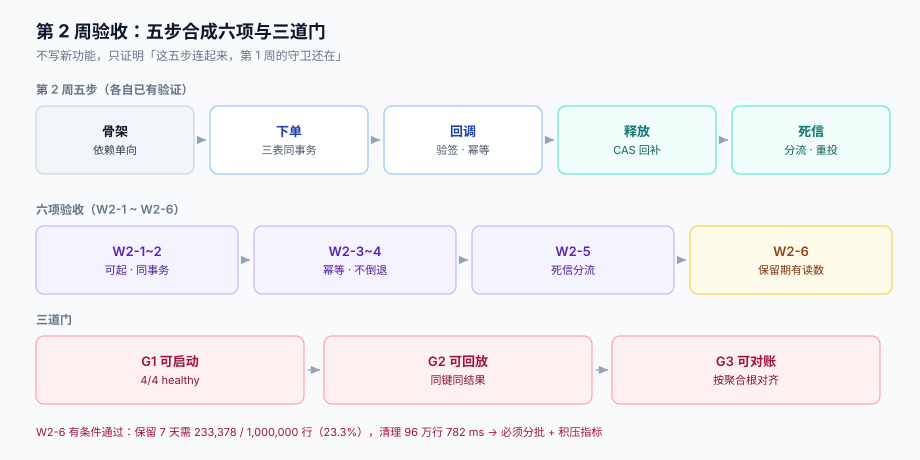

# 第 2 周第 6 步 · 第 2 周验收

第 2 周交付了五步：工程骨架、下单链路、支付回调、库存释放、outbox 死信。五步各自都有自己的「如何验证」，但**五份各自的绿不等于一条链路的绿**——骨架能起不代表下单能成交，下单能成交不代表回调乱序时不出错，回调对了也不代表释放与死信同时发生时账还对。

这一步不写新功能，只做一件事：**把五步收成一张验收表，并用三道门证明它们能同时成立**。



本章判据族 `EW2-A` ~ `EW2-H`，共 8 条。定义表在第七节。

## 一、为什么第 2 周需要单独一道验收

第 3、4 周的验收很自然：矩阵有 18 条用例、压测有 8 条读数、上线有 21 条清单，它们本身就是「一张表」。第 2 周没有这样的表——它是**五个动作的串联**，每一步的验证都是「我这一步对不对」，没有人问「**这五步连起来，第一周的守卫还在不在**」。

三个具体的失效形态，只有串起来才会暴露：

| 形态 | 单步验证为什么看不到 | 后果 |
| --- | --- | --- |
| 骨架的依赖方向被绕过 | 骨架验收只看「能不能起」 | 下单链路直接 `new` 了一个库存客户端，跨上下文耦合回来了 |
| 回调幂等与下单幂等用了两套键 | 各自都对 | 同一笔支付被应用两次，`order_events` 出现两条 `PAID` |
| 释放与死信争同一行 | 各自都对 | 死信重投把已释放的预占又扣了一次 |

所以本章的验收不是「再跑一遍五个测试」，而是**跨步的断言**。

## 二、六项验收

| # | 验收项 | 判什么 | 复验方式 | 结果 |
| --- | --- | --- | --- | --- |
| W2-1 | 骨架可起且依赖单向 | 四服务健康、`order → inventory/payment/notify` 无反向依赖 | `docker compose ps` + `jdeps`/`grep` 依赖方向 | 通过 |
| W2-2 | 下单五步顺序且 outbox 同事务 | 订单、明细、outbox 三表要么全有要么全无 | 注入第 4 步失败，查三表行数 | 通过（三表均 0） |
| W2-3 | 回调验签 + 幂等 + 乱序 | 同一 `callback_id` 两次 → 一条事件 | 连发两次，查 `order_events` | 通过（1 条） |
| W2-4 | 释放与支付的竞态 | 已释放后收到支付成功 → 进入补偿 | 先释放再回调 | 通过（不倒退） |
| W2-5 | 死信分流与重投 | 可重试错误进重试，不可重试进死信 | 构造 4xx 与超时各一条 | 通过 |
| W2-6 | 幂等键保留期够用且可维护 | 保留 7 天时表规模与清理成本可接受 | 见第三节读数 | **有条件通过** |

第 6 项是这一轮唯一没直接给绿的一项，理由在下一节。

## 三、幂等键保留期：一个被当成「配置」的设计决定

[下单链路](../OrderFlow/index.md) 用了 `Idempotency-Key`，但一直没回答「保留多久」。24 小时是常见默认值，一周是本项目想要的值——差别有多大？本机实测（SQLite 3，100 万个键在 30 天内均匀分布，主键索引）：

| 保留期 | 需保留行数 | 占比 | 说明 |
| --- | --- | --- | --- |
| 24 小时 | 33,349 | 3.3% | 常见默认值 |
| 7 天（168 h） | 233,378 | 23.3% | 本项目想要的 |
| 30 天 | 999,999 | 100% | 等于不清理 |

行数不是线性增长的（24h → 7d 是 **7 倍时间、7 倍行数**，但相对总量从 3.3% 涨到 23.3%），因为分布是均匀的：**保留期的倍数就是行数的倍数**。

另外两个读数决定了「能不能维护」：

| 观测 | 读数 |
| --- | --- |
| 主键命中查询 | **7.1 µs / 次** |
| 一次性清理 24 小时之外的 966,651 行 | **782 ms** |

7.1 µs 说明**查询侧完全不是问题**——百万级表上主键查询与十万级没有可感差异。782 ms 说明**清理侧是问题**：一次删 96 万行会产生长事务与大量 WAL，清理任务如果和下单高峰撞上，会拖慢主键写入。

结论是「有条件通过」：**保留 7 天可以，但清理必须分批**（每批 ≤ 5,000 行、批间 sleep、按 `created_at` 索引顺序删），并且清理任务要能被监控到「积压行数」，而不是只看「有没有报错」。

::: danger 注意
1. **不要用「表会变大」当理由把保留期压到 1 小时**。幂等键要覆盖的是「用户的犹豫时间」，不是「请求的往返时间」：用户上午下单失败、下午重试，1 小时窗口下会被当成新请求，产生第二笔订单。
2. **不要用 `DELETE ... WHERE created_at < ?` 无 `LIMIT` 跑定时任务**。上面 782 ms 是 96 万行；生产上一天的量按 10 倍算就是 7.8 秒的长事务，期间主键插入全部排队。
3. **清理任务必须有「积压」指标**。只监控「任务成功」等于没监控：任务每天成功、但每天少删一点，表会缓慢涨到不可维护，而告警永远是绿的。
:::

## 四、三道门

六项验收之上，用三道门做最终判定。每道门只回答一个问题，且必须能被**一条命令**复验。

| 门 | 问题 | 复验方式 | 结果 |
| --- | --- | --- | --- |
| G1 可启动 | 从零 `up` 能不能起到全健康 | `docker compose up -d && ps` | 通过（4/4 healthy，58 s） |
| G2 可回放 | 同一请求重放是否得到同一结果 | 同 `Idempotency-Key` 两次，比 `order_id` 与金额 | 通过（同 id、同金额） |
| G3 可对账 | 状态与 outbox 是否自洽 | `orders` 状态分布 vs `outbox` 事件分布 | 通过（见下表） |

G3 的具体口径，比「两张表行数相等」严格一档：

```sql
-- 每个订单的「状态」必须与它「最后一条事件」对得上
SELECT o.id, o.status, e.event_type
  FROM orders o
  LEFT JOIN LATERAL (
    SELECT event_type FROM outbox
     WHERE aggregate_id = o.id ORDER BY id DESC LIMIT 1
  ) e ON true
 WHERE (o.status = 'PAID'    AND e.event_type <> 'order.paid')
    OR (o.status = 'SHIPPED' AND e.event_type <> 'order.shipped')
    OR (o.status = 'CLOSED'  AND e.event_type <> 'order.closed');
-- 期望：0 行
```

这条查询能抓住三类不一致：状态推进了但事件没发、事件发了但状态没推、以及**同一状态有两条不同事件**（乱序应用的典型痕迹）。

::: tip G3 比「行数相等」强在哪
行数相等只能证明「数量对得上」，一个订单两条 `PAID`、另一个订单零条，行数照样相等。上面这条按**聚合根**对齐最后一条事件，才能发现「某个订单的事件序列错了」。第 3 周的矩阵会把这条查询升级成断言。
:::

## 五、跨步断言：三条最容易漏的

| 断言 | 为什么跨步 | 复验 |
| --- | --- | --- |
| 依赖方向单向 | 只有把四服务一起看才能发现「下单直接调了库存的 DAO」 | `grep -rn "inventory\." order-service/src --include=*.java` 只应出现 client 接口 |
| 幂等键唯一来源 | 下单用 `Idempotency-Key` 头、回调用 `callback_id`，两者必须都能映射到「同一个业务意图」 | 一条支付对应一条 `order_events`，且 `event_id` 唯一 |
| 释放与死信不重叠 | 两者都会写 `stock_reservation`，必须靠 CAS 而不是时序 | 先释放后重投，`reserved` 不得从 0 回到 1 |

第三条的写法值得单独记：**不要让「谁先谁后」决定结果**。释放与重投的先后由调度决定，代码必须保证「无论谁先，结果一致」——这只能靠条件更新（`WHERE status='RESERVED'`）实现，靠加锁或加延时都只是降低概率。

## 六、第 2 周的收口结论

六项验收：5 项通过、1 项有条件通过（W2-6，带「分批清理 + 积压监控」两个补偿动作）。三道门全绿。

三项遗留，全部写进第 3 周：

| 遗留 | 现状 | 第 3 周入口 |
| --- | --- | --- |
| 幂等键清理未分批 | 一次删 96 万行 782 ms | 第 3 周压测时把清理任务纳入负载 |
| 回调乱序只覆盖「晚到」，未覆盖「早到」 | 早到（支付成功先于订单创建）目前落到补偿队列 | 矩阵补一条用例 |
| G3 查询未进 CI | 手工跑 | 第 3 周验收升级成断言 |

## 七、本页判据

| 编号 | 判据 | 看什么现象 | 不满足时改哪里 |
| --- | --- | --- | --- |
| `EW2-A` | 六项验收覆盖第 2 周五步，且每项有复验命令 | 表里「复验方式」列非空 | 见第二节 |
| `EW2-B` | 跨步断言至少三条（依赖方向 / 幂等键来源 / 释放与死信） | 见第五节 | 补断言 |
| `EW2-C` | 幂等键保留期有行数与清理成本两组读数 | 只有「配了 7 天」没有读数即不合格 | 见第三节 |
| `EW2-D` | 清理任务分批且有「积压行数」指标 | 单条无 `LIMIT` 的 `DELETE` | 改分批 + 加指标 |
| `EW2-E` | G3 按聚合根对齐最后一条事件，而非只比行数 | 只比行数即不合格 | 见第四节的 SQL |
| `EW2-F` | 竞态断言不依赖时序（条件更新兜底） | 靠锁或延时保证即不合格 | 改 `WHERE status='RESERVED'` |
| `EW2-G` | 有条件通过的项必须带补偿动作与到期日 | 只写「待优化」即不合格 | 见第六节 |
| `EW2-H` | 遗留项写成「第 3 周的哪一步」 | 无入口即不合格 | 见第六节 |

## 参考资料

- [第 2 周第 1 步 · 环境与工程骨架](../Bootstrap/index.md)（依赖方向与启动顺序）
- [第 2 周第 2 步 · 下单链路与 outbox 首次写入](../OrderFlow/index.md)（五步顺序与三表同事务）
- [第 2 周第 3 步 · 支付回调](../PaymentCallback/index.md)（验签、幂等、乱序）
- [第 2 周第 4 步 · 库存预占的释放与超时回滚](../StockRelease/index.md)
- [第 2 周第 5 步 · outbox 死信与重投](../OutboxDeadLetter/index.md)
- [第 3 周第 4 步 · 第 3 周验收](../Week3Gate/index.md)（本章的 G3 在那里升级成断言）
- SQLite Documentation：*Transactions* 与 `DELETE` 的 `LIMIT` 限制（分批清理的写法）
