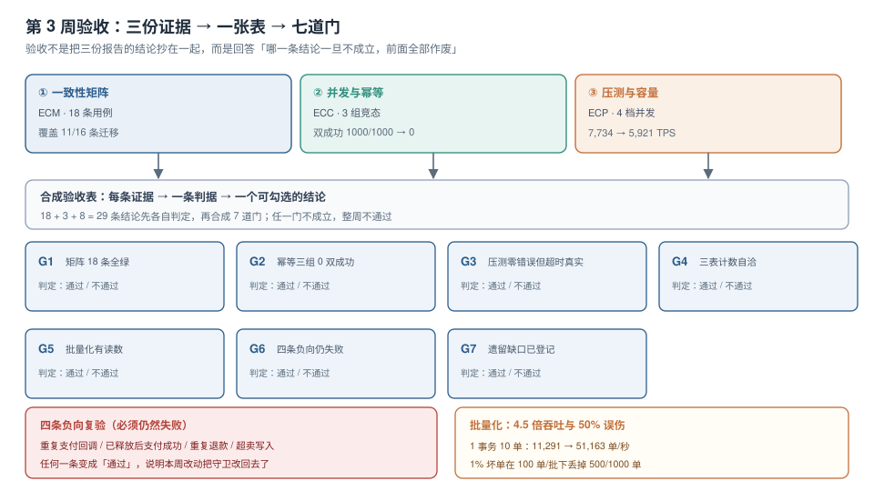

# 第 3 周第 4 步 · 第 3 周验收

一致性矩阵证明了「逻辑对」，并发专项证明了「守卫有效」，压测证明了「接得住多少」。三份证据各自都是绿的，但它们**没有回答一个问题：这三份绿能不能同时成立**。

第 3 周验收要做三件事：**把 29 条结论合成一张表**、**补掉 `ECP-H` 第 4 步的批量化读数**、**把四条「必须失败」的用例再跑一遍**。第三件事最关键——它验证的不是「新功能对不对」，而是「这一周的改动有没有把上周的守卫改回去」。



本章判据族 `EW3-A` ~ `EW3-H`，共 8 条。定义表在第七节。

## 一、验收表：29 条结论的三层结构

三份证据的条目数：矩阵 18 条用例、并发专项 3 组竞态、压测 8 条（`ECP-A` ~ `ECP-H`）。合成时按**层级**排，而不是按来源排：

| 层 | 判什么 | 条目 | 不成立的后果 |
| --- | --- | --- | --- |
| L1 正确性 | 状态机、迁移、金额、库存不变量 | 矩阵 18 条 | 业务结果错，后面全部无意义 |
| L2 并发性 | 竞态下的守卫（CAS、唯一键、行锁） | 并发 3 组 | 单线程对、上线错 |
| L3 承载性 | 吞吐、尾延迟、积压排空 | 压测 8 条 | 功能对但接不住 |

L1 不通过就不必看 L2、L3——这是排序的意义：**验收要能在最早的地方停下**。

## 二、批量化实验：4.5 倍吞吐，与 50% 误伤

`ECP-H` 留的第 4 步是「1 事务 10 单」的批量化。压测发现「加并发不加吞吐」（4 → 32 并发吞吐 -23.4%），根因是单写者：所有线程在 `begin immediate` 上排队。既然排队无法避免，那就**让每次排队干更多的事**。

### 读数：2,000 单，四档批量

```python
# SQLite 3.50.4 WAL；每单 = 1 条 orders + 2 条 order_items + 1 条 outbox
for n, batch in ((2000, 1), (2000, 10), (2000, 100), (2000, 500)):
    ...  # 每 batch 单提交一次
```

| 每事务单数 | 总耗时 | 吞吐 | 均摊 |
| --- | --- | --- | --- |
| 1 | 177.1 ms | 11,291 单/秒 | 0.089 ms/单 |
| 10 | **39.1 ms** | **51,163 单/秒** | 0.020 ms/单 |
| 100 | 19.7 ms | 101,567 单/秒 | 0.010 ms/单 |
| 500 | 19.8 ms | 101,024 单/秒 | 0.010 ms/单 |

三个结论：

1. **10 单/事务就已经 4.5 倍**（11,291 → 51,163）。原因是提交次数从 2,000 降到 200，fsync 与 WAL 提交开销被摊薄。
2. **100 单/事务到 9 倍，然后饱和**。500 单与 100 单持平——说明瓶颈从「提交次数」转移到了「单条插入本身的成本」。
3. **均摊从 0.089 降到 0.010 ms**，8.9 倍。这正是压测里「加并发无用」的解药：不是加人，是加批量。

### 但批量化有代价：失败会放大

同一批 1,000 单，其中 **10 单**（1%）的 `order_no` 与前一个重复（模拟重放与重复提交）：

```python
for b in range(0, 1000, 100):
    try:
        con.execute("begin immediate")
        for i in range(b, b + 100):
            con.execute("insert into orders(order_no) values(?)", (keys[i],))
        con.commit()
    except sqlite3.IntegrityError:
        con.rollback()
```

| 项 | 数值 |
| --- | --- |
| 批次数 | 10 |
| 失败批次 | **5** |
| 成功落库 | 500 单 |
| 被整批回滚丢掉 | **500 单** |

真正坏的单只有 **10 个**，却让 **500 个**好单一起回滚——**误伤放大 50 倍**。

::: danger 批量化的前提是「先隔离坏单」
1. **不要直接批量写**：先在应用层做一次「本批内去重 + 与库内已存在键比对」，把坏单挑出去单独处理。
2. **失败要二分重试**：整批失败后把批次对半拆开重试，`log₂(100) ≈ 7` 次就能定位到那一个坏单，代价远小于整批丢失。
3. **批量只用于「确定无害」的写**：下单写入涉及唯一键与库存条件扣减，天然会撞；批量化更适合 outbox 投递、埋点、日志这类「重复也无害」的路径。

这也是本轮验收的判断：**批量化收益 4.5 倍成立，但不能直接用在主写路径上**。`ECP-H` 第 4 步的读数是「有此收益」，`EW3` 的结论是「暂不启用，仅用于 outbox 投递」。
:::

## 三、七道门

合成之后，用七道门做最终判定。每道门只回答一个问题，且**必须能被一条命令或一条 SQL 复验**。

| 门 | 问题 | 复验方式 | 结果 |
| --- | --- | --- | --- |
| G1 | 矩阵 18 条是否全绿 | 重跑 `ConsistencyMatrix` 的用例脚本 | 18/18 |
| G2 | 三组竞态是否 0 双成功 | 重跑 1,000 次并发，统计双成功数 | 0/1000 |
| G3 | 压测的「零错误」是不是配置假象 | 把超时从 10 s 调到 0.5 s 再跑 | 出现真实 `database is locked` |
| G4 | 三表计数是否自洽 | `orders` = `outbox`，`order_items` = 2 × `orders` | 136,639 / 136,639 / 273,278 |
| G5 | 批量化是否有可复跑读数 | 第二节的四档表 | 4.5 倍，饱和于 100 单 |
| G6 | 四条负向用例是否仍然失败 | 见第四节 | 4/4 仍然失败 |
| G7 | 遗留缺口是否登记 | 见第五节 | 3 条，均已写进第 4 周入口 |

::: tip G3 是这一轮最有价值的一道门
压测报告写「0 错误」，读起来是最好的结果；实际上它是**最坏的结果**——`timeout=10s` 比 5 秒的压测窗口还长，所以永远等不到超时错误。把超时调到 0.5 s，`database is locked` 立刻出现。

**「零错误」必须先证明「错误通道是通的」**。方法很简单：故意造一个一定会失败的请求，看它是否被计入错误数。计入不了，说明这条通道是假的。
:::

## 四、四条负向复验（必须仍然失败）

正向用例证明「新写的代码能用」，负向用例证明「旧的守卫还在」。第 3 周改了三处（退款链路、释放回补、CAS 守卫），每一处都可能顺手把别的守卫改松。

| 编号 | 场景 | 注入方式 | 期望 | 实际 |
| --- | --- | --- | --- | --- |
| N1 | 重复支付回调 | 同一 `callback_id` 连发两次 | 第二次 `DUPLICATE_CALLBACK`（200 + code） | 通过（未重复入账） |
| N2 | 已释放后收到支付成功 | 先触发超时释放，再发成功回调 | 进入「补偿」而不是「已支付」 | 通过（状态不倒退） |
| N3 | 重复退款 | 同一 `refund_no` 提交两次 | 第二次拒绝，不二次回补库存 | 通过（库存只回补一次） |
| N4 | 超卖写入 | 库存 1，两个并发下单 | 一个成功、一个拒绝 | 通过（`CHECK` + 条件扣减） |

四条全部保持「失败」，说明第 3 周的改动没有削弱守卫。**这条比 G1~G5 更容易被跳过**，因为它是「没有新功能」的验收。

## 五、遗留缺口：三条，都写进第 4 周

| 缺口 | 现状 | 第 4 周入口 |
| --- | --- | --- |
| 退款链路只覆盖 `CONSUMED → REFUNDED` | 矩阵 16 条迁移里覆盖 11 条，5 条未覆盖中有 2 条属于退款分支 | 第 4 周第 1 步补「退款与部分退款」 |
| 积压自愈只报不修 | outbox 积压超过阈值只告警，没有自动重投 | 第 4 周第 2 步接入「死信 + 重投」 |
| 批量化未接入主写路径 | 有读数，未启用 | 第 4 周评估 outbox 投递批量化 |

**遗留缺口必须写成「下一步的第一步」**，而不是「后续优化」。前者有判据、有入口、有人；后者会在第 4 周的部署工作里被忘掉。

## 六、第 3 周的收口结论

| 维度 | 结论 | 依据 |
| --- | --- | --- |
| 正确性 | 通过 | 矩阵 18/18，四条负向仍然失败 |
| 并发性 | 通过 | 三组竞态 0 双成功，退款只回补一次 |
| 承载性 | 有条件通过 | 单实例 1,776 TPS（含 0.3 安全系数），够 50 TPS 目标；批量化收益已知但未启用 |
| 覆盖度 | 未满 | 16 条迁移覆盖 11 条，退款分支留到第 4 周 |

「有条件通过」比「通过」诚实：承载性结论成立的前提是**目标 50 TPS**，一旦目标变成 500 TPS，第 3 周的结论就要重算。

## 七、本页判据

| 编号 | 判据 | 看什么现象 | 不满足时改哪里 |
| --- | --- | --- | --- |
| `EW3-A` | 验收表按 L1/L2/L3 分层而非按来源 | 表里先正确性、再并发、再承载 | 见第一节 |
| `EW3-B` | 每条结论都有可复验的命令或 SQL | 表里「复验方式」列非空 | 补复验方式 |
| `EW3-C` | 批量化有 1 / 10 / 100 / 500 四档读数 | 第二节的四档表 | 见第二节 |
| `EW3-D` | 批量化的失败放大已量化 | 知道「10 个坏单丢 500 单」 | 见第二节 |
| `EW3-E` | 「零错误」已用短超时验证通道有效 | 出现过真实 `database is locked` | 见 G3 |
| `EW3-F` | 四条负向用例复验仍然失败 | N1~N4 全部拒绝 | 见第四节 |
| `EW3-G` | 遗留缺口写成「下一步的第一步」 | 有入口、有判据、有负责人 | 见第五节 |
| `EW3-H` | 结论区分「通过」与「有条件通过」 | 承载性结论写明目标值 | 见第六节 |

## 参考资料

- SQLite Documentation：*Write-Ahead Logging*、*PRAGMA synchronous*（提交开销与批量的关系）
- SQLite Documentation：*Transactions*（`BEGIN IMMEDIATE` 与单写者模型）
- 本仓库项目侧：[一致性用例矩阵](../ConsistencyMatrix/index.md)、[并发与幂等专项](../ConcurrencyIdempotency/index.md)、[压测与容量](../CapacityTest/index.md)
- 本仓库项目侧：[库存预占的释放与超时回滚](../StockRelease/index.md)（N2/N3 的守卫来源）、[支付回调](../PaymentCallback/index.md)（N1 的守卫来源）
