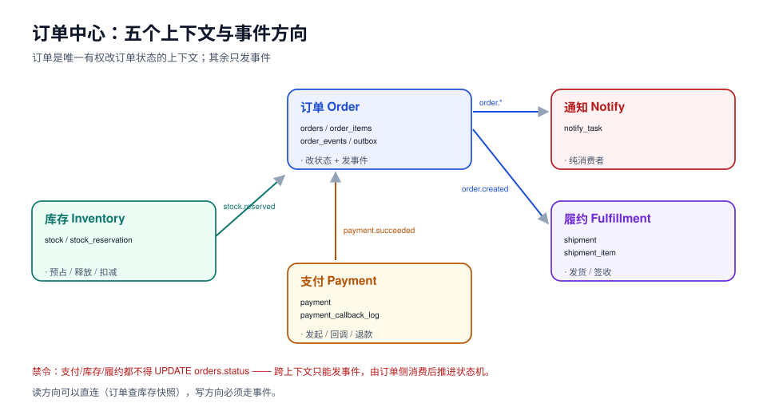

# 事件驱动订单与履约中心

**一句话定位**：做一个「下单 → 支付 → 库存预占 → 发货 → 完成 / 退款」的订单中心，把跨服务的一致性用**事件 + 本地事务表**做出来，并保证每一步都能在本地复现、能对账、能补偿。

周期 7（第 181–210 天）从 0 到 1 交付。与周期 6 的 TeamBoard 不同，这个项目的难点不在「多人实时」，而在**「一笔订单跨四个上下文之后，怎么证明它没丢、没重、没停留在中间态」**。

::: tip 本项目的三个「不做」
1. **不接真实支付通道**：支付只做到「渠道回调的验签、幂等、对账」这一层，不申请任何商户号。
2. **不做物流轨迹**：履约只到「发货单 + 运单号 + 签收状态回传」，不接快递公司 API。
3. **不做商品中心**：商品与价格由外部给定（本项目内用一张 `product_snapshot` 表模拟），避免把范围撑成电商全站。
:::

## 一、四周里程碑

| 周 | 天数 | 里程碑 | 验收（可执行） |
| --- | --- | --- | --- |
| 第 1 周 | 181–187 | 需求设计 | 需求拆分、技术选型、架构图、ER 图、完整 DDL、接口契约齐全 |
| 第 2 周 | 188–194 | 核心编码 | 服务能启动、下单/支付/发货接口可调用、事件能投递 |
| 第 3 周 | 195–201 | 联调测试 | 四类一致性用例全绿、幂等与补偿验证、压测达标 |
| 第 4 周 | 202–210 | 部署验收 | 一键部署、监控接入、上线验收清单全通过、对账日报可跑 |

## 二、上下文边界



| 上下文 | 拥有什么数据 | 明确不拥有 | 对外只暴露 |
| --- | --- | --- | --- |
| 订单（Order） | `orders`、`order_items`、`order_events`、`outbox` | 库存数量、支付流水 | 下单、取消、查询、状态事件 |
| 库存（Inventory） | `stock`、`stock_reservation` | 订单金额、买家信息 | 预占、释放、确认扣减 |
| 支付（Payment） | `payment`、`payment_callback_log` | 订单状态（只发事件） | 发起支付、回调处理、退款 |
| 履约（Fulfillment） | `shipment`、`shipment_item` | 支付金额 | 创建发货单、签收回传 |
| 通知（Notify） | `notify_task` | 任何业务状态 | 消费事件、发消息 |

**关键决定**：订单是**唯一有权改订单状态**的上下文。库存、支付、履约只发事件（`stock.reserved`、`payment.succeeded`、`shipment.delivered`），由订单侧消费后推进状态机。这样「订单状态」只有一个写者，避免了四个服务同时改一个字段的经典泥潭。

## 三、章节清单

| 章节 | 判据族 | 这一族管什么 | 条数 |
| --- | --- | --- | --- |
| [需求拆分：五个上下文与订单状态机](Requirements/index.md) | `EOH` | 上下文边界、十状态十六迁移、六条不变量 | 8 |
| [技术选型与版本基线](TechBaseline/index.md) | `ETS` | 版本选择理由、三条能力边界、本地最小可跑集 | 8 |
| [架构设计：事件流与一致性边界](Architecture/index.md) | `EOA` | 同步/异步定性、事件信封、topic 分区、三处事务 | 8 |
| [数据库设计：九张表与六条不变量](DatabaseDesign/index.md) | `EDB` | DDL 约束、部分索引、不变量 SQL、并发实测 | 8 |
| [第 1 周收口 · 接口契约与第 1 周验收](Week1Gate/index.md) | `EW1` | 9 端点幂等与迁移覆盖、错误码表、契约⇄DDL 对齐、七道门 | 8 |
| [第 2 周第 1 步 · 环境与工程骨架](Bootstrap/index.md) | `EEN` | 四层依赖方向、三套 profile、启动六步、池预算、五条验收 | 8 |

后续 14 章（判据族已预留，交付时补条数）：

- 下单链路与本地事务表（判据族 `EOR`：事务边界、outbox、幂等键）
- 支付回调：验签、幂等与乱序（判据族 `EPY`：回调验签、重复与乱序、对账）
- 库存预占与超时释放（判据族 `EIV`：预占语义、超时释放、超卖兜底）
- 发货与签收（判据族 `ESF`：发货单、签收、异常件）
- 补偿与对账（判据族 `ERC`：补偿动作、对账日报）
- 第 2 周验收（判据族 `EW2`：第 2 周六项验收）
- 一致性用例矩阵（判据族 `ECM`：用例矩阵与可证伪判据）
- 并发与幂等专项（判据族 `ECC`：并发场景与幂等验证）
- 压测与容量（判据族 `ECP`：压测模型与容量结论）
- 第 3 周验收（判据族 `EW3`：第 3 周验收结论）
- 一键部署与配置（判据族 `EDP`：编排、配置、密钥）
- 监控与告警（判据族 `EMO`：指标、告警、大盘）
- 上线验收与对账日报（判据族 `ELA`：上线清单与日报）
- 第 4 周验收与交接（判据族 `EW4`：四周收口与交接）

> 章节按天推进，**每章都自带「如何验证」**：读者按页面里的命令跑一遍，应得到页面写明的读数。项目目录只放 Markdown 与配图，不放任何工程文件。

## 四、技术基线（第 182 天定稿）

| 层 | 定稿版本 | 理由（一句话） |
| --- | --- | --- |
| 语言/运行时 | **Java 25（LTS）** | 与周期 6 保持同一基线，虚拟线程适合大量短事务 |
| 框架 | **Spring Boot 4.1.1**（Spring Framework 7.0.9） | 4.1.x 在 OSS 支持窗口内（至 2027-07），事务、调度、可观测开箱即用 |
| 数据库 | **PostgreSQL 18.6** | 需要 `FOR UPDATE SKIP LOCKED`（扫描 outbox）与 `jsonb`（事件载荷） |
| 消息 | **Kafka 4.2.1（KRaft，单节点）** | 4.x 起 ZooKeeper 已移除；本地单节点只验语义，不追集群 |
| 缓存 | **Redis 8.2** | 幂等键与热点商品快照，按「可丢」设计 |
| 迁移 | **Flyway 11.x** | 迁移以手写 SQL 为主，`afterMigrate` 回调挂清单校验 |
| 可观测 | **OpenTelemetry 1.62 + Prometheus** | 事件延迟与积压必须能看见 |

三条能力边界（详见 [技术选型与版本基线](TechBaseline/index.md)）：**事务内一致性归 PostgreSQL**（订单 + 订单项 + outbox 同事务）、**跨上下文一致性归 outbox + Kafka**（至少一次 + 消费端幂等）、**缓存只做加速不做判定**。

## 五、第 181 天交付

- 新建 [需求拆分：五个上下文、十个故事与订单状态机](Requirements/index.md)（判据 `EOH-A` ~ `EOH-H`）。
- 两张自绘示意图：`eoh-context-map.svg`（上下文与事件方向）、`eoh-order-state.svg`（十状态十六迁移）。
- 本机实测两份读数，写进章节：① 状态机可达性（10 状态 / 16 迁移 / 全部可达 / `CANCELLED → SHIPPED` 无路径）；② `check-then-act` 与 `compare-and-set` 的对比（**双成功 1000/1000 对 0/1000**）。

**如何验证**（读者可执行）：

```shell
# 1) 状态机可达性：把章节里的状态与迁移抄成两个列表，跑一遍 BFS
python3 - <<'PY'
states = ["CREATED","AWAITING_PAYMENT","PAID","ALLOCATED","SHIPPED","COMPLETED","CANCELLED","REFUNDING","REFUNDED","CLOSED"]
trans = [("CREATED","AWAITING_PAYMENT"),("CREATED","CANCELLED"),("AWAITING_PAYMENT","PAID"),
         ("AWAITING_PAYMENT","CANCELLED"),("AWAITING_PAYMENT","CLOSED"),("PAID","ALLOCATED"),
         ("PAID","REFUNDING"),("PAID","CANCELLED"),("ALLOCATED","SHIPPED"),("ALLOCATED","REFUNDING"),
         ("SHIPPED","COMPLETED"),("SHIPPED","REFUNDING"),("COMPLETED","REFUNDING"),
         ("REFUNDING","REFUNDED"),("CANCELLED","CLOSED"),("REFUNDED","CLOSED")]
adj = {s: [] for s in states}
for a, b in trans: adj[a].append(b)
seen, stack = {"CREATED"}, ["CREATED"]
while stack:
    s = stack.pop()
    for n in adj[s]:
        if n not in seen: seen.add(n); stack.append(n)
print("states=%d trans=%d reachable=%d" % (len(states), len(trans), len(seen)))
PY
# 期望输出：states=10 trans=16 reachable=10
```

**下一步**（第 183 天）：架构设计：事件流与一致性边界——五条事件的完整流向、outbox 投递器三个参数、消费端幂等键与去重窗口、三类故障的检测手段。

## 六、第 182 天交付

- 新建 [技术选型与版本基线](TechBaseline/index.md)（判据 `ETS-A` ~ `ETS-H`）。
- 一张自绘示意图：`eoh-tech-baseline.svg`（三条能力边界与本地最小可跑集）。
- 七条组件的版本表，每条都带「为什么不是相邻版本」与「已知坑」；三条能力边界写成可检查的判据。
- 本地最小可跑集：3 个容器（PG 18.6 / Kafka 4.2.1 / Redis 8.2）+ `deploy/compose.yaml` 骨架 + 四段验收命令。

**如何验证**（读者可执行，四步全过才算基线可跑）：

```shell
# 1) 编排文件语法
docker compose -f deploy/compose.yaml config >/dev/null && echo COMPOSE_OK

# 2) 三个容器健康
docker compose -f deploy/compose.yaml up -d
docker compose -f deploy/compose.yaml ps --format 'table {{.Name}}\t{{.Status}}'
# 期望：三行均为 (healthy)

# 3) 关键版本与参数
docker exec eoh-pg psql -U eoh -d eoh -Atc "select version();"
docker exec eoh-pg psql -U eoh -d eoh -Atc "show lock_timeout; show statement_timeout;"
docker exec eoh-redis redis-cli INFO server | grep redis_version
# 期望：PostgreSQL 18.6 / 3s / 30s / redis_version:8.2.x
```

## 七、第 183 天交付

- 新建 [架构设计：事件流与一致性边界](Architecture/index.md)（判据 `EOA-A` ~ `EOA-H`）。
- 一张自绘示意图：`eoh-architecture.svg`（一个写者、两条通道、三处事务，含下游事件回流）。
- 今天把前两天的结论**落成结构**：18 个跨上下文调用逐个定性同步/异步、事件信封六个必填字段、四个 topic 的分区键与保留期、三处事务的可执行 SQL、七种失败的归属矩阵。
- 一条本机实测读数（2000 条未发布、limit 500、两路并发）：`FOR UPDATE SKIP LOCKED` 两路各拿 500、**重复 0**；去掉它，两路都抓到同一批 500 条、**重复 500**。

**如何验证**（读者可执行，六步全过才算架构落地）：

```shell
# 1) 起骨架（PG 18.6 / Kafka 4.2.1 / Redis 8.2）
docker compose -f deploy/compose.yaml up -d && docker compose -f deploy/compose.yaml ps

# 2) 建 topic（关闭自动创建，避免 topic 拼错却"能用"）
docker exec -it eoh-kafka /opt/kafka/bin/kafka-topics.sh \
  --bootstrap-server localhost:9092 --create \
  --topic order.events --partitions 3 --replication-factor 1
docker exec -it eoh-kafka /opt/kafka/bin/kafka-topics.sh --bootstrap-server localhost:9092 --list
# 期望：只有你手动建的 topic

# 3) outbox 表与部分索引
docker exec eoh-pg psql -U eoh -d eoh -c "\d outbox"
# 期望：出现 idx_outbox_unpublished ... WHERE (NOT published)

# 4) relay 并发零重复：两个终端同时执行章节里的 CTE + UPDATE
# 期望：各返回 500 行，两个结果集交集为空

# 5) 幂等表去重：同一 event_id 插两次
# 期望：第二次 ERROR 23505，业务表状态不变

# 6) 参数兜底
docker exec eoh-pg psql -U eoh -d eoh -Atc "show lock_timeout;"
# 期望：3s（迁移与 DDL 不会挂住队列）
```

**下一步**（第 184 天）：数据库设计——九张表的完整 DDL + 六条不变量的可执行 SQL，把今天的 outbox 扩成完整表族。

## 八、第 184 天交付

- 新建 [数据库设计：九张表与六条不变量](DatabaseDesign/index.md)（判据 `EDB-A` ~ `EDB-H`）。
- 一张自绘示意图：`eoh-db-design.svg`（五个上下文、十张表、六条不变量）。
- **九张业务表 + outbox 的完整 DDL**（含生成列、部分唯一索引、成对 CHECK），并回答了第 183 天留下的一个缺口：`order_events` 不单独建表，事件已在 `outbox` 里。
- **六条不变量各配一条可执行 SQL**，在 10 万单 / 30 万明细上实测：I1 199 ms、I2 95 ms、I3 21 ms、I4 22 ms、I5 21 ms、I6 52 ms，基线全部为 0；逐条埋违反后全部抓得到。
- 三组必须两个会话才能测出来的行为：① 幂等键冲突**阻塞 2.30 s 后**才报 23505（不是立刻失败）；② 条件 UPDATE 后到者**阻塞 1.41 s 后 `UPDATE 0`**，最终 `reserved=1/1` 零超卖；③ 在数量型库存上误用 `EXCLUDE` 约束 → `23P01`，第二笔订单下不进去。
- 两条反例读数：`uuidv7()` 主键索引 **6,184 KB vs 8,752 KB（−29.3%）**、按 id 取 1 万行 **64 页 vs 1,274 页**；`stored` 生成列让 10 万行插入 **288.6 ms → 522.6 ms（+81%）**。
- 造数翻车记录：脚本给两个租户建了预留却只给一个租户建库存行 → I3 一次报 **2,994 条**违反；修一行 SQL 后归零。

**如何验证**（读者可执行，六步全过才算设计落地）：

```shell
# 1) 建库 + 十张表（期望：约 1 秒，无报错）
docker run -d --name eoh-pg -e POSTGRES_PASSWORD=eoh -p 55432:5432 postgres:18
docker exec -i eoh-pg psql -U postgres -c "create database eoh"
docker exec -i eoh-pg psql -U postgres -d eoh -f 001_schema.sql

# 2) 表数（期望：10）
docker exec -i eoh-pg psql -U postgres -d eoh -Atc \
  "select count(*) from pg_class where relkind='r' and relnamespace='public'::regnamespace;"

# 3) 六条不变量（期望：全部 0）
docker exec -i eoh-pg psql -U postgres -d eoh -f 900_invariants.sql

# 4) 幂等插入：两个会话同键（期望：后到者约 2s 后 23505；改 on conflict 则 0 行不报错）

# 5) 防超卖：两个会话条件 UPDATE（期望：UPDATE 1 / UPDATE 0，最终 reserved=total）

# 6) 排他约束误用演示（期望：ERROR 23P01）
docker exec -i eoh-pg psql -U postgres -d eoh -f 910_slot_hold_demo.sql
```

**下一步**（第 186 天）：第 2 周第 1 步「环境与工程骨架」已交付（见下节）；接着做第 2 周第 2 步——下单链路与 outbox 的第一次真实写入（`POST /api/orders` 的幂等键校验 → 状态机守卫 → 订单/明细/outbox 三表同事务，判据族建议 `EOC`）。

## 九、第 185 天交付

- 新建 [第 1 周收口 · 接口契约与第 1 周验收](Week1Gate/index.md)（判据 `EW1-A` ~ `EW1-H`）。
- 一张自绘示意图：`eoh-week1-gate.svg`（七道门 + 契约面三类断言）。
- **9 个端点的契约总表**：每个写接口都标出幂等键来源、能触发的状态迁移、声明的错误码；`GET` 接口明确不参与状态机。
- **8 个错误码**的口径表，其中 `DUPLICATE_CALLBACK` 用 **200 + code**（渠道把非 2xx 当失败会持续重推 24 小时）。
- **契约字段 ⇄ DDL 列**的对照表 + 三条硬约定（金额只用 `numeric` 列、时间只用 `timestamptz`、契约不发明列）。
- **收口当天真的抓到了 5 条 FAIL**：需求页里的 5 条迁移没有任何接口能触发（退款路径完全缺失）→ 补 `cancel_order` 的三条迁移 + 新增 `POST /api/orders/{id}/refunds`，端点 8 → 9，重跑 `fails=0`。

**如何验证**（读者可执行，四步全过才算第 1 周收口）：

```shell
# 1) 契约自检（G5/G6/G7）
python3 week1_gate.py
# 期望：states=10 transitions=16 endpoints=9 errors=8 fields=24 / G5=PASS G6=PASS G7=PASS fails=0

# 2) DDL 与六条不变量回归
docker exec -i eoh-pg psql -U postgres -d eoh -f 900_invariants.sql
# 期望：六条不变量各返回 0；表数 10

# 3) 状态机：十状态全可达、唯一终态 CLOSED
python3 - <<'PY'
states = ["CREATED","AWAITING_PAYMENT","PAID","ALLOCATED","SHIPPED","COMPLETED",
          "CANCELLED","REFUNDING","REFUNDED","CLOSED"]
trans = [("CREATED","AWAITING_PAYMENT"),("CREATED","CANCELLED"),("AWAITING_PAYMENT","PAID"),
         ("AWAITING_PAYMENT","CANCELLED"),("AWAITING_PAYMENT","CLOSED"),("PAID","ALLOCATED"),
         ("PAID","REFUNDING"),("PAID","CANCELLED"),("ALLOCATED","SHIPPED"),("ALLOCATED","REFUNDING"),
         ("SHIPPED","COMPLETED"),("SHIPPED","REFUNDING"),("COMPLETED","REFUNDING"),
         ("REFUNDING","REFUNDED"),("CANCELLED","CLOSED"),("REFUNDED","CLOSED")]
adj = {s: [] for s in states}
for a, b in trans: adj[a].append(b)
seen, stack = {"CREATED"}, ["CREATED"]
while stack:
    for n in adj[stack.pop()]:
        if n not in seen: seen.add(n); stack.append(n)
print("reachable=%d terminal=%s" % (len(seen), sorted(s for s in states if not adj[s])))
PY
# 期望：reachable=10 terminal=['CLOSED']

# 4) 三容器 + 四个 topic
docker compose -f deploy/compose.yaml ps
docker exec -it eoh-kafka /opt/kafka/bin/kafka-topics.sh --bootstrap-server localhost:9092 --list
# 期望：三行 healthy；topic 恰好 4 个
```

**下一步**（第 187 天）：第 2 周第 2 步 · 下单链路与 outbox 的第一次真实写入（`EOC`）——幂等键校验、状态机守卫、订单/明细/outbox 三表同事务、投递器用 `FOR UPDATE SKIP LOCKED`。

## 十、第 186 天交付（第 2 周第 1 步 · 环境与工程骨架）

- 新建 [环境与工程骨架](Bootstrap/index.md)（判据 `EEN-A` ~ `EEN-H`），配图 `eoh-bootstrap.svg`（四层依赖 + 六步就绪）。
- **四层目录与依赖方向落成 3 条 ArchUnit 断言**：`domain` 不依赖 `org.springframework`/`jakarta.persistence`/`java.sql`；`api` 不碰 `infra`；`infra.persistence` 与 `infra.messaging` 互不依赖。写不进 CI 的架构规则等于没有。
- **启动六步定序**：TCP 可查询 → Flyway → 连接池 → 缓存/消息 → 消费组分区分配 → 就绪探针。每一步都写了「提前了会怎样」，其中 `5 → 6` 的提前是**假就绪**：订阅没完成就 UP，灰度期看起来正常但不消费。
- **实测把 `healthcheck` 的写法钉死**：PostgreSQL 18 容器从 `docker run` 到 **TCP 可查询 1.57~2.01 s**，期间连接是 `Connection refused`；`pg_isready` 返回 0 比 TCP 可查询**早约 312 ms**（1,697 ms 对 2,009 ms）——所以健康检查必须是「真的查一次」，不能用端口存活或 `pg_isready`。
- **池预算落进配置并故意留了一处错**：`maximumPoolSize=20`、2 实例 → 40 ≤ 80 ✅；但示例里 `leak-detection-threshold: 10000` 大于 `connection-timeout: 3000`，池会先抛「借不到」，泄漏检测永远抓不到（本周专题判据 `CPK-B`）。页内明确写出「这段是故意的，别照抄」，并给了两种正确组合。
- **五条验收断言**：四服务 `healthy`、`/actuator/health` 组件齐全、Flyway 最新一条 `success=t`、库侧连接数 20±2、下单后 outbox 有 1 行且 order/stock 都已写。

**如何验证**（读者可执行）：

```shell
# 1) 一条命令起全栈，退出码即「是否真的就绪」
docker compose -f deploy/compose.yaml up -d --build --wait
docker compose -f deploy/compose.yaml ps --format '{{.Name}} {{.Health}}'
# 期望：四个服务全部 healthy

# 2) 健康聚合与池
curl -s localhost:8080/actuator/health | jq '.status, (.components|keys)'
docker exec eoh-postgres psql -U postgres -d eoh -tAc \
  "select count(*) from pg_stat_activity where application_name='eoh-app';"
# 期望：UP / ["db","kafka","redis"]；连接数 20 ± 2

# 3) 下单写出 outbox
curl -s -X POST localhost:8080/api/v1/orders -H 'Content-Type: application/json' \
  -H 'Idempotency-Key: boot-0001' \
  -d '{"customerId":"c-1","items":[{"skuId":"sku-1","qty":2,"unitPrice":"19.90"}]}' | jq '.status'
docker exec eoh-postgres psql -U postgres -d eoh -tAc \
  "select event_type,status from outbox order by id desc limit 1;"
# 期望：CREATED / OrderCreated|PENDING
```

## 十一、判据纪律

每章 8 条，编号形如 `EOH-A`，逐章前缀唯一（`EOH` / `ETS` / `EOA` / `EDB` / `EEN` / `EW1` / `EOR` / `EPY` / `EIV` / `ESF` / `ERC` / `EW2` / `ECM` / `ECC` / `ECP` / `EW3` / `EDP` / `EMO` / `ELA` / `EW4`），全库不撞号。判据只有三种形态：**可复跑的读数**、**可勾选的检查项**、**可对照的结构**（表/图/契约）。
